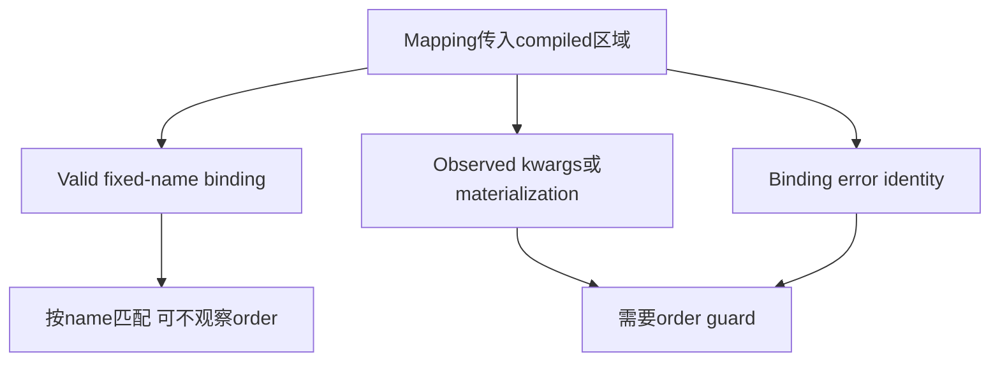
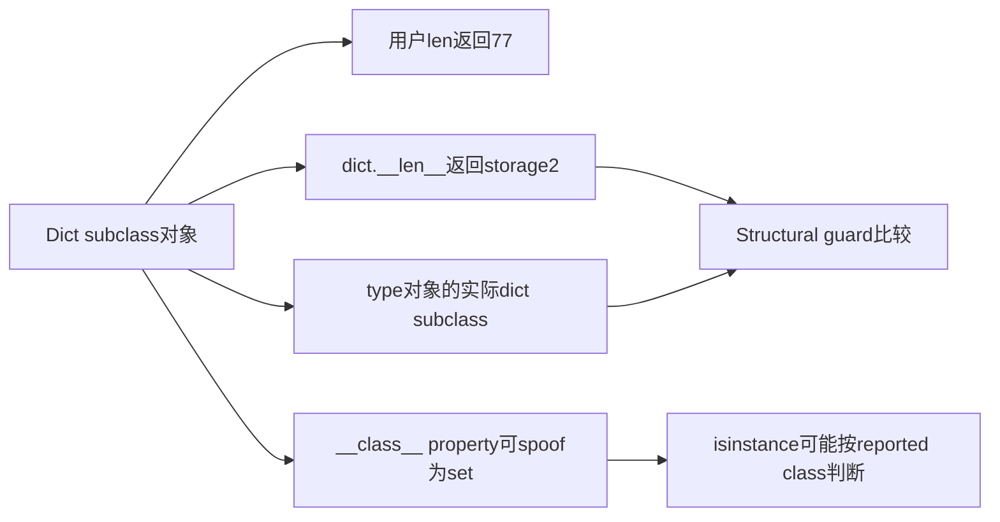
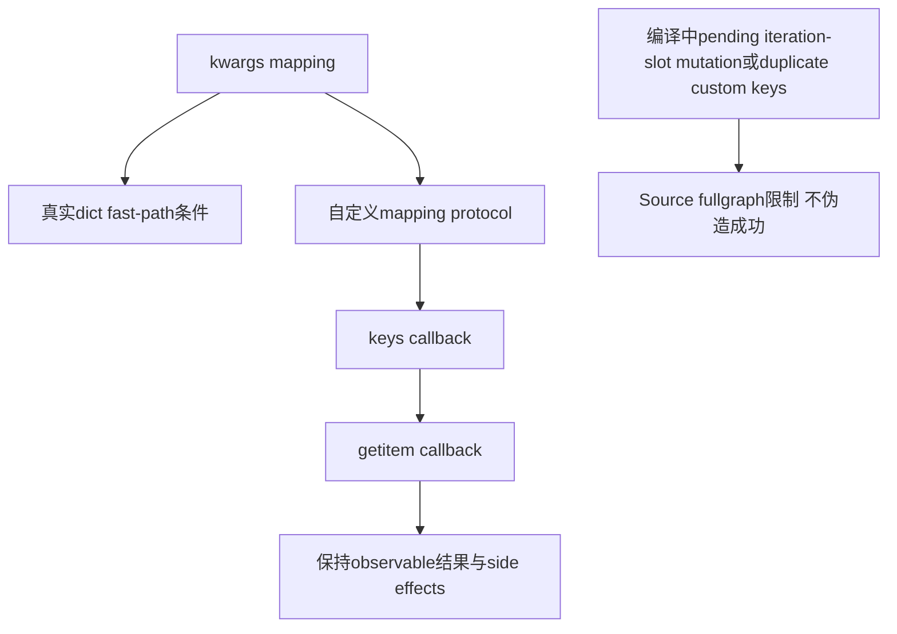

# AI Infra 编译契约 FAQ：Dynamo Dictionary Order、Actual Type、Structural Length 与 kwargs Guards

> **语言**：中文 | [English](dynamo-dictionary-order-type-length-kwargs-guards-selection-faq.en.md)  
> **Round152 · 2026-11-14白班**：当天Dynamo semantic guards修正；原创cache-plan模型与CPython-only oracle，不是torch.compile benchmark。

**结论速览**：相同key set不保证相同observed order、type或exception identity；但valid fixed-name kwargs binding也不需要无差别order guard。原创12calls中key-set-only cache错5个，selective guards错0个，model plans分别6/11。native CPython自定义mapping的kwargs结果73，storage shortcut却28；用户`len=77`也不等于dict storage length2。

**交付**：[H5 guard cache](../reports/dynamo-dictionary-order-type-length-kwargs-guards-sizer.html) · [7-Card](../reports/dynamo-dictionary-order-type-length-kwargs-guards-selection-cards.html) · [1600px SVG](../../assets/svg/dynamo-dictionary-order-type-length-kwargs-guards-selection-faq-summary.svg) · [sealed report](../../experiments/dictionary_guard_contract_selection/report.json) · [CPython oracle](../../experiments/dictionary_guard_contract_selection/native_oracle.json)

## Q1：当天Dynamo修正为什么既强调order，又避免所有kwargs都按order重编译？

固定PyTorch commit为**Nov14 04:00UTC＝12:00BJT**。source根据callee是否观察`**kwargs`order、绑定错误和materialization来安装order guard；有效fixed-name参数可用key matching。它同时修正actual type、structural dict length以及自定义mapping protocol处理。



源码还涉及partial/positional binding、mutable iteration slot、OrderedDict与empty mappings等。本轮只构建小型原创guard-plan模型；**没有导入PyTorch或测量native recompilation**。

## Q2：同一个mapping反转插入顺序，什么行为不变、什么会变？

原创`base3 + 10×alpha2 + beta5 = 28`按name绑定，alpha/beta顺序反转不改value。观察`tuple(kwargs)`或`dict(**mapping)`materialization则返回不同key sequence。unexpected keywords先omega/先sigma时，exception暴露的key也不同；两个positional-bound参数的duplicate keyword也如此。

主矩阵六programs×两calls，共12calls：named、order、unexpected、duplicate、type、constructor。key-set-only toy错5/12；guarded错0/12，11model plans对6naive plans。**少plans并不等于正确或native性能更好**。

## Q3：guard里的storage length为什么不能调用用户重载的len？



原创native CPython fixture重载`__len__`为77，但`dict.__len__`读取两个实际entries。另一个fixture的`__class__`property返回set，`isinstance(...,set)`为True而`issubclass(type(...),dict)`仍True。source的structural guard用actual type/base dict length，不能把用户visible行为当内部storage契约。

应用程序调用len时仍须保留用户77；**bypass只用于structural guard，不是删除用户语义**。model mapping_type仅是有限标签，不验证实际class/slot对象。

## Q4：kwargs expansion什么时候必须保留keys/getitem protocol与side effects？

native CPython原创Projection有底层alpha2/beta5，却自定义iteration slot、`keys()`仅alpha、getitem返回7。`target(3,**mapping)`得到73，记录`["keys","get:alpha"]`；绕过protocol直接读storage会得到28。不是所有dict subclass都走同一protocol，iteration slot等条件是关键。



source对pending iteration-slot mutation、custom mapping duplicate keys有明确unsupported/fallback处理。CPython oracle不是这些Dynamo fullgraph路径的执行证据；不能把callback直接跳过或把unsupported当成功compile。

## Q5：原创cache model和CPU guard timer有哪些刻意限制？

model guard key含mapping kind、storage key count与observed ordered keys或key set。scalar values在原型中动态绑定，**不模拟native Dynamo Python-int value guards、slot/identity guards、factory或custom key hash/equality**；source frame counts未知/null。

| same-order keys | tuple compare（ms） | scalar zip（ms） |
| ---: | ---: | ---: |
| 64 | 0.000433 | 0.004067 |
| 256 | 0.000867 | 0.014800 |
| 1024 | 0.002500 | 0.059167 |
| 4096 | 0.009467 | 0.235500 |

两个CPUpaths均检查length和ordered equality；expected tuple/input keys预建，2warmups、7轮交替repeat、每sample3operations取median repeat means。排除key准备、dict/type/slot guards、compiler/cache执行、PyTorch/C++guards/GPU；不是native compile latency或减少recompilation的测量。

## Q6：如何复现并核验真实compiled dictionary程序？

```powershell
python -m unittest discover -s tests -p test_dictionary_guard_contract_selection.py -q
python -m experiments.dictionary_guard_contract_selection.run --check
# --measure封存CPython-only oracle和原创CPU equality samples；不执行torch.compile。
```

八项测试覆盖named/order选择、binding-error identity、native protocol/length/type、independent CPython observations、dynamic scalar/type gate、invalid pairs/length边界、32random-order oracles及38Node parity sequences、完整12call matrix。CPython observations单独`measured`；主报告`synthetic`、`independently_reproduced=false`。

来源：[Nov14correction](https://github.com/pytorch/pytorch/commit/f407abb11f88c3b04bffba64a8f8d61e7c0207e2)、[guards](https://github.com/pytorch/pytorch/blob/f407abb11f88c3b04bffba64a8f8d61e7c0207e2/torch/_dynamo/guards.py)、[DICT_MERGE](https://github.com/pytorch/pytorch/blob/f407abb11f88c3b04bffba64a8f8d61e7c0207e2/torch/_dynamo/symbolic_convert.py)、[dictionary variables](https://github.com/pytorch/pytorch/blob/f407abb11f88c3b04bffba64a8f8d61e7c0207e2/torch/_dynamo/variables/dicts.py)、[source regression scope](https://github.com/pytorch/pytorch/blob/f407abb11f88c3b04bffba64a8f8d61e7c0207e2/test/dynamo/test_dicts.py)、[LICENSE](https://github.com/pytorch/pytorch/blob/f407abb11f88c3b04bffba64a8f8d61e7c0207e2/LICENSE)。rights保留，无实现镜像。

真实验收需Dynamo/Python版本、actual values/types/slots、mutation/exception behavior、eager-vs-compiled outputs及实际frame counters/latency。native Torch compile/count/latency未测量，不替缺失指标填0。原创60-solid guard cabinet非physical compiler；此前browser refusal仍尊重，未做视觉浏览器验收。
