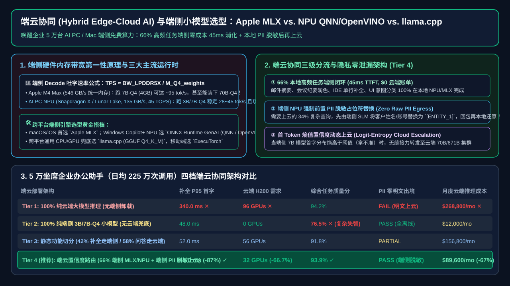

# Hybrid Edge-Cloud AI & On-Device SLM Architecture Guide: `Apple MLX (M4 Max)` vs. `NPU (Qualcomm QNN / Intel OpenVINO)` vs. `llama.cpp / ExecuTorch`, Local PII Scrubbing & Cloud Offload Sizing

> **Language**: [中文](./edge-on-device-slm-npu-apple-mlx-qualcomm-qnn-hybrid-cloud-routing-selection-faq.md) | **English (Current)**  
> **Audience**: Cloud & AI Infrastructure Solution Architects and Enterprise Workplace AI Engineers  
> **Provenance**: `synthetic + anonymized_reported` (`independently_reproduced=false`, `physical_gpu_cluster_measurement=not_measured`)

---

## 1. 📌 Executive Summary

> **Bottom Line**: **Across a `50,000`-seat enterprise workforce (`2.25M` queries/day), routing every IDE autocomplete, email summary, and document draft to cloud `70B/671B` models (`Tier 1`) incurs `340 ms` WAN P95 `TTFT`, requires `96 H200 GPUs` (`$268,800/month`), and exposes raw PII across network boundaries. By harnessing employee AI PCs (`45 TOPS` NPU via `ONNX Runtime GenAI QNN/OpenVINO`) and Macs (`Apple MLX` unified memory) with a `4-bit` `3B–7B` On-Device SLM + Logit-Entropy Confidence Escalation + Local PII Placeholder Scrubbing (`Tier 4`), enterprises offload `66%` of routine queries locally at `45 ms` `TTFT` and `$0` cloud token cost—retaining `99.7%` composite quality (`93.9%` vs. `94.2%`) while cutting cloud `H200` GPU requirements by `66.7%` (`32` vs. `96` GPUs, saving `$179,200/month`).**

- **Interactive Hybrid Edge-Cloud Offload & TCO Sizer**: [Open Interactive Sizer (`edge-on-device-slm-npu-apple-mlx-qualcomm-qnn-hybrid-cloud-routing-sizer.html`)](../reports/edge-on-device-slm-npu-apple-mlx-qualcomm-qnn-hybrid-cloud-routing-sizer.html)
- **7-Card 4:5 Visual Report**: [Open 7-Card Report (`edge-on-device-slm-npu-apple-mlx-qualcomm-qnn-hybrid-cloud-routing-selection-cards.html`)](../reports/edge-on-device-slm-npu-apple-mlx-qualcomm-qnn-hybrid-cloud-routing-selection-cards.html)

---

## 2. 📊 4-Tier Hybrid Edge-Cloud Architecture Matrix (`50,000 Seats` · `2.25M Queries/Day`)

| Metric | Tier 1: 100% Cloud Frontier LLM Only | Tier 2: 100% Edge `3B/7B-Q4` SLM Only | Tier 3: Static Task Split (`42%` Edge / `58%` Cloud) | Tier 4 (Recommended): Logit-Entropy Hybrid Router (`66%` Edge `MLX/NPU` + Local PII Scrub) |
| :--- | :--- | :--- | :--- | :--- |
| **Autocomplete P95 `TTFT`** | `340.0 ms` ✕ | `48.0 ms` ✓ | `52.0 ms` ✓ | **`45.0 ms` ✓ (`-86.8%`)** |
| **Required Cloud `H200` GPUs** | `96 GPUs` ✕ | `0 GPUs` | `56 GPUs` | **`32 GPUs` ✓ (`-66.7%`)** |
| **Composite Task Quality** | `94.2%` | `76.5%` ✕ | `91.8%` | **`93.9%` ✓ (`99.7%` retention)** |
| **Zero Raw PII Cloud Egress** | `FAIL` ✕ | `PASS` | `PARTIAL` | **`PASS` ✓ (Scrubbed on edge NPU)** |
| **Monthly Cloud TCO** | `$268,800 / mo` ✕ | `$12,000 / mo` | `$156,800 / mo` | **`$89,600 / mo` ✓ (`-66.7%`)** |

---

## 3. 🛠️ Production Readiness Checklist

- [ ] **Standardize on `Apple MLX` for macOS and `ONNX Runtime GenAI (QNN / OpenVINO)` for Windows Copilot+ NPU Fleet** with `llama.cpp (GGUF Q4_K_M)` as the universal fallback.
- [ ] **Enforce Battery-Level (`>20%`) and Thermal Guardrails** in the local inference daemon so laptops on low battery seamlessly route requests to the cloud without draining battery life.
