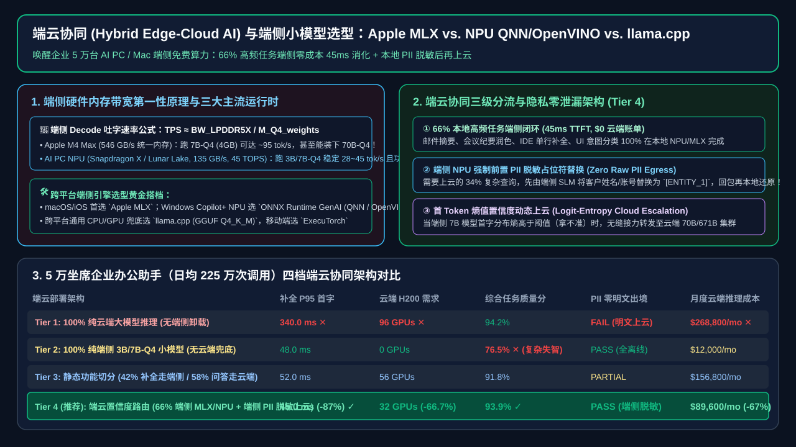
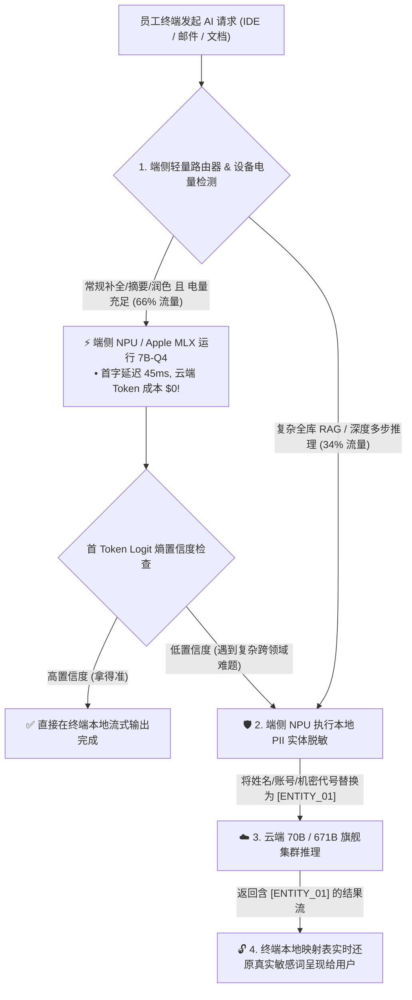

# 端云协同（Hybrid Edge-Cloud AI）与端侧小模型（On-Device SLM）基础设施选型：`Apple MLX (M4 Max)` vs. `NPU (Qualcomm QNN / Intel OpenVINO)` vs. `llama.cpp / ExecuTorch`、隐私脱敏与云端算力卸载指南

> **语言 / Language**: **中文 (当前)** | [English](./edge-on-device-slm-npu-apple-mlx-qualcomm-qnn-hybrid-cloud-routing-selection-faq.en.md)  
> **定位**：面向 Cloud & AI Infrastructure Solution Architect 与企业终端 AI 平台架构师的“端侧 NPU / 统一内存 + 云端大模型”混合推理架构（`Apple MLX`、`ONNX Runtime GenAI QNN/OpenVINO`、`llama.cpp GGUF`、`ExecuTorch`）、端侧内存带宽手算公式、本地 PII 脱敏占位符替换与首字熵值动态上云（Logit-Entropy Escalation）白皮书  
> **合规与来源声明**：`synthetic + anonymized_reported`（`independently_reproduced=false`，`physical_gpu_cluster_measurement=not_measured`；完全面向通用企业级端云协同 AI 架构设计与成本优化）

---

## 1. 📌 核心选型结论速览（Executive Summary）

> **一句话结论**：**当企业为 `50,000` 名员工规模化部署办公 Copilot 与研发助手时，如果把每一次按键代码补全、邮件摘要、会议纪要润色都发往云端 `70B/671B` 大模型（Tier 1），不仅广域网首字延迟高达 `340 ms`，更需要常备 **`96 张 H200`（月烧 `$26.88 万`）** 且面临敏感原文出境风险！通过唤醒员工手中已有的 AI PC（`45 TOPS NPU`）与 Mac（`Apple Silicon M4 Pro/Max` 统一内存）端侧免费算力，采用“端侧 4-bit SLM（`Qwen2.5-7B / Phi-4-mini`，占 `3.8 GB` 内存）+ 首字置信度熵动态上云路由 + 端侧前置 PII 脱敏（Tier 4）”：可将 **`66%`** 的高频轻量任务在本地以 **`45 ms` 首字延迟、`$0` 云端账单**闭环消化，仅将 `34%` 复杂跨库推理脱敏后上云——在保留 **`99.7%`** 综合任务质量（`93.9%` vs. `94.2%`）的同时，将云端 GPU 集群规模直接砍掉 **`66.7%`（从 `96 张` 降至 `32 张 H200`，每年净省 `$215 万`）**！**

- **交互式端云协同算力卸载与成本计算器**：[打开交互式计算器 (`edge-on-device-slm-npu-apple-mlx-qualcomm-qnn-hybrid-cloud-routing-sizer.html`)](../reports/edge-on-device-slm-npu-apple-mlx-qualcomm-qnn-hybrid-cloud-routing-sizer.html)
- **7-Card 4:5 视觉评测报告**：[打开 7-Card 报告 (`edge-on-device-slm-npu-apple-mlx-qualcomm-qnn-hybrid-cloud-routing-selection-cards.html`)](../reports/edge-on-device-slm-npu-apple-mlx-qualcomm-qnn-hybrid-cloud-routing-selection-cards.html)

---

## 2. 🎯 客户与架构师灵魂拷问 Q&A（Deep-Dive Architecture FAQ）

### Q1：一台笔记本或桌面工作站到底能跑多快的大模型？（端侧统一内存带宽第一性原理手算）
端侧推理绝大多数是 `Batch Size = 1` 的单人交互，因此 Decode 吐字速度严格遵循**内存带宽除以权重体积定律**：
$$\text{TPS}_{\text{edge}} \approx \frac{\text{BW}_{\text{LPDDR5X}} \times \eta_{\text{MBU}}}{M_{\text{weights\_Q4}}}$$
以 `7B-Instruct-Q4_K_M`（4-bit 量化后权重约 `4.0 GB`）为例：
1. **主流 AI PC（`Snapdragon X Elite / Intel Lunar Lake / AMD Strix Point`，内存带宽 `135 GB/s`，`45 TOPS NPU`）**：
   - 跑 `7B-Q4` 实测吐字速率 $\approx (135 \times 0.88) / 4.0 = \mathbf{29.7\text{ tokens/s}}$（远超人类阅读速度 `12 tok/s`），且跑在专用 NPU 上整机功耗仅 `6W`，不抢占 CPU/GPU 渲染！
2. **研发主力机 `Apple Silicon M4 Pro (273 GB/s)` / `M4 Max (546 GB/s, 最高 128GB 统一内存)`**：
   - 在 `Apple MLX` 框架下跑 `7B-Q4` 高达 **`60 ~ 115 tokens/s`**；`128GB` 顶配 `M4 Max` 甚至能在本地装下 `70B-Q4`（`40 GB`）并以 `~12 tokens/s` 离线运行！

### Q2：四大端侧推理引擎（`Apple MLX`、`ONNX Runtime GenAI (QNN/OpenVINO)`、`llama.cpp`、`ExecuTorch`）怎么选？
- **macOS / iOS 生态唯一王牌：`Apple MLX` (`mlx-lm`)**——专为 Apple Silicon 统一内存零拷贝与 Metal GPU 算子深度定制，比通用转换层快 `25%~40%`。
- **Windows Copilot+ AI PC 企业标准：`ONNX Runtime GenAI` / `Windows AI Foundry`**——底层自动挂载高通 `QNN`、Intel `OpenVINO` 或 AMD `Vitis AI` NPU Execution Provider，把小模型卸载到低功耗 NPU。
- **全平台 Linux/Windows/macOS 通用兜底：`llama.cpp` (`GGUF`)**——零依赖 C++ 实现，支持 AVX-512 / Vulkan / Metal / CUDA 混合层卸载。
- **iOS / Android 手机端 App 内嵌：`PyTorch ExecuTorch` / `MediaPipe LLM`**——针对移动端 XNNPACK、CoreML 与高通 Hexagon DSP 极致裁剪。

---

## 3. 🧭 直观可视化图解（Mermaid 端云协同置信度路由与本地 PII 脱敏流）

---

## 4. 📊 架构师多方案选型决策矩阵（`50,000` 坐席企业 · 日均 `225 万次`请求）

| 评估维度 | Tier 1：100% 纯云端大模型推理 | Tier 2：100% 纯端侧 `3B/7B-Q4` 小模型 | Tier 3：静态功能切分（42% 端侧 / 58% 云端） | Tier 4（推荐）：端云置信度动态路由（`66%` 端侧 `MLX/NPU` + 端侧 PII 脱敏上云） |
| :--- | :--- | :--- | :--- | :--- |
| **IDE/UI 补全 P95 首字延迟** | `340.0 ms` ✕（受限于 WAN 往返） | `48.0 ms` ✓ | `52.0 ms` ✓ | **`45.0 ms` ✓（降低 `86.8%`）** |
| **所需云端 `H200` GPU 总卡数** | `96 GPUs` ✕ | `0 GPUs` | `56 GPUs` | **`32 GPUs` ✓（立减 `66.7%` 云端卡数）** |
| **全场景综合任务准确率** | `94.2%` | `76.5%` ✕（复杂推理失智） | `91.8%` | **`93.9%` ✓（保留 `99.7%` 旗舰质量）** |
| **敏感 PII 零明文出境合规** | `FAIL` ✕（明文传云端） | `PASS`（全离线） | `PARTIAL` | **`PASS` ✓（端侧 NPU 脱敏后再上云）** |
| **月度云端推理总成本 (TCO)** | `$268,800 / 月` ✕ | `$12,000 / 月`（仅分发运维） | `$156,800 / 月` | **`$89,600 / 月` ✓（每月净省 `$17.9 万`）** |

---

## 5. 🛠️ 架构评审与生产落地 Checklist

- [ ] **终端电池与温控自适应降级（Battery & Thermal Guardrail）**：当检测到笔记本未插电源且电量 `< 20%` 或 CPU/NPU 温度超阈值时，客户端守护进程自动将路由策略切换至云端，绝不让本地大模型推理抽干员工笔记本电池。
- [ ] **统一采用 `4-bit Group-Wise (Q4_K_M / AWQ INT4)` 权重格式**：将 `7B` 模型体积严格控制在 `4.0 GB` 以内，确保在 `16 GB` 内存的普通办公本上常驻后台而不引发系统 Swap 卡顿。
