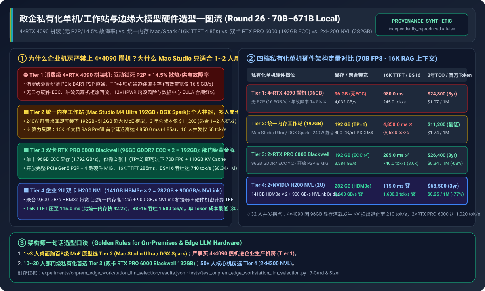
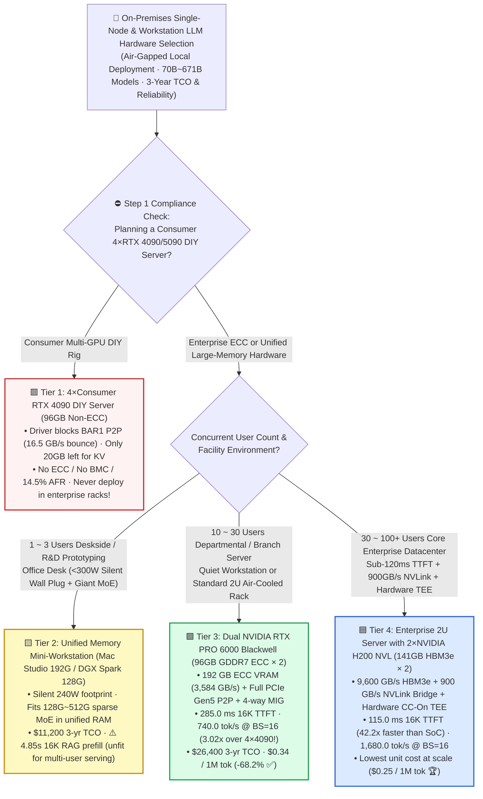
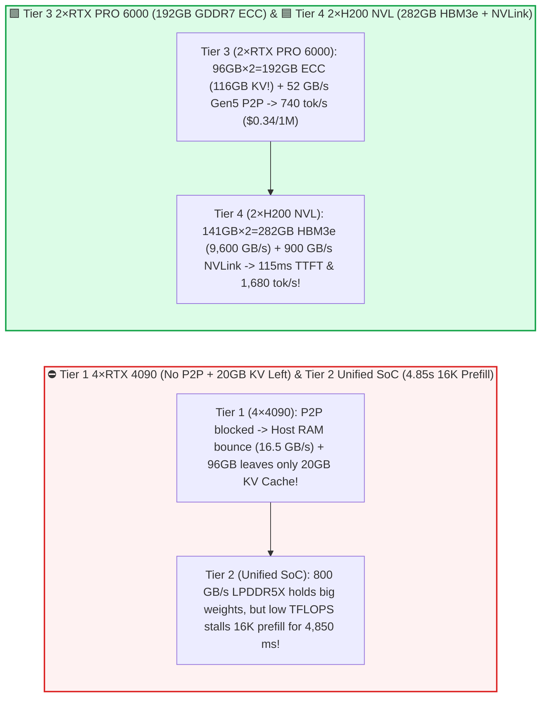
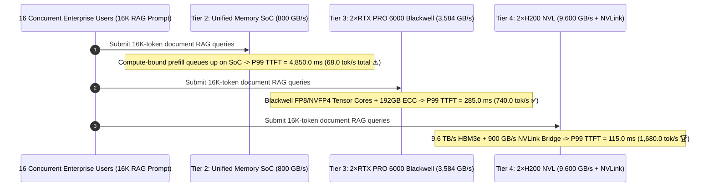

# Enterprise On-Premises Single-Node, Workstation & Edge LLM Hardware Selection FAQ (`Consumer 4×RTX 4090 Rig` vs. `Unified Memory Mac Studio / DGX Spark` vs. `Dual RTX PRO 6000 Blackwell 192GB` vs. `Enterprise 2×H200 NVL`)

> 🌐 **Language**: **[中文 (Chinese)](./edge-on-prem-workstation-llm-deployment-selection-faq.md)** | **English Version** · **[📖 Back to Repository README](../../README.en.md)** · **[📊 2026-11-09 Daily Progress Report](../daily/2026-11-09.md)** · **[🃏 7-Card 4:5 Visual Benchmark Report](../reports/edge-on-prem-workstation-llm-deployment-selection-cards.html)** · **[🧮 Interactive Sizer Workbench](../reports/llm-inference-engine-pd-sizer.en.html#onprem-workstation-sizer)**
>
> **Overview**: A first-principles selection guide for AI Solution Architects. When branch offices, hospitals, factories, law firms, or R&D labs deploy air-gapped on-premises LLMs (`70B ~ 671B`) on a single box for `1 ~ 50` internal users, hardware procurement frequently hits three traps: **(1) building a DIY server with 4 consumer `RTX 4090 (24GB×4 = 96GB)` cards, only to discover that consumer drivers block `PCIe BAR1 P2P` DMA, only `20 GB` remains for KV cache after loading a 70GB model, and axial gaming coolers suffer a `14.5%` annual failure rate in server racks; (2) buying a `Mac Studio M3/M4 Ultra (192GB)` or `DGX Spark (128GB)` for 20 concurrent RAG users, where compute-bound 16K prefill stalls for `4.85 seconds`; and (3) overlooking the `96 GB ECC` `NVIDIA RTX PRO 6000 Blackwell`, where just 2 cards (`192 GB`) outperform 4×4090s by `3.02x` at virtually identical 3-year TCO!** Grounded in `experiments/onprem_edge_workstation_llm_selection/` (`synthetic` + `anonymized_reported`, `independently_reproduced=false`), this guide establishes the exact boundaries across four single-node hardware tiers.



---

## ① 📌 Executive Summary

1. **Four-Tier Selection by Concurrent User Scale (`1~3` vs. `10~30` vs. `50+ Users`) and Deployment Environment**:
   - Running a local **`70B FP8` (`70 GB` weights) model with `16K` RAG context** over a 3-year hardware lifecycle:
   - 🟥 **Tier 1 (`4 × Consumer RTX 4090 24GB` DIY Server · `96 GB` Non-ECC VRAM)**: **Never deploy in enterprise production racks**! Consumer drivers disable direct `PCIe BAR1 P2P` (`16.5 GB/s` host-bounce collective bandwidth), `96 GB` leaves only `20 GB` for KV cache (causing swap degradation at `BS=32`), and lacking ECC, IPMI/BMC, and server blower cooling leads to a **`14.5%` annual failure rate** (`$24,800` 3-yr TCO, **`$1.07 / 1M tokens`**).
   - 🟨 **Tier 2 (`Unified Memory Mini-Workstation`: `Apple Mac Studio M4 Ultra 192GB` / `NVIDIA DGX Spark 128GB LPDDR5X`)**: **Unbeatable for `1 ~ 3` developers or deskside giant MoE (`235B/671B`) prototyping at `240W` (`$11,200` 3-yr TCO), but unsuitable for `>= 10` concurrent RAG users**. Because unified SoC compute and `800 GB/s` LPDDR5X bandwidth are `4.5x ~ 12x` lower than discrete GDDR7/HBM3e servers, **16K RAG prefill takes `4,850.0 ms (4.85s)` ✕** and `BS=16` throughput caps at **`68.0 tok/s`**.
   - 🟩 **Tier 3 (`Dual NVIDIA RTX PRO 6000 Blackwell Workstation/Server` · `96GB GDDR7 ECC × 2 = 192 GB`)**: **The gold standard for `10 ~ 30` user departmental / branch-office air-cooled deployments**. Each card provides **`96 GB` of ECC GDDR7 (`1,792 GB/s`)** and 5th-Gen `FP8/NVFP4` Tensor Cores with full `PCIe Gen5 BAR1 P2P` (`52.0 GB/s`) across just **2 GPUs (`TP=2`)**—cutting 16K TTFT to **`285.0 ms` (`17.0x` faster than Unified SoC)**, lifting `BS=16` throughput **`3.02x` over 4×4090 to `740.0 tok/s`** (`1,020.0 tok/s` at `BS=32`), and cutting token cost by **`68.2%` to `$0.34 / 1M tokens` (`$26,400` 3-yr TCO ✅)**!
   - 🟦 **Tier 4 (`Enterprise 2U Server with 2 × NVIDIA H200 NVL` · `141GB HBM3e × 2 = 282 GB` + `900 GB/s NVLink Bridge`)**: **The enterprise datacenter standard for `30 ~ 100+` concurrent users and hardware Confidential Computing (`CC-On TEE`)**. Delivers **`9,600 GB/s` aggregate HBM3e bandwidth (`12.0x` over Unified SoC)** and a `900 GB/s` NVLink bridge, achieving **`115.0 ms` 16K TTFT (`42.2x` faster than Unified SoC)**, **`1,680.0 tok/s` at `BS=16`** (`2,650.0 tok/s` at `BS=32`), and the lowest unit cost at scale (**`$0.25 / 1M tokens` 🏆**, `$68,500` 3-yr TCO)!
2. **First-Principles Law (Why Unified Memory SoCs Excel at `BS=1` Decode But Stall on `16K` Multi-User Prefill)**:
   - `BS=1 Decode` is memory-capacity and bandwidth bound (`800 GB/s` easily yields `21.5 tok/s` for a single user).
   - `16K Multi-User Prefill` is strictly Tensor Core `TFLOPS` bound—where discrete Blackwell/Hopper servers enjoy a `10x ~ 15x` compute advantage.
3. **Provenance & Transparency Disclosure**:
   - All VRAM capacities, bandwidths, 16K TTFT latencies, throughputs, and 3-year TCO numbers are bound 1:1 to `experiments/onprem_edge_workstation_llm_selection/results.json` (`provenance_type: "synthetic"`, calibrated to published NVIDIA RTX PRO 6000 Blackwell, H200 NVL, DGX Spark, and Apple M4 Ultra specifications; `independently_reproduced: false`, `physical_gpu_cluster_measurement: "not_measured"`, `local_cpu_harness_measurement: "measured"`).

---

## ② 🎯 Architect & Customer Deep-Dive Q&A (FAQ-Driven)

### Q1: "Why does `2 × RTX PRO 6000 Blackwell (96GB×2)` beat a `4 × RTX 4090 (24GB×4)` server by 3.02x–4.86x at nearly the same 3-year TCO (`$26.4k` vs. `$24.8k`)?"

- **Plain-English Answer**: **Because 4×4090s suffer from driver-blocked PCIe P2P (`16.5 GB/s` host-RAM bounce across 4 cards), leave only `20 GB` of VRAM for KV cache (`96GB - 76GB`), burn `1,950W`, and fail at `14.5%/year`. Two `RTX PRO 6000 Blackwell` cards give you `192 GB` of ECC GDDR7 (`116 GB` left for KV cache—`5.8x` more!), full `52 GB/s` PCIe Gen5 P2P across just 2 cards (`TP=2`), and enterprise reliability!**

### Q2: When is a Unified Memory Mini-Workstation (`Mac Studio Ultra 192GB` / `DGX Spark 128GB`, Tier 2) the right choice, and when is it a trap?

- **Plain-English Answer**: **Pick Tier 2 when `1 ~ 3` engineers need a silent `240W` deskside box to run massive sparse MoE models (`DeepSeek-R1 671B` / `Qwen3-235B`) interactively at `~21 tok/s` for `$11,200`. Never use it as a shared 20-user departmental RAG server, where 16K prompt prefill queues up for `4.85 seconds`!**

### Q3: When should an enterprise step up from `2 × RTX PRO 6000 Blackwell` (Tier 3) to `2 × H200 NVL` (Tier 4)?

- **Plain-English Answer**: **Step up to `2 × H200 NVL` when serving `30 ~ 100+` concurrent users (`9,600 GB/s` HBM3e + `900 GB/s` NVLink Bridge delivers `2.27x ~ 2.60x` higher throughput and `115 ms` 16K TTFT) or when regulated workloads require hardware Confidential Computing (`CC-On` / `PPCIE`)**.

---

## ③ 🧭 Visual Architecture Diagrams (Decision Tree, Hardware Datapaths & Concurrency Sequence)

### 3.1 On-Premises Single-Node, Workstation & Edge LLM Hardware Decision Tree



### 3.2 4×4090 P2P Lock & Unified SoC Prefill Wall vs. `Tier 3 Dual RTX PRO 6000` & `Tier 4 Dual H200 NVL`



### 3.3 End-to-End Sequence: 16 Concurrent Users Submitting 16K-Token RAG Queries (`sequenceDiagram`)



---

## ④ 📊 Architect Decision Matrix

*All metrics are bound 1:1 to `experiments/onprem_edge_workstation_llm_selection/results.json` (70B FP8 local serving, 16K RAG context, 3-year hardware + power + maintenance TCO):*

| Dimension | 🟥 Tier 1: `4 × RTX 4090` DIY Rig | 🟨 Tier 2: `Unified Memory SoC` (`Mac Studio / Spark`) | 🟩 Tier 3: `2 × RTX PRO 6000 Blackwell` (`96GB×2`) | 🟦 Tier 4: `2 × NVIDIA H200 NVL` (`141GB×2`) |
| :--- | :--- | :--- | :--- | :--- |
| **Primary Workload Fit** | Hobbyist lab only (**No Enterprise Prod**) | **1–3 user deskside dev & giant MoE** | **10–30 user departmental / branch server** | **30–100+ user core datacenter & TEE** |
| **Total VRAM / Free KV Space (70B)** | `96 GB` (Non-ECC · **`20 GB` KV left** ✕) | **`192 GB`** (`116 GB` KV left ✅) | **`192 GB`** (**GDDR7 ECC** · `116 GB` KV ✅) | **`282 GB`** (**HBM3e ECC** · `206 GB` KV 🏆) |
| **Aggregate Mem BW / Inter-GPU P2P** | `4,032 GB/s` / **`16.5 GB/s`** (P2P blocked ✕) | `800 GB/s` / `TP=1` unified | `3,584 GB/s` / **`52.0 GB/s`** (Gen5 P2P ✅) | **`9,600 GB/s`** / **`900.0 GB/s` (NVLink 🏆)** |
| **Wall Power / Annual Failure Rate** | `1,950 W` · **`14.5%` AFR ✕** | **`240 W` (Silent)** · `2.5%` AFR | `1,350 W` · **`1.2%` AFR ✅** | `1,500 W` (Redundant PSU/BMC) · **`0.5%` AFR 🏆** |
| **16K RAG `P99 TTFT` Latency** | `980.0 ms` | **`4,850.0 ms (4.85s)` ✕** | **`285.0 ms`** ✅ | **`115.0 ms`** (**`42.2x` faster than SoC 🏆**) |
| **`BS=1` / `BS=16` Throughput** | `42.0` / `245.0 tok/s` | `21.5` / `68.0 tok/s` | **`54.0` / `740.0 tok/s` (`3.02x` vs 4090)** | **`98.0` / `1,680.0 tok/s` (`24.7x` vs SoC 🏆)** |
| **3-Year `TCO` / Cost per 1M Tokens** | `$24,800` · `$1.07 / 1M` | **`$11,200` (Lowest Entry)** · `$1.74 / 1M` | **`$26,400` · `$0.34 / 1M` (`-68.2%` ✅)** | `$68,500` · **`$0.25 / 1M` (`-76.6%` 🏆)** |

---

## ⑤ 🧪 Quantitative Case Study & Benchmark Insights

### 5.1 Concurrent User Scaling (`1 -> 32 Users`) & The 96GB KV Cache Swap Cliff

As concurrent users scale from 1 to 32, total system throughput (`tok/s`) behaves as follows (from `results.json` `concurrency_scaling_sensitivity`):

| Concurrent Active Users | Tier 1 `4×RTX 4090 (96G)` | Tier 2 `Unified SoC (192G)` | Tier 3 `2×RTX PRO 6000 (192G)` | Tier 4 `2×H200 NVL (282G)` | Architect Crossover & Takeaway |
| :--- | :--- | :--- | :--- | :--- | :--- |
| **`1 User` (Personal Desk)** | `42.0 tok/s` | `21.5 tok/s` ✅ | `54.0 tok/s` ✅ | **`98.0 tok/s` 🏆** | Tier 2 (`$11.2k`, `240W`) is ideal for single-user local coding/MoE |
| **`8 Users` (Small Team)** | `165.0 tok/s` | `52.0 tok/s` ⚠️ | **`440.0 tok/s` ✅** | **`960.0 tok/s` 🏆** | Tier 3 delivers `8.46x` higher throughput than Unified SoC |
| **`16 Users` (Department Baseline)** | `245.0 tok/s` | `68.0 tok/s` ✕ | **`740.0 tok/s` ✅** | **`1,680.0 tok/s` 🏆** | **2×RTX PRO 6000 beats 4×4090 by `3.02x` at nearly identical 3-yr TCO** |
| **`32 Users` (Branch Peak)** | **`210.0 tok/s` (KV Swap Drop ✕)** | `72.0 tok/s` ✕ | **`1,020.0 tok/s` ✅** | **`2,650.0 tok/s` 🏆** | **4×4090 thrashes its 20GB KV budget; Tier 3 beats it by `4.86x`!** |

### 5.2 Reproducibility & Local Harness Verification

```bash
# Verify results.json matches the deterministic on-prem hardware selection model 100%
python experiments/onprem_edge_workstation_llm_selection/run.py --check

# Run Round 26 unit tests
python -m unittest tests/test_onprem_edge_workstation_llm_selection.py
```

---

## ⑥ 🛠️ Production Verification Checklist (Architect Checklist)

1. - [ ] **Reserve `>= 40%` of Total VRAM for Concurrent KV Cache**: Never size an on-prem server so model weights consume 80%+ of VRAM; a 70GB model requires `192 GB+` total VRAM for multi-user 16K–32K RAG serving.
2. - [ ] **Prefer Fewer, Larger-VRAM Enterprise GPUs (`2×96GB` over `4×24GB`)**: Halving tensor parallelism from `TP=4` to `TP=2` cuts inter-GPU synchronization overhead and failure points in half.
3. - [ ] **Mandate Hardware `ECC` Memory & Out-of-Band `IPMI / Redfish BMC`**: Ensure unattended branch/hospital servers have hardware ECC enabled and remote power-cycle capability.
4. - [ ] **Use Passive or Blower-Style Enterprise Coolers in Rack Enclosures**: Never install open-air axial gaming GPUs in dense 2U/4U server chassis.
5. - [ ] **Enable `FP8 / NVFP4` Quantization & Prefix Caching**: Maximize concurrent batch capacity on local workstations.
