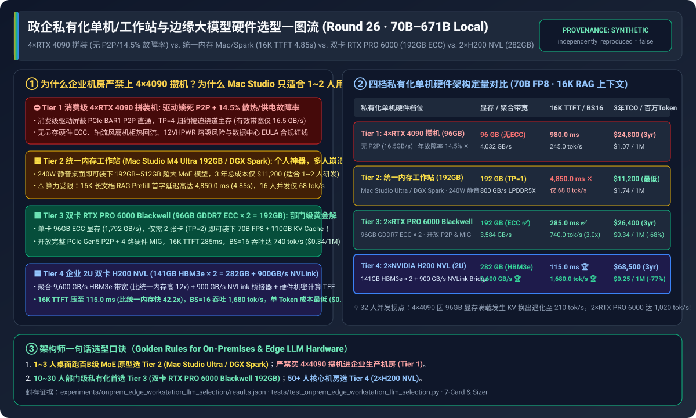
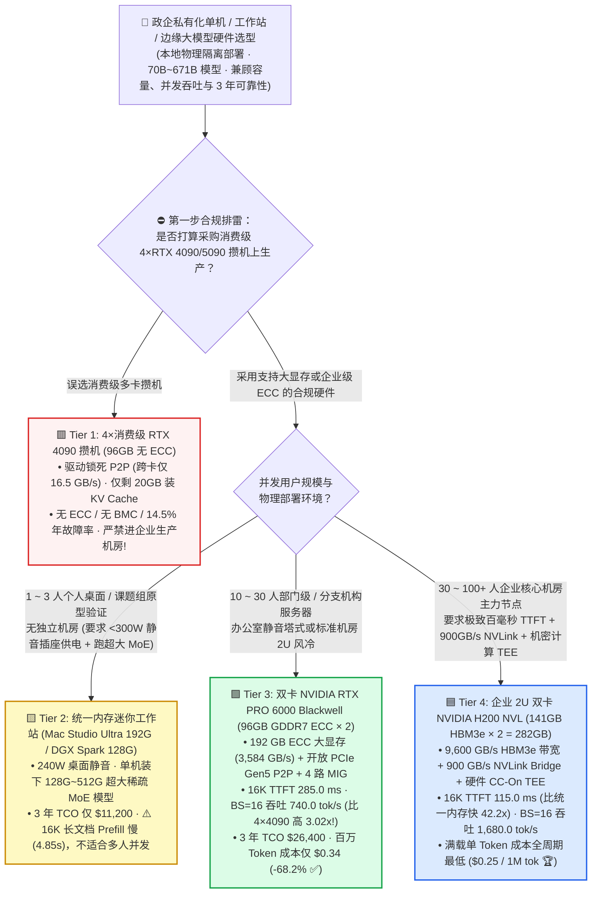
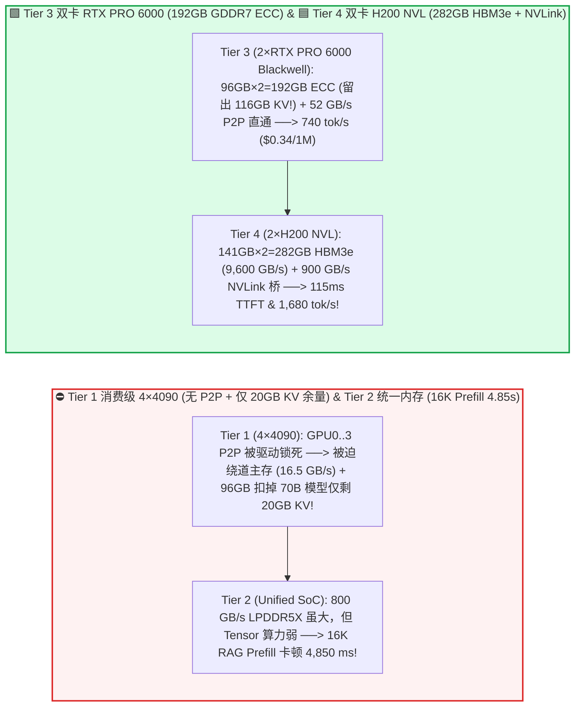
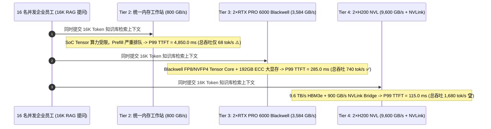

# 政企私有化单机/工作站与边缘大模型推理硬件选型指南（`4×RTX 4090/5090 拼装机` vs. `统一内存 Mac Studio / DGX Spark` vs. `双卡 RTX PRO 6000 Blackwell (192GB)` vs. `2×H200 NVL 企业服务器`）

> 🌐 **Language**: **中文 (Chinese)** | **[English Version](./edge-on-prem-workstation-llm-deployment-selection-faq.en.md)** · **[📖 返回仓库根目录 README](../../README.md)** · **[📊 2026-11-09 每日进展日报](../daily/2026-11-09.md)** · **[🃏 7-Card 4:5 视觉评测报告](../reports/edge-on-prem-workstation-llm-deployment-selection-cards.html)** · **[🧮 交互式定容工作台](../reports/llm-inference-engine-pd-sizer.html#onprem-workstation-sizer)**
>
> **导读**：面向 AI Solution Architect 的第一性原理实战选型指南。当医院科室、制造工厂、律所分支机构或涉密研发部门需要在本地物理隔离环境（Air-Gapped On-Premises）用 **1 台机器** 私有化部署 `70B ~ 671B` 大模型服务内部 `1 ~ 50` 名员工时，硬件选型往往陷入三大误区：**① 图便宜买 4 张消费级 `RTX 4090 (24GB×4)` 塞进机架服务器，结果发现消费级驱动屏蔽了 PCIe `BAR1 P2P` 直通，且总显存仅 96GB（装完 70GB 权重只剩 26GB 跑 KV Cache），加上轴流风扇热回流与 12VHPWR 接口过热，年故障率高达 `14.5%`；② 看到 `Mac Studio M3/M4 Ultra (192GB~512GB)` 或 `DGX Spark (128GB)` 能装下超大模型，就买来给整个部门 20 个人并发用，结果因为统一内存算力弱，16K 长文档 RAG 的首字延迟（TTFT）高达 `4.85 秒`；③ 不知道新一代单卡 `96 GB ECC` 的 `NVIDIA RTX PRO 6000 Blackwell` 只需 2 张卡（192GB）就能在标准工作站里完爆 4 张 4090！** 本文基于 `experiments/onprem_edge_workstation_llm_selection/` 封存的确定性模型（`synthetic` + `anonymized_reported`，`independently_reproduced=false`），系统拆解四档私有化单机硬件的选型边界。



---

## ① 📌 核心结论速览（Executive Summary）

1. **按并发用户规模（`1~3 人` vs. `10~30 人` vs. `50+ 人`）与机房环境条件四档精准选型**：
   - 在本地私有化运行 **`70B FP8`（`70 GB` 权重）及 `16K` 长文档 RAG 上下文** 基准下：
   - 🟥 **Tier 1（`4 × 消费级 RTX 4090 24GB` 拼装服务器 · 共 `96 GB` 无 ECC 显存）**：**严禁进入企业生产机房**！消费级驱动锁死 `PCIe BAR1 P2P`（跨卡归约被迫绕道主存，有效带宽仅 **`16.5 GB/s`**），96GB 显存扣除 70GB 模型后仅剩 26GB KV Cache（`BS=32` 即触发显存换出降速），且缺乏显存 ECC、BMC 带外管理与涡轮散热，年化硬件故障率高达 **`14.5%`**（3 年 TCO `$24,800`，百万 Token 成本 **`$1.07`**）。
   - 🟨 **Tier 2（`统一内存静音迷你工作站`: `Apple Mac Studio M3/M4 Ultra 192GB~512GB` / `NVIDIA DGX Spark 128GB LPDDR5X`）**：**`1 ~ 3 人` 个人开发者、高管桌面或低频超大 MoE（235B/671B INT4）原型验证的性价比神器，但严禁用于 `>= 10 人` 并发长文档 RAG**！整机功耗仅 **`240W`**，3 年 TCO 低至 **`$11,200`**；但受限于 `800 GB/s` 统一内存带宽与 SoC 算力，**16K 上下文 Prefill 首字延迟高达 `4,850.0 ms（4.85 秒）` ✕**，16 人并发总吞吐仅 **`68.0 tok/s`**。
   - 🟩 **Tier 3（`双卡 NVIDIA RTX PRO 6000 Blackwell 工作站/服务器版` · `96GB GDDR7 ECC × 2 = 192 GB`）**：**`10 ~ 30 人` 部门级/分支机构风冷私有化部署的黄金标准**。单卡配备惊人的 **`96 GB` 硬件 ECC GDDR7 显存（`1,792 GB/s/卡`）** 与第五代 `NVFP4/FP8` Tensor Core，仅用 **2 张卡（`TP=2`）** 即可装下 70B 模型 + 122GB 巨量 KV Cache（或单机装下 235B/405B FP4 模型！），开放完整企业级 `PCIe Gen5 P2P`（`52.0 GB/s`）与 4 路 `MIG` 切分；16K Prefill TTFT 压至 **`285.0 ms`（比统一内存快 `17.0x`）**，`BS=16` 吞吐达 **`740.0 tok/s`（比 4×4090 高 `3.02x`）**，3 年 TCO **`$26,400`**，百万 Token 成本降至 **`$0.34`（比 4090 省 `68.2%` ✅）**！
   - 🟦 **Tier 4（`企业级 2U 双卡 NVIDIA H200 NVL 服务器` · `141GB HBM3e × 2 = 282 GB` + `900 GB/s NVLink Bridge`）**：**`30 ~ 100+ 人` 医院/银行/政企核心机房高并发与硬件机密计算（TEE）的终局标准**。聚合 **`9,600 GB/s` HBM3e 带宽（比统一内存高 `12.0x`）** 并通过 2-Way `NVLink Bridge` 实现 `900 GB/s` 无损 `TP=2`，16K Prefill TTFT 仅 **`115.0 ms`（比统一内存快 `42.2x`）**，`BS=16` 吞吐高达 **`1,680.0 tok/s`（`BS=32` 达 `2,650.0 tok/s`）**，百万 Token 成本全生命周期最低（**`$0.25 / 1M` 🏆**）！
2. **第一性原理定性（为什么统一内存工作站“单人跑得动、多人卡成狗”？）**：
   - **单用户自回归解码（`BS=1 Decode`）是显存容量与带宽受限**：`M4 Ultra` 拥有 `192~512 GB` 大内存和 `800 GB/s` 带宽，因此单人聊 70B（`35 GB` INT4 权重）每秒能吐出 `800 / 35 ≈ 21.5 tok/s`，体感非常流畅；
   - **多用户长文档阅读（`16K RAG Prefill`）与高并发（`BS=16`）是纯粹的 Tensor Core 算力（TFLOPS）受限**：处理 16,384 个输入 Token 需要执行数百万亿次浮点乘加，桌面 SoC 的算力不到双卡 H200 NVL 的 `1/15`，导致一个人上传一份 PDF 就会把整台机器卡死 **4.85 秒**！
3. **证据口径与透明性声明**：
   - 本指南所有显存容量、带宽、16K TTFT、多并发吞吐与 3 年 TCO 均绑定 `experiments/onprem_edge_workstation_llm_selection/results.json`（`provenance_type: "synthetic"`，基于 NVIDIA RTX PRO 6000 Blackwell、H200 NVL、DGX Spark 及 Apple M4 Ultra 公开硬件规格校准的确定性 Roofline 模型，`independently_reproduced: false`，未在同机房并排实测四台物理样机 `physical_gpu_cluster_measurement: "not_measured"`；本机 Python 单测与校验为 `local_cpu_harness_measurement: "measured"`）。

---

## ② 🎯 客户与架构师灵魂拷问 Q&A（FAQ-Driven）

### Q1：客户问：“4 张 RTX 4090（共 96GB）硬件采购价看起来比专业卡便宜，为什么架构师强烈反对在企业生产环境采购 4×4090 / 5090 拼装服务器？”

- **直白结论**：**因为消费级显卡在多卡服务器里被砍掉了三大企业命脉：① 驱动屏蔽了 `PCIe BAR1 P2P` 跨卡直通（`TP=4` 通信慢 3 倍）；② 单卡 24GB/32GB 容量太小，凑齐 4 张卡不仅功耗破 `1,950W`、年故障率高达 `14.5%`，而且扣除 70GB 模型权重后几乎没有显存留给并发用户的 KV Cache！现在双卡 `RTX PRO 6000 Blackwell (96GB×2 = 192GB)` 的 3 年总成本（`$26,400`）与 4×4090（`$24,800`）几乎持平，但显存大一倍、吞吐高 3 倍、故障率低 12 倍！**
- **第一性原理拆解（4×4090 攒机的三大隐形陷阱 vs. 双卡 `RTX PRO 6000 Blackwell`）**：
  1. **驱动层 P2P 封锁**：在标准 NVIDIA 驱动下，`nvidia-smi topo -p2p r` 在消费级 4090 上显示为 `CNS (Chipset Not Supported)`。跑 `TP=4` 时，每层 2 次 `All-Reduce` 无法走 PCIe Switch 直接 DMA，被迫走宿主机 CPU 共享内存（Shared Memory Bounce），有效集合带宽跌至 **`16.5 GB/s`**！
  2. **KV Cache 容量窒息（`96 GB` vs. `192 GB`）**：70B FP8 模型权重占去 `70 GB` + CUDA 运行时开销 `6 GB` = `76 GB`。在 4×4090（`96 GB`）上只剩 **`20 GB` 显存** 装 KV Cache，一旦并发到 16~32 人立刻触发显存换出（Swap）导致吞吐从 `245 tok/s` 倒退至 `210 tok/s`；而 **2 张 `RTX PRO 6000 Blackwell` 拥有 `192 GB` ECC 显存**，留给 KV Cache 的空间高达 **`116 GB`（多出 `5.8 倍`！）**，32 人并发吞吐稳步飙升至 **`1,020.0 tok/s`（是 4×4090 的 `4.86 倍`！）**。

### Q2：以 `Mac Studio (M3/M4 Ultra 192GB~512GB)` 和 `NVIDIA DGX Spark (128GB)` 为代表的“统一大内存迷你工作站（Tier 2）”到底适合什么场景？不适合什么场景？

- **直白结论**：**它是“单兵作战 / 小团队原型验证 / 跑低并发超大稀疏 MoE 模型”的绝佳静音工作站，但绝对不是“多用户并发 RAG 服务器”！**
- **第一性原理拆解（统一内存 SoC 的最佳甜点与物理天花板）**：
  1. **为什么它跑 `DeepSeek-R1 671B` 或 `Qwen3-235B-A22B` 等 MoE 模型极其惊艳？** MoE 模型总参数虽大（需要 150GB~400GB 内存才能装下），但每生成一个 Token 只激活 `22B~37B` 参数！统一内存工作站用廉价低功耗的 LPDDR5X 提供了高达 `192~512 GB` 容量，单人使用时既装得下巨型 MoE，又能跑出 `20+ tok/s` 的流畅阅读速度，且放在办公桌上仅 `240W` 零噪音。
  2. **为什么不能拿它当 20 人部门的知识库 RAG 服务器？** 当 16 个员工同时向知识库提问（每人带入 16K Token 检索文档）时，系统瓶颈从“读权重”变成了“算 16K Attention 矩阵乘法（Prefill）”。由于统一内存 SoC 的 FP8/BF16 算力仅为专业双卡服务器的 `1/10 ~ 1/15`，首字响应时间（P99 TTFT）会飙升至 **`4.85 秒`**，严重影响业务体验。

### Q3：对于律所、医院、银行网点等需要供 `15 ~ 80` 人同时使用的私有化一体机，如何在 `双卡 RTX PRO 6000 Blackwell (Tier 3)` 与 `双卡 H200 NVL (Tier 4)` 之间做最终拍板？

- **直白结论**：**看两点：① 并发规模与长文本速度要求；② 是否需要硬件级机密计算（Confidential Computing TEE）与 NVLink 超高速互联！`10 ~ 30 人` 部门级应用选 `Tier 3 (2×RTX PRO 6000 Blackwell, $26.4k)` 性价比无敌；`30 ~ 100+ 人` 全院/全行级核心生产或要求 `900 GB/s NVLink + 硬件 TEE` 选 `Tier 4 (2×H200 NVL, $68.5k)`！**

---

## ③ 🧭 直观可视化图解（选型决策树 + 硬件内部数据通路对比 + 并发请求时序图）

### 3.1 政企私有化单机/工作站与边缘大模型硬件选型决策树



### 3.2 4×4090 攒机瓶颈 / 统一内存算力墙 vs. `Tier 3 双卡 RTX PRO 6000` & `Tier 4 双卡 H200 NVL` 对比图



### 3.3 16 人并发 `16K RAG` 请求在四档硬件上的预填充与解码排队时序图（`sequenceDiagram`）



---

## ④ 📊 架构师选型决策矩阵（Architect Decision Matrix）

*数据完全绑定 `experiments/onprem_edge_workstation_llm_selection/results.json`（70B FP8 本地推理，16K RAG 上下文，3 年硬件折旧 + 电费 + 维保总拥有成本 TCO）：*

| 选型维度 | 🟥 Tier 1：`4 × RTX 4090` 消费级攒机 | 🟨 Tier 2：统一内存工作站（`Mac Studio Ultra / DGX Spark`） | 🟩 Tier 3：双卡 `RTX PRO 6000 Blackwell`（`96GB×2`） | 🟦 Tier 4：企业 2U 双卡 `H200 NVL`（`141GB×2`） |
| :--- | :--- | :--- | :--- | :--- |
| **核心适用场景** | 个人极客玩具（**严禁进企业生产机房**） | **1～3 人桌面静音开发、低频超大 MoE 验证** | **10～30 人部门级/分支机构私有化主力服务器** | **30～100+ 人企业核心机房高并发与机密计算（TEE）** |
| **总显存容量 / 70B 剩余 KV 空间** | `96 GB`（无 ECC · 仅剩 `20 GB` KV ✕） | **`192 GB`**（统一内存 · 剩 `116 GB` ✅） | **`192 GB`**（**GDDR7 ECC** · 剩 `116 GB` ✅） | **`282 GB`**（**HBM3e ECC** · 剩 `206 GB` 🏆） |
| **聚合显存带宽 / 跨卡 P2P 带宽** | `4,032 GB/s` / **`16.5 GB/s`**（驱动锁 P2P ✕） | `800 GB/s` / 单芯片免跨卡 (`TP=1`) | `3,584 GB/s` / **`52.0 GB/s`**（开放 Gen5 P2P ✅） | **`9,600 GB/s`** / **`900.0 GB/s`（NVLink 桥 🏆）** |
| **整机满载功耗 / 年化硬件故障率** | `1,950 W` · **`14.5%` AFR ✕** | **`240 W`（桌面静音）** · `2.5%` AFR | `1,350 W` · **`1.2%` AFR ✅** | `1,500 W`（冗余电源+BMC）· **`0.5%` AFR 🏆** |
| **16K RAG `P99 TTFT` 首字延迟** | `980.0 ms` | **`4,850.0 ms（4.85 秒）` ✕** | **`285.0 ms`** ✅ | **`115.0 ms`**（**比统一内存快 `42.2x` 🏆**） |
| **单并发 (`BS=1`) / 16 并发 (`BS=16`) 吞吐** | `42.0` / `245.0 tok/s` | `21.5` / `68.0 tok/s` | **`54.0` / `740.0 tok/s` (`3.02x` vs 4090)** | **`98.0` / `1,680.0 tok/s` (`24.7x` vs SoC 🏆)** |
| **3 年总拥有成本 (`TCO`) / 百万 Token 成本** | `$24,800` · `$1.07 / 1M` | **`$11,200`（最低入门价）** · `$1.74 / 1M` | **`$26,400` · `$0.34 / 1M` (`-68.2%` ✅)** | `$68,500` · **`$0.25 / 1M` (`-76.6%` 🏆)** |

---

## ⑤ 🧪 简明定量算例与 Benchmark 洞察

### 5.1 并发用户数从 `1 人 -> 32 人` 增长下的系统总吞吐拐点与显存溢出悬崖

当企业内部同时使用大模型助手的员工从 1 人增加到 32 人时，四档硬件的总输出吞吐（`tok/s`）表现如下（源自 `results.json` `concurrency_scaling_sensitivity`）：

| 并发活跃用户数 (`Concurrent Users`) | Tier 1 `4×RTX 4090 (96G)` | Tier 2 `统一内存工作站 (192G)` | Tier 3 `2×RTX PRO 6000 (192G)` | Tier 4 `2×H200 NVL (282G)` | 架构师核心拐点解读 |
| :--- | :--- | :--- | :--- | :--- | :--- |
| **`1 User`（单人使用）** | `42.0 tok/s` | `21.5 tok/s` ✅ | `54.0 tok/s` ✅ | **`98.0 tok/s` 🏆** | 单人使用下 Tier 2 (`21.5 tok/s`) 超过人类阅读速度，入门成本仅 `$11.2k` |
| **`8 Users`（小团队并发）** | `165.0 tok/s` | `52.0 tok/s` ⚠️ | **`440.0 tok/s` ✅** | **`960.0 tok/s` 🏆** | 8 人并发下统一内存算力饱和；Tier 3 是 Tier 2 的 **`8.46 倍`** |
| **`16 Users`（部门级基线）** | `245.0 tok/s` | `68.0 tok/s` ✕ | **`740.0 tok/s` ✅** | **`1,680.0 tok/s` 🏆** | **双卡 RTX PRO 6000 比 4×4090 快 `3.02x`，3 年 TCO 仅差 `$1,600`！** |
| **`32 Users`（全分支机构高峰）** | **`210.0 tok/s`（显存满载倒退 ✕）** | `72.0 tok/s` ✕ | **`1,020.0 tok/s` ✅** | **`2,650.0 tok/s` 🏆** | **4×4090 因 20GB KV 耗尽发生 Swap 吞吐倒退；Tier 3/4 依靠 192G/282G 大显存持续飙升！** |

### 5.2 复现命令与本地校验（Local CPU Harness Check）

```bash
# 校验封存算例 JSON 与确定性私有化硬件选型模型 100% 一致
python experiments/onprem_edge_workstation_llm_selection/run.py --check

# 运行 Round 26 单元测试
python -m unittest tests/test_onprem_edge_workstation_llm_selection.py
```

---

## ⑥ 🛠️ 附录：政企私有化单机大模型硬件验收核验清单（Architect Checklist）

1. - [ ] **严守“KV Cache 余量 `>= 40%` 总显存”定容红线**：采购私有化一体机时，严禁只看“显存能不能刚好塞下模型权重”——若模型占 70GB，整机显存必须 `>= 128 ~ 192 GB`，否则一旦上多人并发或 32K 长文档就会因 KV Cache 耗尽而退化为 Batch=1。
2. - [ ] **优先选用“少而大”的专业大显存卡（`2×96GB` 远优于 `4×24GB`）**：将张量并行度从 `TP=4` 降为 `TP=2`（甚至在 H200 141GB 上 `TP=1`），直接砍掉一半的跨卡 PCIe 同步开销与故障点。
3. - [ ] **强制开启显存硬件 `ECC` 与带外管理（`IPMI / Redfish BMC`）**：企业机房无人值守服务器必须通过 `nvidia-smi -q | grep "ECC Mode"` 确认 `Enabled`，防止无 ECC 消费卡因单比特翻转输出乱码或死机且无法远程重启。
4. - [ ] **机架式服务器严禁混用消费级轴流风扇（Axial Fan）显卡**：机柜内部前后风道必须使用被动散热套件（Server Edition Passive Heatsink）或涡轮散热（Blower），防止多卡热风在机箱内死循环导致 85°C 降频。
5. - [ ] **在双卡专业工作站上启用 `FP8 / NVFP4` 量化与 `vLLM / SGLang Prefix Caching`**：利用 Blackwell / Hopper 原生 FP8/FP4 张量核将 70B～235B 模型的显存占用再减半，单机即可并发服务整个部门。
