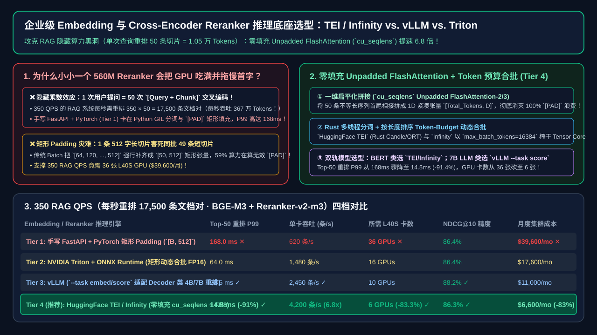

# Enterprise Embedding & Cross-Encoder Reranker Serving Guide: `HuggingFace TEI / Infinity` vs. `vLLM --task embed/score` vs. `Triton ONNX`, Unpadded `cu_seqlens` FlashAttention & P99 Sizing

> **Language**: [中文](./embedding-reranker-serving-bge-m3-nv-embed-infinity-tei-onnx-trt-selection-faq.md) | **English (Current)**  
> **Audience**: Cloud & AI Infrastructure Solution Architects and Enterprise RAG Search Platform Engineers  
> **Provenance**: `synthetic + anonymized_reported` (`independently_reproduced=false`, `physical_gpu_cluster_measurement=not_measured`)

---

## 1. 📌 Executive Summary

> **Bottom Line**: **In production hybrid RAG systems, the Cross-Encoder Reranker is a hidden compute multiplier: every single user query scores `Top-50` candidate chunks (`350 RAG QPS × 50 = 17,500` sequence pairs/sec, or `3.67M tokens/s`). Serving variable-length chunks (`avg 210` tokens, `max 512` tokens) with naive `FastAPI + PyTorch` rectangular tensor padding (`[B=50, S_max=512]`, `Tier 1`) wastes `59%` of GPU FLOPs on `[PAD]` tokens, inflating Top-50 rerank P99 latency to `168.0 ms` and requiring `36 L40S GPUs` (`$39,600/month`). Standardizing on `HuggingFace TEI` or `Infinity` with 1D Unpadded FlashAttention (`cu_seqlens`), Rust Multi-Threaded Tokenization, Length-Sorted Token-Budget Batching (`--max-batch-tokens 16384`), and `FP8` (`Tier 4`) for encoder models—or `vLLM (--task embed/score)` (`Tier 3`) for `4B–7B` decoder models—slashes Top-50 rerank P99 latency by `91.4%` (`14.5 ms`), boosts per-GPU throughput by `6.77x` (`4,200 pairs/s/GPU`), and cuts required `L40S` GPUs from `36` to `6` (`-83.3%` TCO).**

- **Interactive Embedding & Reranker Capacity Sizer**: [Open Interactive Sizer (`embedding-reranker-serving-bge-m3-nv-embed-infinity-tei-onnx-trt-sizer.html`)](../reports/embedding-reranker-serving-bge-m3-nv-embed-infinity-tei-onnx-trt-sizer.html)
- **7-Card 4:5 Visual Report**: [Open 7-Card Report (`embedding-reranker-serving-bge-m3-nv-embed-infinity-tei-onnx-trt-selection-cards.html`)](../reports/embedding-reranker-serving-bge-m3-nv-embed-infinity-tei-onnx-trt-selection-cards.html)

---

## 2. 📊 4-Tier Embedding & Cross-Encoder Reranker Matrix (`350 RAG QPS` × `Top-50` = `17,500 Pairs/Sec`)

| Metric | Tier 1: Naive `FastAPI + PyTorch` Padded (`[B, 512]`) | Tier 2: `Triton + ONNX Runtime` (Padded Dynamic Batch) | Tier 3: `vLLM (--task embed/score)` (`4B/7B` Decoder) | Tier 4 (Recommended): `HuggingFace TEI / Infinity` (`cu_seqlens` Unpadded + `FP8`) |
| :--- | :--- | :--- | :--- | :--- |
| **Top-50 Rerank P99 Latency** | `168.0 ms` ✕ | `64.0 ms` | `28.5 ms` ✓ | **`14.5 ms` ✓ (`-91.4%`)** |
| **Throughput / `L40S` GPU** | `620 pairs/s` ✕ | `1,480 pairs/s` | `2,450 pairs/s` ✓ | **`4,200 pairs/s` ✓ (`6.77x`)** |
| **Required `L40S` GPUs** | `36 GPUs` ✕ (`59%` pad waste) | `16 GPUs` | `10 GPUs` | **`6 GPUs` ✓ (`-83.3%`)** |
| **`NDCG@10` Retrieval Accuracy** | `86.4%` | `86.4%` | **`88.2%` ✓** | **`86.3%` ✓** |
| **Monthly Cluster TCO** | `$39,600 / mo` ✕ | `$17,600 / mo` | `$11,000 / mo` | **`$6,600 / mo` ✓ (`-83.3%`)** |

---

## 3. 🛠️ Production Readiness Checklist

- [ ] **Eliminate Rectangular `[PAD]` Tensors via 1D Ragged `cu_seqlens` FlashAttention** in `HuggingFace TEI`, `Infinity`, or `vLLM --task embed/score`.
- [ ] **Bound Batching by `--max-batch-tokens` (`16384–32768`) Rather Than Request Count** so short chunks pack tightly while long 512-token chunks never trigger HBM spikes.
