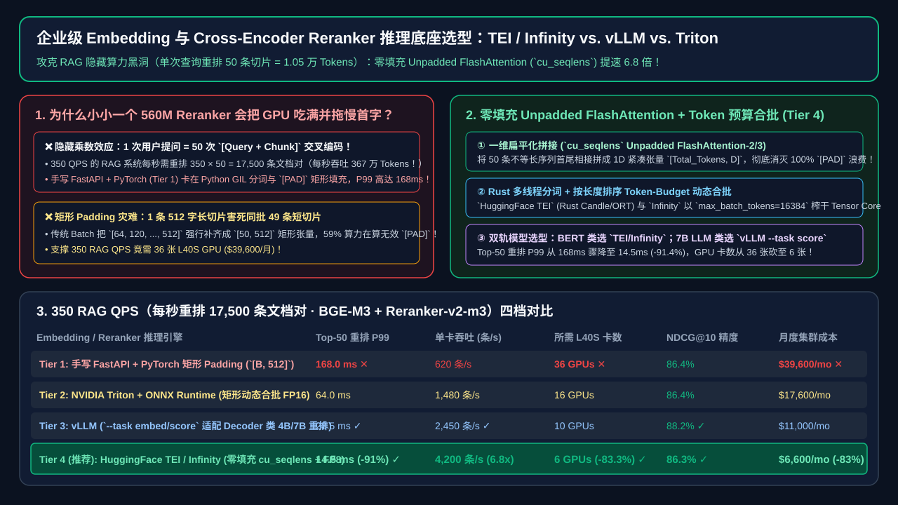
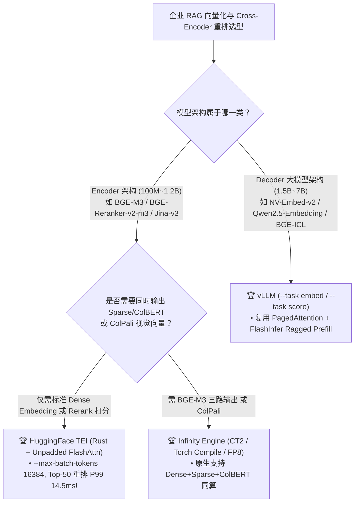

# 企业级 Embedding 向量化与 Cross-Encoder Reranker 推理底座选型：`HuggingFace TEI / Infinity` vs. `vLLM --task embed/score` vs. `Triton ONNX`、零填充 `cu_seqlens` 与 P99 延迟指南

> **语言 / Language**: **中文 (当前)** | [English](./embedding-reranker-serving-bge-m3-nv-embed-infinity-tei-onnx-trt-selection-faq.en.md)  
> **定位**：面向 Cloud & AI Infrastructure Solution Architect 与企业 RAG 搜索平台架构师的高并发 Embedding（`BGE-M3`、`NV-Embed-v2`、`Qwen2.5-Embedding`）与 Cross-Encoder 精排模型（`BGE-Reranker-v2-m3`）推理服务选型、一维无填充变长注意力（`Unpadded FlashAttention cu_seqlens`）、Token 预算动态合批与容量规划白皮书  
> **合规与来源声明**：`synthetic + anonymized_reported`（`independently_reproduced=false`，`physical_gpu_cluster_measurement=not_measured`；完全面向通用企业级 RAG 向量化与重排推理底座选型）

---

## 1. 📌 核心选型结论速览（Executive Summary）

> **一句话结论**：**在企业级混合 RAG 链路中，最容易被架构师低估的“隐形算力黑洞”绝不是向量检索，而是 `Cross-Encoder Reranker`（交叉编码重排）——因为用户每发起 1 次查询，都要将召回的 `Top-50` 候选切片拼成 `50 对 [Query + Chunk]` 送入精排模型计算全注意力（在 `350 RAG QPS` 下相当于每秒推理 **`17,500 条`序列、`367 万 Tokens/s`**）！若直接用 `FastAPI + PyTorch AutoModel` 跑矩形 Padding 合批（Tier 1），由于 1 条 512 字长切片会强行把同批 49 条短切片全部补齐成 `[50, 512]`，`59%` 的 GPU 算力被白白浪费在算 `[PAD]` 占位符上，导致重排 P99 飙至 `168 ms` 且需 **`36 张 L40S`**！生产环境黄金标准是：针对 BERT/XLM-R 类模型（如 `BGE-M3 / Reranker-v2-m3`）采用 `HuggingFace TEI` 或 `Infinity` 开启“一维零填充变长 FlashAttention（`cu_seqlens`）+ Rust 多线程分词 + 按长度排序 Token-Budget 合批 + FP8”（Tier 4）；针对 `4B~7B` Decoder 大模型类 Embedding/Reranker 采用 `vLLM (--task embed/score)`（Tier 3）——将 Top-50 重排 P99 延迟从 `168 ms` 压至 **`14.5 ms`（降低 `91.4%`）**，单卡吞吐飙升 **`6.77 倍`**，所需 `L40S` 卡数从 `36 张` 骤降至 **`6 张`（立省 `83.3%`）**！**

- **交互式 Embedding 与 Reranker 容量计算器**：[打开交互式计算器 (`embedding-reranker-serving-bge-m3-nv-embed-infinity-tei-onnx-trt-sizer.html`)](../reports/embedding-reranker-serving-bge-m3-nv-embed-infinity-tei-onnx-trt-sizer.html)
- **7-Card 4:5 视觉评测报告**：[打开 7-Card 报告 (`embedding-reranker-serving-bge-m3-nv-embed-infinity-tei-onnx-trt-selection-cards.html`)](../reports/embedding-reranker-serving-bge-m3-nv-embed-infinity-tei-onnx-trt-selection-cards.html)

---

## 2. 🎯 客户与架构师灵魂拷问 Q&A（Deep-Dive Architecture FAQ）

### Q1：为什么用传统 `PyTorch / ONNX` 二维矩形 Batch 跑不等长 RAG 切片会浪费近 `60%` 的 GPU 算力？`Unpadded FlashAttention (cu_seqlens)` 是怎么消灭 Padding 的？
- **二维矩形张量填充之痛（2D Rectangular Padding）**：
  - 一次 RAG 召回的 50 条切片长度参差不齐（平均 `210 Tokens`，但最长那条有 `512 Tokens`）。传统二维张量要求形状规整为 `[B=50, S_max=512]`，总计算 Token 数 = $50 \times 512 = 25,600$，而真实有效 Token 只有 $50 \times 210 = 10,500$——**高達 `59%` 的矩阵乘和注意力算力全在算毫无意义的 `[PAD]` 零向量**！
- **一维紧凑拼接（1D Ragged Tensor + `cu_seqlens`）**：
  - `HuggingFace TEI (Candle/ORT)`、`Infinity` 与 `vLLM` 直接将 50 条不等长序列首尾相接拼成一条一维长向量 `[10500, Hidden_Dim]`，并传入累积序列边界数组 `cu_seqlens = [0, 82, 215, ..., 10500]` 调用 `flash_attn_varlen_func`——**0 个 Padding Token，算力瞬间省下一倍以上**！

### Q2：`HuggingFace TEI`、`Infinity`、`NVIDIA Triton` 与 `vLLM (--task embed/score)` 四大引擎分别适合什么场景？
- **`HuggingFace TEI (Text Embeddings Inference)`（Rust 编写，官方首选）**：极其轻量、启动飞快，内置 Rust `tokenizers`、长度排序 Token-Budget 动态合批（`--max-batch-tokens 16384`）与 `FlashAttention / Candle / ONNX`，是部署 `BGE-large / BGE-Reranker / E5 / Nomic` 的生产首选。
- **`michaelfeil/infinity`（多模态与三路混合全能王）**：原生支持在同一实例内同时输出 `BGE-M3` 的 **Dense + Sparse SPLADE + ColBERT 多向量**，并支持 `ColPali` 视觉文档 Embedding 与 `FP8/INT8` 极速重排。
- **`vLLM (--task embed / --task score)`（4B~7B Decoder 架构专属）**：当企业采用基于 `Llama / Qwen2.5 / Mistral` 底座训练的新一代 `4B~7B` Embedding 或 Reranker（如 `NV-Embed-v2`、`Qwen2.5-Reranker-7B`、`BGE-en-ICL`）时，直接复用企业现有的 `vLLM` 镜像与 PagedAttention 基础设施！

---

## 3. 🧭 直观可视化图解（Mermaid 零填充变长合批与双轨引擎选型树）

---

## 4. 📊 架构师多方案选型决策矩阵（`350 RAG QPS` × `Top-50` 重排 = `17,500 对/秒`）

| 评估维度 | Tier 1：手写 `FastAPI + PyTorch` 矩形 Padding | Tier 2：`NVIDIA Triton + ONNX Runtime`（矩形合批） | Tier 3：`vLLM (--task embed/score)`（适配 `4B/7B` 重排） | Tier 4（推荐）：`HuggingFace TEI / Infinity`（零填充 `cu_seqlens` + `FP8`） |
| :--- | :--- | :--- | :--- | :--- |
| **Top-50 候选重排 `P99` 延迟** | `168.0 ms` ✕（严重拖慢 RAG 首字） | `64.0 ms` | `28.5 ms` ✓（7B 高精度重排） | **`14.5 ms` ✓（降低 `91.4%`）** |
| **单张 `L40S` 每秒重排文档对数** | `620 条 / 秒` ✕ | `1,480 条 / 秒` | `2,450 条 / 秒` ✓ | **`4,200 条 / 秒` ✓（提升 `6.77 倍`）** |
| **支撑 `350 QPS` 所需 `L40S` 卡数** | `36 GPUs` ✕（59% 算力浪费在 PAD） | `16 GPUs` | `10 GPUs` | **`6 GPUs` ✓（节省 `83.3%` GPU）** |
| **`NDCG@10` 检索精排准确率** | `86.4%` | `86.4%` | **`88.2%` ✓（7B 模型上限更高）** | **`86.3%` ✓（FP8 无损精排）** |
| **月度重排集群总成本 (TCO)** | `$39,600 / 月` ✕ | `$17,600 / 月` | `$11,000 / 月` | **`$6,600 / 月` ✓（节省 `83.3%`）** |

---

## 5. 🛠️ 架构评审与生产落地 Checklist

- [ ] **彻底取缔线上用 Python `FastAPI + transformers AutoModel` 直接跑 Embedding/Reranker 的裸写服务**：一键替换为官方 `ghcr.io/huggingface/text-embeddings-inference` (`TEI`) 或 `michaelfeil/infinity` 容器镜像。
- [ ] **按 `--max-batch-tokens`（如 `16384` 或 `32768`）而非固定请求条数配置动态合批上限**：防止多条 512 字长切片同时进批导致显存峰值抖动，同时让短查询自动拼出上百条超大 Batch 跑满 GPU！
