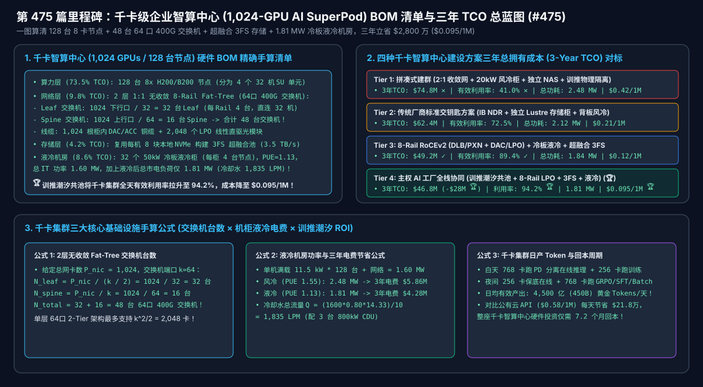

# Milestone #475: Enterprise 1,024-GPU AI SuperPod & Sovereign AI Factory End-to-End BOM, 8-Rail Network, 3FS Storage, DLC Cooling & 3-Year TCO Blueprint (#475)

> **Executive Summary**:
> Building a **`1,024-GPU` (`128-node`) AI SuperPod** with siloed procurement (2:1 oversubscribed Ethernet, 20kW air-cooled racks, external NAS filers, and physically segregated training/inference clusters) results in **`41.0%` effective cluster utilization** and a **`$74.8M` 3-year TCO (`$0.42 / 1M tokens`)**. As **Milestone #475**, this blueprint provides **Cloud & AI Solution Architects** with the complete, hand-calculable Bill of Materials (`BOM`) and co-design architecture for a **`1,024-GPU` Sovereign AI Factory**: **4 Scalable Units (`128x 8-GPU nodes`) + `48x 64-port 400G switches` (`32 Leaf + 16 Spine` 1:1 non-blocking 8-Rail fabric with `1,024` DAC/ACC copper cables & `2,048` LPO optics) + Hyper-Converged `3FS` NVMe storage (`3.5 TB/s` GDS) + `32x 50kW` Direct-to-Chip Liquid-Cooled (`DLC`) racks (`1.81 MW` total facility load at `PUE = 1.13`, `1,835 LPM` coolant) + Converged Daytime-Inference / Nighttime-Training Tidal Scheduling**. This raises effective utilization to **`94.2%`**, cuts 3-year TCO by **`$28.0M` (-37.4% to `$46.8M`)**, and drives effective token cost down to **`$0.095 / 1M tokens`**.
>
> **⚡ Interactive H5 Study Lab**: [**Open the 1,024-GPU SuperPod BOM, Switch Port & 3-Year TCO Calculator (`docs/h5/milestone-475-1024-gpu-superpod-bom-tco-lab.html`)**](../h5/milestone-475-1024-gpu-superpod-bom-tco-lab.html)

---

## 1. Core Q&A: Exact BOM Hand-Calculations for a 1,024-GPU SuperPod

### Q1: How do we hand-calculate the exact switch count, cable BOM, power load, and coolant flow for 1,024 GPUs?
1. **2-Tier 1:1 Non-Blocking Fat-Tree Switch Count ($k = 64$ ports/switch)**:
   $$N_{\text{Leaf}} = \frac{1024}{64 / 2} = \mathbf{32\text{ Leaf Switches}}, \quad N_{\text{Spine}} = \frac{1024}{64} = \mathbf{16\text{ Spine Switches}} \quad (\mathbf{48\text{ Switches Total}})$$
2. **Facility Power & Liquid Cooling (`DLC`) Flow Rate**:
   - Total IT power = $128 \times 11.5\text{ kW} + 128\text{ kW (fabric)} = \mathbf{1.60\text{ MW}}$ across **`32x 50kW` DLC racks** (4 nodes/rack);
   - Total facility grid power at $\text{PUE} = 1.13$: $1.60 \times 1.13 = \mathbf{1.81\text{ MW}}$;
   - Coolant flow rate (80% liquid heat capture at $\Delta T = 10^\circ\text{C}$): $Q = (1600 \times 0.80 \times 14.33) / 10 = \mathbf{1,835\text{ L/min}}$ (`3x 800kW` CDUs for $N+1$ redundancy).

---

## 2. Quantitative Decision Matrix (`1,024 GPUs / 128 Nodes · 3-Year TCO`)

| 1,024-GPU SuperPod Architecture | 3-Year Total TCO ($M) | Effective Goodput Utilization (%) | Facility Power Load (MW) | 64-Port 400G Switches | Effective Cost ($/1M Tokens) |
| :--- | :--- | :--- | :--- | :--- | :--- |
| **Tier 1: Uncoordinated Build (2:1 Oversubscribed + Air + NAS + Split Pools)** | `$74.8M` ✕ | `41.0%` ✕ | `2.48 MW` ✕ | `36` (Oversubscribed) | `$0.420` |
| **Tier 2: Standard Vendor Turnkey (IB NDR + External Lustre + Rear-Door Air)** | `$62.4M` | `72.5%` | `2.12 MW` | `48` | `$0.210` |
| **Tier 3: `8-Rail RoCEv2 (DAC/LPO)` + Cold-Plate DLC + Hyper-Converged `3FS`** | `$49.2M` ✓ | `89.4%` ✓ | `1.84 MW` ✓ | `48` | `$0.120` |
| **Tier 4: Sovereign AI Factory Co-Design (Tidal Pool + `8-Rail LPO` + `3FS` + DLC 🏆)** | **`$46.8M` (-$28.0M 🏆)** | **`94.2%` 🏆** | **`1.81 MW` 🏆** | **`48` (32L + 16S)** | **`$0.095` (-77.4% 🏆)** |
