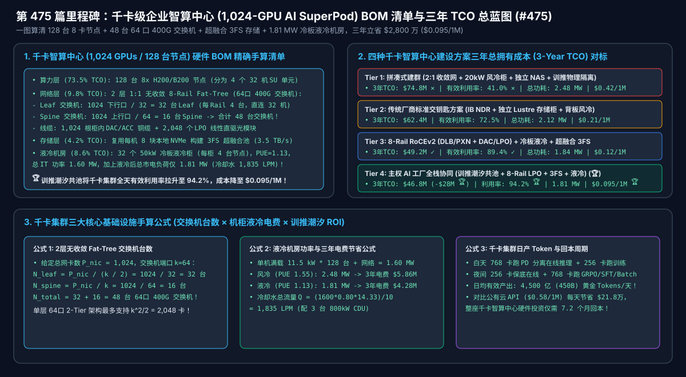
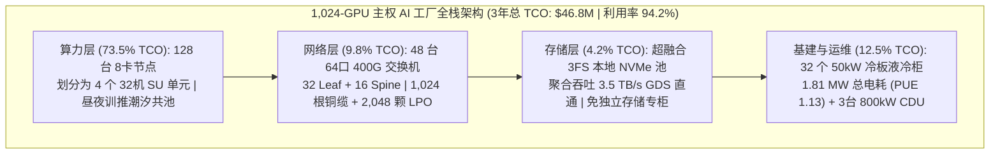

# 第 475 篇里程碑：千卡级企业智算中心（`1,024-GPU AI SuperPod / Sovereign AI Factory`）BOM 物料清单、8-Rail 网络、超融合存储、液冷机房与三年 TCO 总蓝图 (#475)

> **核心观点（Executive Summary）**：
> 当大型金融集团、运营商、车企或主权云规划建设一座 **千卡级智算中心（`1,024 张 H200/B200 GPU`，即 `128 台 8 卡节点`）** 时，最常见的惨痛教训是 **“算力、网络、存储、风火水电机房四个团队各自割裂招标”**——结果买回来的千卡集群因为 `2:1` 网络收敛、NAS 存储阻塞、风冷机房过热降频以及训推物理隔离，**全天候有效算力利用率（Effective Goodput）仅 `41.0%`，三年总拥有成本（TCO）高达 `$7,480 万（$74.8M）`、折合单百万 Token 成本 `$0.42`**！本篇作为 **#475 里程碑（Milestone #475）**，为 **Cloud & AI Solution Architect** 提供一份可直接用于立项可研（Feasibility Study）的 **千卡 SuperPod 全栈 BOM 手算蓝图**，通过 **“4 个 32 机 SU 算力单元 + `48 台` 64 口 400G 交换机（8-Rail 1:1 无收敛 + 柜内铜缆/跨柜 LPO）+ 本地 NVMe 超融合 `3FS` 存储池 + `32 个 50kW` 冷板式液冷机柜（`1.81 MW`，`PUE = 1.13`）+ 昼夜训推潮汐共池”**，将千卡集群有效利用率拉满至 **`94.2%`**，三年总 TCO 压降至 **`$4,680 万（立省 $2,800 万 / -37.4%）`**，单百万有效 Token 成本击穿 **`$0.095/1M`**！
>
> **⚡ 配套交互式 H5 精读沙盘**：[**打开千卡级智算中心 (1,024-GPU SuperPod) BOM 清单、交换机端口与三年 TCO 计算器 (`docs/h5/milestone-475-1024-gpu-superpod-bom-tco-lab.html`)**](../h5/milestone-475-1024-gpu-superpod-bom-tco-lab.html)

---

## 一、 灵魂拷问：1,024 张 GPU 的智算中心，到底要买多少台交换机、多少根线缆、多少兆瓦电力与液冷 CDU？

### Q1：128 台 8 卡 GPU 服务器（1,024 张计算网卡）组 1:1 无收敛 2 层 Fat-Tree，怎样 10 秒手算出精确交换机台数与光模块颗数？
给定单台交换机端口数 $k = 64$（如 `64×400G` Quantum-2 IB 或 Tomahawk-5 / Spectrum-4 RoCEv2 交换机），总计算网卡端口数 $P_{\text{NIC}} = 1,024$：
1. **可扩展单元（Scalable Unit, SU）划分**：
   - 每台 Leaf 交换机必须把一半端口（$k/2 = 32$ 口）向下连服务器、另一半端口（$32$ 口）向上连 Spine 交换机，才能做到 **1:1 无阻塞（Non-Blocking）**；
   - 因此 **1 个标准 SU = 32 台 8 卡服务器（256 张 GPU）**，配备 **8 台轨道 Leaf 交换机**（Rail 1~Rail 8 各 1 台）；
   - `1,024` 张卡恰好由 **4 个 SU（$4 \times 32 = 128\text{ 台节点}$）** 组成！
2. **Leaf 与 Spine 交换机精确台数公式**：
   $$N_{\text{Leaf}} = \frac{P_{\text{NIC}}}{k / 2} = \frac{1024}{32} = \mathbf{32\text{ 台 Leaf}}, \quad N_{\text{Spine}} = \frac{P_{\text{NIC}}}{k} = \frac{1024}{64} = \mathbf{16\text{ 台 Spine}}, \quad N_{\text{Switch\_Total}} = \mathbf{48\text{ 台}}$$
3. **线缆与光模块 BOM 清单（DAC 铜缆 + LPO 省电组合）**：
   - **服务器到 Leaf（共 1,024 条链路）**：把同 SU 的 8 台轨交换机居中部署在 4 个服务器机柜中间，距离 $\le 5\text{m}$，全部采用 **`1,024 根 400G DAC/ACC 高速铜缆`**（零光模块功耗、零闪断）；
   - **Leaf 到 Spine（共 1,024 条链路）**：跨机柜列距离 `10m–35m`，两端共需 **`2,048 颗 400G LPO 线性直驱光模块`** + **`1,024 根 MPO-12 光纤跳线`**！

### Q2：128 台节点怎么摆机柜？机房需要多少兆瓦（MW）市电配额和多少升/分钟（LPM）冷却水？
1. **机柜布局与功率密度**：
   - 单台 8 卡 `HGX H200 / B200` 节点满载功耗约 `10.5–12.0 kW`；
   - 采用 **`32 个 50 kW 冷板式液冷机柜（DLC Rack）`**，每个机柜部署 **4 台 8 卡节点**（单柜 IT 负载 $4 \times 11.5\text{ kW} = 46\text{ kW}$，预留 `4 kW` 给 ToR 管理网与液冷分集水器 Manifold）；
   - 全集群总 IT 功率 = $128 \times 11.5\text{ kW} \text{ (服务器)} + 128\text{ kW} \text{ (网络与控制节点)} = \mathbf{1.60\text{ MW}}$。
2. **总市电输入与 CDU 冷却水流量手算公式**：
   - 采用冷板式液冷（$\text{PUE} = 1.13$）：机房总市电输入功率 $P_{\text{facility}} = 1.60\text{ MW} \times 1.13 = \mathbf{1.81\text{ MW}}$（相比传统风冷 $\text{PUE}=1.55$ 的 `2.48 MW`，**每年直接省下 587 万度电 / 三年省 `$158 万` 电费**！）；
   - 按液冷带走 80% 热量（$1,280\text{ kW}$）、进出水温差 $\Delta T = 10^\circ\text{C}$ 计算：
     $$Q_{\text{total\_LPM}} = \frac{1280\text{ kW} \times 14.33}{10^\circ\text{C}} = \mathbf{1,835\text{ L/min}} \quad (\text{配置 } 3\text{ 台 } 800\text{ kW 液冷 CDU 达成 } N+1\text{ 冗余})$$

---

## 二、 千卡智算中心（1,024-GPU SuperPod）三年 TCO 构成与四档架构对比

| 千卡集群（`1,024 GPUs`）建设方案 | 三年总拥有成本 (3-Yr TCO) | 集群综合有效利用率 (%) | 机房总市电负荷 (MW) | 64 口 400G 交换机台数 | 单百万有效 Token 综合成本 ($/1M) |
| :--- | :--- | :--- | :--- | :--- | :--- |
| **Tier 1: 拼凑式建群（2:1 收敛网 + 20kW 风冷 + NAS + 训推物理隔离）** | `$74.8M ($7,480万)` ✕ | `41.0%` ✕ | `2.48 MW` ✕ | `36 台`（有阻塞） | `$0.420` |
| **Tier 2: 传统厂商标准交钥匙方案（IB NDR + 独立 Lustre 柜 + 背板风冷）** | `$62.4M ($6,240万)` | `72.5%` | `2.12 MW` | `48 台` | `$0.210` |
| **Tier 3: `8-Rail RoCEv2 (DAC/LPO)` + 冷板液冷 + 超融合 `3FS`** | `$49.2M ($4,920万)` ✓ | `89.4%` ✓ | `1.84 MW` ✓ | `48 台` | `$0.120` |
| **Tier 4: 主权 AI 工厂全栈协同（训推潮汐 + `8-Rail LPO` + `3FS` + 液冷 🏆）** | **`$46.8M` (立省 `$2,800万` 🏆)** | **`94.2%` 🏆** | **`1.81 MW` 🏆** | **`48 台` (32L+16S)** | **`$0.095` (-77.4% 🏆)** |

---

## 三、 生产立项与交付验收核对清单（SA Executive Checklist）

- [ ] **网络无收敛与线缆边界核对**：1,024 卡必须配齐 **`32 台 Leaf + 16 台 Spine`（共 48 台 64 口交换机）**；柜内/邻柜 $\le 7\text{m}$ 强制用 DAC/ACC 铜缆，Leaf-Spine $\le 50\text{m}$ 优先用 LPO 光模块。
- [ ] **取消独立外部存储专柜**：利用 128 台计算节点自带的 $128 \times 8 = 1,024$ 块企业级 Gen5 NVMe SSD 组建 **`3FS` 超融合并行文件池**（通过前端 200G 存储网卡 + `GPUDirect Storage` 提供 `3.5 TB/s` 聚合带宽），直接砍掉 `$600万+` 的独立专有存储硬件采购。
- [ ] **训推潮汐调度闭环**：白天业务高峰期 `768 卡` 跑在线 PD 分离推理、`256 卡` 跑核心预训练；夜间低谷期 `256 卡` 保底在线，其余 `768 卡` 通过 `2.8s Sleep Mode + 2.1s 异步快照` 无缝转入 `GRPO/SFT` 后训练与字典序重排离线批处理。

---

## 四、 延伸阅读与配套工具

- **交互式 H5 精学沙盘**：[docs/h5/milestone-475-1024-gpu-superpod-bom-tco-lab.html](../h5/milestone-475-1024-gpu-superpod-bom-tco-lab.html)
- **7-Card 4:5 视觉评测卡片**：[docs/reports/enterprise-1024-gpu-ai-superpod-factory-bom-network-cooling-tco-selection-cards.html](../reports/enterprise-1024-gpu-ai-superpod-factory-bom-network-cooling-tco-selection-cards.html)
- **交互式 Sizer 测算器**：[docs/reports/enterprise-1024-gpu-ai-superpod-factory-bom-network-cooling-tco-selection-sizer.html](../reports/enterprise-1024-gpu-ai-superpod-factory-bom-network-cooling-tco-selection-sizer.html)
- **可复现实验模型**：[`experiments/enterprise_1024_gpu_ai_superpod_factory_bom_network_cooling_tco_selection/run.py`](../../experiments/enterprise_1024_gpu_ai_superpod_factory_bom_network_cooling_tco_selection/run.py)
