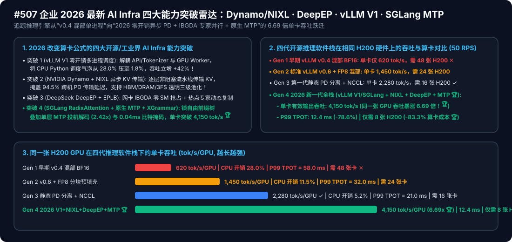

# Enterprise 2026 AI Infra Breakthrough Radar (`NVIDIA Dynamo/NIXL`, `DeepSeek DeepEP/3FS`, `vLLM V1` & `SGLang MTP`) Adoption & Sizer Guide (#507)

> **Executive Summary**:
> Upgrading an enterprise serving cluster from legacy **Gen 1 (`vLLM v0.4 / TGI` Colocated BF16 with `28.0%` synchronous Python scheduling overhead)** to the **2026 Gen 4 Next-Gen Stack (`vLLM V1` Zero-Overhead Multiprocess Scheduler + `NVIDIA Dynamo / NIXL` Layer-Pipelined Async KV Transfer + `DeepSeek DeepEP / EPLB` IBGDA RDMA + `SGLang RadixAttention & Native MTP`)** multiplies per-GPU output throughput **6.69x (`620 -> 4,150 tok/s/GPU`)** on the exact same `H200` silicon, cuts `P99 TPOT` by **`78.6%` (`58.0ms -> 12.4ms`)**, and reduces the fleet required for `50 RPS` from **`48x H200 GPUs` to just `8x H200 GPUs` (`-83.3%` GPUs)**.
>
> **⚡ Interactive H5 Study Lab**: [**Open the 2026 AI Infra Breakthrough Radar & 4-Gen Serving Stack Sizer (`docs/h5/ai-infra-2026-breakthrough-radar-dynamo-deepep-vllmv1-lab.html`)**](../h5/ai-infra-2026-breakthrough-radar-dynamo-deepep-vllmv1-lab.html)

---

## 1. Quantitative 4-Generation Serving Stack Matrix (`50 RPS Enterprise Workload`)

| Serving Software Stack Generation (`H200` Baseline) | Output `tok/s/GPU` | CPU Scheduler Overhead | `P99 TPOT` | H200 GPUs (`50 RPS`) |
| :--- | :--- | :--- | :--- | :--- |
| **Gen 1: Legacy `vLLM v0.4 / TGI` (Colocated BF16)** | `620 tok/s` ✕ | `28.0%` ✕ | `58.0 ms` ✕ | `48 GPUs` ✕ |
| **Gen 2: Standard `vLLM v0.6 + FP8` (Chunked Prefill)** | `1,450 tok/s` | `11.5%` | `32.0 ms` | `24 GPUs` |
| **Gen 3: Static `PD Disaggregation + NCCL` Copy** | `2,280 tok/s` ✓ | `5.2%` | `21.0 ms` ✓ | `16 GPUs` |
| **Gen 4: 2026 `vLLM V1 / SGLang + Dynamo NIXL + DeepEP + MTP` 🏆** | **`4,150 tok/s (6.69x)` 🏆** | **`1.8%` 🏆** | **`12.4 ms (-78.6%)` 🏆** | **`8 GPUs (-83.3%)` 🏆** |
