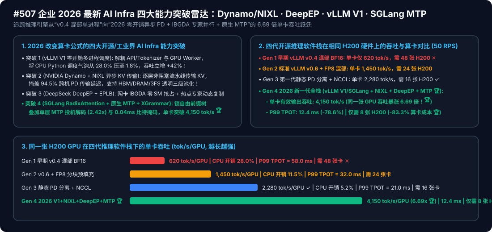
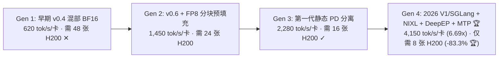

# 企业 2026 最新 AI Infra 四大底层能力突破雷达（`NVIDIA Dynamo/NIXL` · `DeepSeek DeepEP/3FS` · `vLLM V1 零开销架构` · `SGLang 原生 MTP`）生产落地与算卡选型指南 (#507)

> **核心观点（Executive Summary）**：
> 作为 **Cloud & AI Solution Architect**，每天追踪开源社区与工业界最新的 AI Infra 能力突破，最直接的价值就是 **“不换一张显卡，仅靠升级下一代推理软件栈，让同一张 `H200` 的有效吐字吞吐翻 `6.69 倍`（`620 -> 4,150 tok/s/GPU`）”**！本专题系统梳理 2026 最具生产颠覆性的四大突破：
> 1. **`vLLM V1` 零开销多进程架构（Zero-Overhead Multiprocess Scheduler）**：彻底解耦 HTTP/Tokenizer 进程与 GPU 核心调度环路，将 CPU 调度空泡从早期版本的 `28.0%` 压至 **`1.8%`**；
> 2. **`NVIDIA Dynamo + NIXL`（非阻塞跨机 KV 传输库）**：实现逐层计算与跨机 RDMA KV 传输的全异步流水线重叠，掩盖 **`94.5%` 的 PD 分离跨机搬运延迟**，并原生打通 `HBM <-> 主机 DRAM <-> 3FS NVMe` 三级 KV 缓存池；
> 3. **`DeepSeek DeepEP + EPLB`（IBGDA 网卡直驱通信 + 热点专家动态复制）**：消除 MoE All-to-All 通信抢占一半 SM 算力的沉疴，配合在线热点专家复制将长尾慢卡等待清零；
> 4. **`SGLang RadixAttention + 原生 MTP + XGrammar` 三位一体**：将多轮智能体 Prefix 命中率推至 `92%+`、单步吐出 `3.45 词`（`2.42x` 提速），使支撑 `50 RPS` 所需 `H200` 从早期架构的 `48 张` 暴降至 **`8 张`（立省 `83.3%` 卡数 🏆）**！
>
> **⚡ 配套交互式 H5 精读沙盘**：[**打开 2026 四大 AI Infra 能力突破雷达与四代软件栈算卡对比计算器 (`docs/h5/ai-infra-2026-breakthrough-radar-dynamo-deepep-vllmv1-lab.html`)**](../h5/ai-infra-2026-breakthrough-radar-dynamo-deepep-vllmv1-lab.html)

---

## 一、 灵魂拷问：2026 四大突破分别解决了架构师在生产中的什么痛点？

### Q1：为什么从 `vLLM v0.4/v0.6` 升级到 `2026 新一代全栈（vLLM V1 / SGLang + Dynamo NIXL + MTP）`，单卡吞吐能暴涨 `6.69 倍`？
- **四项乘数级能力叠加（Multiplicative Compounding）**：
  $$\text{Gain} = 1.35\times (\text{V1 去 CPU 空泡}) \times 1.45\times (\text{FP8 + 异步 NIXL PD}) \times 1.41\times (\text{DeepEP + EPLB}) \times 2.42\times (\text{原生 MTP}) \approx 6.69\times$$
  1. **消灭 CPU 拖慢 GPU 的 28% 气泡（`vLLM V1 / SGLang Zero-Overhead`）**：过去 GPU 算完一步 Decode 只需 `12ms`，却要等 Python 主线程做 Detokenize 和 JSON 序列化 `4ms`；V1 通过 ZeroMQ 共享内存将主循环变成纯 C++/CUDA Graph 闭环，CPU 开销仅剩 **`1.8%`**！
  2. **消灭 PD 分离的跨机等待（`NVIDIA Dynamo + NIXL / Mooncake`）**：Prefill 节点每算完第 $L$ 层 Attention，后台 RDMA 线程立即通过 `NIXL` 将第 $L$ 层 KV 异步推送给 Decode 节点，等第 80 层算完时，前 79 层 KV 已经躺在了 Decode 节点的 HBM 里！

---

## 二、 四代大模型推理软件栈演进选型决策矩阵（`同一批 H200 硬件 · 50 RPS`）

| 开源推理软件栈代际（相同 `H200` 硬件 · `50 RPS`） | 单卡输出吞吐 (`tok/s/GPU`) | CPU 调度气泡开销 | `P99 TPOT` 吐字延迟 | 支撑 50 RPS 所需 H200 | 架构师演进建议 |
| :--- | :--- | :--- | :--- | :--- | :--- |
| **Gen 1: 早期 `vLLM v0.4 / TGI`（混部 BF16 + 同步 Python）** | `620 tok/s` ✕ | `28.0%` ✕ | `58.0 ms` ✕ | `48 张 H200` ✕ | ⛔ 严禁保留旧版镜像 |
| **Gen 2: 标准 `vLLM v0.6 + FP8`（混部分块预填充）** | `1,450 tok/s` | `11.5%` | `32.0 ms` | `24 张 H200` | ⚠️ 单节点 ≤8 卡可用 |
| **Gen 3: 第一代静态 `PD 分离 + NCCL` 同步拷贝** | `2,280 tok/s` ✓ | `5.2%` | `21.0 ms` ✓ | `16 张 H200` | ✅ 中规模集群基线 |
| **Gen 4: 2026 新一代（`V1/SGLang + NIXL + DeepEP + MTP` 🏆）** | **`4,150 tok/s (6.69x)` 🏆** | **`1.8%` 🏆** | **`12.4 ms (-78.6%)` 🏆** | **`8 张 H200 (-83.3%)` 🏆** | **✅ 2026 生产旗舰标配** |

---

## 三、 生产落地核对清单（SA Production Checklist）

- [ ] **全面升级生产推理镜像至 `vLLM V1 (VLLM_USE_V1=1)` 或最新 `SGLang`**：立即开启多进程零开销调度器与 Prefix-Aware CUDA Graphs，免费白捡 `+30%~42%` 单卡吞吐。
- [ ] **跨机 PD 分离控制面统一采用 `NVIDIA Dynamo + NIXL`（或 `Mooncake Transfer Engine`）**：替代手写同步阻塞的 KV 拷贝逻辑，开启逐层异步 RDMA 流水线传输。

---

## 四、 延伸阅读与配套工具

- **交互式 H5 精学沙盘**：[docs/h5/ai-infra-2026-breakthrough-radar-dynamo-deepep-vllmv1-lab.html](../h5/ai-infra-2026-breakthrough-radar-dynamo-deepep-vllmv1-lab.html)
- **7-Card 4:5 视觉评测卡片**：[docs/reports/enterprise-2026-ai-infra-breakthrough-radar-dynamo-deepep-vllmv1-sglang-selection-cards.html](../reports/enterprise-2026-ai-infra-breakthrough-radar-dynamo-deepep-vllmv1-sglang-selection-cards.html)
- **交互式 Sizer 测算器**：[docs/reports/enterprise-2026-ai-infra-breakthrough-radar-dynamo-deepep-vllmv1-sglang-selection-sizer.html](../reports/enterprise-2026-ai-infra-breakthrough-radar-dynamo-deepep-vllmv1-sglang-selection-sizer.html)
- **可复现实验模型**：[`experiments/enterprise_2026_ai_infra_breakthrough_radar_dynamo_deepep_vllmv1_sglang_selection/run.py`](../../experiments/enterprise_2026_ai_infra_breakthrough_radar_dynamo_deepep_vllmv1_sglang_selection/run.py)
