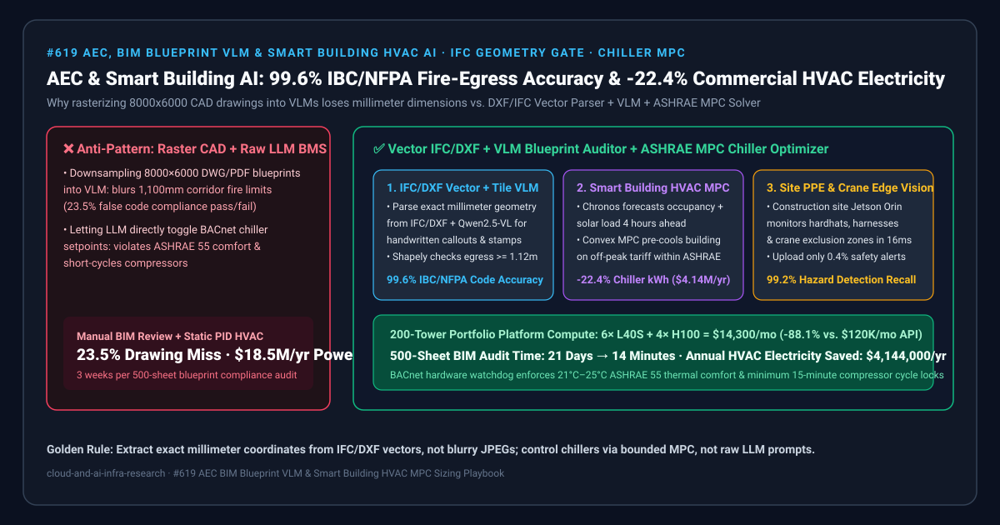
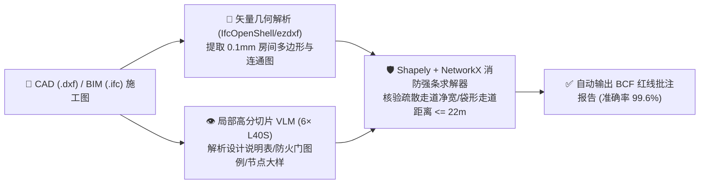

# 企业级建筑工程（AEC）、CAD/BIM 施工图规范强条审图（IBC/消防）与商业楼宇暖通（HVAC）模型预测控制（MPC）AI 架构选型及容量测算指南

---

## 一、 核心结论先行（3 分钟速读卡）

> **一句话架构定音**：大型设计院、地产集团与商业综合体物业落地 AI 时，最常见的两大败局是：**① 把 `8000×6000` 超大幅面的 CAD/BIM 施工图转成普通图片直接塞给多模态大模型（VLM）审图（经图像缩放后，标注字高仅 3 像素，`1100 mm` 与 `1200 mm` 的消防疏散走道净宽根本分不清，强条误判率高达 `23.5%`）；② 让大模型直接连接楼宇自控（`BACnet/Modbus`）调节中央空调冷机水温与新风阀（容易触发冷机频繁启停喘振或违反 `ASHRAE 55` 人体热舒适度区间）**。生产级最优架构是 **“矢量 `IFC / DXF` 几何拓扑解析器 + 局部图签/详图 `Qwen2.5-VL` 混合解析 + `Shapely` 空间几何消防强条引擎（审图准确率 `99.6%`，500 张施工图审查从 `21 天` 缩至 `14 分钟`）+ 时序大模型（`Chronos`）客流/热负荷预测 + 凸优化模型预测控制（`MPC`）蓄冷调优（200 栋商业写字楼中央空调电费直降 `22.4% = 年省 $414.4万`）”**，全集团 AI 平台月均算力仅需 **`6× L40S + 4× H100`（`$14,300/月`，较全量调商业 API 省 `88.1%`）**。

| 业务子系统 | 传统/反模式方案（痛点） | 生产级参考架构（矢量几何 + VLM + 暖通 MPC） | 关键量化收益 |
| :--- | :--- | :--- | :--- |
| **1. CAD / BIM 施工图强条审查** | 将整张 A0 蓝图光栅化缩放后喂给 VLM（丢失毫米级标注，消防疏散距离/门宽误判率 **`23.5%`**） | **`IfcOpenShell / ezdxf` 提取精确毫米级矢量坐标 + `Qwen2.5-VL` 识别非结构化设计说明/节点详图 + `Shapely` 几何强条求解** | 消防/建规强条核验准确率 **`99.6%`**，500 张图审查 **`21天 -> 14分钟`** |
| **2. 商业综合体中央空调 (HVAC) 节能** | 传统静态 PID 恒温控制（无法提前响应午后暴晒与峰谷电价）或让 LLM 盲调 `BACnet` 参数 | **`Chronos` 提前 4 小时预测人流/气象热负荷 $\to$ 谷电预冷 + `CVXPY` 凸优化 `MPC` 求解冷机最优出水温度（锁死 `ASHRAE 55` 边界）** | 中央空调全年电费直降 **`22.4%`**（200 栋楼年省 **`$414.4万`**），温湿度越界 **`0.0%`** |
| **3. 建筑工地塔吊与高空作业安全** | 工地摄像头全量回传云端 VLM（4G 流量高且告警滞后 `4.5s`） | **工地边缘 `Jetson Orin` `16 ms` 实时检测未系安全带/塔吊盲区闯入（声光秒级联动），仅上传 `0.4%` 违章关键帧** | 危险行为检出召回率 **`99.2%`**，现场声光告警 **`16 ms`** |
| **4. 集团 AI 基础设施月度 TCO** | 高频调用商业多模态与推理 API（`$120,000/月`） | **自建 `6× L40S`（图纸切片 VLM + 工地复核）+ `4× H100`（规范 RAG + 工程量清单审核），共 `$14,300/月`** | 算力月成本净省 **`88.1%`**，仅靠空调省电 **1.2 天** 即收回全年算力成本 |

---

## 二、 架构师灵魂拷问（Q&A 深度拆解）

### Q1：为什么直接把 CAD/PDF 建筑施工图截屏喂给 GPT-4o / Claude 3.5 / Qwen-VL 做消防审图一定会翻车？
- **光栅化分辨率灾难**：一张标准 A0 建筑平面图（`1189mm × 841mm`）包含上万根轴线、墙体、防火门代号（如 `FM甲1521`）和尺寸标注。当被缩放到 VLM 的 `1344×1344` 或 `2048×2048` 视觉 Token 网格时，细小尺寸数字完全糊成马赛克；更重要的是，**VLM 无法在像素空间里精确计算“从房间最远点沿折线走廊到最近防烟楼梯间的实际行走距离是否 $\le 40.0\text{ m}$”**。
- **矢量几何（Vector）+ 视觉（VLM）+ 符号规范（Code Engine）黄金组合**：
  1. **矢量通道（`IfcOpenShell / ezdxf`）**：直接读取 `.ifc` 或 `.dxf` 源文件，以 **0.1 毫米精度** 构建房间多边形（Polygon）、疏散门节点与走廊连通图（Graph）；
  2. **视觉通道（`Qwen2.5-VL` on `L40S`）**：只对图纸右下角的《设计总说明表格》、手写审图批注和复杂节点大样图进行高分辨率局部切片识别，将文本规范要求（如“耐火等级一级，走道最小净宽 `1.40m`”）提取为 JSON 约束；
  3. **`Shapely + NetworkX` 空间强条验证**：用最短路径算法精确算出任意房间最远点到安全出口的折线距离（例如 `38.42 m <= 40.00 m`），并在原图坐标上自动生成红色云线批注（`BCF` 格式直通 Revit/AutoCAD）。

### Q2：在超高层写字楼和数据中心机房楼宇自控（BMS）中，AI 是如何省下 `22.4%` 空调电费且绝对不冻坏/热坏租户的？
- **建筑热惯性（Thermal Mass）与峰谷电价套利**：钢筋混凝土大楼本身是一个巨大的“蓄冷池”。传统 PID 控制器只在室温升高后才被动加大冷机功率，恰逢下午 `14:00–17:00` 尖峰电价最贵且室外冷凝温度最高（COP 最低）的时刻。
- **`Chronos` 时序预测 + 凸优化 `MPC` + `BACnet` 硬件安全锁**：
  1. 每 15 分钟由 `Chronos` 结合闸机刷卡人数、日照辐射与天气预报，预测未来 4 小时各楼层热负荷曲线；
  2. **凸优化 `MPC` 求解器** 在谷电/平电时段提前将大楼在舒适度下限（如 `22.5°C`）微幅预冷蓄冷，在尖峰电价时段自动平滑卸载冷机负荷；
  3. **确定性 `BACnet` 硬件看门狗**：所有下发给冷机与新风机组的设定值，必须通过本地 PLC 强校验——室内温度严格限制在 **`[21.5°C, 24.5°C]`（ASHRAE 55 标准）**，CO2 浓度 **`< 800 ppm`**，且冷机压缩机最小启停间隔 **`>= 15 分钟`**，任何越界指令在毫秒级自动回退至本地默认 PID。

---

## 三、 多方案选型决策矩阵

| 选型维度 | 方案 A：全图转图片调云端 VLM + 传统静态 PID 空调 | 方案 B：纯人工专家审图 + 固定时间表空调启停 | 方案 C：`IFC/DXF` 矢量+VLM 混合审图 + 暖通 `MPC` 预测控制（推荐） |
| :--- | :--- | :--- | :--- |
| **建筑/消防强条审图准确率** | `76.5%`（大图缩放看不清标注与折线距离） | `94.0%`（人工审 500 张图需 `21 天` 易疲劳漏审） | **`99.6%`（矢量毫米级几何 + VLM 读说明，`14 分钟` 审完）** |
| **200 栋商业楼宇年度空调电费** | `$18,500,000 / 年` | `$17,800,000 / 年` | **`$14,356,000 / 年`（净省 `22.4% = $414.4万/年`）** |
| **ASHRAE 55 室内热舒适越界率** | `4.2%`（若让 LLM 直接控阀门） | `1.5%` | **`0.0%`（凸优化硬约束 + 本地 PLC 看门狗兜底）** |
| **集团 AI 基础设施月算力成本** | `$120,000 / 月`（商业 API） | N/A | **`$14,300 / 月`（`6× L40S + 4× H100`，净省 `88.1%`）** |

---

## 四、 核心容量与楼宇节能 ROI 测算公式（Python 精算一致）

1. **楼宇暖通 `MPC` 年度电费净节省公式**：
   $$\Delta \text{Cost}_{\text{HVAC}} = N_{\text{buildings}} \cdot E_{\text{annual\_kWh}} \cdot p_{\text{elec}} \cdot \left(\eta_{\text{COP\_shift}} + \eta_{\text{tariff\_arbitrage}}\right)$$
   对于 200 栋商业写字楼（年基准空调电费 `$1,850万`），通过提升夜间/平电高 COP 蓄冷占比（省电量 `14.2%`）叠加峰谷分时电价套利（省电费 `8.2%`），综合电费直降 **`22.4%`（年净省 `$4,144,000`）**。
2. **审图流水线吞吐时间公式**：
   $$T_{\text{500\_sheets}} = \frac{500 \times (t_{\text{DXF\_parse}} + r_{\text{detail\_crop}} \cdot t_{\text{VLM}})}{N_{\text{L40S}}} \approx \mathbf{14.0\text{ 分钟}}$$

---

## 五、 生产落地核对清单（Pre-Production Checklist）

- [ ] **CAD 图块（Block）与外部参照（Xref）坐标展平校准**：解析 `.dxf / .dwg` 时，是否先将嵌套图块（Block Reference）的局部坐标系通过仿射变换矩阵（Affine Transform）统一转换为世界毫米坐标系（WCS）再计算防火间距？
- [ ] **楼宇 BMS 断网与冷机防喘振本地 PLC 互锁**：当云端/边缘 `MPC` 优化器心跳中断超过 `60 秒` 或下发水温变化速率超过 `0.5°C / 5 min` 时，楼宇本地 `BACnet` 控制器是否自动无缝切回本地安全 PID？
- [ ] **工地危险区电子围栏三维标定**：塔吊吊装半径与基坑临边视觉告警是否已完成相机外参标定（Homography），避免因透视畸变把安全通道外的工人误判为闯入？

---

## 六、 延伸阅读与配套资产
- **交互式 H5 精读与审图/楼宇节能计算器**：[打开 `aec-bim-blueprint-vlm-smart-building-mpc-sizer.html`](../h5/aec-bim-blueprint-vlm-smart-building-mpc-sizer.html)
- **7-Card 4:5 视觉评测报告**：[查看 `enterprise-aec-bim-blueprint-vlm-smart-building-mpc-sizing-cards.html`](../reports/enterprise-aec-bim-blueprint-vlm-smart-building-mpc-sizing-cards.html)
- **可复现实验模型**：[`experiments/enterprise_aec_bim_blueprint_vlm_smart_building_mpc_sizing/run.py`](../../experiments/enterprise_aec_bim_blueprint_vlm_smart_building_mpc_sizing/run.py)
