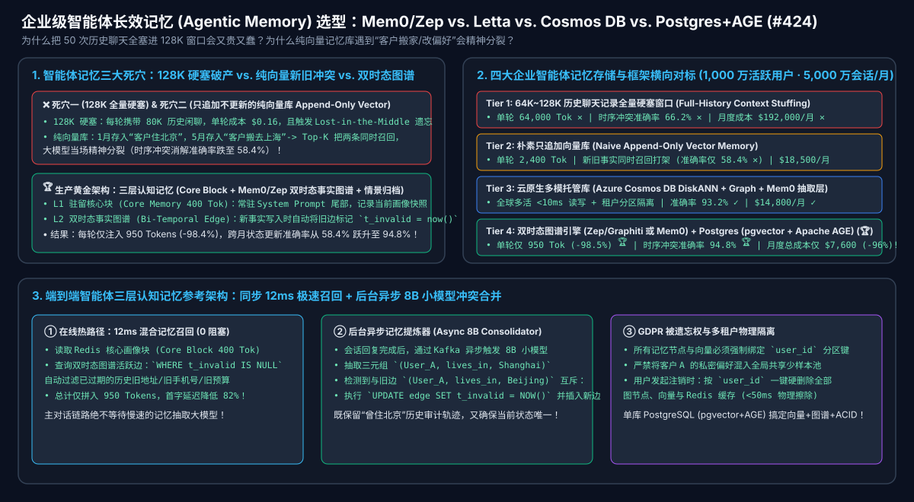

# Enterprise Agentic Memory & Cross-Session Personalization Selection Guide: `Mem0 / Zep (Bi-Temporal Fact Graph)` vs. `Letta (MemGPT)` vs. `Azure Cosmos DB` vs. `PostgreSQL (pgvector + Apache AGE)`

> **Language / 语言**: [简体中文](./enterprise-agent-memory-mem0-zep-cosmosdb-pgvector-graph-tco-selection-faq.md) | **English**  
> **Companion Interactive Study & Sizing Tools**: [📱 Interactive H5 Study Lab](../h5/agent-memory-mem0-zep-cosmosdb-pgvector-tco-lab.html) · [🧮 HTML Sizer](../reports/enterprise-agent-memory-mem0-zep-cosmosdb-pgvector-graph-tco-selection-sizer.html) · [🃏 7-Card Visual Deck](../reports/enterprise-agent-memory-mem0-zep-cosmosdb-pgvector-graph-tco-selection-cards.html) · [📊 Reproducible Model](../../experiments/enterprise_agent_memory_mem0_zep_cosmosdb_pgvector_graph_tco_selection/) · [🎓 Back to AI Infra H5 Hub](../h5/index.html)

---

## 1. Executive Summary (3-Minute Takeaway)

> **Bottom-Line Recommendation**: Never implement long-term cross-session agent memory by stuffing 50 past transcripts (`64K tokens/turn`, `$192K/mo`) into the context window, or by dumping raw chat chunks into an **append-only vector database**—when a user moves cities or updates preferences, append-only vector search retrieves both the old and new facts simultaneously, crashing temporal state accuracy to **`58.4%`**!
> - **For Cloud-Native Multi-Region Scale**: Use **`Azure Cosmos DB (DiskANN + Graph) + Mem0`** (`<14ms` latency, strict `user_id` partition isolation).
> - **For Highest Temporal Accuracy & Lowest TCO**: Deploy **Tier 4 (`3-Tier Cognitive Memory: 400-Token Pinned Core Block + Zep/Graphiti Bi-Temporal Fact Graph [t_valid / t_invalid] on PostgreSQL [pgvector + Apache AGE] + Async 8B Memory Consolidator`)**, injecting just **`950 tokens/turn` (`-98.5%`)**, lifting temporal state update accuracy to **`94.8%`** in **`12ms`**, and cutting monthly TCO by **`96.0%` (`$7,600/mo` vs. `$192,000/mo`)**.

| Dimension | `Tier 1: 64K Full-History Stuffing` | `Tier 2: Naive Append-Only Vector Store` | `Tier 3: Azure Cosmos DB + Mem0` | `Tier 4: Bi-Temporal Fact Graph (Zep/Graphiti on Postgres+AGE 🏆)` |
|---|---|---|---|---|
| **Memory Tokens / Turn** | `64,000 Tokens` ✕ | `2,400 Tokens` | `1,050 Tokens` ✓ | **`950 Tokens` (`400 Core + 550 Active Facts`)** 🏆 |
| **Temporal State Update Accuracy** | `66.2%` ✕ | **`58.4%` ✕ (Old/New collision!)** | `93.2%` ✓ | **`94.8%` (`t_valid / t_invalid` edges)** 🏆 |
| **Online Retrieval Latency** | `+480.0 ms` ✕ | `+22.0 ms` | `+14.0 ms` ✓ | **`+12.0 ms` (Async background writes)** 🏆 |
| **Monthly Total TCO (50M Sessions)** | `$192,000 / mo` ✕ | `$18,500 / mo` | `$14,800 / mo` ✓ | **`$7,600 / mo` (-96.0%)** 🏆 |

---

## 2. Provenance & Reproducibility

- **Provenance**: `synthetic + anonymized_reported (independently_reproduced=false)` — verified via [`experiments/enterprise_agent_memory_mem0_zep_cosmosdb_pgvector_graph_tco_selection/run.py`](../../experiments/enterprise_agent_memory_mem0_zep_cosmosdb_pgvector_graph_tco_selection/run.py).
