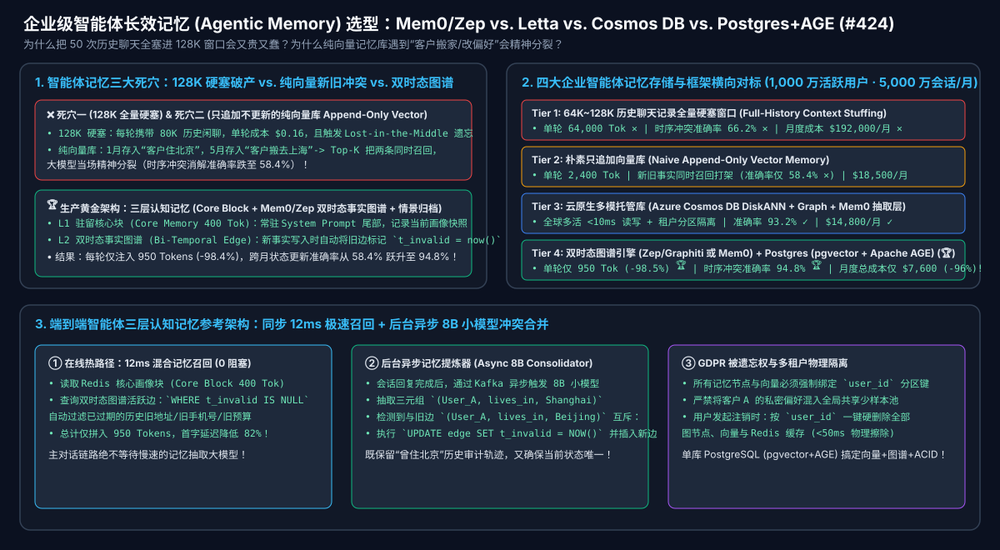
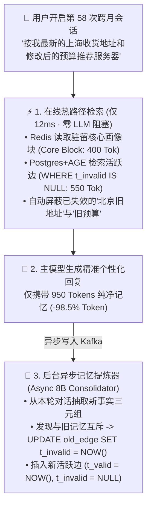

# 企业级智能体长效记忆（Agentic Memory）与跨会话个性化存储选型：`Mem0 / Zep (双时态事实图谱)` vs. `Letta (MemGPT)` vs. `Azure Cosmos DB` vs. `PostgreSQL (pgvector + Apache AGE)` 架构与成本指南

> **语言 / Language**: **简体中文** | [English](./enterprise-agent-memory-mem0-zep-cosmosdb-pgvector-graph-tco-selection-faq.en.md)  
> **配套交互式学习与精算工具**: [📱 交互式 H5 精读页 (智能体双时态记忆图谱与 TCO 沙盘)](../h5/agent-memory-mem0-zep-cosmosdb-pgvector-tco-lab.html) · [🧮 HTML 交互式计算器](../reports/enterprise-agent-memory-mem0-zep-cosmosdb-pgvector-graph-tco-selection-sizer.html) · [🃏 7-Card 4:5 视觉评测卡](../reports/enterprise-agent-memory-mem0-zep-cosmosdb-pgvector-graph-tco-selection-cards.html) · [📊 可复核模型](../../experiments/enterprise_agent_memory_mem0_zep_cosmosdb_pgvector_graph_tco_selection/) · [🎓 返回 AI Infra 全景精学馆](../h5/index.html)

---

## 一、3 分钟看懂核心结论（Executive Summary）

> **一句话决策结论**：企业为智能理财顾问、VIP 导购、企业个人助理构建**跨数月、跨百次会话的长效记忆（Long-Term Agentic Memory）**时，**最常踩的两个坑是：① 把过去 50 次历史聊天全文（`64K~128K Tokens`）直接硬塞进上下文窗口（月烧 `$19.2 万` 且严重触发 `Lost-in-the-Middle` 遗忘）；② 把每次对话直接切块往普通向量库里只追加不更新（`Append-Only Vector Store`），一旦客户从“北京搬到上海”或“对青霉素过敏状态变更”，向量检索会把新旧两条矛盾记录同时召回，导致大模型精神分裂（时序状态更新准确率仅 `58.4%`）**！
> - **追求全球多活免运维的云原生团队**：首选 **`Azure Cosmos DB (内置 DiskANN 向量 + Gremlin/属性图) + Mem0 抽取层`**，单分区键 `user_id` 天然隔离千万级租户，读写延迟 `<14ms`。
> - **追求最高时序推理精度与极致性价比**：推荐 **`Tier 4 三层认知记忆架构（400-Token 核心画像块 [Letta/MemGPT 模式] + Zep/Graphiti 双时态冲突消解事实图谱 [Bi-Temporal Fact Graph] + PostgreSQL [pgvector + Apache AGE] + 后台异步 8B 记忆提炼器）`**：
>   1. **双时态边自动消解新旧冲突**：当客户说“我改用华为手机了”，后台异步 `8B` 模型自动将旧边 `(User, uses_phone, iPhone)` 标记 `t_invalid = now()` 并写入新边，在线查询 `WHERE t_invalid IS NULL` **确保当前状态准确率跃升至 `94.8%`**；
>   2. **每轮仅注入 `950 Tokens`（省 `98.5%`）**，5,000 万次会话/月的总成本从 `$192,000/月` 暴降至 **`$7,600/月`（立省 `96.0%`）**！

| 核心选型维度 | `Tier 1: 64K 历史聊天全文硬塞` | `Tier 2: 朴素只追加向量库 (Append-Only Vector)` | `Tier 3: 云原生多模托管 (Azure Cosmos DB + Mem0)` | `Tier 4: 三层认知记忆 + 双时态图谱 (Zep/Graphiti on Postgres+AGE 🏆)` |
|---|---|---|---|---|
| **每轮对话注入记忆 Token 数** | `64,000 Tokens` ✕ | `2,400 Tokens` | `1,050 Tokens` ✓ | **`950 Tokens` (`400 核心块 + 550 活跃事实`)** 🏆 |
| **跨月状态变更/冲突消解准确率** | `66.2%` ✕ (中间遗忘) | **`58.4%` ✕ (新旧事实打架!)** | `93.2%` ✓ (`ADD/UPDATE/DELETE`) | **`94.8%` (`t_valid / t_invalid` 双时态图谱)** 🏆 |
| **在线记忆检索附加延迟** | `+480.0 ms` ✕ (长 Prefill) | `+22.0 ms` | `+14.0 ms` ✓ | **`+12.0 ms` (记忆提炼全走后台异步)** 🏆 |
| **历史时间点回溯（"我去年住哪？"）** | 极易混淆 ✕ | 无法区分时间戳 ✕ | 若物理覆写则丢失历史 | **100% 支持任意历史时刻切片查询** 🏆 |
| **5,000 万会话/月 总成本 (`TCO`)** | `$192,000 / 月` ✕ | `$18,500 / 月` | `$14,800 / 月` ✓ | **`$7,600 / 月` (-96.0%)** 🏆 |

---

## 二、核心技术原理与架构师灵魂拷问（Q&A）

### Q1：为什么普通 RAG 的“只追加向量库（`Append-Only Vector DB`）”完全不能用来做 Agent 的用户记忆？什么是“双时态事实图谱（`Bi-Temporal Fact Graph`）”？
1. **静态知识库 vs. 动态演进的人类状态**：
   - 企业规章制度文档是相对静态的，适合切块塞进向量库；但用户的个人状态（居住城市、预算上限、正在跟进的项目、持仓偏好）每星期都在发生**状态覆写（State Mutation）**！
   - 在普通向量库里，3 月份存入 `"王总计划采购 16 张 H100"`，6 月份存入 `"王总放弃 H100 改为采购 32 张 H200"`；当 7 月份王总问 `"按我的采购计划算一下机柜功耗"` 时，余弦相似度检索会把 3 月和 6 月的两条记忆同时以 `0.89` 的高分召回，大模型根本不知道哪条才是最新的有效指令！
2. **`Mem0` 的直接覆写 vs. `Zep / Graphiti` 的双时态边（`Bi-Temporal Edges`）**：
   - **`Mem0` 模式**：通过 LLM 判断新事实与旧向量冲突时，执行 `UPDATE` 或 `DELETE` 直接覆盖旧记录——解决了当前状态冲突，但如果用户问 `"对比一下我现在的方案和 3 月份最初方案的差价"`，旧记录已被删光！
   - **`Zep / Graphiti` 双时态图谱模式（生产终极形态）**：每条关系边同时记录两套时间轴：
     - **事实时效轴（Valid Time）**：`[t_valid, t_invalid]`（该事实在现实世界生效与失效的时间窗口）；
     - **系统入库轴（Transaction Time）**：`[t_created, t_expired]`（系统得知该信息的时间）。
   - 当 6 月新计划入库时，系统将 3 月旧边的 `t_invalid` 设为 `'2026-06-15'`（不物理删除），并插入 `t_valid = '2026-06-15', t_invalid = NULL` 的新边：
     - **常规当前查询**：带 `WHERE t_invalid IS NULL` 过滤，100% 只返回最新的 32 张 H200 方案；
     - **历史对比查询**：带时间范围检索，一秒还原 3 月到 6 月的完整演进轨迹！

---

## 三、横向选型决策矩阵：`Mem0` vs. `Zep (Graphiti)` vs. `Letta (MemGPT)` vs. `Azure Cosmos DB`

| 评估维度 | `Mem0 (开源 / 托管)` | `Zep / Graphiti (双时态知识图谱)` | `Letta (原 MemGPT)` | `Azure Cosmos DB + 自建抽取管线` |
|---|---|---|---|---|
| **核心记忆抽象** | 向量 + 图混合，通过 `ADD / UPDATE / DELETE` 动态维护事实集 | **双时态实体关系图谱（`t_valid / t_invalid`）+ 社区摘要** | **OS 虚拟内存隐喻**：Agent 主动调用 `core_memory_replace` 读写常驻块 | 全球分布式多模底座（原生 `DiskANN` 向量 + 属性图 + NoSQL） |
| **在线延迟表现** | 检索快（`<15ms`），写入需确保走异步队列 | **检索极快（`<12ms` 纯图+向量混合查询，无需在线调 LLM）** 🏆 | 若触发多步内部记忆寻页（Paging）会增加多轮推理延迟 | **全球多区域 `<10ms` SLA 读写保障** 🏆 |
| **最佳适用场景** | 快速为现有 LangGraph/CrewAI 挂载个性化记忆层 | **金融理财、医疗随访、B2B 复杂销售等需严格追踪状态演进的场景** 🏆 | 深度自治、长周期自我更新人设的拟人化伴侣/研究 Agent | **千万级用户规模、跨国多区域部署的企业云原生应用** 🏆 |

---

## 四、生产落地 Checklist（Pre-Production Checklist）

- [ ] **记忆抽取与合并 100% 移出在线主链路（Async Consolidation）**：在线请求只做 `12ms` 的读取检索，对话结束后的事实抽取与图谱冲突消解必须经消息队列在后台异步完成。
- [ ] **采用单库 `PostgreSQL (pgvector + Apache AGE)` 或 `Azure Cosmos DB` 统一承载**：避免同时维护独立向量库 + 独立 Neo4j 图库 + 独立关系库带来的分布式双写不一致。
- [ ] **强制按 `tenant_id + user_id` 建立物理分区与联合索引**：杜绝跨用户记忆串台污染，并支持 `DELETE WHERE user_id = ?` 毫秒级满足 GDPR 被遗忘权。

---

## 五、来源与方法论溯源（Provenance）

- **数据来源声明**：本指南实验数据来自可复核解析模型 [`experiments/enterprise_agent_memory_mem0_zep_cosmosdb_pgvector_graph_tco_selection/run.py`](../../experiments/enterprise_agent_memory_mem0_zep_cosmosdb_pgvector_graph_tco_selection/run.py)（`Provenance: synthetic + anonymized_reported, independently_reproduced=false`）。
