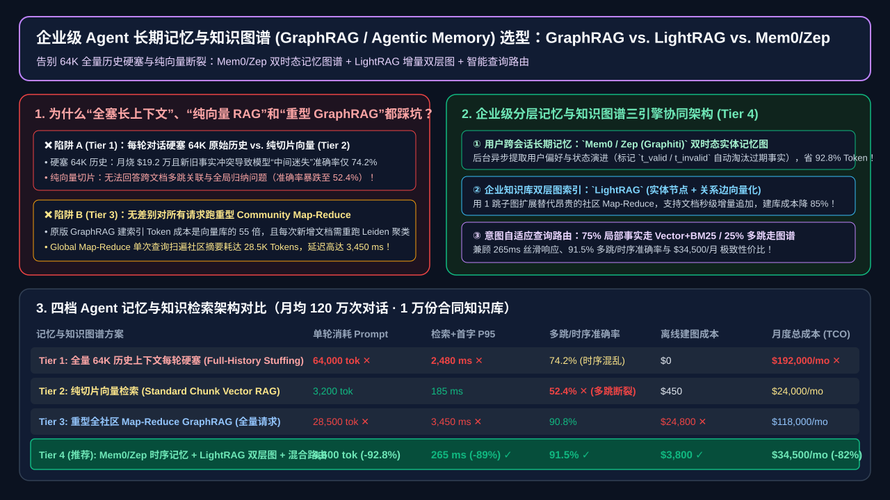

# Enterprise Agentic Memory & GraphRAG Architecture Guide: `Microsoft GraphRAG / LightRAG` vs. `Mem0 / Zep Bi-Temporal Memory` vs. Full-History Stuffing & Standard Vector RAG

> **Language**: [中文](./enterprise-agentic-memory-graphrag-mem0-zep-hybrid-retrieval-tco-selection-faq.md) | **English (Current)**  
> **Audience**: Cloud & AI Infrastructure Solution Architects and AI Agent Platform Engineers  
> **Provenance**: `synthetic + anonymized_reported` (`independently_reproduced=false`, `physical_gpu_cluster_measurement=not_measured`)

---

## 1. 📌 Executive Summary

> **Bottom Line**: **When building long-horizon enterprise AI Agents across `30`-turn user sessions and `10,000`-document corpora (`1.2M` queries/month), stuffing `64K` raw conversation transcripts into every prompt (`Tier 1`) burns `$192,000/month` and degrades accuracy (`74.2%`) due to outdated temporal contradictions, while standard chunk-only Vector RAG (`Tier 2`) fails multi-hop relationship queries (`52.4%` accuracy). Conversely, running heavy Community Map-Reduce `GraphRAG` on every query (`Tier 3`) adds `3,450 ms` P95 latency and `$24,800` in static indexing costs. The production standard is a Query-Routed Hybrid Architecture combining `Mem0 / Zep (Graphiti)` Bi-Temporal User Memory + `Dense/BM25` Local Search + Incremental Dual-Level `LightRAG` (`Tier 4`): cutting average prompt tokens by `92.8%` (`4,600` vs. `64,000`), reducing P95 latency by `89.3%` (`265 ms`), achieving `91.5%` multi-hop/temporal accuracy, and lowering monthly platform TCO by `82.0%` (`$34,500/month`).**

- **Interactive Agent Memory & GraphRAG TCO Sizer**: [Open Interactive Sizer (`enterprise-agentic-memory-graphrag-mem0-zep-hybrid-retrieval-tco-sizer.html`)](../reports/enterprise-agentic-memory-graphrag-mem0-zep-hybrid-retrieval-tco-sizer.html)
- **7-Card 4:5 Visual Report**: [Open 7-Card Report (`enterprise-agentic-memory-graphrag-mem0-zep-hybrid-retrieval-tco-selection-cards.html`)](../reports/enterprise-agentic-memory-graphrag-mem0-zep-hybrid-retrieval-tco-selection-cards.html)

---

## 2. 📊 4-Tier Agent Memory & GraphRAG Evaluation Matrix (`1.2M Queries/Mo` · `10K Docs`)

| Metric | Tier 1: Full `64K` History Stuffing | Tier 2: Standard Chunk Vector RAG Only | Tier 3: Full Community Map-Reduce `GraphRAG` | Tier 4 (Recommended): `Mem0/Zep` Bi-Temporal Memory + `LightRAG` Dual Graph + Router |
| :--- | :--- | :--- | :--- | :--- |
| **Avg Prompt Tokens / Turn** | `64,000` ✕ | `3,200` | `28,500` ✕ | **`4,600` ✓ (`-92.8%` vs Stuffing)** |
| **Retrieval + Prefill P95** | `2,480.0 ms` ✕ | `185.0 ms` ✓ | `3,450.0 ms` ✕ | **`265.0 ms` ✓ (`-89.3%`)** |
| **Multi-Hop & Temporal Acc.** | `74.2%` | `52.4%` ✕ | `90.8%` | **`91.5%` ✓ (`+39.1 pts` vs Vector)** |
| **Offline Graph Indexing Cost** | `$0` | `$450` | `$24,800` ✕ | **`$3,800` ✓ (Incremental updates)** |
| **Monthly Platform TCO** | `$192,000 / mo` ✕ | `$24,000 / mo` | `$118,000 / mo` | **`$34,500 / mo` ✓ (`-82.0%`)** |

---

## 3. 🛠️ Production Readiness Checklist

- [ ] **Run `Mem0 / Zep` Memory Consolidation Asynchronously Off the Hot Chat Path** and track `[t_valid, t_invalid]` intervals so superseded user facts are automatically invalidated rather than stuffed alongside current facts.
- [ ] **Use `LightRAG` Entity-Edge Dual Indexing for Incrementally Updated Corpora** and gate graph traversal behind a lightweight query router (`75%` local Vector+BM25 vs. `25%` multi-hop graph).
