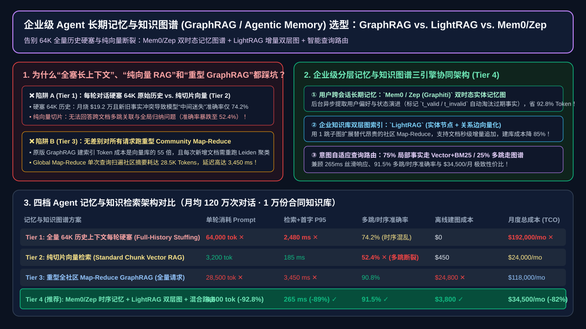
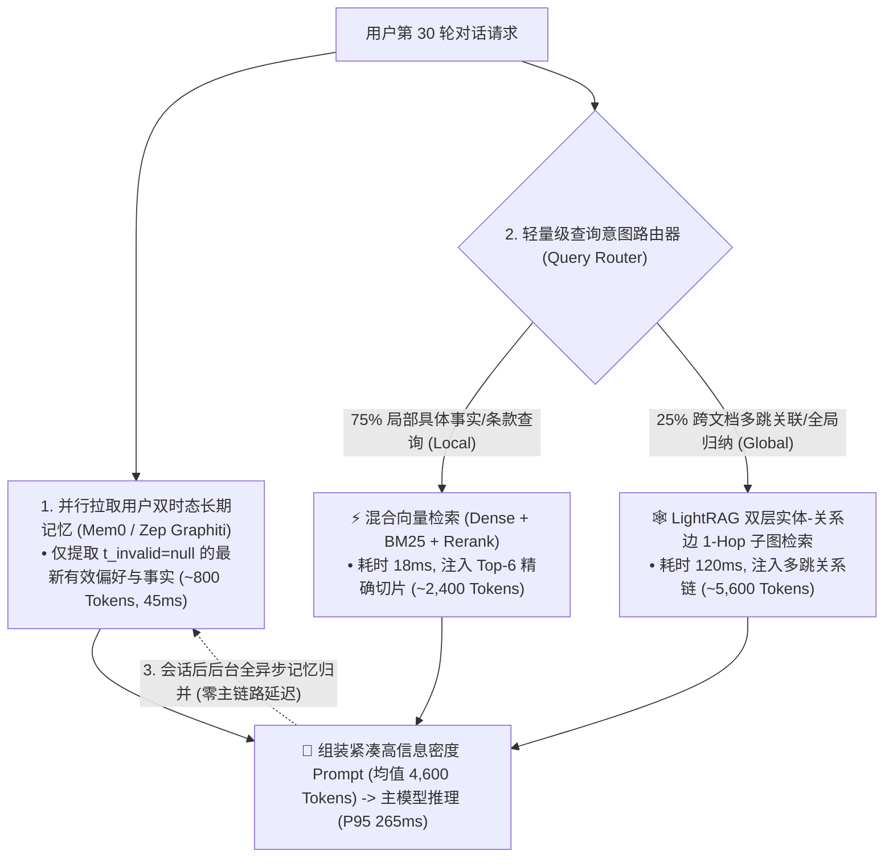

# 企业级 Agent 长期记忆与知识图谱增强（GraphRAG / Agentic Memory）选型：`Microsoft GraphRAG / LightRAG` vs. `Mem0 / Zep 时序记忆图谱` vs. 全量长上下文硬塞与标准向量 RAG 成本延迟指南

> **语言 / Language**: **中文 (当前)** | [English](./enterprise-agentic-memory-graphrag-mem0-zep-hybrid-retrieval-tco-selection-faq.en.md)  
> **定位**：面向 Cloud & AI Infrastructure Solution Architect 与企业 Agent 平台架构师的跨会话长期记忆（`Mem0`、`Zep / Graphiti` 双时态知识图谱）、多跳全局知识图谱检索（`Microsoft GraphRAG` vs. `LightRAG` 双层实体-边向量化）与长上下文硬塞（`64K/128K` Context Stuffing）TCO 拐点白皮书  
> **合规与来源声明**：`synthetic + anonymized_reported`（`independently_reproduced=false`，`physical_gpu_cluster_measurement=not_measured`；完全面向通用企业级 AI Agent 长期记忆与复杂知识库架构设计）

---

## 1. 📌 核心选型结论速览（Executive Summary）

> **一句话结论**：**在构建需要记住用户数月交互历史（跨会话长期记忆）并洞察上万份企业文档隐藏关联（多跳全局推理）的智能体时，架构师常掉入三大极端陷阱：① 每轮对话直接把 `64K` 历史记录硬塞进长上下文窗口（Tier 1，月烧 `$19.2 万`，且新旧过期事实混杂导致准确率仅 `74.2%`）；② 只用纯切片向量检索（Tier 2，跨文档多跳关联完全断裂，准确率跌至 `52.4%`）；③ 对所有在线请求无差别运行重型社区 `Map-Reduce GraphRAG`（Tier 3，建库成本暴增 `55 倍`，单次查询延迟高达 `3,450 ms`）！生产环境最优解是采用“三层混合路由记忆与图谱架构（`Mem0/Zep` 双时态用户记忆 + `Vector/BM25` 局部事实 + `LightRAG` 增量双层实体-关系边图谱，Tier 4）”：将单轮平均消耗 Prompt Token 从 `64,000` 骤降至 **`4,600`（立省 `92.8%`）**、P95 延迟从 `2,480 ms` 压至 **`265 ms`**、多跳与时序准确率提升至 **`91.5%`**，月度平台总 TCO 降低 **`82.0%`（`$34,500/月`）**！**

- **交互式 Agent 记忆与 GraphRAG 成本延迟计算器**：[打开交互式计算器 (`enterprise-agentic-memory-graphrag-mem0-zep-hybrid-retrieval-tco-sizer.html`)](../reports/enterprise-agentic-memory-graphrag-mem0-zep-hybrid-retrieval-tco-sizer.html)
- **7-Card 4:5 视觉评测报告**：[打开 7-Card 报告 (`enterprise-agentic-memory-graphrag-mem0-zep-hybrid-retrieval-tco-selection-cards.html`)](../reports/enterprise-agentic-memory-graphrag-mem0-zep-hybrid-retrieval-tco-selection-cards.html)

---

## 2. 🎯 客户与架构师灵魂拷问 Q&A（Deep-Dive Architecture FAQ）

### Q1：既然现在大模型都支持 `128K ~ 1M` 上下文了，为什么不能直接把用户历史对话全塞进 Prompt，而要用 `Mem0 / Zep`？
1. **成本与延迟的二次方惩罚**：即便有 Prefix Caching，一个跨 30 个 Session 的老用户历史记录动辄 `64K Tokens`；每天跨节点唤醒会话时，每轮都带着 `64K` 历史跑推理，月度账单高达 `$192,000`（是结构化记忆的 **5.5 倍**）。
2. **更致命的“新旧事实冲突（Temporal Contradiction）”**：用户在第 3 轮说“我在西雅图工作”，在第 18 轮说“我刚搬到奥斯汀了”。如果把全量原始记录塞给大模型，模型经常发生中间迷失（Lost-in-the-Middle）把旧地址当成当前地址！
3. **`Mem0 / Zep (Graphiti)` 的双时态图谱解法**：在每轮对话结束后，由后台异步小模型提取实体关系边并打上双时间戳 `[t_valid, t_invalid]`（将旧边“居住在西雅图”标记为 `t_invalid = Turn 18`），下一轮检索时只向 Prompt 注入 **`~800 Tokens`** 当前有效子图，既省下 `92.8%` Token，又彻底消灭新旧事实打架！

### Q2：在企业文档知识图谱上，什么时候选原版 `Microsoft GraphRAG`，什么时候选 `LightRAG`？
- **原版 `Microsoft GraphRAG`（基于 Leiden 社区层级摘要 + Global Map-Reduce）**：适合静态语料的“全库宏观综述”（如“总结这 1 万份研报的五大行业趋势”），但**不支持低成本增量更新**（每新增几百篇文档就要重跑全局 Leiden 图聚类），且在线 Map-Reduce 需并发调用数十次 LLM（耗时 `3.45s`）。
- **`LightRAG`（双层实体节点 + 关系边向量索引 + 1 跳子图扩展）**：直接将提取出的“实体节点（Entity）”与“关系边描述（Edge Key-Value）”存入向量库与图库；新文档到达时**直接秒级增量插入节点和边（无需重算全局社区，建库成本省 `85%`）**，在线查询时通过向量直接定位高层关系边 + 局部 1 跳邻居，在 **`480 ms`** 内即可完成跨文档多跳推理！

---

## 3. 🧭 直观可视化图解（Mermaid 企业 Agent 记忆与双层图谱混合路由架构）

---

## 4. 📊 架构师多方案选型决策矩阵（月均 `120 万次`请求 · `10,000` 份合同文档）

| 评估维度 | Tier 1：全量 `64K` 历史每轮硬塞 | Tier 2：纯切片向量检索 (`Vector RAG`) | Tier 3：重型全社区 `Map-Reduce GraphRAG` | Tier 4（推荐）：`Mem0/Zep` 时序记忆 + `LightRAG` 双层图 + 混合路由 |
| :--- | :--- | :--- | :--- | :--- |
| **单轮平均消耗 Prompt Tokens** | `64,000 Tokens` ✕ | `3,200 Tokens` | `28,500 Tokens` ✕ | **`4,600 Tokens` ✓（比硬塞省 `92.8%`）** |
| **检索 + 首字 `P95` 延迟** | `2,480.0 ms` ✕ | `185.0 ms` ✓ | `3,450.0 ms` ✕（Map-Reduce 慢） | **`265.0 ms` ✓（降低 `89.3%`）** |
| **多跳推理与时序记忆准确率** | `74.2%`（新旧事实混淆） | `52.4%` ✕（多跳关系断裂） | `90.8%` | **`91.5%` ✓（提升 `+39.1 pts` vs 纯向量）** |
| **1 万份文档离线建图成本** | `$0` | `$450` | `$24,800` ✕（重聚类极贵） | **`$3,800` ✓（支持秒级增量追加）** |
| **月度平台总成本 (TCO)** | `$192,000 / 月` ✕ | `$24,000 / 月` | `$118,000 / 月` | **`$34,500 / 月` ✓（比硬塞省 `82.0%`）** |

---

## 5. 🛠️ 架构评审与生产落地 Checklist

- [ ] **记忆写入必须 100% 异步化（Async Background Memory Consolidation）**：用户对话完成下发 SSE 后，通过消息队列异步触发 `Mem0 / Zep` 提取事实并更新时序图谱，绝不阻塞当前对话轮次的响应时间。
- [ ] **离线建图抽取统一使用 `7B / 8B FP8` 本地微调小模型（或 Batch API）**：切勿用昂贵的旗舰闭源商业 API 去跑上万篇文档的实体关系三元组抽取！
