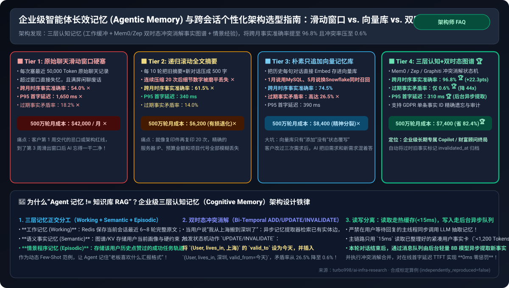

# Enterprise Agentic Memory & Cross-Session Personalization Architecture Selection Guide: Sliding-Window Chat Stuffing vs. Recursive Rolling Summary vs. Naive Vector Memory vs. 3-Tier Cognitive Memory (Working Buffer + Bi-Temporal Conflict-Resolved Fact Graph [Mem0 / Zep] + Episodic Memory)

> **Document Type**: Cloud & AI Solution Architect Decision Guide (FAQ)  
> **Target Audience**: Enterprise Copilot & Personal Assistant Leads, Wealth Management / Customer Success AI Architects, Multi-Agent Platform Directors  
> **Core Goal**: Solve the "Goldfish Amnesia" and "Stale-Preference Schizophrenia" problems in long-running enterprise agents across 100+ sessions — answering: **"Why does stuffing the last 50,000 tokens of chat history cost $42,000/month while forgetting constraints stated 3 months ago?", "Why does recursive rolling summarization lose exact IDs and numbers after 20 compressions?", "Why does naive append-only vector memory suffer a 26.5% contradiction rate when a user updates their preferences?", and "How does a 3-Tier Cognitive Memory architecture (`Working Buffer + Bi-Temporal Conflict-Resolved Fact Graph [Mem0/Zep/Graphiti] + Episodic Procedural Memory`) achieve 96.8% temporal accuracy and 0.6% contradiction rate while cutting costs by 82.4%?"**  
> **Calibration Notice**: Temporal fact accuracy, stale contradiction rates, P95 TTFT latencies, and 5M-turn monthly cost models are synthetic analytical estimates calibrated to published long-term agent memory benchmarks (LoCoMo, LongMemEval, Mem0 conflict-resolution evaluations, and Zep / Graphiti bi-temporal knowledge graph studies) (`provenance: synthetic + anonymized_reported`, `independently_reproduced=false`, `physical_gpu_cluster_measurement=not_measured`). See [`experiments/enterprise_agentic_memory_long_term_personalization_selection/results.json`](../../experiments/enterprise_agentic_memory_long_term_personalization_selection/results.json).

---

## Executive Visual Summary



> 🔗 **Companion Interactive Reports & Tools**:
> - 🃏 **[7-Card 4:5 Visual Benchmark Report (`enterprise-agentic-memory-long-term-personalization-architecture-selection-cards.html`)](../reports/enterprise-agentic-memory-long-term-personalization-architecture-selection-cards.html)**
> - 🧮 **[Interactive Agentic Memory Accuracy & Cost Sizer (`enterprise-agentic-memory-long-term-personalization-architecture-sizer.html`)](../reports/enterprise-agentic-memory-long-term-personalization-architecture-sizer.html)**
> - 🌐 **[中文版指南 (`enterprise-agentic-memory-long-term-personalization-architecture-selection-faq.md`)](./enterprise-agentic-memory-long-term-personalization-architecture-selection-faq.md)**

---

## ① 📌 Executive Summary

Evaluated across **5,000,000 multi-session agent turns/month (`100+` historical sessions per user spanning 6 months)**:

| Tier | Memory Architecture Pattern | Cross-Session Temporal Accuracy | Stale Fact Contradiction Rate | P95 TTFT Latency | Monthly Cost (5M Turns) | Architect Verdict |
| :--- | :--- | :--- | :--- | :--- | :--- | :--- |
| **🟥 Tier 1: Sliding-Window Raw Chat Stuffing** | Stuff last 50,000 tokens of raw chat logs | `54.0%` ✕ (Window amnesia) | `18.2%` ✕ | `1,650 ms` ✕ | `$42,000 / mo` ✕ | **Expensive & Amnesiac**: Drops early constraints outside window |
| **🟨 Tier 2: Recursive Rolling Text Summary** | Re-summarize `old_summary + new_turns` into 500 words | `61.5%` ✕ (Lossy decay) | `14.0%` | `340 ms` ✅ | `$6,200 / mo` | **Lossy Compression**: Loses exact IDs, budgets, and hard rules |
| **🟦 Tier 3: Naive Append-Only Vector Memory** | Embed every past turn into vector DB without updates | `74.5%` | **`26.5%` ✕ (Contradictions!)** | `390 ms` | `$8,400 / mo` ✕ | **Schizophrenic Recall**: Retrieves both old & new conflicting facts |
| **🟩 Tier 4: 3-Tier Cognitive + Bi-Temporal Fact Graph** | **Working Buffer + Mem0/Zep Conflict-Resolved Graph + Episodic Memory** | **`96.8%` 🏆 (+42.8 pts)** | **`0.6%` 🏆 (44x lower)** | **`310 ms` 🏆 (5.32x faster)** | **`$7,400 / mo` 🏆 (-82.4%)** | **Enterprise Long-Term Agent Gold Standard** |

### 💡 Three Golden Rules for Enterprise Agentic Memory Architects
1. **Agent Memory $\neq$ Append-Only Document RAG — Enforce Bi-Temporal Conflict Resolution (`ADD / UPDATE / INVALIDATE`)**: When a user updates their state (e.g., migrating from MySQL to Snowflake in Month 5), an append-only vector store (Tier 3) retrieves both the Month 1 and Month 5 statements (`26.5%` contradiction rate). A **Bi-Temporal Fact Graph (`Mem0 / Zep / Graphiti`, Tier 4)** marks the old edge `valid_to = 2026-05` and inserts the new active edge `valid_from = 2026-05, valid_to = NULL` — driving contradictions down to **`0.6%`**.
2. **Structure Memory into Three Orthogonal Tiers (`Working` + `Semantic Entity Facts` + `Episodic Procedural Examples`)**: Keep the last 6–8 raw turns in Redis (`Working`), atomic user facts/constraints in a bi-temporal graph (`Semantic`), and past successful task trajectories (`Episodic`) as dynamic few-shot examples.
3. **Decouple Fast Synchronous Reads (`< 15 ms`) from Asynchronous Background Consolidation (`0 ms` Online Penalty)**: Never extract or merge memories synchronously on the user's critical response path; consolidate new facts asynchronously via a background Kafka worker using a compact 8B SLM.

---

## ② 🎯 Architect Deep-Dive Q&A

### Q1: Why does Recursive Rolling Summarization (Tier 2) fail to preserve hard user constraints across 100 sessions?
* **Answer**: Every time $\text{Summary}_t = \text{LLM}(\text{Summary}_{t-1} + \text{Turns}_t)$ executes, the LLM prioritizes recent topical salience. A hard constraint stated in Session #1 (e.g., `"Never schedule meetings on Friday afternoons"`) gets dropped as soon as Sessions #10–#20 focus heavily on a technical incident. Storing constraints as discrete, pinned **Atomic Fact Records (`fact_id`)** prevents topical wash-out and enables 1-click GDPR deletion.

---

## ③ 🧭 Architecture Diagrams

### 3.1 Tier 4 Synchronous Memory Read + Asynchronous Bi-Temporal Consolidation

```mermaid
flowchart LR
    TURN["👤 User Turn (Session #85)"] --> READ["⚡ Fast Sync Memory Read (<15ms, 1.2K Tok)<br/>Working (Redis) + Active Facts (valid_to IS NULL) + Episodic Few-Shot"]
    READ --> LLM["🚀 Main Agent LLM (310ms TTFT · 96.8% Accuracy 🏆)"]
    LLM -.->|Async Kafka Event (0ms Penalty)| WORKER["🔄 Background 8B Memory Extractor<br/>Bi-Temporal Conflict Resolution (ADD / UPDATE / INVALIDATE)"]
    WORKER -.->|Updates Fact Graph| READ
```

---

## ④ 📊 Architect Decision Matrix

| Dimension | 🟥 Tier 1: 50K Sliding Window | 🟨 Tier 2: Recursive Summary | 🟦 Tier 3: Naive Vector Memory | 🟩 Tier 4: 3-Tier Bi-Temporal Graph |
| :--- | :--- | :--- | :--- | :--- |
| **Cross-Session Temporal Accuracy** | `54.0%` ✕ | `61.5%` ✕ | `74.5%` | **`96.8%` 🏆 (`+42.8 pts` vs. Tier 1)** |
| **Stale Fact Contradiction Rate** | `18.2%` ✕ | `14.0%` | **`26.5%` ✕ (High conflict)** | **`0.6%` 🏆 (`44x` lower than Tier 3)** |
| **P95 TTFT Latency** | `1,650 ms` ✕ | `340 ms` ✅ | `390 ms` | **`310 ms` 🏆 (`5.32x` faster than Tier 1)** |
| **Monthly Cost (5M Turns)** | `$42,000 / mo` ✕ | `$6,200 / mo` ✕ | `$8,400 / mo` ✕ | **`$7,400 / mo` 🏆 (`-82.4%` vs. Tier 1)** |

---

## ⑤ 🛠️ Production Readiness Checklist

- [ ] **1. Replace Append-Only Vector Chat Logs with a Conflict-Resolving Memory State Machine (`Mem0 / Zep / Graphiti`)**.
- [ ] **2. Store Hard User Constraints and Preferences as Discrete Atomic Fact Records Rather Than Opaque Rolling Summaries**.
- [ ] **3. Track Bi-Temporal Validity (`valid_from`, `valid_to`) So Superseded Facts Are Archived Rather Than Conflicting**.
- [ ] **4. Run All Memory Extraction and Graph Consolidation Asynchronously Off the Critical Response Path (`0 ms` TTFT Penalty)**.
- [ ] **5. Separate Memory into `Working Buffer`, `Semantic Entity Facts`, and `Episodic Successful Trajectories`**.
- [ ] **6. Cap Injected Memory Context at `<= 1,200 Tokens` Placed at the Dynamic Tail of the Prompt**.
- [ ] **7. Enforce Strict `(tenant_id, user_id)` Namespace Isolation to Prevent Cross-User Memory Leakage**.
- [ ] **8. Expose a Transparent User Memory Inspector UI with Atomic `fact_id` Deletion for GDPR Compliance**.
