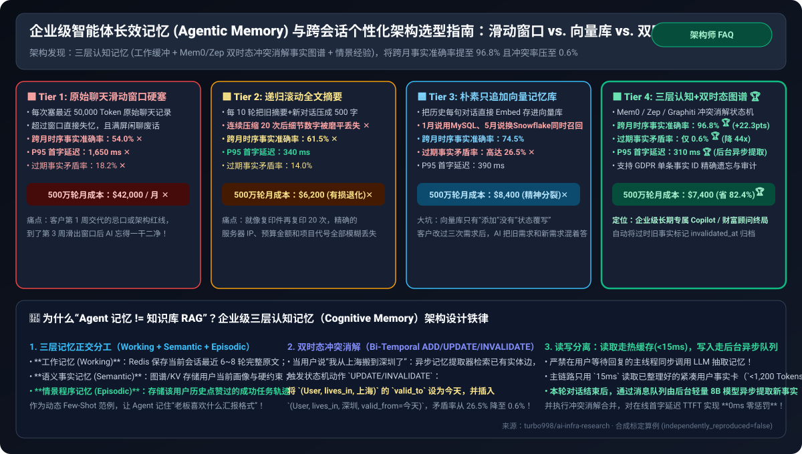
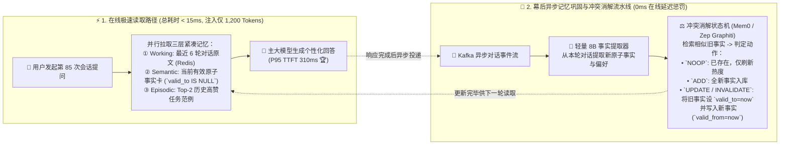
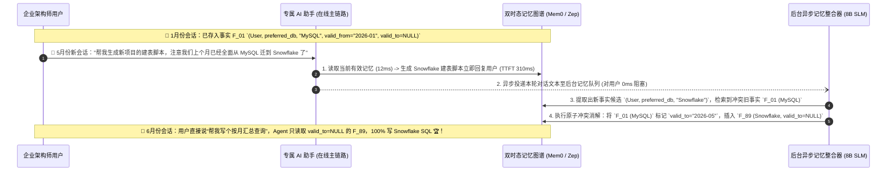

# 企业级智能体长效记忆（Agentic Memory）与跨会话个性化状态管理架构选型指南：原始聊天滑动窗口硬塞 vs. 递归滚动全文摘要 vs. 朴素只追加向量记忆库 vs. 三层认知记忆（工作缓冲 + Mem0/Zep 双时态冲突消解事实图谱 + 情景经验库）架构

> **文档类型**：企业级 AI Agent 平台与个性化应用解决方案架构师（Cloud & AI Solution Architect）选型决策指南（FAQ）  
> **适用读者**：企业级 Copilot 与智能助理产品负责人、财富管理/私人银行/客户成功 AI 架构师、多智能体平台研发总监  
> **核心目标**：用通俗、可落地的架构语言解决企业智能体在跨周、跨月长期服务同一用户时最尴尬的“金鱼失忆症”与“新旧偏好精神分裂”——系统回答：**“为什么把最近 50,000 Token 聊天记录塞进窗口（Tier 1）既贵又会忘掉三个月前的核心约束？”、“为什么做滚动全文摘要（Tier 2）压了 20 次之后，用户的精确账号和预算数字全丢了？”、“为什么把每句历史对话存进向量数据库（Tier 3）会导致 26.5% 的新旧事实冲突（比如 1 月说用 MySQL、5 月说换成了 Snowflake，AI 把俩全搜出来混着写）？”、“怎么用‘工作缓冲 + 双时态冲突消解事实图谱（Mem0 / Zep / Graphiti）+ 情景经验库’把跨月事实准确率推到 96.8% 且冲突率压到 0.6%？”**。  
> **标定声明**：本文所引用的跨月时序事实准确率、过期事实矛盾率、P95 首字延迟（TTFT）与 500 万轮月度成本模型基于公开发布的长效智能体记忆基准（LoCoMo、LongMemEval、Mem0 冲突消解记忆与 Zep / Graphiti 双时态知识图谱评测）构建的合成分析模型（`provenance: synthetic + anonymized_reported`, `independently_reproduced=false`, `physical_gpu_cluster_measurement=not_measured`），详见 [`experiments/enterprise_agentic_memory_long_term_personalization_selection/results.json`](../../experiments/enterprise_agentic_memory_long_term_personalization_selection/results.json)。

---

## 一图流总结（Executive Visual Summary）



> 🔗 **关联可交互报告与工具**：
> - 🃏 **[7-Card 4:5 视觉评测报告 (`enterprise-agentic-memory-long-term-personalization-architecture-selection-cards.html`)](../reports/enterprise-agentic-memory-long-term-personalization-architecture-selection-cards.html)**
> - 🧮 **[交互式 Agentic Memory 准确率与成本计算器 (`enterprise-agentic-memory-long-term-personalization-architecture-sizer.html`)](../reports/enterprise-agentic-memory-long-term-personalization-architecture-sizer.html)**
> - 🌐 **[English Version (`enterprise-agentic-memory-long-term-personalization-architecture-selection-faq.en.md`)](./enterprise-agentic-memory-long-term-personalization-architecture-selection-faq.en.md)**

---

## ① 📌 核心选型结论速览（Executive Summary）

许多团队误以为 **“给 Agent 加记忆 = 把历史聊天记录塞进向量库做 RAG（Tier 3）”**。这是典型的架构概念混淆！
- **文档知识库（RAG）处理的是静态客观事实**（《公司差旅制度》第 3 条不会每天自相矛盾）；
- **而智能体记忆（Agentic Memory）处理的是随时间不断演进、不断推翻旧状态的动态主观事实**（客户上个月说“预算上限 50 万”，这个月说“追加到 120 万”；上周说“正在排查 Redis 故障”，这周已经修好了）！

基于 **月均 500 万轮跨会话深度交互（单用户跨越 6 个月、累计 100+ 次历史会话）** 的基准测算，四档记忆架构对比如下：

| 架构档位 | 核心记忆存储与更新机制 | 跨月时序事实准确率 | 过期事实矛盾率 | P95 首字延迟 (TTFT) | 500万轮月成本 | 架构师拍板结论 |
| :--- | :--- | :--- | :--- | :--- | :--- | :--- |
| **🟥 Tier 1：原始聊天记录滑动窗口硬塞** | 每次拼入最近 50,000 Token 原始聊天流水账 | `54.0%` ✕ (超窗即失忆) | `18.2%` ✕ | `1,650 ms` ✕ | `$42,000 / 月` ✕ | **金鱼记忆且昂贵**：早期核心约束滑出窗口即永久遗忘 |
| **🟨 Tier 2：递归滚动全文摘要** | 每 10 轮把 `旧摘要 + 新对话` 浓缩成 500 字 | `61.5%` ✕ (细节磨平) | `14.0%` | `340 ms` ✅ | `$6,200 / 月` | **有损压缩退化**：精确数字、代码规范与ID在反复摘要中丢失 |
| **🟦 Tier 3：朴素只追加向量记忆库** | 历史每轮对话直接 Embed 存入向量库（无覆写） | `74.5%` | **`26.5%` ✕ (精神分裂)** | `390 ms` | `$8,400 / 月` ✕ | **新旧状态打架**：1月旧偏好与5月新偏好同时召回搞懵模型 |
| **🟩 Tier 4：三层认知记忆 + 双时态事实图谱** | **工作缓冲 + Mem0/Zep 冲突消解双时态图谱 + 情景经验库** | **`96.8%` 🏆 (+42.8pts)** | **`0.6%` 🏆 (降44x)** | **`310 ms` 🏆 (快5.32x)** | **`$7,400 / 月` 🏆 (-82.4%)** | **企业级长效 Agent 终局标准**：状态精准演进、零在线写入延迟 |

### 💡 架构师三句话选型铁律
1. **彻底分清“只追加向量检索（Tier 3）”与“带冲突消解状态机的双时态记忆（Tier 4，Mem0 / Zep / Graphiti）”**：当用户在第 58 次会话中说 `“我们数据库从 MySQL 切换到 Snowflake 了”`，记忆系统绝对不能只是傻傻地往向量库里多插一条新记录！它必须触发 **`ADD / UPDATE / INVALIDATE` 冲突消解状态机**——找到旧事实 `(User, database, MySQL)` 并将其标记为 `invalidated_at = 2026-05-12`，同时激活新事实 `(User, database, Snowflake, valid_from = 2026-05-12)`，将新旧事实打架率从 `26.5%` 压至 **`0.6%`**！
2. **仿照人类大脑建立“三层正交认知记忆（Working + Semantic Fact + Episodic Procedural）”**：
   - **① 短期工作记忆（Working Memory）**：Redis 保留当前会话最近 `6~8 轮` 原文，负责指代消解；
   - **② 语义事实记忆（Semantic / Entity Memory）**：双时态图谱/结构化槽位存储用户的**客观属性、架构约束、个人偏好与当前项目状态**（每次注入 `< 600 Tokens` 极高信息密度事实卡）；
   - **③ 情景程序记忆（Episodic / Procedural Memory）**：存储该用户过去明确表扬过或修正成功的**“完整任务执行轨迹范例（Few-Shot Trajectories）”**，让 Agent 永远记住“这位高管喜欢先看表格再看结论”！
3. **坚持“同步极速读（`<15 ms`），异步后台写（`0 ms` 在线开销）”的读写分离原则**：绝对禁止在用户发消息等待回复的主链路上同步调用大模型去提取和合并记忆！在线主链路只用 `15 ms` 读取已整理好的紧凑记忆卡；对话返回后，由后台异步 Worker（用轻量 8B 模型）在幕后提取原子事实并更新图谱。

---

## ② 🎯 客户与架构师灵魂拷问 Q&A（Architect Deep-Dive Q&A）

### Q1：为什么我们用 LangChain 默认的 `ConversationSummaryBufferMemory`（递归滚动摘要，Tier 2），用了两个月后高管抱怨“我第一天明明告诉过它我对花生过敏、且只买 R2 级以下低风险理财，它怎么全忘了”？
* **真相剖析（递归有损压缩的“复印机失真定律”）**：
  - 递归摘要的原理是：$\text{Summary}_{t} = \text{LLM}(\text{Summary}_{t-1} + \text{Recent\_Turns}_{t})$。
  - 当最近 50 轮对话都在密集讨论“某只债券的收益率计算”时，负责生成新摘要的大模型为了把字数控制在 500 字以内，会本能地认为“三个月前提到的一句花生过敏或风险等级 R2”与当前话题无关，从而在某一次摘要迭代中将其悄然抹去！**一旦在某次摘要中被漏掉，这条关键约束就永远不可逆地消失了**（实测 100 次会话后早期硬约束保留率不足 `40%`）！
  - **Tier 4 怎么保证硬约束永不丢失？** 将记忆提取为独立的**结构化原子事实条目（Atomic Facts，如 `fact_id="F_102": {"category": "risk_constraint", "fact": "Only invest in <= R2 low-risk products", "pinned": true}`）**。只要没有收到用户显式推翻该约束的新指令，这条原子事实永远不会被后续的日常闲聊稀释或冲刷掉！

### Q2：如果把旧事实直接删掉（只保留最新状态），那当高管问“对比一下我今年一季度和三季度的投资偏好变化”时，岂不是答不出来了？
* **真相剖析（为什么企业级记忆必须用“双时态边 Bi-Temporal Edges”而不是简单物理删除）**：
  - 在 **Zep / Graphiti / 企业级双时态记忆图谱（Tier 4）** 中，更新一条冲突事实**绝不是执行 `DELETE`**，而是维护两个时间维度：
    - `t_valid_from / t_valid_to`（业务事实在现实世界中的生效起止时间）；
    - `t_created_at / t_expired_at`（系统获知与归档该事实的系统时间）。
  - **平时常规提问（95% 场景）**：检索器默认附带过滤条件 `WHERE t_valid_to IS NULL`（只拉取当前有效状态，零过时干扰）；
  - **历史回溯/演变提问（5% 场景，如“我之前的架构方案是什么？”）**：检索器读取带时间轴的完整演进链 `MySQL (2026-01 ~ 2026-05) -> Snowflake (2026-05 ~ Present)`，既不精神分裂，又能精准复盘历史变迁！

### Q3：企业安全与隐私合规（GDPR / 个人信息保护法）要求“用户有权查看 AI 记住了自己什么，并能一键彻底忘掉某条敏感信息”，怎么在架构上低成本实现？
* **真相剖析（明文原子事实面板 vs. 黑盒摘要/原始日志泥潭）**：
  - 在 Tier 1（几万条原始日志）和 Tier 2（揉成一团的黑盒摘要文本）中，要精准找到并抹除“某一条特定隐私事实”几乎是不可能的任务。
  - 而在 **Tier 4（结构化原子事实库）** 中，每条记忆都是独立存储、带唯一 `fact_id` 与来源会话溯源（`source_session_id`）的明文卡片。前端可以直接向用户展示一个透明的 **“🧠 记忆管理面板（Memory Inspector）”**，用户点一下垃圾桶图标即可按 `fact_id` 毫秒级物理硬删除，100% 满足合规审计！

---

## ③ 🧭 直观可视化图解（Mermaid 决策树、三层认知记忆架构与冲突消解时序图）

### 3.1 企业级智能体记忆（Agentic Memory）架构选型决策树

```mermaid
flowchart TD
    A[企业计划为 AI Agent / Copilot 设计对话状态与记忆系统] --> B{业务是否为跨会话长期伴随型应用？}
    B -->|否：一次性单轮工具或匿名公共问答<br/>会话结束即销毁，无跨天个性化需求| C[Redis 短期滑动窗口 (保留最近 8~10 轮)<br/>无需构建长效记忆库]
    B -->|是：员工专属 Copilot / 客户成功管家 / 财富顾问 / 个人编程助手<br/>跨周、跨月持续交互，需记住用户偏好、约束与历史项目| D{用户的状态与偏好是否会随时间发生变更覆写？}
    D -->|是 (99% 真实场景)：预算、技术栈、项目状态、汇报偏好不断演进| E[🟩 Tier 4: 三层认知记忆 + 双时态冲突消解事实图谱 (Mem0 / Zep)<br/>工作缓冲 + 原子事实 ADD/UPDATE/INVALIDATE + 情景 Few-Shot 库<br/>跨月准确率 96.8% / 矛盾率 0.6% / 在线写入 0ms 开销 🏆]
```

### 3.2 Tier 4“三层认知记忆 + 异步双时态冲突消解”端到端参考架构图



### 3.3 跨月偏好变更的双时态冲突消解（Bi-Temporal Conflict Resolution）时序图



---

## ④ 📊 架构师多方案选型决策矩阵（Architect Decision Matrix）

| 评估维度 | 🟥 Tier 1：原始聊天滑动窗口硬塞 | 🟨 Tier 2：递归滚动全文摘要 | 🟦 Tier 3：朴素只追加向量记忆库 | 🟩 Tier 4：三层认知 + 双时态事实图谱 |
| :--- | :--- | :--- | :--- | :--- |
| **跨月时序事实准确率** | `54.0%` ✕（超窗即彻底遗忘） | `61.5%` ✕（反复浓缩磨平细节） | `74.5%` | **`96.8%` 🏆（比滑动窗口高 `+42.8 pts`）** |
| **新旧偏好变更矛盾率** | `18.2%` ✕ | `14.0%` | **`26.5%` ✕（新旧事实同时召回打架）** | **`0.6%` 🏆（双时态 `INVALIDATE` 归档旧状态）** |
| **每轮注入记忆 Token 数** | `50,000 tok` ✕（95% 是闲聊废话） | `600 tok` ✅ | `3,500 tok` | **`1,200 tok` 🏆（100% 高纯度结构化事实与范例）** |
| **P95 首字延迟 (TTFT)** | `1,650 ms` ✕ | `340 ms` ✅ | `390 ms` | **`310 ms` 🏆（比 Tier 1 快 `5.32x`，异步零阻塞写入）** |
| **GDPR 单条隐私遗忘与可解释性** | ✕ 需全量扫描原始日志 | ✕ 事实揉进黑盒摘要无法单独抠出 | ⚠️ 散落在多条对话切块中 | **🏆 透明事实卡片 UI + 按 `fact_id` 毫秒级物理删除** |
| **500 万轮/月总成本** | **`$42,000 / 月` ✕** | `$6,200 / 月`（精度不合格） | `$8,400 / 月` | **`$7,400 / 月` 🏆（比 Tier 1 省 `82.4%`）** |

---

## ⑤ 🧪 容量/成本拐点算例与 7-Card 报告（Quantitative Sizer & 7-Card Deck）

### 5.1 基准算例假设（500 万轮对话/月 · 单用户累计 100+ 次历史会话）
- **为什么 Tier 4 能以 `$7,400/月`（比滑动窗口 `$42,000/月` 省下 `82.4%`）把跨月事实准确率从 `54.0%` 拉升到 `96.8%`？**
  1. **将 50,000 Token 的闲聊流水账蒸馏为 1,200 Token 的高密度结构化事实图谱**：主大模型每次推理少算 `48,800` 个无关输入 Token，线上 Prefill 成本立降 90%；
  2. **后台异步记忆整合使用廉价 8B 小模型**：提取原子事实与判定 `ADD / UPDATE / INVALIDATE` 的任务完全在后台异步由高吞吐 8B SLM 完成，每百万轮整合成本仅需约 `$280`！

```chart
{
  "data": {
    "values": [
      { "Tier": "1. 原始聊天滑动窗口", "跨月事实准确率(%)": 54.0, "过期事实矛盾率(%)": 18.2, "月总成本($K)": 42.0 },
      { "Tier": "2. 递归滚动全文摘要", "跨月事实准确率(%)": 61.5, "过期事实矛盾率(%)": 14.0, "月总成本($K)": 6.2 },
      { "Tier": "3. 朴素只追加向量库", "跨月事实准确率(%)": 74.5, "过期事实矛盾率(%)": 26.5, "月总成本($K)": 8.4 },
      { "Tier": "4. 三层认知+双时态图谱", "跨月事实准确率(%)": 96.8, "过期事实矛盾率(%)": 0.6, "月总成本($K)": 7.4 }
    ]
  },
  "semantic_types": {
    "Tier": "Category",
    "跨月事实准确率(%)": "Percentage",
    "过期事实矛盾率(%)": "Percentage",
    "月总成本($K)": "Amount"
  },
  "chart_spec": {
    "chartType": "Grouped Bar Chart",
    "title": "三层认知记忆 + 双时态冲突消解图谱 (Tier 4) 达 96.8% 事实准确率、0.6% 矛盾率且月省 82.4%",
    "subtitle": "500万轮跨会话交互/月下的跨月时序事实准确率 (%)、过期事实矛盾率 (%) 与月成本 ($K)",
    "encodings": {
      "x": "Tier",
      "y": ["跨月事实准确率(%)", "过期事实矛盾率(%)", "月总成本($K)"]
    }
  }
}
```

---

## ⑥ 🛠️ 架构评审与生产落地 Checklist（Production Readiness Checklist）

在企业上线长效智能体记忆（Agentic Memory）系统前，架构师必须逐项核对以下 8 条铁律：

- [ ] **1. 严禁把“只追加的普通文档 RAG 向量库”直接当成 Agent 个人记忆库**：记忆系统必须具备 **`ADD / UPDATE / INVALIDATE` 状态覆写与冲突消解状态机（如 Mem0 / Zep / Graphiti）**。
- [ ] **2. 严禁依赖无限递归滚动摘要（Rolling Summary）保存精确业务约束**：用户的关键身份、红线约束、偏好配置必须提取为独立的原子事实条目（Atomic Fact Slots）持久化。
- [ ] **3. 为每条记忆事实引入双时态时间戳（`valid_from`, `valid_to`, `created_at`）**：当用户状态变更时将旧事实归档为 `valid_to = now` 而非物理抹除，兼顾“当前状态零干扰”与“历史变迁可追溯”。
- [ ] **4. 严格执行“同步读、异步写”的记忆读写分离**：严禁在用户等待首字响应的主线程里同步跑记忆抽取大模型；记忆整合必须走后台异步消息队列。
- [ ] **5. 建立三层正交记忆结构（Working 会话缓冲 + Semantic 实体事实 + Episodic 成功轨迹范例）**：不仅记住“用户是谁”，还要通过情景记忆记住“该用户满意的任务执行套路”。
- [ ] **6. 严控每轮注入主模型 Prompt 的记忆预算 `<= 1,200 ~ 1,500 Tokens`**：置于 System Prompt 尾部动态区，避免破坏前序静态工具定义的 Prefix Cache。
- [ ] **7. 严禁跨用户/跨租户记忆串味（Strict `user_id + tenant_id` Partitioning）**：个人记忆与企业公共知识库物理隔离，未经脱敏审批严禁将个人私密对话直接晋升为全员公共记忆。
- [ ] **8. 前端提供透明的“用户记忆查看与一键遗忘面板（Memory Inspector UI）”**：允许用户随时检视、修正或按 `fact_id` 彻底删除错误的个人记忆，满足隐私合规要求。
