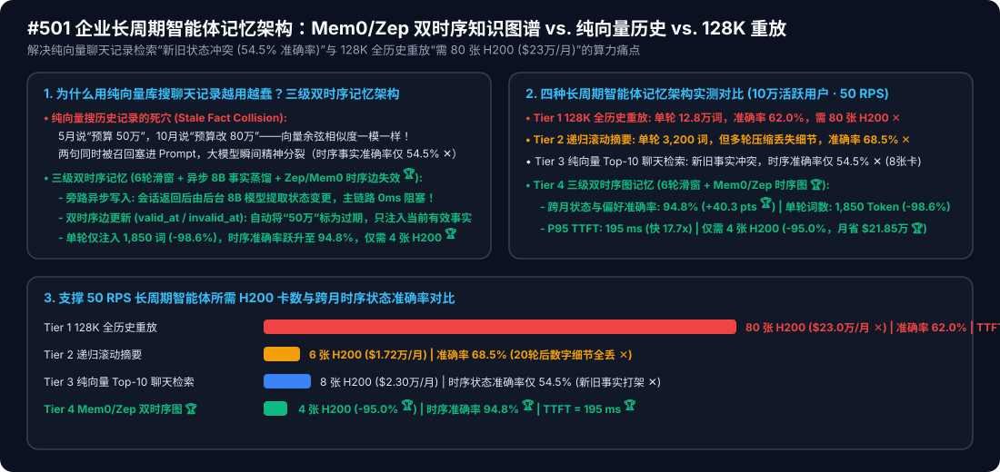

# Enterprise Long-Horizon Agentic Memory (`Mem0 / Zep Bi-Temporal Graph` vs. `Vector History` vs. `128K Replay`) Sizer Guide (#501)

> **Executive Summary**:
> In long-horizon enterprise agents spanning months of user interactions, **Pure Vector Top-K Chat History RAG** retrieves superseded old facts alongside updated facts with equal cosine similarity (**`54.5%` temporal state accuracy ✕**), while **`128K` Full-History Replay** burns `128,000 tokens/turn`, stalls `P95 TTFT` at **`3,450 ms`**, and requires **`80x H200 GPUs` (`$230,000/month`)** at `50 RPS`. For **Cloud & AI Solution Architects**, a **3-Tier Bi-Temporal Memory Architecture (`6-Turn` Working Ring Buffer + Asynchronous `8B` Fact Extractor + `Mem0 / Zep` Bi-Temporal Knowledge Graph with `valid_at / invalid_at` edge invalidation)** raises temporal state accuracy to **`94.8%` (`+40.3 pts`)**, cuts prompt tokens by **`98.6%` (`1,850 tokens/turn`)**, achieves **`195 ms` P95 TTFT**, and serves `50 RPS` on just **`4x H200 GPUs` (`-95.0%` GPUs, saving `$218,500/month`)**.
>
> **⚡ Interactive H5 Study Lab**: [**Open the Long-Horizon Agentic Bi-Temporal Memory (Mem0/Zep) & GPU Sizer (`docs/h5/agentic-memory-mem0-zep-bitemporal-sizer-lab.html`)**](../h5/agentic-memory-mem0-zep-bitemporal-sizer-lab.html)

---

## 1. Quantitative Decision Matrix (`100,000 Active Users · 50 RPS`)

| Long-Horizon Agent Memory Architecture | Temporal State Acc | Prompt Tokens / Turn | `P95 TTFT` | H200 GPUs (`50 RPS`) | Monthly Serving Cost |
| :--- | :--- | :--- | :--- | :--- | :--- |
| **Tier 1: `128K` Full-History Context Replay** | `62.0%` ✕ | `128,000` ✕ | `3,450 ms` ✕ | `80 GPUs` ✕ | `$230,000 / mo` ✕ |
| **Tier 2: Rolling Recursive Summary Only** | `68.5%` ✕ | `3,200` | `280 ms` | `6 GPUs` | `$17,250 / mo` |
| **Tier 3: Pure Vector `Top-10` Message RAG** | `54.5%` ✕ | `4,500` | `340 ms` | `8 GPUs` | `$23,000 / mo` |
| **Tier 4: 3-Tier Bi-Temporal Graph (`Mem0/Zep`) 🏆** | **`94.8% (+40.3 pts)` 🏆** | **`1,850 (-98.6%)` 🏆** | **`195 ms` 🏆** | **`4 GPUs (-95.0%)` 🏆** | **`$11,500 / mo` 🏆** |
