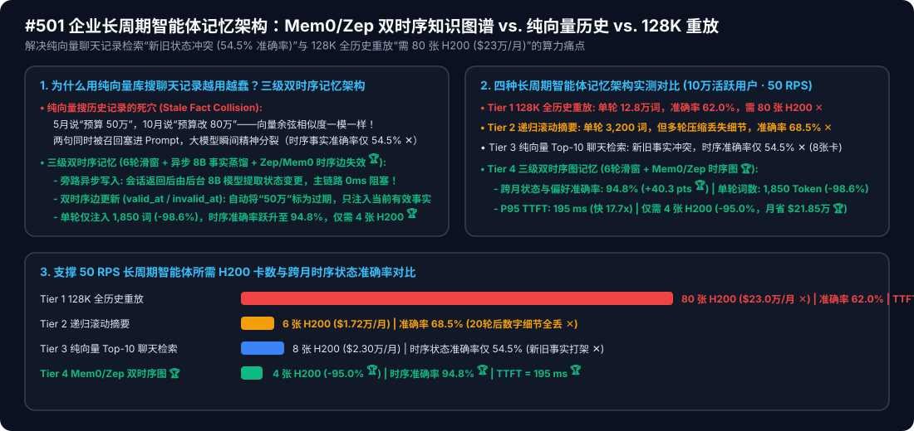
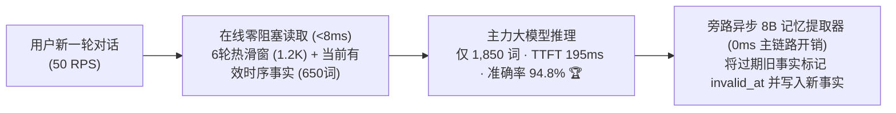

# 企业长周期智能体记忆架构（`Mem0 / Zep 双时序知识图谱` vs. `纯向量历史检索` vs. `128K 全历史重放`）跨月召回率、Token 成本与算卡选型指南 (#501)

> **核心观点（Executive Summary）**：
> 当企业构建伴随客户或员工长达数月的 **长周期智能体（财富顾问、项目管家、VIP 专属助理）** 时，最大的陷阱是用 **“纯向量数据库检索历史聊天记录（Naive Vector History RAG）”** 或 **“直接塞入最近 `128K` 聊天记录”**：
> 1. **纯向量搜历史聊天记录的“新旧事实打架灾难（`54.5%` 时序准确率 ✕）”**：用户在 5 月说“项目预算 50 万”，10 月说“项目预算上调到 80 万”——这两句话在向量空间里的余弦相似度几乎一模一样！纯向量检索会把新旧两条冲突记录同时捞出来塞进 Prompt，导致大模型当场产生幻觉；
> 2. **`128K` 全历史重放的算力黑洞**：每说一句话都要重带 `128,000 Token`，不仅因 `Lost-in-the-Middle` 准确率跌至 `62.0%`，更导致 `P95 TTFT` 高达 `3,450 ms`，支撑 `50 RPS` 需要 **`80 张 H200`（每月烧掉 `$230,000` ✕）**！
>
> 作为 **Cloud & AI Solution Architect**，生产级最优解是采用 **“三级双时序记忆架构（`6 轮热滑窗缓存 + 旁路异步 8B 事实蒸馏 + Mem0 / Zep 双时序知识图谱 valid_at/invalid_at 边自动失效`）”**：将跨月状态与偏好准确率从 `54.5%` 拉升至 **`94.8%`（`+40.3 pts` 🏆）**，单轮提示词压缩 **`98.6%`（`128,000 -> 1,850 Token`）**，`P95 TTFT` 降至 **`195 ms`（提速 `17.7 倍`）**，仅需 **`4 张 H200`（立省 `95.0%` 卡数，月省 `$218,500`！）** 即可支撑 10 万活跃用户！
>
> **⚡ 配套交互式 H5 精读沙盘**：[**打开长周期智能体双时序图记忆 (Mem0/Zep) 与 GPU 算卡计算器 (`docs/h5/agentic-memory-mem0-zep-bitemporal-sizer-lab.html`)**](../h5/agentic-memory-mem0-zep-bitemporal-sizer-lab.html)

---

## 一、 灵魂拷问：为什么向量数据库管不好“会随时间改变的用户状态”？

### Q1：什么是“双时序图边（Bi-Temporal Graph Edge）”？它如何彻底消灭新旧记忆冲突？
- 在 `Zep (Graphiti) / Mem0` 双时序图架构中，每一条抽取出的事实三元组（如 `User_A -> has_budget -> $50k`）都带有两套时间戳：
  1. **事件发生时间（`t_valid` / `t_invalid`）**：当用户在 10 月 12 日说“预算改成 80 万”时，后台异步 `8B` 模型自动对比已有图节点，将旧边 `($50k)` 的 `t_invalid` 置为 `2026-10-12`（归档入历史审计层），同时插入新边 `($80k, t_valid = 2026-10-12, t_invalid = NULL)`！
  2. **在线检索时只过滤 `t_invalid IS NULL` 的当前有效事实（仅 `~650 Token`）**，从物理上杜绝了过时旧状态污染主模型上下文！

---

## 二、 四种长周期智能体记忆架构选型决策矩阵（`10 万活跃用户 · 50 RPS`）

| 智能体长周期记忆架构（`50 RPS`） | 跨月时序状态准确率 | 单轮提示词 Token | `P95 TTFT` 延迟 | 所需 H200 卡数 | 月度推理成本 (`$`) |
| :--- | :--- | :--- | :--- | :--- | :--- |
| **Tier 1: `128K` 全历史重放（Lost-in-the-Middle）** | `62.0%` ✕ | `128,000 Tok` ✕ | `3,450 ms` ✕ | `80 张 H200` ✕ | `$230,000 / 月` ✕ |
| **Tier 2: 递归滚动全文摘要（细节逐轮磨损）** | `68.5%` ✕ | `3,200 Tok` | `280 ms` | `6 张 H200` | `$17,250 / 月` |
| **Tier 3: 纯向量 `Top-10` 历史聊天检索（新旧冲突）** | `54.5%` ✕ | `4,500 Tok` | `340 ms` | `8 张 H200` | `$23,000 / 月` |
| **Tier 4: 三级双时序记忆（`6轮滑窗 + Mem0/Zep 时序图` 🏆）** | **`94.8% (+40.3 pts)` 🏆** | **`1,850 Tok (-98.6%)` 🏆** | **`195 ms` 🏆** | **`4 张 H200 (-95.0%)` 🏆** | **`$11,500 / 月` 🏆** |

---

## 三、 生产落地核对清单（SA Production Checklist）

- [ ] **记忆抽取与图更新必须 100% 走旁路异步队列（Kafka / Redis Streams + 8B Worker）**：严禁在用户等待回复的同步主链路上串行调用大模型做记忆总结（否则每轮对话平白增加 `800ms` 延迟）。
- [ ] **将注入的 `650 Token` 静态用户画像/有效事实块放在每轮最新 User Turn 前面而非 System Prompt 顶部**：保证会话级前缀缓存（Prefix Cache）不会因为后台异步更新了一条新记忆而在下一轮全部失效。

---

## 四、 延伸阅读与配套工具

- **交互式 H5 精学沙盘**：[docs/h5/agentic-memory-mem0-zep-bitemporal-sizer-lab.html](../h5/agentic-memory-mem0-zep-bitemporal-sizer-lab.html)
- **7-Card 4:5 视觉评测卡片**：[docs/reports/enterprise-agentic-memory-mem0-zep-bitemporal-graph-kv-sizing-selection-cards.html](../reports/enterprise-agentic-memory-mem0-zep-bitemporal-graph-kv-sizing-selection-cards.html)
- **交互式 Sizer 测算器**：[docs/reports/enterprise-agentic-memory-mem0-zep-bitemporal-graph-kv-sizing-selection-sizer.html](../reports/enterprise-agentic-memory-mem0-zep-bitemporal-graph-kv-sizing-selection-sizer.html)
- **可复现实验模型**：[`experiments/enterprise_agentic_memory_mem0_zep_bitemporal_graph_kv_sizing_selection/run.py`](../../experiments/enterprise_agentic_memory_mem0_zep_bitemporal_graph_kv_sizing_selection/run.py)
