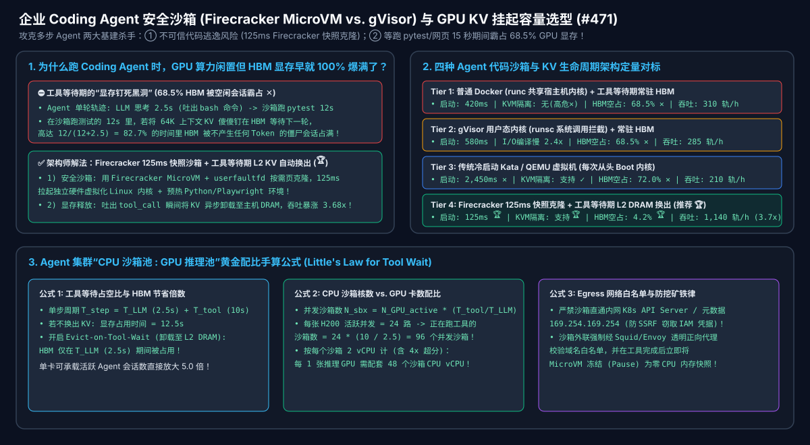

# Enterprise Coding Agent Sandbox (`Firecracker MicroVM` vs. `gVisor` vs. `Kata`) & GPU KV Cache Pause-on-Tool-Wait Sizing Guide (#471)

> **Executive Summary**:
> Multi-step Coding Agents (`SWE-Agent`) and Computer-Use browser agents expose two severe infrastructure bottlenecks: (1) executing untrusted LLM-generated code inside shared-kernel `runc` Docker containers risks host kernel escape and cloud metadata (`169.254.169.254`) credential theft, and (2) keeping `64K` KV Cache pinned in GPU HBM while the agent waits `10–20 seconds` for `pytest` or browser actions wastes **`68.5%` of GPU HBM on idle tool-waiting sessions**. For **Cloud & AI Solution Architects**, the production reference architecture pairs **`Firecracker MicroVM` `125ms` UFFD Copy-on-Write Snapshot Restoration** with **Automatic L2 Host DRAM KV Evict-on-Tool-Wait**, provisioned at a **`48 Sandbox CPU vCPUs : 1 Inference GPU`** ratio. This boosts completed agent trajectories per 8-GPU node from `310/hr` to **`1,140/hr` ($3.68\times$)** with full hardware KVM isolation.
>
> **⚡ Interactive H5 Study Lab**: [**Open the Coding Agent Sandbox & GPU KV Evict-on-Tool-Wait Sizer (`docs/h5/agentic-sandbox-firecracker-microvm-gpu-kv-pause-lab.html`)**](../h5/agentic-sandbox-firecracker-microvm-gpu-kv-pause-lab.html)

---

## 1. Core Q&A: Eliminating the 68.5% Tool-Wait HBM Leak and Sizing CPU Sandbox Pools

### Q1: How do we hand-calculate the CPU Sandbox-to-GPU ratio for multi-step Coding Agents?
- With average LLM generation time $T_{\text{LLM}} = 2.5\text{ s}$ and sandbox tool execution time $T_{\text{tool}} = 10.0\text{ s}$, for every `24` active concurrent requests on 1 H200 GPU, there are $24 \times (10.0 / 2.5) = \mathbf{96}$ sandboxes actively executing tool calls;
- At `2 vCPUs` per sandbox with $4\times$ burst oversubscription, provision **`48 Sandbox CPU vCPUs` (`128 GB` RAM) per `1 Inference H200 GPU`**.

---

## 2. Quantitative Decision Matrix

| Sandbox & KV Lifecycle Tier | Cold Spawn / Restore (ms) | Overhead / Sandbox (MB) | Hardware KVM Isolation | HBM Wasted in Tool Wait (%) | Agent Trajectories / Hr (8-GPU) |
| :--- | :--- | :--- | :--- | :--- | :--- |
| **Tier 1: Shared-Kernel Docker (`runc`) + Pinned HBM KV** | `420 ms` | `45 MB` | No (Escape risk ✕) | `68.5%` ✕ | `310 / hr` |
| **Tier 2: `gVisor (runsc)` User-Space Kernel + Pinned HBM KV** | `580 ms` | `90 MB` | Partial (2.4x slower I/O) | `68.5%` ✕ | `285 / hr` |
| **Tier 3: Cold-Boot `Kata / QEMU` VM per Session** | `2,450 ms` ✕ | `260 MB` | Yes ✓ | `72.0%` ✕ | `210 / hr` |
| **Tier 4: `Firecracker 125ms Snapshot` + L2 KV Evict-on-Tool-Wait 🏆** | **`125 ms` 🏆** | **`18 MB` 🏆** | **Yes (KVM 🏆)** | **`4.2%` 🏆** | **`1,140 / hr` (3.68x 🏆)** |
