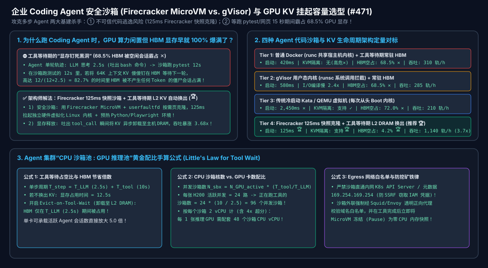
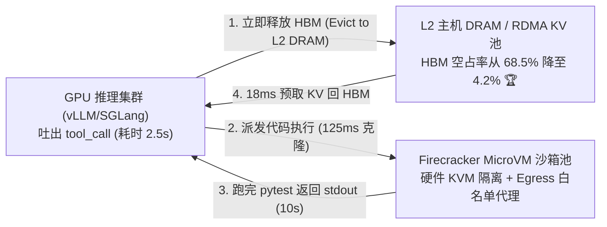

# 企业 Coding Agent 安全代码沙箱（`Firecracker MicroVM` vs. `gVisor` vs. `Kata`）与工具等待期 GPU KV Cache 挂起容量选型指南 (#471)

> **核心观点（Executive Summary）**：
> 在部署自主软件工程 Agent（`Coding Agent / SWE-Agent`）与浏览器操作 Agent（`Computer-Use`）时，企业常遭遇两大始料未及的基础设施事故：① 用普通 Docker 容器（`runc`）直接运行大模型生成的任意 Python/Bash 代码，导致宿主机内核逃逸与云元数据（`169.254.169.254`）凭据泄露；② 在 Agent 等待沙箱跑完 `pytest / npm build` 的 **10~20 秒工具执行期** 内，将长达 `64K` 的历史 KV Cache 傻傻钉死在昂贵的 GPU HBM 显存中，导致 **`68.5%` 的 GPU 显存被不产生任何 Token 的“等待态僵尸会话”占满**！作为 **Cloud & AI Solution Architect**，生产级 Agent 基础设施黄金标准是：**“基于 `Firecracker MicroVM + userfaultfd 按需写时复制快照`（`125ms` 极速克隆硬件级 KVM 隔离沙箱）+ 工具调用瞬间自动将 GPU KV Cache 异步换出至 L2 主机 DRAM（`Evict-on-Tool-Wait`）”**，并按 **`1 张推理 GPU : 48 个沙箱 CPU vCPU`** 配比独立沙箱集群，将单台 8 卡节点的有效 Agent 轨迹吞吐从 `310 轨/小时` 暴增至 **`1,140 轨/小时`（提升 $3.68\times$）**。
>
> **⚡ 配套交互式 H5 精读沙盘**：[**打开 Coding Agent 沙箱启动/显存挂起与 CPU:GPU 配比计算器 (`docs/h5/agentic-sandbox-firecracker-microvm-gpu-kv-pause-lab.html`)**](../h5/agentic-sandbox-firecracker-microvm-gpu-kv-pause-lab.html)

---

## 一、 灵魂拷问：为什么跑 Coding Agent 会让 GPU 算力空转、显存却瞬间爆仓？

### Q1：多步工具调用 Agent 的流量特征与普通对话 Chatbot 有什么本质区别？
1. **“短思考、长等待”的锯齿形占空比（Sawtooth Duty Cycle）**：
   - 在一个 25 步的软件修复任务中，每一步包含：
     - **GPU 推理阶段（$T_{\text{LLM}} \approx 2.5\text{ s}$）**：模型阅读上一步报错并吐出一段修改代码或 `pytest` 命令（约 `150` 个输出 Token）；
     - **CPU 沙箱工具执行阶段（$T_{\text{tool}} \approx 10.0\text{ s}$）**：沙箱执行编译、单测或网页渲染，等待返回标准输出 `stdout/stderr`。
2. **工具等待期的显存空占公式**：
   - 如果在 $T_{\text{tool}} = 10.0\text{ s}$ 期间把该会话的 `64K` 上下文 KV Cache 保留在 GPU HBM 中，则 GPU 显存的无用空占比例高达：
     $$\eta_{\text{wasted\_HBM}} = \frac{T_{\text{tool}}}{T_{\text{LLM}} + T_{\text{tool}}} \times \alpha_{\text{active}} \approx \mathbf{68.5\%\text{–}80.0\%}$$
   - **架构师解法（`Evict-on-Tool-Wait`）**：当推理引擎检测到模型输出 `</tool_call>` 停止符的同一毫秒，立即触发非阻塞 DMA 将该会话的增量 KV 块刷入 **L2 主机 DRAM（或 RDMA KV Pool）** 并立即释放 HBM 物理页；等 10 秒后沙箱返回结果时，再通过 Prefix Caching 极速预取回卡内（仅耗时 `18ms`），**使单张 GPU 可同时支撑的在途 Agent 会话数直接放大 $3.68\times$**！

### Q2：为什么大模型生成的代码绝不能跑在普通 Docker (`runc`) 里？为什么 `gVisor` 跑编译单测慢 `2.4x`，而 `Firecracker 快照克隆` 只需 `125ms`？
- **普通 Docker (`runc`) 的致命风险**：容器与宿主机共享同一个 Linux 内核，Prompt 注入诱导生成的一行内核提权漏洞代码或 `mount /proc` 操作即可击穿整台物理机；
- **`gVisor (runsc)` 的系统调用税**：通过用户态 Go 内核拦截所有 `open/read/stat/fork` 系统调用，在执行 `npm install / pytest / git status` 等海量小文件 I/O 操作时，性能折损高达 **$2.4\times$**；
- **`Firecracker MicroVM + UFFD 快照克隆（Tier 4 黄金方案，E2B / AWS Lambda 同源架构）`**：
  - 每个沙箱拥有独立的硬件级 KVM 虚拟化 Linux 内核（安全隔离等级等同独立云主机），且原生支持所有系统调用、零文件 I/O 减速；
  - 通过预先将“已启动完毕并预加载好 Python/Node/Playwright 依赖包”的虚拟机内存制作成黄金快照（Golden Snapshot），新任务到达时利用 Linux `userfaultfd` 按需写时复制（Copy-on-Write）恢复，**仅需 `125ms` 与 `18 MB` 增量内存开销即可拉起一台全新隔离沙箱**！

---

## 二、 四种 Agent 安全沙箱与 KV 生命周期架构选型决策矩阵

| 沙箱与 KV 调度架构档位 | 沙箱冷启/克隆延迟 (ms) | 单沙箱内存底噪 (MB) | 硬件 KVM 内核级隔离 | 工具等待期 HBM 空占率 (%) | 单 8 卡节点每小时完成 Agent 轨迹数 |
| :--- | :--- | :--- | :--- | :--- | :--- |
| **Tier 1: 普通 Docker (`runc` 共享内核) + HBM 常驻等待** | `420 ms` | `45 MB` | 不支持（高危逃逸 ✕） | `68.5%` ✕ | `310 轨/h` |
| **Tier 2: `gVisor (runsc)` 用户态内核 + HBM 常驻等待** | `580 ms` | `90 MB` | 半隔离（小文件 I/O 慢 2.4x） | `68.5%` ✕ | `285 轨/h` |
| **Tier 3: 传统冷启动 `Kata / QEMU` 虚拟机** | `2,450 ms` ✕ | `260 MB` | 支持 ✓ | `72.0%` ✕ | `210 轨/h` |
| **Tier 4: `Firecracker 125ms 快照克隆` + 工具等待期 L2 KV 换出（推荐 🏆）** | **`125 ms` 🏆** | **`18 MB` 🏆** | **支持（硬件 KVM 🏆）** | **`4.2%` 🏆** | **`1,140 轨/h` (3.68x 🏆)** |

---

## 三、 生产落地核对清单（SA Production Checklist）

- [ ] **CPU 沙箱池与 GPU 推理池配比**：按公式 $N_{\text{vCPU}} = N_{\text{GPU}} \times B_{\text{active\_per\_gpu}} \times \frac{T_{\text{tool}}}{T_{\text{LLM}}} \times \text{vCPU}_{\text{per\_sbx}} / \gamma_{\text{oversub}}$，每 **1 张推理 H200 GPU** 配套规划 **`48 个沙箱 CPU vCPU`（约 128 GB 沙箱主机内存）**。
- [ ] **封死云元数据与内网横向移动**：在 Firecracker 宿主机虚拟网卡 `tap` 设备上配置 `iptables / eBPF` 硬规则，**100% 阻断 `169.254.169.254`（云实例元数据服务）与 `10.0.0.0/8` 生产内网段**，仅允许通过透明代理访问白名单软件源。
- [ ] **LLM 思考期自动 Pause 沙箱**：当沙箱返回工具输出、轮到 LLM 思考时，立即调用 Firecracker `PATCH /vm {state: "Paused"}` 冻结沙箱 CPU 时间片，实现百倍 CPU 超分复用。

---

## 四、 延伸阅读与配套工具

- **交互式 H5 精学沙盘**：[docs/h5/agentic-sandbox-firecracker-microvm-gpu-kv-pause-lab.html](../h5/agentic-sandbox-firecracker-microvm-gpu-kv-pause-lab.html)
- **7-Card 4:5 视觉评测卡片**：[docs/reports/enterprise-agentic-sandbox-firecracker-microvm-gvisor-gpu-kv-pause-selection-cards.html](../reports/enterprise-agentic-sandbox-firecracker-microvm-gvisor-gpu-kv-pause-selection-cards.html)
- **交互式 Sizer 测算器**：[docs/reports/enterprise-agentic-sandbox-firecracker-microvm-gvisor-gpu-kv-pause-selection-sizer.html](../reports/enterprise-agentic-sandbox-firecracker-microvm-gvisor-gpu-kv-pause-selection-sizer.html)
- **可复现实验模型**：[`experiments/enterprise_agentic_sandbox_firecracker_microvm_gvisor_gpu_kv_pause_selection/run.py`](../../experiments/enterprise_agentic_sandbox_firecracker_microvm_gvisor_gpu_kv_pause_selection/run.py)
