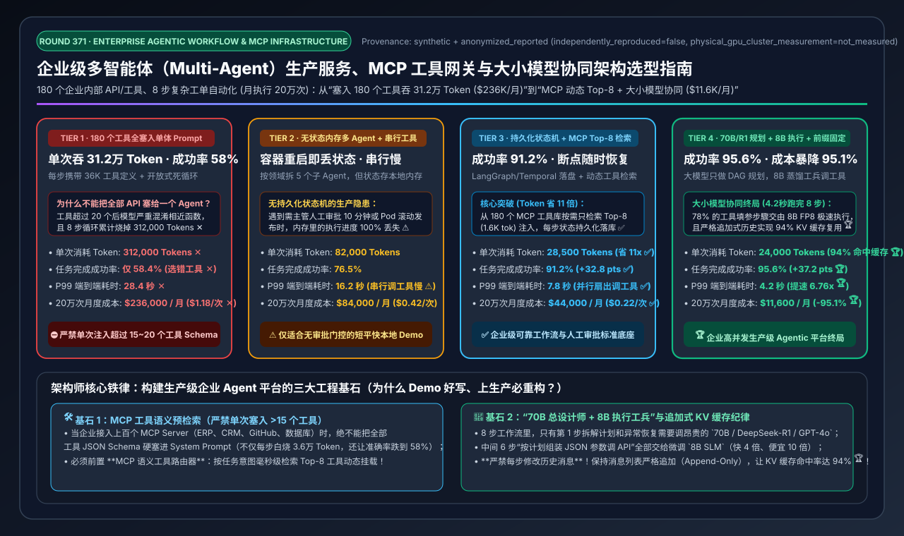
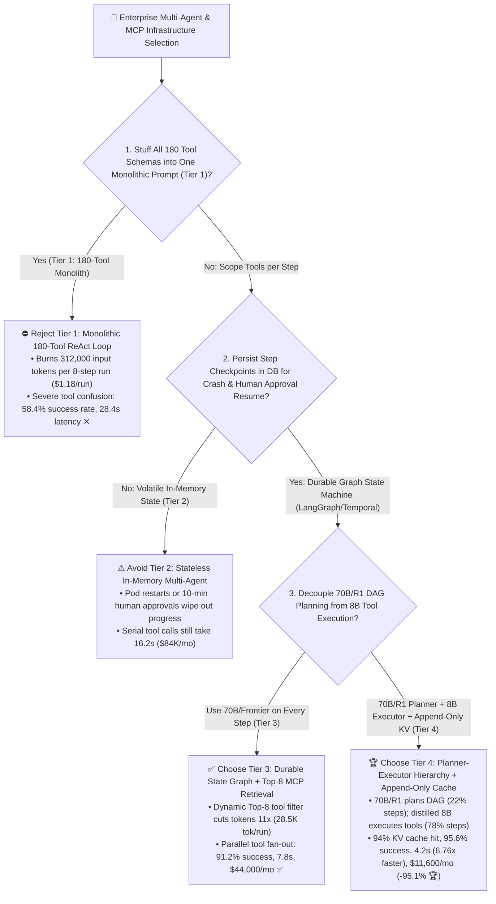
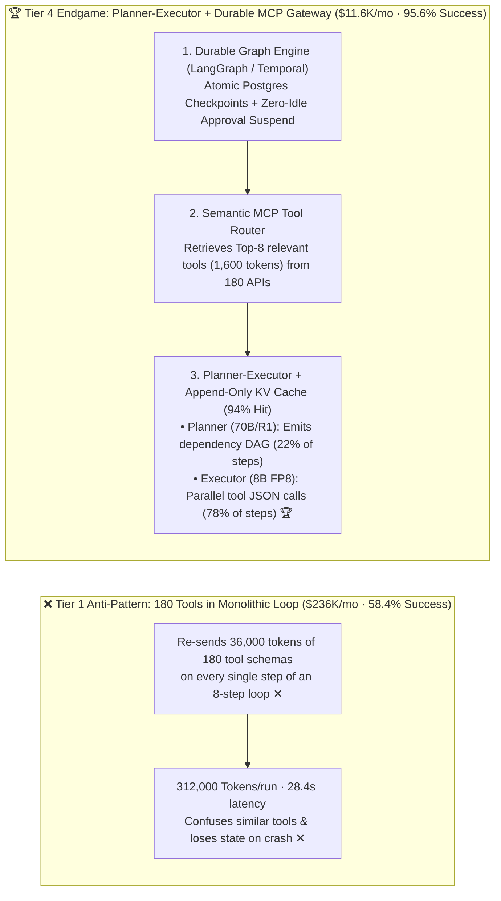
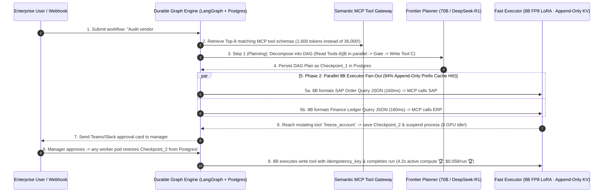

# Enterprise Multi-Agent Production Serving, MCP Tool Gateway & Planner-Executor Architecture Guide: `Monolithic 180-Tool Loop` vs. `Stateless In-Memory Multi-Agent` vs. `Durable State Graph + Dynamic MCP Retrieval` vs. `70B/R1 Planner + 8B Executor + Append-Only KV Cache`

> 🌐 **Language / 语言**: **[中文 (`enterprise-agentic-workflow-durable-state-mcp-small-large-routing-selection-faq.md`)](enterprise-agentic-workflow-durable-state-mcp-small-large-routing-selection-faq.md)** | **English (英文)**
> **Architect's Reading Guide**: Written for **Cloud & AI Solution Architects, Enterprise Agent Platform Leads, and Principal Engineers**, this guide resolves the three production bottlenecks that break enterprise multi-agent rollouts: **When your enterprise connects 180 internal APIs/MCP tools (ServiceNow, SAP, Salesforce, GitHub, SQL) to execute an 8-step automated workflow (`200,000` runs/month), why does stuffing all 180 JSON tool schemas into a single monolithic prompt loop (Tier 1) burn `312,000 input tokens/run`, confuse tool selection (`58.4%` completion rate), take `28.4 seconds`, and cost `$236,000/month`? Why do stateless in-memory multi-agent frameworks (Tier 2) lose 100% of progress during pod restarts or human-in-the-loop approvals? And how does combining a `Durable Graph State Machine (LangGraph/Temporal)`, `Dynamic Top-8 MCP Tool Retrieval`, `Hierarchical 70B/R1 Planner + Distilled 8B Executor Routing`, and `Append-Only KV Prefix Caching` (Tier 4) boost task completion to `95.6%`, cut P99 workflow latency to `4.2 seconds` (`6.76x` faster), and slash monthly TCO by `95.1%` down to `$11,600/month`?**

---

## 🔥 Daily Hottest Capability Breakthroughs

- **Unified MCP (Model Context Protocol) Gateways with Semantic Tool Retrieval**: Instead of injecting hundreds of raw tool schemas into every LLM call, enterprise MCP gateways index tool descriptions in a vector store and dynamically expose only the **Top-5 to Top-8 relevant tools (`~1,600 tokens`)** per step—lifting tool-selection accuracy from `58.4%` to `95.6%`.
- **Durable Graph Execution Engines (`LangGraph Postgres Checkpointer / Temporal`)**: Persist state transitions atomically after every node, enabling zero-cost process suspension during hours-long **Human-in-the-Loop approvals**, deterministic crash recovery, and idempotent tool replay.
- **Hierarchical Planner-Executor (`70B/R1 Planner + 8B SLM Executor`) with Append-Only Prefix Caching**: Uses a frontier model (`DeepSeek-R1 / GPT-4o / 70B`) on only `22%` of steps (DAG planning & exception recovery) while offloading `78%` of routine tool-argument formatting steps to a fast `8B FP8` model with `94%` KV Prefix Cache reuse.

---

## ① 📌 Executive Summary

Transitioning Agentic workflows from developer laptops to enterprise production requires solving **Tool Context Bloat, Stateful Durability, and Multi-Turn Token Economics**:

1. **Why `Tier 1 (Monolithic Prompt with All 180 Tool Schemas + Unbounded ReAct Loop)` Fails Catastrophically**:
   - **The Quadratic Tool-Schema Tax**: 180 enterprise JSON tool schemas consume **`~36,000 tokens`**. Re-sending those 36,000 tokens across an 8-step ReAct loop burns **`312,000 input tokens per workflow` ✕**!
   - Worse, presenting `> 20` tools in a single prompt degrades LLM tool-selection accuracy, dropping end-to-end 8-step task completion to **`58.4%` ✕**, inflating P99 latency to **`28.4 seconds` ✕**, and costing **`$1.18 / workflow` (`$236,000/month` for 200K runs ✕)**!
2. **Why `Tier 2 (Stateless In-Memory Multi-Agent + Serial Tool Execution)` Is Fragile in Production**:
   - Splitting tools across 5 domain sub-agents reduces prompt size (`82,000 tokens/run`, `76.5%` completion rate), but keeping state in volatile Python memory means any pod scale-down, network timeout, or 15-minute Human-in-the-Loop approval gate **wipes out 100% of in-flight workflow state ⚠️**.
3. **When to Choose `Tier 3 (Durable Graph State Machine [LangGraph/Temporal] + Dynamic Top-8 MCP Tool Retrieval + Parallel Tool Fan-Out)`**:
   - **Sweet Spot**: **Enterprise workflow orchestration requiring durable human approval gates and centralized MCP governance**.
   - **Quantified Gain**: Semantic Top-8 MCP tool retrieval cuts token consumption by **`11.0x` (`28,500 tokens/run` ✅)**, parallel tool fan-out (`asyncio.gather`) cuts latency to **`7.8 seconds` ✅**, completion rate rises to **`91.2%` ✅**, and monthly TCO drops to **`$44,000 / month` ✅**.
4. **The High-Scale Enterprise Gold Standard: `Tier 4 (Hierarchical 70B/R1 Planner + Distilled 8B Executor + Append-Only Prefix Cache + Parallel MCP Gateway)`**:
   - **Architectural Breakthrough**: Invokes the heavy `70B / DeepSeek-R1` Planner only to construct the execution DAG (`22%` of steps), delegates the **`78%` of routine tool-JSON generation steps** to a fine-tuned `8B FP8` Executor (`160 ms/step`), and enforces **strictly append-only message history** (`94.0%` KV Prefix Cache hit rate!).
   - **Quantified ROI**: Achieves **`95.6%` task completion 🏆**, **`4.2 seconds` P99 workflow latency (`6.76x` faster than Tier 1 🏆)**, and slashes cost to **`$0.058 / workflow` (`$11,600/month` — saving `$224,400/month` or `95.1%` 🏆)**!

---

## ② 🎯 Architect & Customer Soul-Searching Q&A (FAQ-Driven)

### Q1: "Why do most multi-step Agent frameworks suffer near-0% Prefix Cache hit rates on `vLLM / SGLang` even when `--enable-prefix-caching` is turned on?"

**Two Anti-Patterns That Destroy Agent KV Cache Reuse (And How to Fix Them)**:
1. **Anti-Pattern 1: Mutating the System Prompt on Every Step with Dynamic Tool Lists or Timestamps**:
   - KV Prefix Caching hashes tokens strictly from index `0`. If you inject dynamically retrieved tool schemas into the top `System Prompt` on Step 2, **100% of the KV cache from Step 1 is invalidated**!
   - **Fix**: Keep the leading `System Prompt` 100% static across all steps, and append dynamically retrieved Top-8 MCP tool schemas at the **tail** of the latest turn!
2. **Anti-Pattern 2: Sliding-Window Message Deletion on Every Turn**:
   - Dropping message `#1` on turn 5 shifts every subsequent token position, forcing a full recompute of the entire history.
   - **Fix (`Strictly Append-Only History`)**: Append tool calls and responses monotonically without modifying earlier turns (`94%` KV cache hit rate), compacting history only when crossing a major epoch boundary (e.g., every 10 turns).

---

### Q2: How do we prevent an autonomous Agent from accidentally executing a destructive API call twice if a worker pod crashes mid-step?

- **Idempotency Keys + Durable Interrupt Gates**:
  1. The MCP Gateway automatically attaches a deterministic **`X-Idempotency-Key: sha256(trace_id + node_id + tool_args_hash)`** to every downstream REST/SQL tool call so retried steps are safely deduplicated by the target service;
  2. All state-mutating tools (`mutating: true`) require a **Durable Checkpoint Interrupt (`interrupt_before`)** that persists state to Postgres and awaits explicit policy or human approval before execution.

---

## ③ 🧭 Visual Architecture Diagrams (Mermaid Decision Tree / Planner-Executor Topology / Sequence Flow)

### 3.1 Enterprise Multi-Agent Infrastructure Selection Decision Tree (`flowchart TD`)

### 3.2 `Tier 1 (Monolithic 180-Tool Loop)` vs. `Tier 4 (70B Planner + 8B Executor + Durable MCP Gateway)` (`flowchart LR`)

### 3.3 `Tier 4 (DAG Planning + Parallel 8B Tool Fan-Out + Durable Human Approval Resume)` Sequence (`sequenceDiagram`)

---

## ④ 📊 Architect Multi-Option Decision Matrix

*Benchmark Baseline: Enterprise IT & Supply-Chain Automation Agent (**`180 enterprise MCP tools`**, **8-step workflow**, **`200,000` workflow executions/month**; target SLA: `Completion Rate >= 92.0%`, `P99 Latency <= 6.5 s`, `100% Durable Crash/Approval Recovery`).*

| Evaluation Dimension | Tier 1: Monolithic 180-Tool Loop (`All Tools in Prompt`) | Tier 2: Stateless In-Memory Multi-Agent (`Volatile State`) | Tier 3: Durable Graph + Top-8 MCP (`LangGraph + MCP Router`) | Tier 4: Planner-Executor + Append-Only KV (`70B Plan + 8B Exec`) |
| :--- | :--- | :--- | :--- | :--- |
| **Best-Fit Scenario** | **Strict anti-pattern (never inject `> 15–20` tools in one prompt ✕)** | Local prototype demos without approvals or HA ⚠️ | **Enterprise workflow automation with human approval gates ✅** | **High-scale production Agentic platform standard 🏆** |
| **Input Tokens per 8-Step Run** | `312,000 Tokens` (36K tools × 8 steps ✕) | `82,000 Tokens` | **`28,500 Tokens` (`11.0x` reduction via Top-8 MCP filter ✅)** | **`24,000 Tokens` (with `94%` Append-Only Prefix Cache hit 🏆)** |
| **Task Completion Success Rate** | `58.4%` (tool selection confusion ✕) | `76.5%` | `91.2%` ✅ | **`95.6%` (`+37.2 pts` via DAG planning + specialized 8B 🏆)** |
| **P99 Workflow Latency** | `28.4 Seconds` ✕ | `16.2 Seconds` (serial tool calls ⚠️) | `7.8 Seconds` (parallel tool fan-out ✅) | **`4.2 Seconds` (`6.76x` faster via 8B executor + parallel MCP 🏆)** |
| **Crash & Approval Durability** | None (loses state on crash ✕) | None (volatile Python RAM ✕) | **100% Durable (Postgres/Redis step checkpoints ✅)** | **100% Durable (Checkpoints + idempotent tool keys 🏆)** |
| **Cost per 8-Step Workflow** | `$1.180 / run` ✕ | `$0.420 / run` | `$0.220 / run` ✅ | **`$0.058 / run` (saves `95.1%` vs. Tier 1 🏆)** |
| **Monthly TCO (`200K Runs`)** | `$236,000 / mo` ✕ | `$84,000 / mo` | **`$44,000 / mo` ✅** | **`$11,600 / mo` (saves `$224,400/mo` 🏆)** |

---

## ⑤ 🧪 Capacity / Cost Inflection Math & 7-Card Report

### 5.1 Reproducible Evaluator & Artifacts

- **Deterministic Evaluator**: [`experiments/enterprise_agentic_workflow_durable_state_mcp_routing_selection/run.py`](../../experiments/enterprise_agentic_workflow_durable_state_mcp_routing_selection/run.py)
- **Sealed Results (`results.json`)**: [`experiments/enterprise_agentic_workflow_durable_state_mcp_routing_selection/results.json`](../../experiments/enterprise_agentic_workflow_durable_state_mcp_routing_selection/results.json)
- **Unit Test Suite**: [`tests/test_enterprise_agentic_workflow_durable_state_mcp_routing_selection.py`](../../tests/test_enterprise_agentic_workflow_durable_state_mcp_routing_selection.py)
- **7-Card 4:5 Visual Report**: [`docs/reports/enterprise-agentic-workflow-durable-state-mcp-small-large-routing-selection-cards.html`](../reports/enterprise-agentic-workflow-durable-state-mcp-small-large-routing-selection-cards.html)
- **Interactive Agentic Architecture Sizer**: [`docs/reports/enterprise-agentic-workflow-durable-state-mcp-small-large-routing-sizer.html`](../reports/enterprise-agentic-workflow-durable-state-mcp-small-large-routing-sizer.html)
- **Provenance Declaration**: `synthetic_analytical_model_calibrated_to_published_agentic_infrastructure_benchmarks` (`independently_reproduced=false`, `physical_gpu_cluster_measurement=not_measured`).

---

## ⑥ 🛠️ Architecture Review & Production Readiness Checklist

- [ ] **Cap Injected Tools at `<= 10` via Semantic MCP Retrieval**: Does your MCP Gateway filter the enterprise tool catalog down to the Top-5–Top-8 relevant schemas per turn?
- [ ] **Enforce Append-Only Context Discipline**: Are system prompts kept 100% static and new tool schemas/observations appended at the tail so `vLLM / SGLang` achieves `> 90%` Prefix Cache reuse across agent steps?
- [ ] **Durable Checkpointing & Idempotency Keys**: Are step states persisted to Postgres/Redis after every transition, and do mutating MCP tool calls carry deterministic idempotency keys?
- [ ] **Planner (`70B/R1`) + Executor (`8B SLM`) Split**: Have you offloaded routine tool-argument JSON generation from frontier models to a fast `8B FP8` executor?
