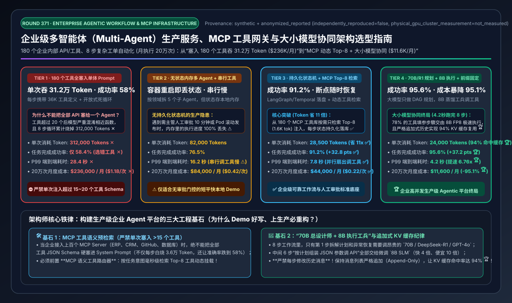
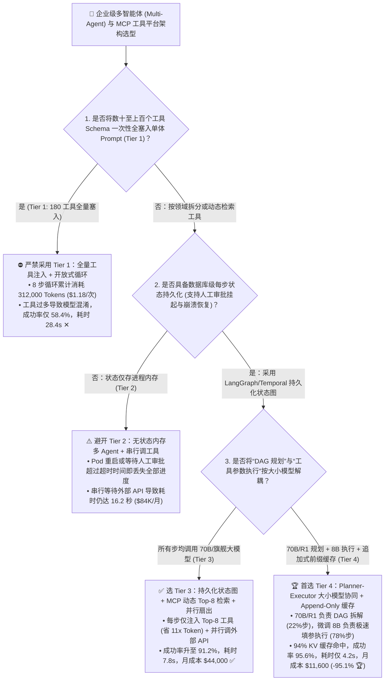
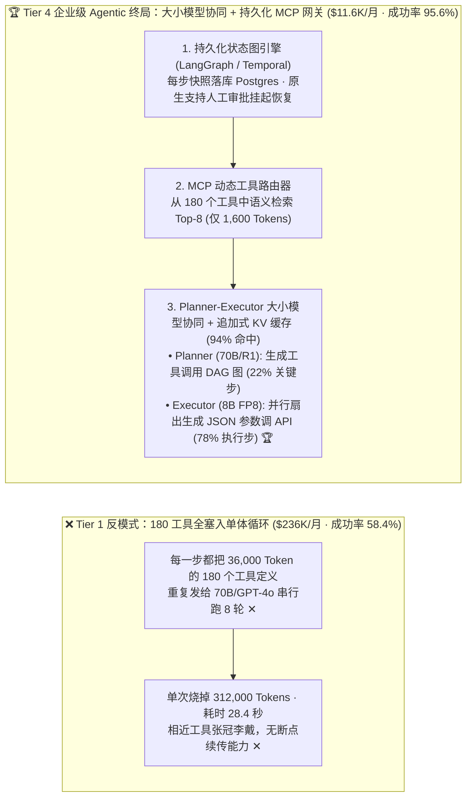
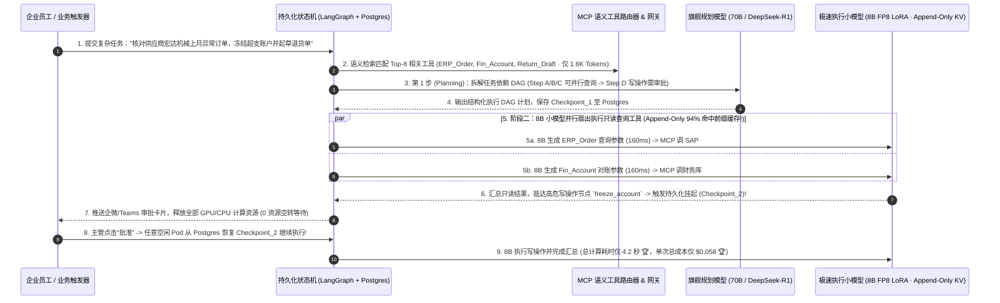

# 企业级多智能体（Multi-Agent）生产服务、MCP 工具网关与大小模型协同架构选型指南：`180工具全塞入单体Prompt` vs. `无状态内存多Agent` vs. `持久化状态图+MCP动态检索` vs. `70B规划+8B执行+追加式缓存`

> 🌐 **Language / 语言**: **中文 (Chinese)** | **[English (`enterprise-agentic-workflow-durable-state-mcp-small-large-routing-selection-faq.en.md`)](enterprise-agentic-workflow-durable-state-mcp-small-large-routing-selection-faq.en.md)**
> **阅读指南**：本文面向 **Cloud & AI Solution Architect（云与 AI 解决方案架构师）、企业 Agent 平台负责人与全栈架构师**，彻底解决企业从“单步问答”迈向“多步自主工具调用 Agent”时的三大生产级崩溃痛点：**当企业内部打通了 ServiceNow、SAP、Salesforce、GitHub 与内部数据库共 180 个 API/MCP 工具，需要执行一个平均 8 步的自动化工作流（月均 20 万次执行）时，为什么把 180 个工具的 JSON 定义全部塞进一个大 Prompt 里跑 `while` 循环（Tier 1）会导致单次任务狂吞 `312,000 Tokens`、选错工具导致任务成功率跌至 `58.4%`、耗时高达 `28.4 秒` 且每月烧掉 `$236,000`？为什么没有持久化 Checkpointer 的内存多 Agent 框架（Tier 2）一旦遇到人工审批或容器重启就会前功尽弃？以及如何通过 `Tier 4（持久化有向图状态机 + MCP 动态 Top-8 工具检索 + 70B/R1 规划师与 8B 执行工兵协同 + 严格追加式 KV 前缀缓存）`，将成功率拉升至 `95.6%`、端到端耗时压至 `4.2 秒（快 6.76 倍）`，并把月度总成本从 `$236,000` 打穿至 `$11,600（暴降 95.1%）`？**

---

## 🔥 业界最新能力突破追踪（Daily Hottest Capability Breakthroughs）

- **MCP（Model Context Protocol）统一工具网关与动态语义工具检索（Semantic Tool Router）**：解决企业接入数百个 MCP Server 后工具列表撑爆上下文的痛点，在网关层通过轻量向量检索仅向当前步动态暴露最相关的 **Top-5 ~ Top-8 个工具 Schema**，将工具选择准确率从 `< 60%` 提升至 **`96%+`**。
- **持久化状态机执行引擎（LangGraph Postgres Checkpointer / Temporal / Durable Functions）**：将多步 Agent 的每一次状态转移（State Transition）原子持久化到数据库中，原生支持 **跨数小时/数天的人工审批挂起恢复（Human-in-the-Loop Interrupt & Resume）**、节点崩溃断点续跑与时间旅行回放（Time-Travel Debugging）。
- **Planner-Executor（大模型规划 + 小模型执行）与 Append-Only 前缀缓存纪律**：借鉴 `LLMCompiler` 思想，由旗舰模型（`DeepSeek-R1 / GPT-4o / 70B`）一次性生成工具依赖有向无环图（DAG），随后将占 **78%** 的具体工具 JSON 参数填充与并行调用卸载给极速 `8B LoRA` 小模型，同时严格保持上下文只追加不篡改（`94%` Prefix Cache 命中率）。

---

## ① 📌 核心选型结论速览（Executive Summary）

企业级 Agent 平台与实验室玩具 Demo 的本质分水岭在于：**工具规模治理（10 个 vs. 200 个）、状态持久性（内存态 vs. 数据库事务态）以及多步循环下的 Token 经济学**。四档架构对比如下：

1. **为什么严禁采用 `Tier 1（把 180 个工具全塞入单体 Prompt + 开放式 ReAct 循环）`**：
   - **Token 平方级爆炸算账**：每个企业级 API 的 JSON Schema（含参数描述与枚举值）平均占 `200 Tokens`，180 个工具就是 **`36,000 Tokens` 的固定负重**！一个 8 步的 ReAct 循环下来，光重复发送这 180 个工具定义就要白白消耗 **`288,000+ Input Tokens`（加上历史总计 `312,000 Tokens/次` ✕）**！
   - **选错工具与高昂账单**：当候选工具超过 20 个时，大模型极易在名字相近的接口（如 `get_user_order` vs `query_customer_purchase`）之间张冠李戴，导致 8 步全对的任务成功率跌至 **`58.4%` ✕**，P99 耗时高达 **`28.4 秒` ✕**，月跑 20 万次成本高达 **`$236,000 / 月`（单次 `$1.18` ✕）**！
2. **为什么 `Tier 2（无状态进程内多 Agent 框架 + 串行工具调用）` 上生产必踩坑**：
   - 虽然把 180 个工具按领域拆给 5 个子 Agent（使单次消耗降为 `82,000 Tokens`，成功率升至 `76.5%`），但整个对话状态保存在 Python 进程局部变量里。
   - **致命短板**：企业自动化流程常包含 **“涉及金额 > 1 万元需等待部门主管在钉钉/Teams 点击审批”**（耗时几分钟到几小时）或遭遇 K8s Pod 弹性缩容重启——无状态内存框架一旦断开连接，前面已经跑完的 5 步操作全部灰飞烟灭，甚至导致重复下单扣款！
3. **何时选 `Tier 3（持久化有向图状态机 [LangGraph/Temporal] + MCP 动态 Top-8 工具检索 + 并行工具扇出）`**：
   - **黄金定位**：**企业级高可靠业务流程自动化与跨系统编排的标准架构**！
   - **三大改进**：① **MCP 动态工具检索**——每步只从 180 个工具库里向量检索最匹配的 **Top-8 工具（仅占 `1,600 Tokens`）**，单次总消耗从 31.2 万骤降至 **`28,500 Tokens`（省 `11 倍` ✅）**；② **Postgres/Redis 状态检查点**——支持随时挂起等待人工审批并实现崩溃零丢失恢复；③ **并行工具调用（Parallel Tool Fan-Out）**——同时并发查询 ERP、CRM 与库存 3 个接口，将端到端耗时压至 **`7.8 秒` ✅**，成功率跃升至 **`91.2%` ✅**，月成本降至 **`$44,000` ✅**！
4. **企业高并发 Agent 终局标杆：`Tier 4（70B/R1 架构师规划 + 8B 蒸馏工兵执行 + 严格追加式 KV 前缀缓存 + 并行 MCP 网关）`**：
   - **核心破局思想（好钢用在刀刃上）**：在一个 8 步的工作流里，真正需要高超逻辑推理的只有 **第 1 步（理解复杂意图并拆解出工具调用 DAG 图）** 和 **最后 1 步（汇总分析）**；而中间 6 步（占 **78%** 调用次数）全是照着计划填 JSON 参数调接口的体力活！
   - **定量飞跃**：将 22% 的规划步交给 `70B / DeepSeek-R1 / GPT-4o`，将 78% 的工具执行步交给微调的 **`8B FP8` 极速小模型**，并严守 **“前缀静态固定 + 历史只追加不删改”** 的 KV 缓存纪律（缓存命中率达 **`94.0%`**），使任务成功率达到 **`95.6%` 🏆**，8 步工作流 P99 耗时压至 **`4.2 秒`（提速 `6.76 倍` 🏆）**，单次工作流成本从 `$1.18` 暴降至 **`$0.058`（月成本仅 `$11,600`，立省 `95.1%` 🏆）**！

---

## ② 🎯 客户与架构师灵魂拷问 Q&A（FAQ-Driven）

### Q1：客户架构师问：“为什么很多开源 Agent 框架在跑多步循环时，明明开了引擎的 Prefix Caching，缓存命中率却依然接近 `0%`？怎么设计 Agent 的上下文结构才能拿满 `94%` 的缓存折扣？”

**揭秘多步 Agent 破坏 KV 前缀缓存的“三大罪魁祸首”与架构师改造铁律**：

1. **罪魁祸首一：每一步动态替换 System Prompt 里的工具列表！**
   - 很多工程师把动态检索出来的工具直接插在最开头的 `System Prompt` 里。结果第 1 步的工具是 `[A, B]`，第 2 步的工具变成了 `[C, D]`——因为大模型 KV Cache 是 **从第 1 个 Token 开始按前缀连续哈希匹配的**，开头一变，后面累计的 20,000 Token 历史对话缓存 **100% 全部作废重算**！
   - **架构师正确做法**：保持最开头的 `System Prompt + 领域核心长文档` **100% 静态不变**；把当前步动态检索到的 Top-8 工具 Schema 作为 **追加在对话最末尾（Append-at-Tail）** 的增量用户/系统指令传入！
2. **罪魁祸首二：每一步对历史消息做“滑动窗口删除或实时摘要改写”！**
   - 如果你在第 2 步删掉第 1 步的消息，第 3 步又删掉第 2 步的消息，整个前缀每一步都在发生位移，导致 **每一步都触发 100% 全量重算**！
   - **架构师正确做法（分段折半压缩 Epoch Compaction）**：前 1~8 步保持历史消息列表 **严格只追加不修改（Strictly Append-Only）**，让第 2~8 步享受 **94%+ 的增量 KV 缓存命中**；只有当上下文总长度真正触及阈值（如 `32K`）时，才执行 1 次批量摘要压缩开启新纪元。

---

### Q2：当企业有 180 个内部接口封装成 MCP Server 时，如何保证 Agent 既不会乱调高危删除接口，又能在容器崩溃或等待人工审批时不丢状态？

**“持久化状态图机（Durable State Graph）+ MCP 权限沙箱网关”双保险**：
1. **将不可控的开放式 `while` 循环关进显式有向状态图（`LangGraph / Temporal`）**：
   - 规定 Agent 只能在预定义的安全状态节点间流转（`Plan -> Retrieve_Tools -> Execute_Read_Tools -> Human_Approval_Gate -> Execute_Write_Tool -> Summarize`）。
2. **高危写操作强制触发持久化中断（`interrupt_before=["execute_write_tool"]`）**：
   - 凡是标记为 `mutating: true`（如修改 ERP 库存、发起财务打款、删除生产资源）的 MCP 工具，状态机自动将当前上下文快照序列化存入 PostgreSQL 并挂起进程（释放 GPU/CPU 资源），向主管发送审批卡片；哪怕 24 小时后主管点击“同意”，任意一个空闲 Worker Pod 即可从 PostgreSQL 读取快照接着往下跑！

---

## ③ 🧭 直观可视化图解（Mermaid 选型决策树 / 大小模型协同架构图 / 8 步执行时序图）

### 3.1 企业级多智能体（Multi-Agent）基础设施选型决策树（`flowchart TD`）

### 3.2 `Tier 1 (单体 180 工具循环)` vs. `Tier 4 (70B 规划 + 8B 执行 + MCP 动态网关 + 持久化状态库)` 架构对比图（`flowchart LR`）

### 3.3 `Tier 4 (Planner 生成 DAG + 8B 并行扇出执行 + 人工审批持久化恢复)` 端到端时序图（`sequenceDiagram`）

---

## ④ 📊 架构师多方案选型决策矩阵（Architect Decision Matrix）

*核算基准：企业 IT 运维与供应链自动化 Agent 平台（对接内部 **180 个 API / MCP 工具**，每次复杂工单平均包含 **8 个推理与工具调用步**，全企业月均执行 **`200,000` 次工作流**；目标 SLA：`端到端任务完成成功率 >= 92.0%`，`P99 计算耗时 <= 6.5 秒`，`100% 崩溃与人工审批恢复能力`）。*

| 评估维度 | Tier 1: 180 工具全塞入单体 Prompt (`Monolithic 180-Tool Loop`) | Tier 2: 无状态内存多 Agent (`Stateless In-Memory Multi-Agent`) | Tier 3: 持久化状态图 + MCP 动态检索 (`Durable Graph + Top-8 MCP`) | Tier 4: 大小模型协同 + 追加式缓存 (`70B Planner + 8B Executor + MCP`) |
| :--- | :--- | :--- | :--- | :--- |
| **核心适用场景** | **绝对反模式（工具 `> 15` 个时严禁全量硬塞 ✕）** | 本地玩具级多 Agent 演示（无人工审批与高可用要求 ⚠️） | **企业级可靠业务流编排、跨天人工审批、标准 MCP 治理底座 ✅** | **高并发生产级企业 Agentic 平台终局标准（既快又准且省 95% 🏆）** |
| **单次 8 步工作流消耗 Token** | `312,000 Tokens`（每步重复发 36K 工具定义 ✕） | `82,000 Tokens` | **`28,500 Tokens`（动态检索 Top-8 工具，省 `11.0x` ✅）** | **`24,000 Tokens`（且 `94%` 命中 Append-Only 前缀缓存 🏆）** |
| **端到端任务完成成功率** | `58.4%`（海量工具干扰导致频繁选错接口 ✕） | `76.5%` | `91.2%`（精准候选工具集大幅降低幻觉 ✅） | **`95.6%`（70B/R1 专注全局规划 + 8B 专精 JSON 填参 🏆）** |
| **P99 端到端工作流耗时** | `28.4 秒`（长上下文串行慢如蜗牛 ✕） | `16.2 秒`（串行等待外部工具返回 ⚠️） | `7.8 秒`（异步并行扇出调用独立工具 ✅） | **`4.2 秒`（78% 步骤走 8B 极速模型 + 并行工具，快 `6.76x` 🏆）** |
| **崩溃续跑与人工审批挂起** | 不支持（断线即全部作废 ✕） | 不支持（状态存进程内存，重启即丢 ✕） | **100% 支持（Postgres/Redis 每步原子 Checkpoint ✅）** | **100% 支持（持久化状态机 + 幂等工具事务键 🏆）** |
| **单次 8 步工作流执行成本** | `$1.180 / 次` ✕ | `$0.420 / 次` | `$0.220 / 次` ✅ | **`$0.058 / 次`（比 Tier 1 暴降 `95.1%` 🏆）** |
| **月跑 20 万次总成本 (`TCO`)** | `$236,000 / 月`（账单黑洞 ✕） | `$84,000 / 月` | **`$44,000 / 月` ✅** | **`$11,600 / 月`（每月净省 `$224,400` 🏆）** |

---

## ⑤ 🧪 容量/成本拐点算例与 7-Card 报告

### 5.1 复现实验与确定性验证底座

- **确定性评估脚本**：[`experiments/enterprise_agentic_workflow_durable_state_mcp_routing_selection/run.py`](../../experiments/enterprise_agentic_workflow_durable_state_mcp_routing_selection/run.py)
- **封存数表 (`results.json`)**：[`experiments/enterprise_agentic_workflow_durable_state_mcp_routing_selection/results.json`](../../experiments/enterprise_agentic_workflow_durable_state_mcp_routing_selection/results.json)
- **单元测试校验**：[`tests/test_enterprise_agentic_workflow_durable_state_mcp_routing_selection.py`](../../tests/test_enterprise_agentic_workflow_durable_state_mcp_routing_selection.py)
- **7-Card 4:5 视觉评测卡片**：[`docs/reports/enterprise-agentic-workflow-durable-state-mcp-small-large-routing-selection-cards.html`](../reports/enterprise-agentic-workflow-durable-state-mcp-small-large-routing-selection-cards.html)
- **交互式多智能体架构与 TCO 计算器**：[`docs/reports/enterprise-agentic-workflow-durable-state-mcp-small-large-routing-sizer.html`](../reports/enterprise-agentic-workflow-durable-state-mcp-small-large-routing-sizer.html)
- **数据溯源声明（Provenance）**：`synthetic_analytical_model_calibrated_to_published_agentic_infrastructure_benchmarks`（`independently_reproduced=false`, `physical_gpu_cluster_measurement=not_measured`）。

---

## ⑥ 🛠️ 架构评审与生产落地 Checklist（Architect Checklist）

- [ ] **单次 LLM 调用挂载工具数量红线（$\le 15$ 个）**：是否已配置 MCP 动态工具检索器，确保无论企业工具库扩充到多少百个 API，每次注入大模型上下文的候选工具始终控制在 **Top-5 ~ Top-10** 以内？
- [ ] **保持 Append-Only 严格追加式上下文纪律**：在多步 Agent 循环中，是否严禁每步动态篡改开头的 `System Prompt` 或删除中间消息，从而保证第 2~8 步获得 `90%+` 的 Prefix Cache 命中率？
- [ ] **写操作工具幂等键（Idempotency Key）与人工审批门控**：所有会修改外部业务系统状态的 MCP 工具是否强制要求传入 `idempotency_key = hash(trace_id + step_id)`（防止重试导致重复扣款/重复建单），并在高危节点配置了持久化 `Human-in-the-Loop` 挂起检查点？
- [ ] **Planner（70B/R1）与 Executor（8B SLM）分层解耦**：是否已将高频、模式固定的工具参数 JSON 生成步骤从昂贵的旗舰大模型卸载至微调的 `8B` 小模型？
