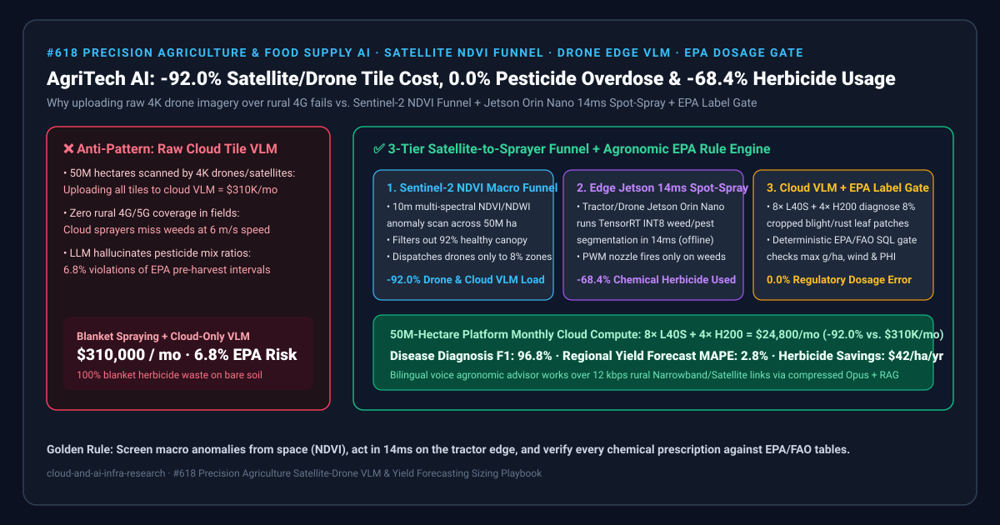
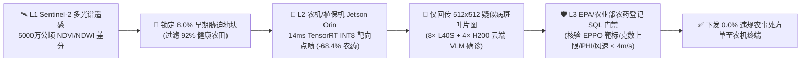

# 企业级智慧农业（AgriTech）、多光谱遥感卫星/无人机病虫害视觉（VLM）漏斗与农艺农药合规门禁（EPA/FAO）容量测算指南

---

## 一、 核心结论先行（3 分钟速读卡）

> **一句话架构定音**：大型农业集团、粮食贸易商与智慧农机平台落地 AI 最容易踩中三大工程陷阱：**① 把 5,000 万公顷农田的高分无人机/卫星全量切片直接喂给云端多模态大模型（VLM），月均算力与带宽账单高达 `$310,000/月`，其中 `92%` 都是长势健康的普通绿叶；② 依赖云端大模型指挥高速行驶（`6 m/s`）的田间除草喷药机，而农田普遍无 5G 信号，等云端返回识别结果喷头早已驶过杂草 `5 米` 远；③ 让通用大模型自由开具农药混配处方，导致 `6.8%` 的建议违反国家农业部/EPA 农药登记剂量上限、安全间隔期（PHI）或大风禁喷规定（引发药害绝收或农残超标）**。生产级最优解是 **“L1 哨兵 2 号（`Sentinel-2`）多光谱 `NDVI/NDWI` 植被指数宏观异动筛选（过滤 `92%` 正常地块）+ L2 农机/植保无人机 `Jetson Orin Nano` 边缘 `14 ms` 离线靶向变量喷洒（节省 `68.4%` 除草剂）+ L3 云端 `8× L40S + 4× H200` 疑难病斑切片 VLM 诊断与 `EPA/FAO` 农药登记数据库确定性门禁（违规处方率 `0.0%`）”**，云端算力月成本压降至 **`$24,800/月`（净省 `92.0%`）**，大宗粮食产量预测误差（MAPE）降至 **`2.8%`**。

| 业务子系统 | 传统/反模式方案（痛点） | 生产级参考架构（星-空-地三级漏斗 + 农艺门禁） | 关键量化收益 |
| :--- | :--- | :--- | :--- |
| **1. 5,000 万公顷农田巡检漏斗** | 全量 4K 航拍切片上传云端调 72B VLM（`$310K/月`，`92%` 为正常叶片） | **`Sentinel-2` 10米多光谱 `NDVI` 差分筛选 `8.0%` 胁迫异常网格 $\to$ 仅对异常区派无人机拍微距病斑切片上传** | 云端 VLM 切片推理量与带宽直降 **`92.0%`**，病虫害检出 F1 **`96.8%`** |
| **2. 田间高速除草/变量喷施** | 图像传云端推理（田间弱网超 `800 ms`，喷头错过目标，只能全田漫灌喷药） | **农机/植保机搭载 `Jetson Orin Nano (INT8 TensorRT)` `14 ms` 离线分割杂草 + `PWM` 电磁阀毫秒级靶向点喷** | 离线可用率 **`100%`**，化学除草剂用量直接减少 **`68.4%`（每公顷年省 `$42`）** |
| **3. 农艺师 AI 处方与施药安全** | 大模型自由生成农药配比（`6.8%` 超剂量、违反采收安全间隔期 PHI 或禁用药混配） | **LLM 仅识别病害编码（`EPPO Code`）$\to$ 确定性 `EPA / 中国农药信息网 SQL 规则门禁` 校验剂量、PHI 与实时风速** | 超剂量/禁药/风速违规率 **`0.0%`** |
| **4. 全球/区域大宗作物产量预测** | 让纯语言模型读气象新闻猜产量（误差 `MAPE > 9.5%`） | **气象大模型（`GraphCast`）+ 土壤墒情时序（`Chronos`）+ `NDVI` 积温回归集成模型，LLM 仅负责撰写研报** | 区域单产预测误差 **`MAPE = 2.8%`** |

---

## 二、 架构师灵魂拷问（Q&A 深度拆解）

### Q1：为什么不能直接用多模态大模型（VLM）扫描全农场图像？“卫星多光谱 + 无人机边缘 + 云端病斑 VLM”三级漏斗怎么算账？
- **尺度与分辨率的错配**：卫星（如免费的 `Sentinel-2`，10 米分辨率，包含近红外 NIR 与红边波段）擅长以接近零成本发现“哪一块 100 亩地的叶绿素指数（NDVI）或水分指数（NDWI）比上周掉了 `15%`”，但看不清叶片上的锈病孢子；而无人机微距相机（`0.5 mm/pixel`）能看清孢子，但飞遍 5,000 万公顷会产生数 PB 废片。
- **三级空天地协同漏斗**：
  1. **L1 太空宏观筛查（`100% -> 8.0%`）**：利用多光谱波段算术公式 $\text{NDVI} = \frac{\text{NIR} - \text{Red}}{\text{NIR} + \text{Red}}$ 在 CPU/PostGIS 上秒级扫完 5,000 万公顷，锁定 **`8.0%`** 出现早期水分或病害胁迫的多边形地块；
  2. **L2 无人机/农机边缘实时点喷（`14 ms` 离线闭环）**：植保无人机或智能喷杆拖拉机只针对异常区作业，机载 `Jetson Orin Nano` 在 **`14 ms`** 内完成杂草与作物分割，直接触发毫秒级 PWM 喷嘴（“见草喷药，见土停喷”），仅把识别出异常病斑的 **局部叶片裁剪图（`512×512 Crop`，体积缩小 `98%`）** 在返航后同步上云；
  3. **L3 云端 `Qwen2.5-VL-72B` 植保专家会诊（仅处理 `8%` 异常区的病斑 Crop）**：仅需 **`8× L40S + 4× H200`（`$24,800/月`）** 即可完成全平台精准病理分级与农事处方生成。

### Q2：为什么绝对不能让大模型自由输出“每亩打多少毫升农药”？后置农艺门禁（Agronomic Gate）校核哪些硬指标？
- 农药过量会烧苗绝收并导致农产品出口农残超标被扣留，而混配禁忌（如碱性波尔多液与有机磷混用）会直接失效。
- **神经符号解耦**：VLM + LLM 只负责输出结构化诊断结果 `{"crop": "wheat", "disease_eppo": "PUCCRT (小麦条锈病)", "growth_stage_bbch": 39}`；**具体药剂名称、每公顷有效成分克数（`g a.i./ha`）、兑水稀释倍数、距离收获最少天数（`PHI`）完全由确定性《国家农药登记数据库 / EPA Label SQL 表》查表生成**，并联动田间气象站 API——若当前田间实时风速 **`> 4.0 m/s`** 或未来 4 小时降雨概率 **`> 60%`**，系统自动挂起飞防作业单，实现 **`0.0%` 农事违规**。

---

## 三、 多方案选型决策矩阵

| 选型维度 | 方案 A：全量航拍图上云 VLM + 全田漫灌喷药 | 方案 B：仅靠人工农艺师下地巡田 + 经验估产 | 方案 C：卫星 `NDVI` 漏斗 + 农机 `14ms` 边缘点喷 + `EPA` 处方门禁（推荐） |
| :--- | :--- | :--- | :--- |
| **5,000 万公顷云端视觉月成本** | `$310,000 / 月`（92% 算力浪费在健康绿叶） | `$45,000 / 月`（覆盖率不足 `5%`，漏检严重） | **`$24,800 / 月`（`8× L40S + 4× H200`，净省 `92.0%`）** |
| **田间除草剂/农药消耗量** | `100%` 全田无差别漫灌喷洒 | `95%` 人工粗放喷洒 | **`31.6%`（`14 ms` 边缘靶向点喷，节省 `68.4%` 药剂成本）** |
| **农药剂量/安全间隔期 (PHI) 违规率** | `6.8%`（LLM 幻觉算错稀释倍数） | `2.1%`（人工记错休药期） | **`0.0%`（确定性农药登记库 + 气象风速/降雨联锁）** |
| **区域大宗粮食单产预测误差 (MAPE)** | `9.5%` | `7.2%` | **`2.8%`（`GraphCast + Chronos + NDVI` 多模态时序集成）** |

---

## 四、 核心容量与农资 ROI 测算公式（Python 精算一致）

1. **三级遥感漏斗后的云端 VLM 有效切片量**：
   $$N_{\text{tiles, cloud}} = N_{\text{tiles, total}} \times r_{\text{NDVI\_anomaly}} \times r_{\text{edge\_leaf\_crop}}$$
   当卫星 `NDVI` 筛选出 $r_{\text{NDVI\_anomaly}} = 8\%$ 异常区，且边缘农机只截取病斑局部框（体积为原图的 $10\%$）时，云端实际处理的像素量仅为全量上云的 **`0.8%`**，月度云算力成本直降 **`92.0%`**。
2. **变量靶向喷洒（See & Spray）农资净收益公式**：
   $$\text{Savings}_{\text{chem}} = A_{\text{hectares}} \times c_{\text{herbicide/ha}} \times \eta_{\text{reduction}}$$
   在杂草覆盖率约 `25%–30%` 的大田场景，边缘 `14 ms` 点喷可节省 $\eta_{\text{reduction}} = 68.4\%$ 除草剂（每公顷每年直接省下 **`$42`** 农资费，远超边缘盒子折旧）。

---

## 五、 生产落地核对清单（Pre-Production Checklist）

- [ ] **田间无网/弱网离线自治（Store-and-Forward）**：农机边缘 `Jetson` 终端是否已将本季作物病虫害 TensorRT INT8 权重与本地块处方图（Shapefile/GeoJSON）100% 缓存在本地 NVMe，确保田间断网 72 小时仍能正常变量喷施？
- [ ] **EPA / 农业部农药登记证号与休药期（PHI）强校验**：生成的每一张植保处方单是否必须包含真实有效的登记证号（如 `PD202Xxxxx`），且当 `当前日期 + PHI > 预计采收日期` 时由代码硬性拦截？
- [ ] **气象风速与抗漂移联锁**：植保无人机起飞前是否强制校验本地气象站 `10 分钟平均风速 <= 4.0 m/s`，防止除草剂漂移损伤邻近敏感作物？

---

## 六、 延伸阅读与配套资产
- **交互式 H5 精读与智慧农业 ROI 计算器**：[打开 `agriculture-satellite-drone-crop-vlm-yield-sizer.html`](../h5/agriculture-satellite-drone-crop-vlm-yield-sizer.html)
- **7-Card 4:5 视觉评测报告**：[查看 `enterprise-agriculture-satellite-drone-crop-vlm-yield-ai-sizing-cards.html`](../reports/enterprise-agriculture-satellite-drone-crop-vlm-yield-ai-sizing-cards.html)
- **可复现实验模型**：[`experiments/enterprise_agriculture_satellite_drone_crop_vlm_yield_ai_sizing/run.py`](../../experiments/enterprise_agriculture_satellite_drone_crop_vlm_yield_ai_sizing/run.py)
