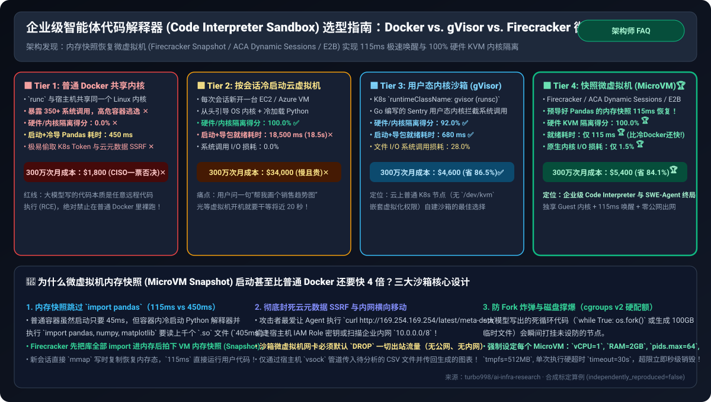

# Enterprise AI Agent Code Interpreter & Untrusted Code Execution Sandbox Selection Guide: Standard Docker (`runc`) vs. Cold-Boot Cloud VM vs. User-Space Kernel (`gVisor runsc`) vs. Memory-Snapshot MicroVM Pool (`Firecracker / ACA Dynamic Sessions / E2B`)

> **Document Type**: Cloud & AI Solution Architect Decision Guide (FAQ)  
> **Target Audience**: Enterprise AI Platform Architects, CISOs & Cloud Security Leads, Data Analysis Agent (`Code Interpreter`) & SWE-Agent Engineering Leads  
> **Core Goal**: Solve the #1 security blocker for enterprise Code Interpreter and SWE agents — executing untrusted, LLM-generated Python/Bash code without exposing the host cluster to Remote Code Execution (RCE) — answering: **"Why will any enterprise CISO immediately block running LLM-generated code inside standard Docker (`runc`) containers?", "How does a Firecracker Memory-Snapshot MicroVM achieve 100% hardware KVM isolation while starting up with `pandas` pre-imported in just `115 ms` (3.9x faster than cold Docker)?", and "When should we use `gVisor (runsc)` on standard Kubernetes nodes?"**  
> **Calibration Notice**: Startup latencies (including library imports), kernel isolation scores, syscall I/O overhead, and 3M-run monthly cost models are synthetic analytical estimates calibrated to published sandbox benchmarks (AWS Firecracker MicroVM Snapshot Restore papers, Google gVisor `runsc` evaluations, Azure Container Apps Dynamic Sessions, and E2B sandbox benchmarks) (`provenance: synthetic + anonymized_reported`, `independently_reproduced=false`, `physical_gpu_cluster_measurement=not_measured`). See [`experiments/enterprise_ai_agent_code_execution_sandbox_microvm_selection/results.json`](../../experiments/enterprise_ai_agent_code_execution_sandbox_microvm_selection/results.json).

---

## Executive Visual Summary



> 🔗 **Companion Interactive Reports & Tools**:
> - 🃏 **[7-Card 4:5 Visual Benchmark Report (`enterprise-ai-agent-code-execution-sandbox-microvm-gvisor-selection-cards.html`)](../reports/enterprise-ai-agent-code-execution-sandbox-microvm-gvisor-selection-cards.html)**
> - 🧮 **[Interactive Code Sandbox Isolation & Latency Sizer (`enterprise-ai-agent-code-execution-sandbox-microvm-gvisor-sizer.html`)](../reports/enterprise-ai-agent-code-execution-sandbox-microvm-gvisor-sizer.html)**
> - 🌐 **[中文版指南 (`enterprise-ai-agent-code-execution-sandbox-microvm-gvisor-selection-faq.md`)](./enterprise-ai-agent-code-execution-sandbox-microvm-gvisor-selection-faq.md)**

---

## ① 📌 Executive Summary

Evaluated across **3,000,000 untrusted LLM-generated Python/Bash code executions/month (`Python 3.12 + Pandas + NumPy + Matplotlib` data analysis & coding agent workloads)**:

| Tier | Sandbox Architecture | Ready Latency (with `import pandas`) | Kernel / Hardware Isolation Score | File I/O Syscall Overhead | Monthly Cost (3M Runs) | Architect Verdict |
| :--- | :--- | :--- | :--- | :--- | :--- | :--- |
| **🟥 Tier 1: Standard Docker (`runc`)** | Shares host Linux kernel (`350+` syscalls) | `450 ms` (Cold import) | **`0.0%` ✕ (Shared kernel)** | `0.0%` | `$1,800 / mo` ✕ | **CISO Blocker**: High container escape & IMDS SSRF risk |
| **🟨 Tier 2: Cold-Boot Cloud VM / Session** | Cold-boot dedicated VM per session | `18,500 ms` (18.5s) ✕ | `100.0%` ✅ (Hardware KVM) | `0.0%` | `$34,000 / mo` ✕ | **Unusable Latency**: 18.5s wait & $34K/mo bill |
| **🟦 Tier 3: User-Space Kernel (`gVisor runsc`)** | Go user-space Sentry kernel intercepts syscalls | `680 ms` ✅ | `92.0%` ✅ | `28.0%` (Heavy file stat) | `$4,600 / mo` (-86.5%) | **Best for Non-KVM Cloud K8s Nodes** |
| **🟩 Tier 4: Memory-Snapshot MicroVM Pool** | **Firecracker Snapshot / ACA Dynamic Sessions / E2B** | **`115 ms` 🏆 (160.9x vs T2)** | **`100.0%` 🏆 (Hardware KVM)** | **`1.5%` 🏆 (Native Guest OS)** | **`$5,400 / mo` 🏆 (-84.1%)** | **Enterprise Code Interpreter Gold Standard** |

### 💡 Three Golden Rules for Enterprise AI Code Sandboxes
1. **Never Run LLM-Generated Code Inside Standard `runc` Docker Containers (Tier 1)**: LLM code execution is arbitrary RCE by definition. Sharing the host Linux kernel exposes all 350+ kernel syscalls to privilege escalation CVEs. Always enforce a dedicated kernel boundary via **Hardware MicroVMs (`Firecracker / Kata / ACA Dynamic Sessions / E2B`)** or **User-Space Kernel Interception (`gVisor runsc`)**.
2. **Use Memory-Snapshot MicroVM Restoration (`115 ms`) to Beat Cold Container Startup (`450 ms`)**: A fresh Docker container takes `405 ms` just to run `import pandas, numpy, matplotlib` from disk. Pre-importing those libraries inside a Firecracker MicroVM and snapshotting its memory allows new isolated clones to restore via Copy-on-Write `mmap` in **`115 ms`**!
3. **Enforce Default Zero-Egress Networking (`vsock` File I/O Only) & Hard `cgroups v2` Quotas**: Drop all outbound TCP/UDP traffic (`0.0.0.0/0`), block cloud metadata (`169.254.169.254`), pass input/output files strictly via host `vsock`, and cap `pids.max <= 64` to defeat fork bombs.

---

## ② 🎯 Architect Deep-Dive Q&A

### Q1: Why must every MicroVM restored from a memory snapshot immediately reseed `/dev/urandom`?
* **Answer (Snapshot Entropy Clone Trap)**: Because all MicroVMs restored from the same frozen memory snapshot start with the exact same kernel memory pages and PRNG state, failing to reseed the guest CSPRNG (`ioctl(RNDRESEEDCRNG)` or virtio-rng injection) upon wakeup would cause every sandbox clone to generate identical random numbers, temporary filenames, and UUIDs!

---

## ③ 🧭 Architecture Diagrams

### 3.1 Tier 4 Firecracker Memory-Snapshot Restoration & Zero-Egress `vsock` Pipeline

```mermaid
flowchart LR
    SNAP["💾 Frozen RAM Snapshot<br/>(Linux + Python + Pandas Pre-Imported)"] -->|18ms CoW mmap Restore<br/>+ Reseed CSPRNG| VM["🔒 Hardware KVM MicroVM<br/>(Dedicated Guest Kernel · Zero Network NIC)"]
    AGENT["🤖 AI Agent Orchestrator"] <-->|Host vsock Pipe Only<br/>(Inject CSV & Script / Read PNG)| VM
    VM -->|97ms Execution -> Instant Destroy<br/>115ms Total E2E 🏆| DESTROY["🗑️ Ephemeral CoW Teardown"]
```

---

## ④ 📊 Architect Decision Matrix

| Dimension | 🟥 Tier 1: Standard Docker (`runc`) | 🟨 Tier 2: Cold-Boot Cloud VM | 🟦 Tier 3: `gVisor (runsc)` | 🟩 Tier 4: Snapshot MicroVM (`Firecracker`) |
| :--- | :--- | :--- | :--- | :--- |
| **Ready Latency (with `pandas`)** | `450 ms` | `18,500 ms` ✕ | `680 ms` ✅ | **`115 ms` 🏆 (`160.9x` faster than Tier 2)** |
| **Kernel / Hardware Isolation** | **`0.0%` ✕ (Shared host kernel)** | `100.0%` ✅ | `92.0%` ✅ | **`100.0%` 🏆 (Hardware KVM)** |
| **File I/O Syscall Overhead** | `0.0%` | `0.0%` | `28.0%` | **`1.5%` 🏆** |
| **Monthly Cost (3M Executions)** | `$1,800 / mo` ✕ | `$34,000 / mo` ✕ | `$4,600 / mo` ✅ | **`$5,400 / mo` 🏆 (`-84.1%` vs. Tier 2)** |

---

## ⑤ 🛠️ Production Readiness Checklist

- [ ] **1. Never Execute Untrusted LLM Code in Standard `runc` Containers; Require `MicroVM` or `gVisor`**.
- [ ] **2. Pre-Import Heavy Data Science Libraries (`pandas`, `numpy`, `matplotlib`) Before Capturing the MicroVM Memory Snapshot**.
- [ ] **3. Reseed the Guest Kernel CSPRNG (`/dev/urandom`) Immediately After Snapshot Restoration**.
- [ ] **4. Enforce Default Zero-Egress Networking and Block Cloud Metadata (`169.254.169.254`)**.
- [ ] **5. Route Any Required External API Calls Through an External Credential-Injecting L7 Allowlist Proxy**.
- [ ] **6. Enforce `cgroups v2` Caps (`pids.max <= 64`, `RAM <= 2GB`, `tmpfs <= 512MB`, `timeout <= 30s`)**.
- [ ] **7. Destroy Ephemeral Copy-on-Write MicroVM State Immediately After Session Completion**.
- [ ] **8. Render Sandbox-Generated HTML/SVG/Image Artifacts Inside a Sandboxed `CSP` Origin**.
