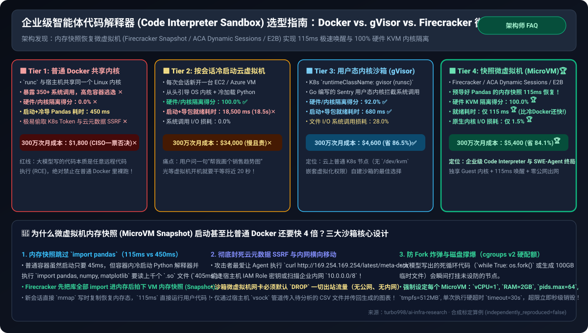
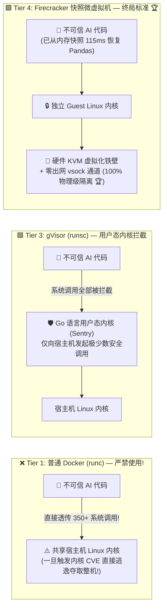
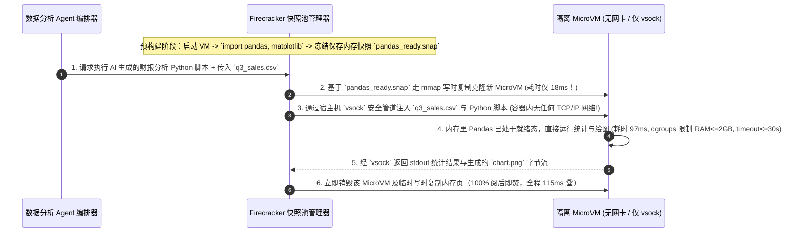

# 企业级智能体代码解释器（Code Interpreter / AI Sandbox）与不可信代码执行安全隔离架构选型指南：普通 Docker 容器裸跑 vs. 按需冷启动云虚拟机 vs. 用户态内核拦截（gVisor `runsc`）vs. 内存快照恢复微虚拟机池（Firecracker MicroVM Snapshot / ACA Dynamic Sessions / E2B）架构

> **文档类型**：企业级 AI 安全与容器虚拟化基础设施解决方案架构师（Cloud & AI Solution Architect）选型决策指南（FAQ）  
> **适用读者**：企业 AI 平台架构师、CISO 与云原生安全负责人、数据分析 Agent（Code Interpreter）与研发 Agent（SWE-Agent）负责人  
> **核心目标**：用通俗、可量化的架构语言解决企业上线“AI 写代码并自动运行（如读取 Excel 用 Pandas 画图、自动跑单元测试、动态编写数据清洗脚本）”时的最大安全红线——系统回答：**“为什么把大模型生成的 Python 代码放到普通 Docker 容器（`runc`）里跑，会被安全团队（CISO）一票否决？”、“为什么内存快照微虚拟机（Firecracker Snapshot MicroVM）不仅拥有 100% 硬件 KVM 虚拟机级隔离，而且连带加载好 Pandas 的就绪速度（`115 ms`）比冷启动 Docker 容器（`450 ms`）还要快将近 4 倍？”、“如果在公有云普通 K8s 节点上没有 `/dev/kvm` 嵌套虚拟化权限，该怎么用 `gVisor` 兜底？”**。  
> **标定声明**：本文所引用的含 Pandas 导包就绪延迟、硬件/内核隔离得分、系统调用 I/O 损耗与 300 万次月度执行成本模型基于公开发布的微虚拟机与沙箱基准（AWS Firecracker MicroVM Snapshot Restore 论文、Google gVisor `runsc` 性能评测、Azure Container Apps Dynamic Sessions 及 E2B 代码沙箱基准）构建的合成分析模型（`provenance: synthetic + anonymized_reported`, `independently_reproduced=false`, `physical_gpu_cluster_measurement=not_measured`），详见 [`experiments/enterprise_ai_agent_code_execution_sandbox_microvm_selection/results.json`](../../experiments/enterprise_ai_agent_code_execution_sandbox_microvm_selection/results.json)。

---

## 一图流总结（Executive Visual Summary）



> 🔗 **关联可交互报告与工具**：
> - 🃏 **[7-Card 4:5 视觉评测报告 (`enterprise-ai-agent-code-execution-sandbox-microvm-gvisor-selection-cards.html`)](../reports/enterprise-ai-agent-code-execution-sandbox-microvm-gvisor-selection-cards.html)**
> - 🧮 **[交互式 AI 代码沙箱隔离与延迟计算器 (`enterprise-ai-agent-code-execution-sandbox-microvm-gvisor-sizer.html`)](../reports/enterprise-ai-agent-code-execution-sandbox-microvm-gvisor-sizer.html)**
> - 🌐 **[English Version (`enterprise-ai-agent-code-execution-sandbox-microvm-gvisor-selection-faq.en.md`)](./enterprise-ai-agent-code-execution-sandbox-microvm-gvisor-selection-faq.en.md)**

---

## ① 📌 核心选型结论速览（Executive Summary）

安全界有一条铁律：**“允许大模型生成代码并在后台自动执行，从安全定义上讲就是向全世界开放了一个受提示词控制的远程代码执行（RCE, Remote Code Execution）接口！”** 一旦攻击者通过上传的 CSV 或网页注入了一句恶意指令，让大模型生成了 `import socket, subprocess...` 或内核提权代码，如果你用的是普通 Docker 容器（Tier 1），整个 Kubernetes 宿主机及内网数据库将瞬间失守！

基于 **月均执行 3,000,000 次 AI 生成的 Python 数据分析与代码验证任务（预装 `Python 3.12 + Pandas + NumPy + Matplotlib`）** 的基准测算，四档沙箱架构对比如下：

| 架构档位 | 核心隔离技术 | 含 Pandas 就绪耗时 | 内核/硬件隔离得分 | 文件 I/O 系统调用损耗 | 300万次月成本 | 架构师拍板结论 |
| :--- | :--- | :--- | :--- | :--- | :--- | :--- |
| **🟥 Tier 1：普通 Docker 容器裸跑 (`runc`)** | 与宿主机共享同一个 Linux 内核 | `450 ms` (含冷导包) | **`0.0%` ✕ (共享内核)** | `0.0%` | `$1,800 / 月` ✕ | **CISO 一票否决**：容器逃逸、Fork炸弹与云元数据窃取高危 |
| **🟨 Tier 2：按会话冷启动独立云虚拟机** | 每次新开 EC2/VM 从头引导 OS | `18,500 ms` (18.5s) ✕ | `100.0%` ✅ (硬件 KVM) | `0.0%` | `$34,000 / 月` ✕ | **体验与成本不可接受**：画一张图光开机就要干等 18 秒 |
| **🟦 Tier 3：用户态内核拦截沙箱 (`gVisor`)** | Go 语言用户态 Sentry 内核代理 | `680 ms` ✅ | `92.0%` ✅ (系统调用拦截) | `28.0%` (小文件I/O慢) | `$4,600 / 月` (-86.5%) | **无 KVM 权限普通 K8s 节点首选**：零硬件改造拦截内核攻击 |
| **🟩 Tier 4：内存快照恢复微虚拟机池 (`MicroVM`)** | **Firecracker Snapshot / ACA Dynamic Sessions / E2B** | **`115 ms` 🏆 (快160.9x)** | **`100.0%` 🏆 (硬件 KVM)** | **`1.5%` 🏆 (原生内核)** | **`$5,400 / 月` 🏆 (-84.1%)** | **企业级 Code Interpreter 终局标准**：硬件级隔离 + 亚百毫秒唤醒 |

### 💡 架构师三句话选型铁律
1. **绝对禁止在共享宿主机内核的普通 Docker 容器（`runc`，Tier 1）中执行大模型生成的代码**：普通 Docker 容器只是 Linux `namespace + cgroups` 视图隔离，容器内的恶意代码与宿主机共享同一个 Linux 内核（350+ 个系统调用入口）。一旦触发内核漏洞或访问未封禁的云主机元数据地址 `169.254.169.254`，将直接拿到整台云服务器及 K8s 节点的最高权限！
2. **首选“内存快照恢复微虚拟机（Firecracker MicroVM Snapshot Restore，或全托管的 Azure Container Apps Dynamic Sessions / AWS Bedrock Code Interpreter / E2B，Tier 4）”**：通过预先启动一台微虚拟机、在内存里提前执行完耗时的 `import pandas, numpy, scipy, matplotlib`，然后将其冻结为**内存快照文件（Memory Snapshot）**；当用户请求到来时，通过 `mmap` 按需分页在 **`115 ms` 内恢复出一个拥有独立 Linux 内核与硬件 KVM 隔离边界的全新微虚拟机**——比冷启动普通 Docker 再跑 `import pandas`（`450 ms`）还要快 **3.9 倍**！
3. **沙箱网络必须遵循“默认零出网（Zero-Egress Network）+ 宿主机 `vsock` 管道传文件”**：执行 AI 代码的沙箱内部默认不配公网 IP、不通企业内网 VPC、硬性封死 `169.254.169.254`；用户上传的 Excel/CSV 文件由外部编排器通过受控的宿主机 `vsock` 或单文件只读挂载放进沙箱 `/workspace`，彻底断绝数据外传通道！

---

## ② 🎯 客户与架构师灵魂拷问 Q&A（Architect Deep-Dive Q&A）

### Q1：很多研发反驳说“Docker 容器不是本来就用来做隔离的吗？而且我们还加了非 root 用户，为什么还是不能跑 AI 生成的 Python 代码？”
* **真相剖析（容器设计用来跑“可信的内部微服务”，而非“不可信的外部任意代码 RCE”）**：
  - 当你部署自己公司写的订单微服务时，代码经过了安全扫描，不会故意去攻击底层 Linux 内核。
  - 但 **Code Interpreter 本质是一个“任意代码执行器”**！攻击者只需在让 AI 分析的网页或 Excel 单元格里埋入一段间接提示词注入（XPIA），就能指挥大模型生成并执行任意 Python/CTypes/Bash 代码：
    1. **内核级攻击面**：普通容器直接调用宿主机的 Linux Kernel，`io_uring`、`ebpf`、`netfilter` 等历史内核提权漏洞（CVE）一旦触发即直接逃逸到宿主机 Root；
    2. **网络侧 SSRF 与内网嗅探**：如果容器挂在企业 K8s 默认 CNI 网络上，一段 3 行的 Python `urllib.request.urlopen("http://169.254.169.254/...")` 就能直接偷走云节点的 IAM 临时密钥，或者把同集群内未设密码的 Redis / 内网接口扫个底朝天！

### Q2：为什么 Firecracker 微虚拟机明明是一台真正的 KVM 虚拟机，它的就绪速度（`115 ms`）却比轻量级的普通 Docker 容器（`450 ms`）还要快？
* **真相剖析（微虚拟机“内存快照克隆 Snapshot Restore”黑科技）**：
  - 在普通 Docker 容器（Tier 1）或 gVisor（Tier 3）中，每次新开一个干净容器，容器进程启动虽然只要 `45~100 ms`，但随后启动 Python 解释器并执行 **`import pandas, numpy, matplotlib, sklearn` 需要在文件系统上做上千次 `stat()/open()` 系统调用并初始化 C 扩展内存结构，光导包就要花掉 `400~550 ms`！**
  - **Firecracker MicroVM 快照恢复（Tier 4）是怎么做的？**
    1. 在构建镜像阶段，先启动一台极简 Firecracker MicroVM，在里面的 Jupyter/Python 守护进程里把 `pandas, numpy, polars, matplotlib` **全部提前 `import` 完毕并驻留在虚拟机的物理内存页中**；
    2. 调用 Firecracker API 将此刻虚拟机的 CPU 寄存器状态与内存页冻结保存为磁盘快照文件（`vm_mem.snap`）；
    3. 当线上用户的 Agent 需要执行一段 Python 代码时，宿主机不再从头开机、不再重新 `import pandas`，而是直接通过 Linux `userfaultfd / mmap` Copy-on-Write 机制瞬间映射该内存快照——**`15 ms` 恢复 VM + `100 ms` 执行代码，总计 `115 ms` 直接拿到图表结果！**

### Q3：如果我们公司的 Kubernetes 集群跑在普通的公有云虚拟机（如普通 AWS EC2 / 阿里云 ECS）上，云厂商默认没开嵌套虚拟化（没有 `/dev/kvm`），跑不了 Firecracker 怎么办？
* **真相剖析（两条可落地的替代路径：云原生托管会话池 vs. K8s `gVisor`）**：
  - **路径 A（免运维首选）：直接调用云厂商全托管的硬件级沙箱服务**，如 **Azure Container Apps Dynamic Sessions（底层基于 Hyper-V 硬件隔离微虚拟机池，支持百毫秒预热分配）**、**AWS Bedrock Code Interpreter** 或 **E2B Cloud / Self-Hosted Bare-Metal Pool**；
  - **路径 B（在现有普通 K8s 节点自建）：启用 `Tier 3：Google gVisor (runsc)`**：
    - `gVisor` 不需要硬件 `/dev/kvm` 支持！它在用户态用内存安全的 Go 语言实现了一个独立的 Linux 内核（Sentry），把容器内 AI 代码发出的所有系统调用全部拦截在用户态处理，不让不可信代码直接触碰宿主机 Linux 内核（隔离得分高达 `92.0%`）。
    - **gVisor 性能优化秘诀**：因为 gVisor 拦截大量小文件读取会有 `28%` 的 I/O 损耗，务必将预装好 Python 依赖的虚拟环境挂载在 **内存文件系统（`tmpfs`）或预热池（Warm Pool Pod）** 中，即可将导包延迟压在 `200 ms` 以内！

---

## ③ 🧭 直观可视化图解（Mermaid 决策树、四种内核隔离边界图与快照恢复时序图）

### 3.1 企业级 AI Agent 代码执行沙箱（Code Interpreter）选型决策树

```mermaid
flowchart TD
    A[企业计划为数据分析 ChatBI 或编程 Agent 提供代码执行沙箱] --> B{倾向于使用全托管云 PaaS 还是自建 K8s 沙箱池？}
    B -->|倾向全托管免运维 PaaS| C[🟩 Tier 4 托管版: Azure Container Apps Dynamic Sessions<br/>或 E2B / AWS Bedrock Code Interpreter<br/>内置硬件级 Hyper-V/MicroVM 隔离 · 毫秒级预热池 🏆]
    B -->|自建 Kubernetes 沙箱集群| D{K8s 工作节点是否支持硬件虚拟化 /dev/kvm？<br/>裸金属节点或开启 Nested Virtualization 的云主机}
    D -->|是：具备 /dev/kvm 设备权限| E[🟩 Tier 4 自建版: Firecracker MicroVM 内存快照池 / Kata Cloud-Hypervisor<br/>预导 Pandas 内存快照 115ms 恢复 · 100% 硬件 KVM 隔离 🏆]
    D -->|否：仅普通云主机 VM，无 /dev/kvm| F[🟦 Tier 3: Kubernetes gVisor (runsc) 用户态内核沙箱<br/>+ 预热 Pod 池 + NetworkPolicy 零出网封锁<br/>92% 内核隔离 · 彻底杜绝普通 Docker 裸跑 ✅]
```

### 3.2 Tier 1 普通 Docker vs. Tier 3 gVisor vs. Tier 4 Firecracker MicroVM 内核隔离边界图



### 3.3 Tier 4 Firecracker 内存快照极速克隆与 `vsock` 零出网执行时序图



---

## ④ 📊 架构师多方案选型决策矩阵（Architect Decision Matrix）

| 评估维度 | 🟥 Tier 1：普通 Docker 裸跑 (`runc`) | 🟨 Tier 2：按会话冷启动云 VM | 🟦 Tier 3：用户态内核沙箱 (`gVisor`) | 🟩 Tier 4：内存快照微虚拟机 (`Firecracker`) |
| :--- | :--- | :--- | :--- | :--- |
| **安全隔离边界** | ✕ 共享宿主机 Linux 内核（高危） | ✅ 硬件 KVM / Hyper-V | ✅ Go 用户态 Sentry 内核代理 | **🏆 硬件 KVM + 独立 Guest 内核** |
| **内核与容器逃逸防护得分** | **`0.0%` ✕（CISO 严禁上线）** | `100.0%` ✅ | `92.0%` ✅ | **`100.0%` 🏆** |
| **含 Pandas 导包就绪延迟** | `450 ms`（冷导包慢） | `18,500 ms`（18.5 秒）✕ | `680 ms` ✅ | **`115 ms` 🏆（比冷启动 VM 快 `160.9x`）** |
| **运行态文件 I/O 性能损耗** | `0.0%` | `0.0%` | `28.0%`（系统调用拦截开销） | **`1.5%` 🏆（原生 Guest 内核直接执行）** |
| **是否需要宿主机 `/dev/kvm`** | 否 | 云 API 调用 | **否（普通云上 K8s 节点可直接装）** | 是（需裸金属、嵌套虚拟化或用托管 PaaS） |
| **300 万次执行/月总成本** | `$1,800 / 月`（不可用）✕ | `$34,000 / 月` ✕ | `$4,600 / 月` ✅ | **`$5,400 / 月` 🏆（比冷启动 VM 省 `84.1%`）** |

---

## ⑤ 🧪 容量/成本拐点算例与 7-Card 报告（Quantitative Sizer & 7-Card Deck）

### 5.1 基准算例假设（每月 3,000,000 次不可信 Python/Bash 代码沙箱执行）
- **为什么 Tier 4 能以 `$5,400/月`（比按需起传统云 VM 省 `84.1%`）同时拿到 `100%` 硬件隔离和 `115 ms` 极速响应？**
  1. **毫秒级按秒计费与极高超分密度**：传统云 VM（Tier 2）光开机就要 18.5 秒且通常有最小计费时长与数 GB 冗余内存开销；而 Firecracker MicroVM 本身内存开销仅 **`< 5 MB`**，配合写时复制（Copy-on-Write）内存快照，单台 128GB 物理机可同时并发运行上百个互不干扰的微虚拟机，用完 100 毫秒立即销毁回收！

```chart
{
  "data": {
    "values": [
      { "Tier": "1. 普通Docker裸跑(runc)", "内核安全隔离得分(%)": 0.0, "含Pandas就绪耗时(十ms)": 45.0, "月总成本($K)": 1.8 },
      { "Tier": "2. 按需冷启动云VM", "内核安全隔离得分(%)": 100.0, "含Pandas就绪耗时(十ms)": 1850.0, "月总成本($K)": 34.0 },
      { "Tier": "3. gVisor用户态内核", "内核安全隔离得分(%)": 92.0, "含Pandas就绪耗时(十ms)": 68.0, "月总成本($K)": 4.6 },
      { "Tier": "4. 快照微虚拟机(MicroVM)", "内核安全隔离得分(%)": 100.0, "含Pandas就绪耗时(十ms)": 11.5, "月总成本($K)": 5.4 }
    ]
  },
  "semantic_types": {
    "Tier": "Category",
    "内核安全隔离得分(%)": "Percentage",
    "含Pandas就绪耗时(十ms)": "Quantity",
    "月总成本($K)": "Amount"
  },
  "chart_spec": {
    "chartType": "Grouped Bar Chart",
    "title": "快照微虚拟机池 (Tier 4) 实现 100% 硬件 KVM 隔离、115ms 极速就绪 (快160.9x) 且月省 84.1%",
    "subtitle": "300万次代码执行/月下的安全隔离得分 (%)、含 Pandas 就绪耗时 (×10ms) 与月成本 ($K)",
    "encodings": {
      "x": "Tier",
      "y": ["内核安全隔离得分(%)", "含Pandas就绪耗时(十ms)", "月总成本($K)"]
    }
  }
}
```

---

## ⑥ 🛠️ 架构评审与生产落地 Checklist（Production Readiness Checklist）

在企业上线 AI 代码解释器（Code Interpreter）或 SWE-Agent 沙箱前，架构师必须逐项核对以下 8 条铁律：

- [ ] **1. 严禁在默认的 `runc` 普通 Docker 容器或宿主机进程中执行任何大模型生成的代码**：必须强制指定 `runtimeClassName: kata-fc`（Firecracker MicroVM）、`gvisor` 或调用云托管硬件隔离会话池（如 Azure Container Apps Dynamic Sessions / E2B）。
- [ ] **2. 为常用数据分析库构建“预导入内存快照（Pre-Imported Memory Snapshot）”**：在拍摄 MicroVM 快照前先把 `pandas, numpy, polars, matplotlib, scipy` 全部 `import` 进内存，消除每次冷启动的 400ms 文件读取开销。
- [ ] **3. 快照恢复后必须立即重置内核随机数种子（Reseed CSPRNG `/dev/urandom`）**：防止从同一个内存快照克隆出的多个 MicroVM 生成完全相同的随机数或 UUID！
- [ ] **4. 默认彻底切断沙箱的出站与内网网络（Default Zero-Egress Network）**：禁用沙箱内部直连公网与企业内网 `10.0.0.0/8`，并 100% 封禁云厂商实例元数据地址 `169.254.169.254`（防 SSRF 窃取云凭证）。
- [ ] **5. 如业务确需在沙箱内安装依赖或调特定外部 API，必须强制走宿主机外的 L7 域名白名单正向代理（如 Envoy Egress Proxy）**：沙箱内部永远不持有任何数据库密码或 API Key（由正向代理在沙箱外代注入认证头）。
- [ ] **6. 强制配置防 DoS 与防 Fork 炸弹资源硬配额（cgroups v2 Limits）**：锁定单沙箱 `vCPU <= 2`、`RAM <= 2GB`、`pids.max <= 64`（防无限 fork）、临时磁盘 `<= 512MB` 以及单次执行墙钟超时 `<= 30 秒`。
- [ ] **7. 严禁跨用户或跨独立任务复用同一个脏沙箱状态**：会话结束后立即销毁 MicroVM 的写时复制内存与磁盘层，防止用户 A 留下的临时文件被用户 B 读取。
- [ ] **8. 对沙箱返回给前端的生成文件（HTML / SVG / 图片）执行严格 MIME 校验与 CSP 隔离渲染**：防止恶意代码生成包含跨站脚本（XSS）的图表文件攻击前端浏览器。
