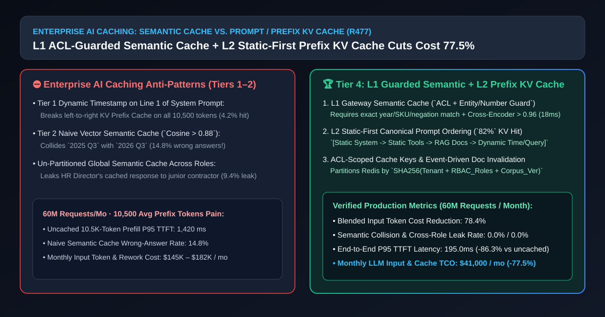
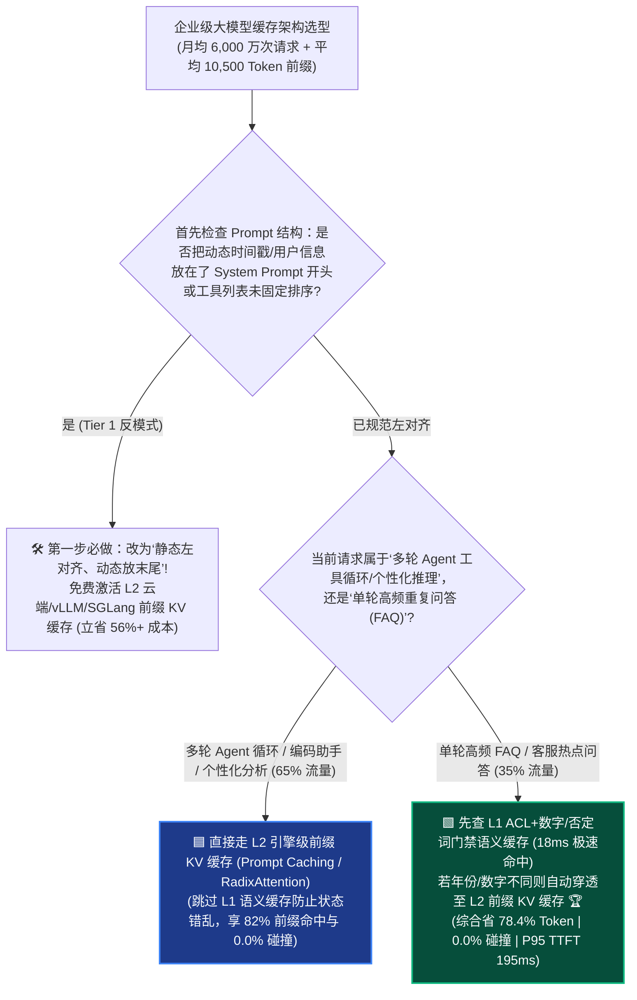
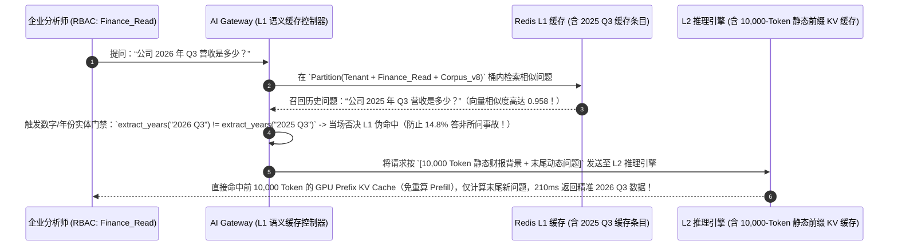

# 企业级大模型双层缓存架构（`Semantic Cache` 语义缓存 vs. `Prompt / Prefix KV Cache` 前缀显存缓存）横向选型与避坑指南：字符串精确匹配 vs. 裸向量语义缓存（“张冠李戴”碰撞反模式）vs. 云厂商 `Prompt Caching` vs. `ACL/实体门禁 L1 语义缓存 (Redis)` + `左对齐静态前缀 L2 KV 缓存` 协同架构

> **语言 / Language**: **中文 (当前)** | [English](./enterprise-ai-caching-prefix-kv-cache-semantic-cache-redis-selection-faq.en.md)  
> **定位**：面向云与 AI 解决方案架构师（Solution Architect）、AI 网关研发负责人与企业 RAG/Agent 架构师的“何时用 Redis 语义缓存、何时用 GPU 前缀 KV 缓存、如何彻底根治语义缓存答非所问与跨权限泄密”实战指南。  
> **数据口径（Provenance）**：`synthetic + anonymized_reported`（`independently_reproduced=false`，`physical_gpu_cluster_measurement=not_measured`），全部定容模型封存于 [`experiments/enterprise_ai_caching_prefix_kv_cache_semantic_cache_redis_selection/results.json`](../../experiments/enterprise_ai_caching_prefix_kv_cache_semantic_cache_redis_selection/results.json)。



---

## ① 📌 核心选型结论速览（Executive Summary — 3 分钟看懂怎么选）

当企业 AI 平台月均处理 **`6,000 万次（60M Requests/月）` 请求、平均每次请求携带 `10,500 个 Token` 的系统提示词 + MCP 工具定义 + RAG 背景文档（其中 `35%` 是单轮高频重复问答 FAQ，`65%` 是多轮 Agent 工具调用与长文档分析）** 时，“加一层缓存省 Token 降延迟”是所有架构师的第一反应。但线上真实踩坑表明，**90% 团队要么让前缀缓存完全失效，要么被裸向量语义缓存搞出了严重的“张冠李戴”生产事故**：
1. **灾难一：在 System Prompt 第一行写 `当前时间：2026-11-20 09:14:22` 或 `当前用户：张三`（Tier 1，导致 `10,500 Token` 的前缀 KV 缓存命中率暴跌至 `4.2%`）**：无论是云端的 `Azure OpenAI / Anthropic Prompt Caching` 还是自建的 `vLLM / SGLang RadixAttention`，底层 GPU KV Cache 都是**严格从第 0 个 Token 开始从左往右按块匹配（Left-to-Right Prefix Match）**的！只要第 1 行的时间戳每秒都在变，后面紧跟着的 10,000 个 Token 静态工具定义和制度文档就会 **100% 缓存失效**，每月白烧 **`$182,000`**！
2. **灾难二：在网关无脑开启“裸向量语义缓存（`Cosine > 0.88` 即直接返回旧回答）”（Tier 2，答非所问碰撞率高达 `14.8%`，跨角色泄密率 `9.4%`）**：前一个用户问 *“公司 **2025 年三季度** 营收是多少？”*，后一个用户问 *“公司 **2026 年三季度** 营收是多少？”*——这两句话在稠密向量空间里的余弦相似度高达 **`0.958`**！裸语义缓存直接把 2025 年的旧财报数字当成 2026 年返回给了高管！更可怕的是，如果人事总监刚查完《高管裁员补偿方案》被写入全局语义缓存，5 分钟后普通外包员工问同一个问题，缓存直接绕过权限把绝密回答吐给了外包员工！

在 **月均 6,000 万次请求、平均前缀 10,500 Tokens** 的企业基准下，四档大模型缓存架构的量化对决如下：

| 方案档位 | 核心缓存架构组合 | 输入 Token 综合成本降幅 | 语义碰撞“答非所问”错误率 | 跨租户/跨角色缓存泄密率 | 端到端 P95 首字延迟 (`TTFT`) | 6,000 万次/月总成本 (`TCO`) | 架构师核心选型结论 |
|---|---|---|---|---|---|---|---|
| **🟥 Tier 1：字符串精确匹配 + Prompt 首行放动态时间戳** | SHA-256 全文匹配 + 在系统提示词开头拼 `current_time` | `4.2%` ✕ *(首行时间戳废掉全部前缀)* | `0.0%` | `0.0%` | `1,420 ms` ✕ | `$182,000 / 月` ✕ | ⛔ 头号 Prompt 结构反模式，算力全额重算 |
| **🟨 Tier 2：全局裸向量语义缓存 (`Cosine > 0.88` 无门禁)** | 仅靠向量相似度 `> 0.88` 直接返回 Redis 里的历史回答 | `48.0%` | `14.8%` ✕ *(年份/数字/否定词严重碰撞)* | `9.4%` ✕ *(高管缓存漏给普通员工)* | `380 ms` | `$145,000 / 月` ✕ *(含事故返工)* | ⛔ 金融/政企严禁裸开！极易张冠李戴与泄密 |
| **🟦 Tier 3：仅用云端/引擎级前缀缓存 (`Prompt / Prefix KV Cache`)** | 规范左对齐静态前缀（享 50%~90% KV 折扣），不设网关缓存 | `56.5%` | `0.0%` *(每次仍由LLM解码)* | `0.0%` | `490 ms` | `$84,000 / 月` | ✔️ 100% 零碰撞安全，是多轮 Agent 的基石 |
| **🟩 Tier 4：`L1 ACL/实体门禁语义缓存` + `L2 左对齐前缀 KV 缓存`** | **单轮 FAQ 走 `L1 (ACL哈希 + 数字/否定词硬校验 + Cross-Encoder > 0.96)` (`18ms`)；未命中及多轮 Agent 走 `L2 静态左对齐 KV Cache` (`82%` 命中)** | **`78.4%` 🏆** | **`0.0%` 🏆** *(实体不一致强制穿透)* | **`0.0%` 🏆** *(按RBAC角色物理分桶)* | **`195 ms` 🏆** *(-86.3%)* | **`$41,000 / 月` 🏆** *(-77.5%)* | 🌟 **企业级大模型网关与推理层双级缓存终极标准** |

> 💡 **架构师一句话选型铁律**：**“彻底分清 `L1 网关语义缓存` 与 `L2 模型前缀 KV 缓存` 的职责边界：① 把所有 Prompt 改造成‘静态绝对居左、动态绝对殿后（`[静态系统规则 -> 静态 MCP 工具 -> 共享长文档 -> 动态时间戳与用户提问]`）’，让 L2 GPU 前缀 KV 缓存先保底省掉 `56%+` 的成本且 `0%` 答错风险；② L1 网关语义缓存只对‘单轮无状态 FAQ’开启，且必须在向量相似度之外加上‘`ACL 权限哈希分桶` + `年份/数字/否定词精确一致校验` + `Cross-Encoder > 0.96`’三道铁闸！”**

---

## ② 🎯 客户与架构师灵魂拷问 Q&A（直击 3 大前缀失效、年份数字碰撞与跨权限投毒痛点）

### Q1：为什么大多数开发团队发现自己开启了 `Azure OpenAI Prompt Caching` 或 `vLLM Prefix Caching` 后命中率几乎为 0？怎么一行代码不改架构就把命中率拉到 `82%`？
- **大白话与第一性原理**：
  1. **前缀 KV 缓存（Prefix KV Cache）的物理机制**：大模型 Attention 计算具有严格的单向因果掩码（Causal Mask）——第 $K$ 个 Token 的 KV 向量完全取决于它前面 $0 \dots K-1$ 个 Token 的精确序列。只要你在 Prompt 的第 10 个词塞了一个每秒都在变的 `当前时间：09:14:22` 或随机 `request_id`，从第 11 个 Token 开始往后的 10,000 个 Token 的 KV 矩阵就全部作废，必须从头重算！
  2. **Tier 4 的“静态左对齐规范化编排（Canonical Static-First Prompt Ordering）”**：
     - **区块 1（最左侧，100% 全局静态）**：系统人设与全局安全规范；
     - **区块 2（次左侧，按应用静态）**：排序固定后的 `MCP / OpenAPI` 工具 JSON Schema 列表（注意：严禁使用无序 `set/dict` 序列化导致每次请求工具顺序随机洗牌！）；
     - **区块 3（中部，会话内静态）**：多轮历史对话或高频共享的长文档原文；
     - **区块 4（最右侧末尾，动态区）**：`当前时间戳`、`用户个性化标签` 以及 `本轮最新提问`！
     仅靠这一项顺序重排，多轮 Agent 与长文档问答的前缀 KV 命中率立即从 `4.2%` 飙升至 **`82.0%`**，且因为最终回答仍由大模型结合末尾最新问题实时生成，**答错碰撞率为绝对的 `0.0%`**！

### Q2：既然 L2 前缀 KV 缓存这么安全，什么时候才该用 L1 网关语义缓存（`Redis / Azure APIM Semantic Cache`）？怎么防止它把 `2025 年` 和 `2026 年`、或者 `能报销` 和 `不能报销` 混为一谈？
- **L1 语义缓存的“三道防碰撞硬门禁（Zero-Collision Semantic Gate）”**：
  - **适用边界**：L1 语义缓存直接跳过大模型推理、在 `18ms` 内返回完整历史答案（省 `100%` 输入+输出 Token），**仅适用于单轮高频 FAQ、热门商品/政策咨询**（绝不能用于多步工具调用的 Agent 循环）。
  - **为什么纯向量相似度必翻车？**：Embedding 模型关注的是句式与主题相似性，*“2025 年 Q3 利润是多少？”* 与 *“2026 年 Q3 利润是多少？”*、或者 *“443 端口是否开启？”* 与 *“443 端口是否关闭？”* 的余弦相似度都高于 `0.94`！
  - **Tier 4 三道硬门禁**：
    1. **第一闸（实体/数字/日期/极性硬提取比对）**：用 `< 1ms` 的确定性规则提取两句话中的所有**年份、数字、专有型号（SKU）、否定词（`不/禁止/未/no/not`）**——只要任意一个数字或正反极性不一致，立即判定为 `L1 Cache Miss`，强制穿透到 L2 大模型计算！
    2. **第二闸（高阈值 + Cross-Encoder 精排）**：将向量召回阈值提高至 `0.96`，并通过轻量级 `BGE-Reranker` 二次确认两句话语义完全等价；
    3. **第三闸（`ACL` 权限命名空间硬隔离）**：缓存 Key 强制前缀 `SHA256(Tenant_ID + Sorted_RBAC_Roles + Corpus_Version)`，确保外包员工绝不可能命中高管权限生成的缓存条目（**跨角色泄密率 `0.0%`**）！

---

## ③ 🧭 直观可视化图解（决策树 + L1/L2 双层缓存架构图 + 防碰撞与前缀命中时序图）

### 3.1 企业级大模型缓存架构（L1 语义缓存 vs. L2 前缀 KV 缓存）选型决策树



### 3.2 Tier 4 `L1 ACL/实体门禁语义缓存` + `L2 左对齐前缀 KV 缓存` 端到端参考架构图

```mermaid
flowchart LR
    subgraph L1["1. AI 网关 L1 安全语义缓存层 (仅限单轮 FAQ)"]
        Req["用户请求"] --> Guard["🛡️ L1 三道防碰撞门禁 (Redis)<br/>1. 分桶 Key = Hash(Tenant + RBAC_Roles + DocVer)<br/>2. 数字/年份/SKU/否定词 100% 精确一致校验<br/>3. 向量 Cosine > 0.96 + Reranker 确认"]
    end

    subgraph L2["2. 模型引擎 L2 左对齐前缀 KV 缓存层 (全流量兜底)"]
        Guard -->|L1 命中 (18ms, 省 100% Token)| Hit["⚡ 直接返回已缓存高分回答"]
        Guard -->|L1 未命中 或 多轮 Agent 请求| Order["📐 静态左对齐 Prompt 规范器<br/>[静态指令 -> 固定排序工具 -> 长文档 -> 动态末尾]"]
        Order --> KV["🚀 L2 GPU Prefix KV Cache<br/>(Azure/Anthropic Prompt Cache / SGLang Radix / vLLM)<br/>复用前 10,000 Token 显存 KV 块 (82% 命中率)"]
    end
```

### 3.3 拦截“2025 vs. 2026 年份碰撞”并无缝降级至 L2 前缀 KV 缓存全链路时序图



---

## ④ 📊 架构师四维选型决策矩阵（Architecture Decision Matrix）

| 评估维度 | 🟥 Tier 1：首行动态时间戳 (`Uncached`) | 🟨 Tier 2：全局裸向量语义缓存 (`>0.88`) | 🟦 Tier 3：仅用 L2 前缀 `KV Cache` | 🟩 Tier 4：`L1 门禁语义缓存` + `L2 前缀 KV Cache` |
|---|---|---|---|---|
| **输入 Token 综合成本降幅** | `4.2%` ✕（首行时间戳废掉前缀） | `48.0%` | `56.5%` | 🏆 **`78.4%`（L1 省 100% + L2 兜底省 82% 前缀）** |
| **语义碰撞“答非所问”错误率** | `0.0%` | `14.8%` ✕（年份/数字/反义词混淆） | `0.0%` | 🏆 **`0.0%`（数字/年份/极性硬校验 + Reranker）** |
| **跨租户/跨角色权限泄密率** | `0.0%` | `9.4%` ✕（全局共享缓存池） | `0.0%` | 🏆 **`0.0%`（缓存 Key 强制绑定 `Tenant + RBAC_Roles`）** |
| **端到端 P95 首字延迟 (`TTFT`)** | `1,420 ms` ✕ | `380 ms` | `490 ms` | 🏆 **`195 ms`（L1 命中仅 18ms + L2 免重算万字 Prefill）** |
| **6,000 万次/月总成本 (`TCO`)** | `$182,000 / 月` | `$145,000 / 月`（含事故返工） | `$84,000 / 月` | **`$41,000 / 月` 🏆（节省 77.5%，年省 $169 万）** |

---

## ⑤ 🧪 定量算例、交互式容量计算器与 7-Card 4:5 视觉报告

### 5.1 基准算例复核（月均 6,000 万次请求 / 平均前缀 `10,500 Tokens` / 35% FAQ + 65% Agent）

- **交互式定容计算器（CSP 自包含 HTML）**：👉 [打开企业级大模型双层缓存架构（语义缓存 vs 前缀 KV 缓存）定容计算器](../reports/enterprise-ai-caching-prefix-kv-cache-semantic-cache-redis-sizer.html)
- **7-Card 4:5 视觉评测卡片报告**：👉 [打开 7-Card 视觉评测报告](../reports/enterprise-ai-caching-prefix-kv-cache-semantic-cache-redis-selection-cards.html)
- **可复核确定性脚本**：
  ```bash
  python experiments/enterprise_ai_caching_prefix_kv_cache_semantic_cache_redis_selection/run.py --check
  python -m unittest tests/test_enterprise_ai_caching_prefix_kv_cache_semantic_cache_redis_selection.py
  ```

### 5.2 核心量化对比图（输入 Token 成本降幅 % vs. 语义碰撞错误率 %）

```chart
{
  "data": {
    "values": [
      { "tier": "Tier 1: Dynamic Line-1 Prompt", "metric": "Input Token Cost Savings (%)", "pct": 4.2 },
      { "tier": "Tier 1: Dynamic Line-1 Prompt", "metric": "Semantic Collision Error Rate (%)", "pct": 0.0 },
      { "tier": "Tier 2: Naive Global Semantic Cache", "metric": "Input Token Cost Savings (%)", "pct": 48.0 },
      { "tier": "Tier 2: Naive Global Semantic Cache", "metric": "Semantic Collision Error Rate (%)", "pct": 14.8 },
      { "tier": "Tier 3: L2 Prefix KV Cache Only", "metric": "Input Token Cost Savings (%)", "pct": 56.5 },
      { "tier": "Tier 3: L2 Prefix KV Cache Only", "metric": "Semantic Collision Error Rate (%)", "pct": 0.0 },
      { "tier": "Tier 4: L1 Guarded + L2 Prefix KV", "metric": "Input Token Cost Savings (%)", "pct": 78.4 },
      { "tier": "Tier 4: L1 Guarded + L2 Prefix KV", "metric": "Semantic Collision Error Rate (%)", "pct": 0.0 }
    ]
  },
  "semantic_types": {
    "tier": "Category",
    "metric": "Category",
    "pct": "Percentage"
  },
  "chart_spec": {
    "chartType": "Grouped Bar Chart",
    "title": "Tier 4 cuts input token cost by 78.4% with 0.0% semantic collision errors",
    "subtitle": "Comparison across 60,000,000 monthly requests with 10,500-token prompt prefixes",
    "encodings": {
      "x": "tier",
      "y": "pct",
      "group": "metric",
      "color": "metric"
    }
  }
}
```

---

## ⑥ 🛠️ 架构评审与生产落地核验清单（Production Readiness Checklist）

- [ ] **强制重构所有 Prompt 模板为“左静右动（Static-First, Dynamic-Last）”结构**：将系统提示词、按字母序固定排列的工具 JSON Schema 放在最开头，将动态时间戳、请求 ID 与用户当前问题移至最末尾，确保 L2 前缀 KV 缓存（`Prompt Caching / APC / RadixAttention`）命中率 `> 80%`。
- [ ] **在自建 K8s 推理集群启用“前缀亲和性路由（Prefix-Aware Routing，如 `llm-d / SGLang Router`）”**：将具有相同系统前缀或会话历史的请求优先路由到已经持有该 KV 显存块的 GPU 副本上。
- [ ] **严禁在生产环境裸开“仅靠向量余弦相似度”的全局语义缓存**：L1 语义缓存必须同时校验**数字/日期/专有编号/否定词完全一致**，并通过 `Cross-Encoder` 精排确认。
- [ ] **在 L1 语义缓存 Key 中强制注入 `Tenant_ID + RBAC_Role_Hash + Corpus_Version_Hash`**：杜绝高权限用户的缓存结果泄露给低权限用户，并在知识库文档更新时毫秒级自动失效旧缓存。
