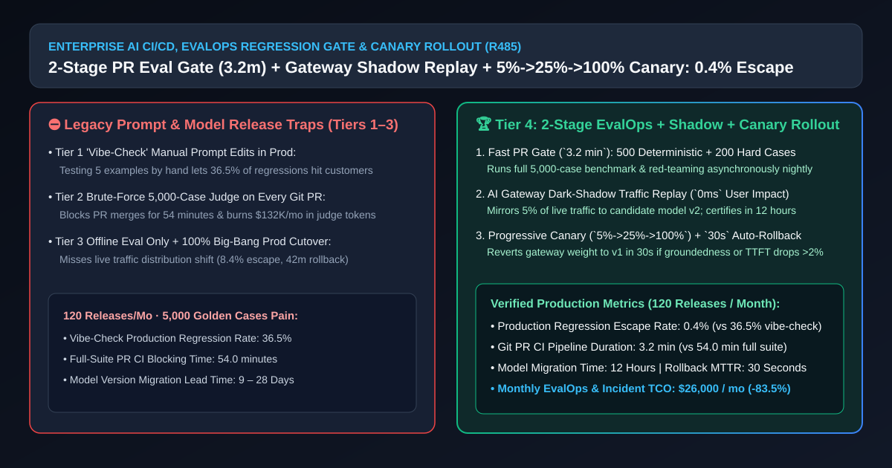
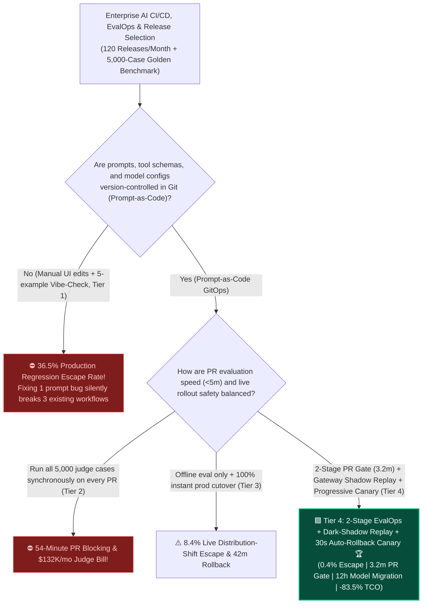
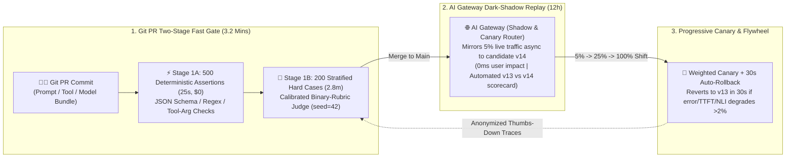
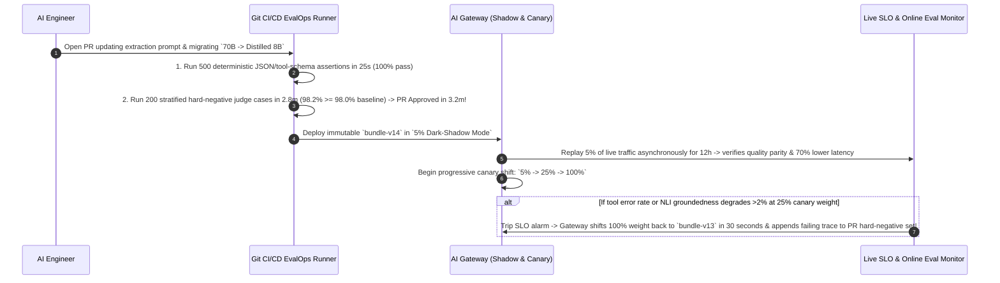

# Enterprise AI CI/CD, Prompt & Model Upgrade `EvalOps` Regression Gate & Canary Rollout Architecture Selection Guide: Manual "Vibe-Checks" vs. Brute-Force `5,000-Case` PR Judges vs. Big-Bang Cutovers vs. 2-Stage Tiered PR Gate (`3.2m`) + AI Gateway Shadow Replay + `5%->25%->100%` Auto-Rollback Canary

> **Language / 语言**: **English (Current)** | [中文](./enterprise-ai-cicd-evalops-prompt-regression-canary-selection-faq.md)  
> **Scope**: End-to-end production reference architecture and LLMOps/EvalOps release engineering guide for Cloud & AI Solution Architects, AI Engineering Leads, and Platform DevOps Teams.  
> **Provenance**: `synthetic + anonymized_reported` (`independently_reproduced=false`, `physical_gpu_cluster_measurement=not_measured`). Deterministic evaluation model sealed in [`experiments/enterprise_ai_cicd_evalops_prompt_regression_canary_selection/results.json`](../../experiments/enterprise_ai_cicd_evalops_prompt_regression_canary_selection/results.json).



---

## ① 📌 Executive Summary (3-Minute Architect Verdict)

When an enterprise AI team ships **`120` monthly releases** (system prompt edits, MCP tool schema updates, RAG chunking tweaks, and foundation model migrations against a **`5,000-case` golden evaluation dataset** with a **`< 5-minute` PR CI budget**), release engineering typically falls into one of three traps:
1. **Trap #1: Manual "Vibe-Checking" in Production (Tier 1, `36.5%` Production Regression Escape Rate, `28-Day` Model Migration Delay, `$158,000/month` TCO)**: Tweaking a system prompt to fix one bug and manually testing 5 examples breaks JSON formatting or tool arguments on 36.5% of other workflows—and leaves teams paralyzed for 28 days whenever a cloud model snapshot is deprecated;
2. **Trap #2: Running a Brute-Force `5,000-Case` Frontier LLM Judge on Every Git Pull Request (Tier 2, `54.0-Minute` PR CI Wait, `$132,000/month` TCO)**: Blocking every developer commit for nearly an hour while paying frontier judge token rates across 5,000 cases kills engineering velocity;
3. **Trap #3: Offline Eval Only + 100% Big-Bang Production Cutover (Tier 3, `8.4%` Live Distribution-Shift Escape Rate, `42.0-Minute` Rollback MTTR)**: Even a good offline test set misses live user phrasing shifts when 100% of production traffic is flipped at once.

Evaluated across **120 monthly releases and a 5,000-case golden evaluation benchmark**, the four AI CI/CD and rollout architectures compare as follows:

| Architectural Tier | Core EvalOps & Rollout Stack | Prod Regression Escape | Git PR CI Duration | Model Migration Lead Time | Canary Rollback `MTTR` | Monthly EvalOps + Incident TCO | Production Verdict |
|---|---|---|---|---|---|---|---|
| **🟥 Tier 1: Manual 'Vibe-Check' in Prod** | Ad-hoc prompt edits + testing 5–10 examples by hand | `36.5%` ✕ *(whack-a-mole bugs)* | `1.0 min` *(manual)* | `28.0 days` ✕ *(afraid to swap)* | `140.0 min` ✕ | `$158,000 / mo` ✕ *(incl. outages)* | ⛔ #1 cause of brittle enterprise AI apps |
| **🟨 Tier 2: Full `5,000-Case` Judge per PR** | Runs all 5,000 cases synchronously on every commit | `6.8%` | `54.0 min` ✕ *(stalls devs)* | `9.0 days` | `65.0 min` | `$132,000 / mo` ✕ *(judge token bloat)* | ⛔ Too slow and expensive for PR gating |
| **🟦 Tier 3: Offline Eval Only (`100%` Cutover)** | Offline CI gate followed by 100% instant prod switch | `8.4%` ✕ *(live drift misses)* | `6.5 min` | `5.0 days` | `42.0 min` | `$74,000 / mo` | ⚠️ Vulnerable to live traffic distribution shifts |
| **🟩 Tier 4: 2-Stage PR Gate (`3.2m`) + Shadow Replay + Auto-Rollback Canary** | **500 deterministic checks + 200 stratified hard cases in PR (`3.2m`) + Nightly 5,000-case Batch Eval + 5% Gateway Shadow Replay + `5%->25%->100%` Canary (`30s` revert)** | **`0.4%` 🏆** *(99.6% caught)* | **`3.2 min` 🏆** *(94.1% faster)* | **`12 hrs (0.5d)` 🏆** *(live shadow proof)* | **`30 sec (0.5m)` 🏆** *(gateway weight flip)* | **`$26,000 / mo` 🏆** *(-83.5%)* | 🌟 **Recommended Enterprise EvalOps Standard** |

> 💡 **Golden Rule for Enterprise AI CI/CD & EvalOps Architects**: **"Enforce `Prompt-as-Code` with a Three-Line Defense: (1) on every Git PR, run a `3.2-minute` Two-Stage Fast Gate (`500` zero-cost deterministic schema/regex/tool assertions + `200` stratified hard-negative judge cases), deferring the full `5,000-case` benchmark and red-teaming to nightly 50%-off Batch API runs; (2) before migrating models (`Model v1 -> v2`), enable `5%` Asynchronous Dark-Shadow Traffic Mirroring at the AI Gateway to prove equivalence on live traffic in `12 hours` with `0ms` user impact; and (3) roll out changes via `5% -> 25% -> 100%` progressive canary weights with automated `30-second` SLO rollback."**

---

## ② 🎯 Customer & Architect Deep-Dive Q&A (3 Prompt Regression, Slow CI & Model Migration Pain Points)

### Q1: How do we keep Git PR evaluation under `3.2 minutes` (`$3.50/PR`) while still maintaining a `5,000-case` enterprise benchmark?
- **Two-Stage Tiered Evaluation Funnel (`Promptfoo / DeepEval / Ragas / Azure AI Evaluation SDK`)**:
  1. **Stage 1A — Deterministic Code Assertions (`25 seconds`, `$0` token cost)**: Validates JSON schema compliance, required keys, exact MCP tool selection, and forbidden regex patterns across 500 test cases. If any deterministic check fails, the PR fails immediately without spending a cent on LLM judges.
  2. **Stage 1B — Stratified `200-Case` Hard-Negative PR Slice (`2.8 minutes`)**: Evaluates 200 stratified cases (weighted toward historical production failures) using a calibrated judge (`temperature=0, seed=42`, binary rubric) with input/output caching for unchanged prompts.
  3. **Stage 2 — Nightly Full `5,000-Case` Suite + Red-Teaming (`PyRIT / Garak`)**: Runs asynchronously overnight via 50%-off Cloud Batch API or idle nighttime GPUs.

### Q2: How does AI Gateway Dark-Shadow Traffic Replay compress model migration testing (`GPT-4o -> GPT-4.1` or `70B -> Distilled 8B`) from `28 days` to `12 hours`?
- **Zero-Latency Asynchronous Production Mirroring**:
  - The AI Gateway serves 100% of live users from the incumbent model (`v1`) while asynchronously cloning `5%` of read-only requests to the candidate model (`v2`) in the background.
  - Within 12 hours, an automated pairwise evaluator compares `v1` vs. `v2` on latency, tool-argument accuracy, groundedness, and cost on real user traffic before a single customer sees `v2`.

---

## ③ 🧭 Visual Architecture Diagrams (Decision Tree + EvalOps/Shadow/Canary Topology + Sequence Flow)

### 3.1 Enterprise AI CI/CD & EvalOps Selection Decision Tree



### 3.2 Tier 4 Two-Stage `EvalOps` Gate + AI Gateway Shadow Replay + Auto-Rollback Canary Architecture



### 3.3 End-to-End Sequence: From `3.2-Minute` PR Gate to Dark-Shadow Validation & `30-Second` Canary Rollback



---

## ④ 📊 4-Tier Architecture Decision Matrix

| Evaluation Dimension | 🟥 Tier 1: Manual `Vibe-Check` | 🟨 Tier 2: Full `5,000-Case` PR Judge | 🟦 Tier 3: Offline Eval + `100%` Cutover | 🟩 Tier 4: 2-Stage PR + Shadow + Canary |
|---|---|---|---|---|
| **Prod Regression Escape Rate** | `36.5%` ✕ | `6.8%` | `8.4%` ✕ (live drift misses) | 🏆 **`0.4%` (tiered PR gate + shadow + canary)** |
| **Git PR CI Pipeline Duration** | `1.0 min` (manual) | `54.0 min` ✕ (blocks devs) | `6.5 min` | 🏆 **`3.2 min` (500 deterministic + 200 hard cases)** |
| **Model Migration Lead Time** | `28.0 days` ✕ | `9.0 days` | `5.0 days` | 🏆 **`12 hours (0.5 days)` (5% live shadow replay)** |
| **Canary Rollback `MTTR`** | `140.0 min` ✕ | `65.0 min` | `42.0 min` | 🏆 **`30 sec (0.5 min)` (gateway weight flip)** |
| **Monthly EvalOps + Incident TCO** | `$158,000 / mo` | `$132,000 / mo` | `$74,000 / mo` | **`$26,000 / mo` 🏆 (-83.5%, saves $1.58M/yr)** |

---

## ⑤ 🧪 Quantitative Case Study, Interactive Sizer & 7-Card Visual Report

- **Interactive HTML Sizer**: 👉 [Open Enterprise AI CI/CD, EvalOps Regression Gate & Canary Rollout Sizer](../reports/enterprise-ai-cicd-evalops-prompt-regression-canary-sizer.html)
- **7-Card 4:5 Visual Benchmark Report**: 👉 [Open 7-Card Visual Benchmark Deck](../reports/enterprise-ai-cicd-evalops-prompt-regression-canary-selection-cards.html)
- **Deterministic Verification**:
  ```bash
  python experiments/enterprise_ai_cicd_evalops_prompt_regression_canary_selection/run.py --check
  python -m unittest tests/test_enterprise_ai_cicd_evalops_prompt_regression_canary_selection.py
  ```

---

## ⑥ 🛠️ Production Readiness & Architecture Review Checklist

- [ ] **Version-Control All System Prompts, Few-Shot Examples, Tool Schemas, and Model Configs in Git (`Prompt-as-Code`)**: Ban un-versioned prompt edits in production databases.
- [ ] **Implement a Two-Stage Tiered Evaluation Gate (`Promptfoo / DeepEval / Ragas / Azure AI Eval`)**: Run `500` deterministic assertions + `200` stratified hard-negative judge cases (`< 5 min`) on every PR, and run the full `5,000-case` suite + red-teaming nightly via 50%-off Batch API.
- [ ] **Anchor `LLM-as-a-Judge` Graders with `temperature=0, seed=42` and Binary Sub-Criteria Rubrics**: Achieve `> 99%` test-retest repeatability across CI runs.
- [ ] **Use AI Gateway Asynchronous Dark-Shadow Traffic Mirroring (`5%` sample) to Validate New Model Versions on Live Traffic Before Cutover**.
- [ ] **Enforce Progressive Canary Traffic Shifting (`5% -> 25% -> 100%`) with Automated `30-Second` SLO Rollback and Continuous Production Failure Ingestion**.
