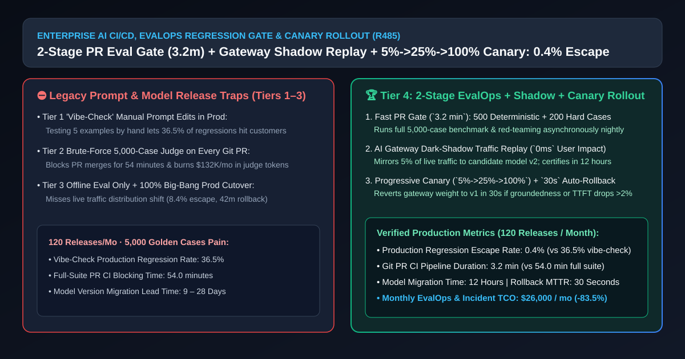
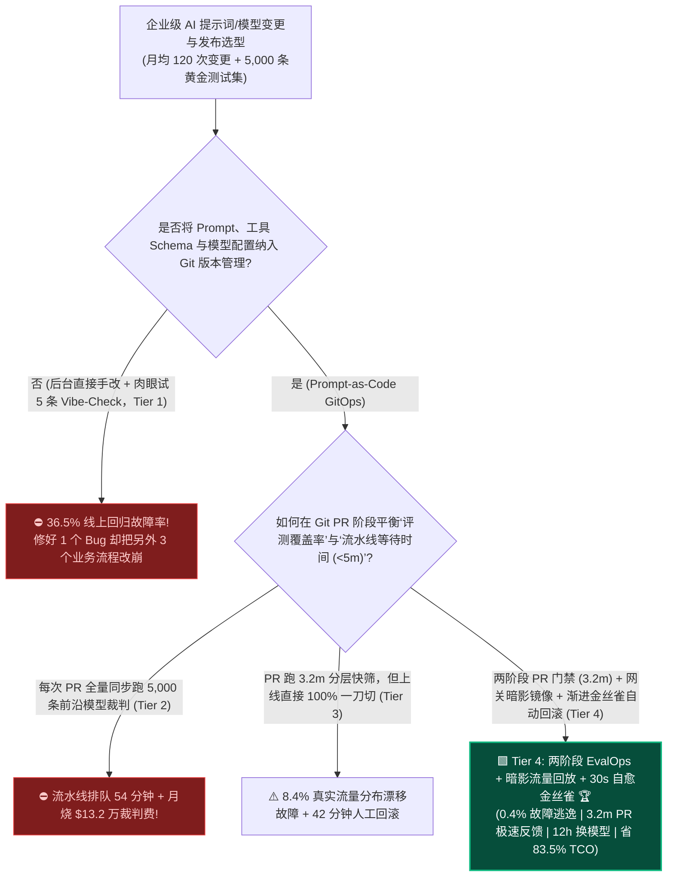
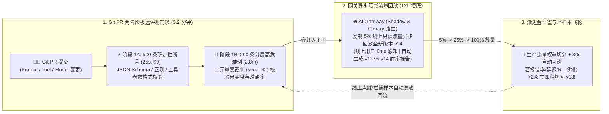

# 企业级 AI 应用持续交付（`AI CI/CD`）、自动化回归评测门禁（`EvalOps`）与流量镜像灰度发布（Shadow & Canary Rollout）架构选型指南：凭感觉改提示词（`Vibe-Check` 反模式）vs. 每次 PR 全跑 5,000 条大模型裁判 vs. 纯离线评测一键全切 vs. 两阶段极速 PR 门禁（`3.2 分钟`）+ 网关流量异步镜像（Shadow Replay）+ `5%->25%->100%` 秒级自愈灰度架构

> **语言 / Language**: **中文 (当前)** | [English](./enterprise-ai-cicd-evalops-prompt-regression-canary-selection-faq.en.md)  
> **定位**：面向云与 AI 解决方案架构师（Solution Architect）、AI 研发效能负责人（LLMOps / EvalOps Lead）与平台工程团队的“怎么改一条 Prompt 不把另外 10 个场景改挂、怎么在 12 小时内安全完成底层大模型版本切换”实战指南。  
> **数据口径（Provenance）**：`synthetic + anonymized_reported`（`independently_reproduced=false`，`physical_gpu_cluster_measurement=not_measured`），全部定容模型封存于 [`experiments/enterprise_ai_cicd_evalops_prompt_regression_canary_selection/results.json`](../../experiments/enterprise_ai_cicd_evalops_prompt_regression_canary_selection/results.json)。



---

## ① 📌 核心选型结论速览（Executive Summary — 3 分钟看懂怎么选）

当企业 AI 应用进入深水区（**每月发生 `120 次` 系统提示词修改、RAG 切片策略调整或底层大模型版本迁移，积累了 `5,000 条` 黄金测试集，且研发团队要求 Git PR 流水线在 `< 5 分钟` 内出结果**）时，工程团队普遍困在两个极端之间：
1. **极端一：靠肉眼试 5 条样本的“凭感觉发布（Vibe-Checking）”（Tier 1，线上回归故障逃逸率高达 `36.5%`，且底层模型升级不敢动、耗时长达 `28 天`）**：算法或产品经理为了修一个Bad Case，直接在后台改了一句 System Prompt，手工试了 5 个问题觉得挺好就上线了——结果导致另外 36.5% 场景的 JSON 格式破损或工具调用参数报错！更糟的是，当云厂商通知旧版模型快照即将下线、或者团队想把昂贵的 70B 替换为蒸馏 8B 时，因为不敢确认会不会搞挂生产，一拖就是整整一个月！
2. **极端二：在每次 Git PR 提交时全量跑完 5,000 条样本 + 闭源大模型裁判（Tier 2，单次 PR 流水线阻塞长达 `54 分钟`，月烧 `$132,000`）**：开发者改一行提示词要等近 1 小时才能合并代码，且每次 PR 都全量调用前沿大模型打分，评测账单比线上生产还贵！
3. **盲区三：只做离线评测、上线时 100% 流量一刀切（Tier 3，仍有 `8.4%` 的线上分布漂移故障逃逸）**：离线黄金集永远无法 100% 覆盖真实用户千奇百怪的口语提问。

在 **月均 120 次发布、5,000 条黄金评测集** 的企业基准下，四档 AI CI/CD 与灰度发布架构的量化对决如下：

| 方案档位 | 核心 EvalOps 与发布架构组合 | 线上回归故障逃逸率 | Git PR 流水线耗时 | 模型版本迁移验证周期 | 线上故障回滚耗时 (`MTTR`) | 月度评测算力与故障总成本 (`TCO`) | 架构师核心选型结论 |
|---|---|---|---|---|---|---|---|
| **🟥 Tier 1：人工试几条凭感觉上线 (`Vibe-Check`)** | 直接改线上 Prompt + 手工抽查 5~10 个例子 | `36.5%` ✕ *(按下葫芦浮起瓢)* | `1.0 分钟` *(纯人工)* | `28.0 天` ✕ *(不敢换模型)* | `140.0 分钟` ✕ | `$158,000 / 月` ✕ *(含线上故障损失)* | ⛔ 作坊式开发，是 AI 无法规模化落地的头号病因 |
| **🟨 Tier 2：每次 PR 暴力跑全量 5,000 条大模型裁判** | 每个 Commit 同步跑完 5,000 条 + GPT-4o 裁判 | `6.8%` | `54.0 分钟` ✕ *(拖死研发效率)* | `9.0 天` | `65.0 分钟` | `$132,000 / 月` ✕ *(评测Token账单爆炸)* | ⛔ 流水线太慢太贵，一周后必被程序员强行绕过 |
| **🟦 Tier 3：仅跑离线评测 + 生产 100% 一刀切上线** | PR 跑离线评测通过后，线上瞬间 100% 切换新版本 | `8.4%` ✕ *(漏掉真实流量漂移)* | `6.5 分钟` | `5.0 天` | `42.0 分钟` | `$74,000 / 月` | ⚠️ 缺少真实流量暗影回放与渐进式灰度保护 |
| **🟩 Tier 4：两阶段极速 PR 门禁 (`3.2m`) + 网关流量镜像 (`Shadow`) + `5%->25%->100%` 自动回滚灰度** | **PR 级 `500条确定性断言 + 200条高危难例` (`3.2分钟`) + 夜间 5,000 条全量半价批跑 + 网关 5% 真实流量异步暗影比对 + 金丝雀 30秒自动回滚** | **`0.4%` 🏆** *(拦截99.6%故障)* | **`3.2 分钟` 🏆** *(快 94.1%)* | **`12 小时 (0.5天)` 🏆** *(真实流量一键摸底)* | **`30 秒 (0.5分)` 🏆** *(网关权重秒切)* | **`$26,000 / 月` 🏆** *(-83.5%)* | 🌟 **企业级 LLMOps / EvalOps 持续交付唯一标准** |

> 💡 **架构师一句话选型铁律**：**“把 Prompt、工具 Schema 和模型路由配置全部纳入 Git 版本控制（`Prompt-as-Code`），并建立‘三级递进发布防线’：① **PR 提交门禁（3.2 分钟内跑完）**——先跑 500 条零成本的 JSON/正则/工具参数代码断言，再跑 200 条分层抽样的历次线上事故难例（Hard Negatives），把 5,000 条全量评测与红队测试放到夜间用 5 折 `Batch API` 异步跑；② **暗影流量回放（Dark-Shadow Mirroring）**——新模型上线前，在 AI 网关把 5% 的线上真实请求异步复制一份发给新模型（不影响线上用户 0 毫秒），12 小时自动比对完真实分布表现；③ **金丝雀渐进放量（`5% -> 25% -> 100%`）**——一旦新版本的工具报错率或首字延迟劣化超 2%，网关在 `30 秒` 内自动把流量权重切回旧版！”**

---

## ② 🎯 客户与架构师灵魂拷问 Q&A（直击 3 大改 Prompt 越改越坏、PR 评测太慢太贵与换模型不敢上线痛点）

### Q1：为什么每次改一句 System Prompt 都会“修好第 1 个问题、搞坏第 8 个问题”？怎么把单次 Git PR 评测从 54 分钟压缩到 `3.2 分钟`（成本从 `$180/次` 降到 `$3.50/次`）？
- **大白话与第一性原理**：
  1. **提示词是高度耦合的全局代码（Prompt-as-Code）**：自然语言指令没有模块边界，删掉一句限制词就可能让 JSON 输出多出 Markdown 反引号，导致下游解析器崩溃。因此任何 Prompt 修改都必须走 Git PR，严禁在生产数据库里直接手改！
  2. **Tier 4 的“漏斗式两阶段 PR 极速门禁（`Promptfoo / DeepEval / Ragas / Azure AI Eval`）”**：
     - **第 1 层（耗时 `25 秒`，成本 `$0`）——500 条确定性代码断言（Deterministic Code Graders）**：不调任何裁判大模型，直接用 Python 校验输出是否为合法 JSON、必填字段是否齐全、是否调用了正确的 MCP 工具名、耗时与 Token 数是否超标。一旦不合法当场 Fast-Fail 打回！
     - **第 2 层（耗时 `2.8 分钟`，成本 `$3.50`）——200 条分层难例（Stratified Hard-Negative Golden Slice）+ 缓存复用**：从 5,000 条总库里按业务分类与历史线上翻车记录精选出最具代表性的 **200 条核心难例**，并发调用固定随机种子（`seed=42, temperature=0`）与二元评分量表（Binary Rubric）的裁判模型打分；
     - **全量 5,000 条去哪了？**：合并进 `main` 分支后，每晚通过云端 **5 折异步 Batch API** 或夜间闲置本地 GPU 跑全量 5,000 条回归与安全红队扫描（`PyRIT / Garak`）！

### Q2：当云厂商发布新模型（如 `GPT-4o -> GPT-4.1`）或内部完成了 `70B -> 8B` 蒸馏模型，怎么在完全不影响线上客户的前提下，用 `12 小时` 摸清它在线上真实流量下的表现？
- **AI 网关异步暗影流量镜像（Asynchronous Dark-Shadow Traffic Mirroring）**：
  - 在 AI 网关（如 Envoy AI Gateway / Azure APIM / LiteLLM）开启 `shadow_mirror: 5%` 策略：
  - 当线上用户发起只读查询时，主路由（Primary）照常调用现有的生产模型 `Model v1` 并将结果实时流式返回给用户（**对线上用户体验影响为绝对的 `0.0ms`**）；
  - 与此同时，网关在后台异步将该请求克隆一份发给候选模型 `Model v2`，并将 `v1` 与 `v2` 的回答、首字延迟（TTFT）、Token 消耗及工具调用参数成对写入 `Langfuse / Arize Phoenix` 进行自动对比评分（Pairwise Arena）——只需跑半天（`12 小时`），架构师就能拿到一份基于真实生产流量的精确迁移报告！

### Q3：就算通过了离线评测和暗影测试，真正切换线上写操作流量时万一遇到未知的极端 Bad Case 怎么办？
- **网关级渐进式金丝雀放量（`5% -> 25% -> 100%`）+ 30 秒 SLO 自动回滚（Auto-Rollback）**：
  - 每次发布打包为不可变的 **`Prompt_Version + Model_ID + RAG_Config` 组合版本包（Bundle Digest）**；
  - 网关先将 5% 生产流量切往新版本包 `v14`，实时比对新旧两个桶的 **4 项黄金 SLO 指标**（① 工具调用语法报错率；② P99 TTFT；③ 用户点踩/重试率；④ 异步 NLI 忠实度得分）。一旦新版本任一指标劣化超过阈值，网关控制器无需重新部署容器，直接在 **`30 秒` 内将路由权重 100% 切回 `v13`**！

---

## ③ 🧭 直观可视化图解（选型决策树 + 两阶段 EvalOps 与暗影灰度架构图 + 全自动闭环时序图）

### 3.1 企业级 AI CI/CD、回归评测与灰度发布架构选型决策树



### 3.2 Tier 4 两阶段 `EvalOps` 门禁 + AI 网关暗影镜像 + 自动回滚金丝雀端到端架构图



### 3.3 从“提交 Prompt PR（3.2 分钟门禁）”到“暗影比对与 30 秒自动回滚”全链路时序图

```mermaid
sequenceDiagram
    autonumber
    participant Dev as AI 应用工程师
    participant CI as Git CI/CD EvalOps 引擎
    participant GW as AI Gateway (Shadow & Canary)
    participantMon as 实时 SLO 与在线评估监控

    Dev->>CI: 提交 PR：优化合同抽取 Prompt 并计划将模型从 `70B` 切换至 `蒸馏 8B`
    CI->>CI: 1. 25 秒跑完 500 条 JSON/工具参数确定性断言（100% 通过）
    CI->>CI: 2. 2.8 分钟并发跑完 200 条分层难例基准集（准确率 98.2% >= 基线 98.0%）-> PR 绿灯放行（总耗时 3.2m）！
    CI->>GW: 部署候选版本包 `bundle-v14`，先开启 `5% 异步暗影流量镜像 (Dark-Shadow)`
    GW->>participantMon: 异步回放 12 小时真实流量，验证新模型在生产长尾提问下忠实度达标且延迟降 70%
    GW->>GW: 开始渐进式金丝雀切换：`5% -> 25% -> 100%`
    alt 若放量至 25% 时某类特殊请求触发工具调用报错 > 2%
        participantMon->>GW: 触发 SLO 告警阈值 -> 网关在 30 秒内自动将 100% 流量权重切回 `bundle-v13`，并将该报错样本自动加入 PR 难例库！
    end
```

---

## ④ 📊 架构师四维选型决策矩阵（Architecture Decision Matrix）

| 评估维度 | 🟥 Tier 1：人工试 5 条 (`Vibe-Check`) | 🟨 Tier 2：每次 PR 跑全量 5,000 条 | 🟦 Tier 3：仅跑离线评测 + 一刀切 | 🟩 Tier 4：两阶段门禁 + 暗影回放 + 自动金丝雀 |
|---|---|---|---|---|
| **线上回归故障逃逸率** | `36.5%` ✕（顾此失彼） | `6.8%` | `8.4%` ✕（漏掉真实分布漂移） | 🏆 **`0.4%`（离线分层门禁 + 线上暗影与金丝雀双保险）** |
| **Git PR 流水线等待时长** | `1.0 分钟`（纯人工漏检） | `54.0 分钟` ✕（严重阻塞研发） | `6.5 分钟` | 🏆 **`3.2 分钟`（500 条代码断言 + 200 条难例并发）** |
| **底层模型版本迁移周期** | `28.0 天` ✕（不敢升级） | `9.0 天` | `5.0 天` | 🏆 **`12 小时 (0.5天)`（网关 5% 异步暗影流量自动摸底）** |
| **线上质量退化回滚 `MTTR`** | `140.0 分钟` ✕ | `65.0 分钟` | `42.0 分钟`（需重新走发布） | 🏆 **`30 秒 (0.5分钟)`（网关权重秒级自动切回旧版）** |
| **月度评测与故障总成本 (`TCO`)** | `$158,000 / 月`（含事故损失） | `$132,000 / 月`（裁判费爆炸） | `$74,000 / 月` | **`$26,000 / 月` 🏆（节省 83.5%，年省 $158 万）** |

---

## ⑤ 🧪 定量算例、交互式容量计算器与 7-Card 4:5 视觉报告

### 5.1 基准算例复核（月均 120 次发布 / 5,000 条黄金测试集 / 200 条 PR 极速难例切片）

- **交互式定容计算器（CSP 自包含 HTML）**：👉 [打开企业级 AI CI/CD、EvalOps 回归门禁与灰度发布定容计算器](../reports/enterprise-ai-cicd-evalops-prompt-regression-canary-sizer.html)
- **7-Card 4:5 视觉评测卡片报告**：👉 [打开 7-Card 视觉评测报告](../reports/enterprise-ai-cicd-evalops-prompt-regression-canary-selection-cards.html)
- **可复核确定性脚本**：
  ```bash
  python experiments/enterprise_ai_cicd_evalops_prompt_regression_canary_selection/run.py --check
  python -m unittest tests/test_enterprise_ai_cicd_evalops_prompt_regression_canary_selection.py
  ```

### 5.2 核心量化对比图（线上回归故障逃逸率 % vs. Git PR 流水线等待时长 分钟）

```chart
{
  "data": {
    "values": [
      { "tier": "Tier 1: Manual Vibe-Check", "metric": "Regression Escape Rate (%)", "val": 36.5 },
      { "tier": "Tier 1: Manual Vibe-Check", "metric": "PR CI Duration (Minutes)", "val": 1.0 },
      { "tier": "Tier 2: Full 5,000-Case PR Judge", "metric": "Regression Escape Rate (%)", "val": 6.8 },
      { "tier": "Tier 2: Full 5,000-Case PR Judge", "metric": "PR CI Duration (Minutes)", "val": 54.0 },
      { "tier": "Tier 3: Offline Eval + 100% Cutover", "metric": "Regression Escape Rate (%)", "val": 8.4 },
      { "tier": "Tier 3: Offline Eval + 100% Cutover", "metric": "PR CI Duration (Minutes)", "val": 6.5 },
      { "tier": "Tier 4: 2-Stage PR + Shadow + Canary", "metric": "Regression Escape Rate (%)", "val": 0.4 },
      { "tier": "Tier 4: 2-Stage PR + Shadow + Canary", "metric": "PR CI Duration (Minutes)", "val": 3.2 }
    ]
  },
  "semantic_types": {
    "tier": "Category",
    "metric": "Category",
    "val": "Quantity"
  },
  "chart_spec": {
    "chartType": "Grouped Bar Chart",
    "title": "Tier 4 cuts regression escapes to 0.4% while keeping PR CI duration at 3.2 minutes",
    "subtitle": "Comparison across 120 monthly prompt, RAG, and model releases (lower is better)",
    "encodings": {
      "x": "tier",
      "y": "val",
      "group": "metric",
      "color": "metric"
    }
  }
}
```

---

## ⑥ 🛠️ 架构评审与生产落地核验清单（Production Readiness Checklist）

- [ ] **全面推行 `Prompt-as-Code` 与不可变发布包（Immutable Release Bundle）**：将系统提示词、Few-Shot 模板、MCP 工具 Schema 与模型参数全部纳入 Git 仓库版本控制，严禁在生产环境后台数据库直接裸改提示词。
- [ ] **实施“两阶段分层评测门禁（Tiered EvalOps Gate）”**：Git PR 阶段只跑“确定性语法/工具断言 + 200 条高危分层难例”（控制在 `< 5 分钟`）；全量 5,000+ 条基准测试与安全红队测试放到夜间通过 5 折 `Batch API` 异步执行。
- [ ] **校准 `LLM-as-a-Judge` 裁判模型的一致性**：固定 `temperature=0, seed=42`，采用带参考答案锚定的二元子项评分量表（Binary Sub-Criteria Rubrics）替代模糊的 1~10 分主观打分。
- [ ] **在底层大模型切换或蒸馏替换前，强制开启 AI 网关 `5%` 异步暗影流量镜像（Dark-Shadow Traffic Mirroring）**：用真实生产流量零风险验证新模型的延迟与质量分布。
- [ ] **所有生产变更强制走 `5% -> 25% -> 100%` 渐进式金丝雀放量并绑定 30 秒自动回滚阈值**：同时将每周线上捕获的点踩/拦截 Bad Case 自动脱敏回流至 PR 200 条高危难例库，形成质量单调递增飞轮。
