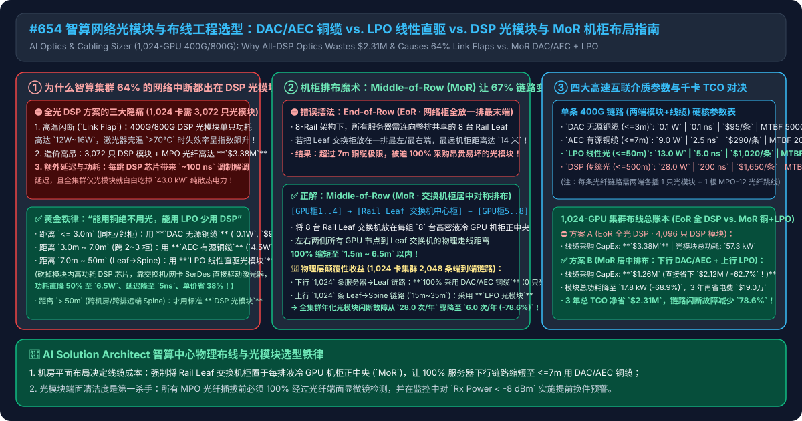

# AI Cluster Interconnect Cabling & Optics Sizer: `DAC/AEC Copper` vs. `400G/800G LPO` Linear Pluggable Optics vs. `DSP` Transceivers & `Middle-of-Row (MoR)` Rack Layout TCO

> **Language / 语言**: [简体中文](./enterprise-ai-cluster-optics-dac-aec-lpo-vs-dsp-mor-tco-faq.md) | **English** · [📱 Open Interactive H5 Study Lab](../h5/ai-cluster-optics-dac-aec-lpo-vs-dsp-mor-tco-lab.html) · [🧮 Open Interactive Sizer](../reports/enterprise-ai-cluster-optics-dac-aec-lpo-vs-dsp-mor-tco-sizer.html) · [🃏 View 7-Card 4:5 Benchmark Deck](../reports/enterprise-ai-cluster-optics-dac-aec-lpo-vs-dsp-mor-tco-cards.html)

---

## 0. 3-Minute Executive Summary

In `1,024-GPU` (`2,048` end-to-end `400G/800G` links) AI factories, **optical transceivers account for `64%` of all physical network link flaps (`Link Flaps`) and up to `$3.38M` in cabling CapEx** when architects default to an **End-of-Row (`EoR`) all-optical `DSP` transceiver layout**:
1. **Why All-Optical `DSP` Transceivers (`4,096` Modules) Are a Reliability & Thermal Trap**:
   - Traditional `400G/800G DSP` transceivers draw `14W` per module (`28W` per link = **`57.3 kW`** cluster optics power), add `200 ns` PHY latency per link, cost **`$1,650/link` (`$3.38M` total)**, and suffer accelerated laser degradation above `70°C` (`28.0` link flaps/yr).
2. **`Middle-of-Row (MoR)` Rack Placement + `DAC/AEC` Copper + `LPO` Optics Saves `$2.31M` (`-62.7%` CapEx)**:
   - Placing the `8` Rail Leaf switches in the **center of each liquid-cooled GPU row (`MoR`)** keeps `100%` of the `1,024` server-to-Leaf links within **`1.5m–6.5m`**, replacing `2,048` optical modules with **`DAC` Passive Copper (`<=3m`, `$95/link`, `0.1W`)** and **`AEC` Active Copper (`3–7m`, `$290/link`, `9W`)**;
   - Using **`LPO (Linear Pluggable Optics)`** (`13W/link`, `5 ns`, `$1,020/link`) for the `15m–35m` `Leaf-to-Spine` links cuts total cabling CapEx from `$3.38M` to **`$1.26M` (`-62.7%`)**, slashes optics power by **`68.9%` (`57.3 kW → 17.8 kW`)**, and reduces annual link flaps by **`78.6%` (`28.0 → 6.0/yr`)**.

---

## 1. Quantitative Interconnect Media & `1,024-GPU` Layout Matrix

| Cabling & Rack Layout (`1,024 GPUs` · `2,048` Links) | Server → Leaf (`1,024` Links) | Leaf → Spine (`1,024` Links) | Cabling CapEx | Optics Power (`3-Yr` Power Cost) | Annual Link Flaps & Verdict |
| :--- | :--- | :--- | :--- | :--- | :--- |
| **1. `EoR` All-Optical `DSP` Transceivers** | `100% DSP Optics` | `100% DSP Optics` | `$3.38M` | `57.3 kW` (`$275K`) | `28.0 / yr` · ⛔ **Overpriced & hot** |
| **2. `MoR` Copper Downlink + `DSP` Uplink** | `50% DAC + 50% AEC` | `100% DSP Optics` | `$1.89M` | `33.3 kW` (`$160K`) | `14.5 / yr` · ✅ **Good intermediate** |
| **3. `MoR` `DAC/AEC` Downlink + `LPO` Uplink** | **`50% DAC + 50% AEC`** | **`100% LPO Linear Optics`** | **`$1.26M` (`-62.7%`)** | **`17.8 kW` (`$85K`, `-68.9%`)** | **`6.0 / yr` (`-78.6%`, saves `$2.31M` 3-Yr)** 🏆 |
