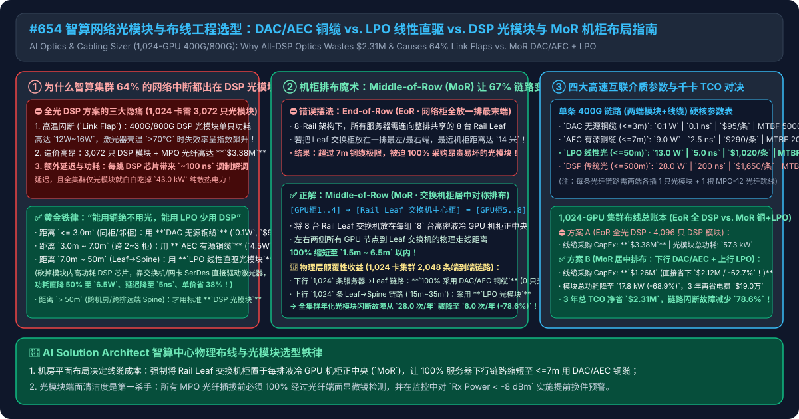
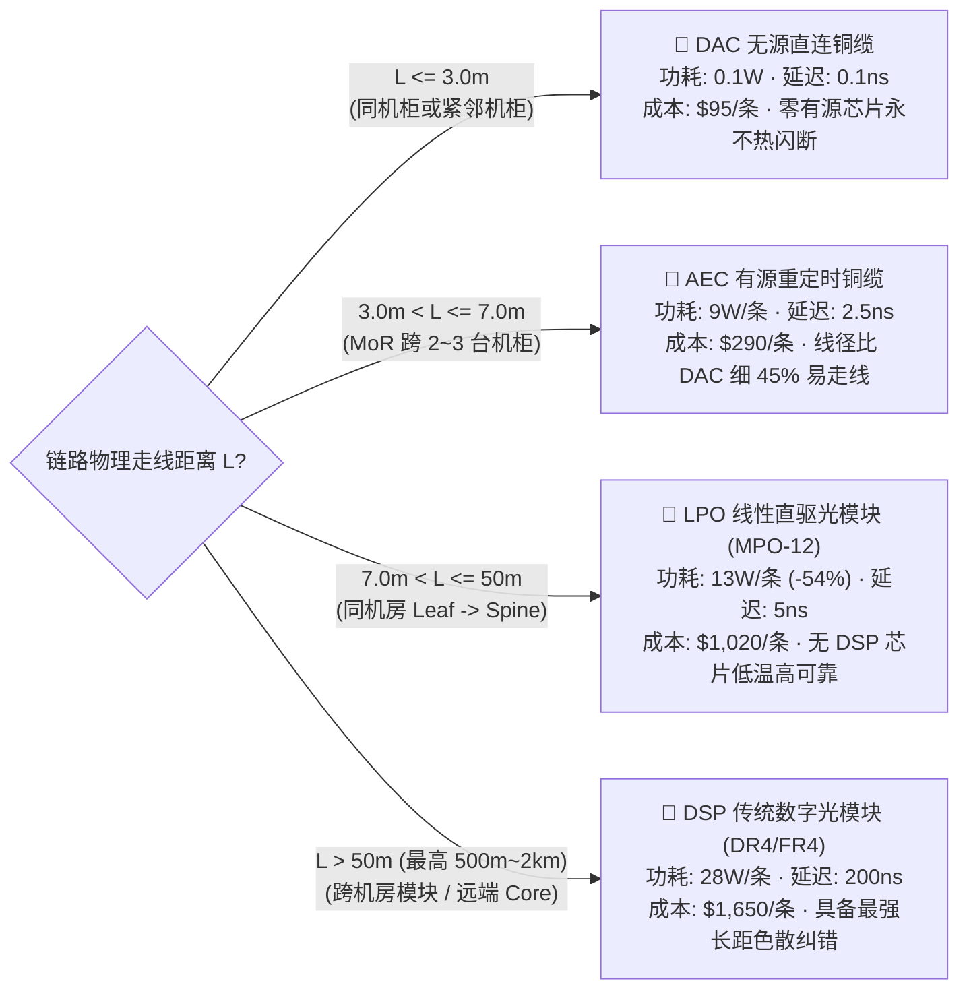

# 智算网络光模块与布线工程选型：`DAC/AEC 铜缆` vs. `400G/800G LPO 线性直驱光模块` vs. `传统 DSP 光模块` 及 `Middle-of-Row (MoR)` 机柜布局降本指南

> **语言 / Language**: **简体中文** | [English](./enterprise-ai-cluster-optics-dac-aec-lpo-vs-dsp-mor-tco-faq.en.md) · [📱 打开交互式 H5 精读页](../h5/ai-cluster-optics-dac-aec-lpo-vs-dsp-mor-tco-lab.html) · [🧮 打开交互式容量计算器](../reports/enterprise-ai-cluster-optics-dac-aec-lpo-vs-dsp-mor-tco-sizer.html) · [🃏 查看 7-Card 4:5 评测报告](../reports/enterprise-ai-cluster-optics-dac-aec-lpo-vs-dsp-mor-tco-cards.html)

---

## 0. 3 分钟执行摘要（Executive Summary）

在建设千卡至万卡智算中心时，许多初次规划的团队将全部精力放在 GPU 与交换机芯片选型上，却忽略了占网络总预算近一半、且占 **`64%` 线上物理网络闪断故障（`Link Flap`）** 的罪魁祸首——**光模块（Optical Transceivers）与机柜布局**：
1. **为什么“全光 DSP 模块（All-Optical DSP）+ 排末交换柜（End-of-Row, EoR）”是可靠性与预算的双重陷阱？**
   - 在 `1,024-GPU`（`128` 台节点）两层 Fat-Tree / Rail-Optimized 网络中，共有 `2,048` 条 `400G/800G` 端到端链路（如果全部使用光纤，需要 **`4,096` 只光模块 + `2,048` 根 MPO 光纤**）；
   - 传统 `400G/800G DSP 光模块` 内置高速数字信号处理器（DSP 芯片），单只功耗高达 **`12W–16W`**（每条链路两端共 `28W`），全集群仅光模块就消耗 **`57.3 kW`** 电力，采购成本高达 **`$3.38M`**，且激光器与 DSP 在 `> 70°C` 高温下极易发生热老化闪断（全年平均触发 **`28.0 次` 链路闪断中断**）！
2. **机柜布局魔术：`Middle-of-Row (MoR)` 居中排布让 `50%` 全集群链路直接改用 `DAC/AEC 铜缆`**：
   - 将 `Rail Leaf` 交换机柜放置在每排 `8` 台高密液冷 GPU 机柜的**正中央（`MoR`）**，使左右两侧所有 GPU 服务器到 Leaf 交换机的物理距离 `100%` 控制在 **`1.5m – 6.5m`** 以内；
   - **距离 `< 3.0m` 采用 `DAC 无源铜缆`（`$95/条`、`0.1W`）**，**距离 `3.0m – 7.0m` 采用 `AEC 有源铜缆`（内置 Retimer 芯片，线径细软易折弯，`$290/条`、`9.0W/条`）**——瞬间消灭了服务器下行侧全部 `2,048` 只光模块，故障率直降一个数量级！
3. **上行链路（`Leaf → Spine`, `15m – 35m`）采用 `LPO（线性直驱可插拔光模块）` 再省 `50%` 光功耗**：
   - `LPO (Linear Pluggable Optics)` 移除模块内发热大户 DSP 芯片，仅保留高线性度驱动器（Driver）与跨阻放大器（TIA），由交换机/网卡的高性能 SerDes 直接补偿信道损耗，将单条光纤链路功耗从 `28W` 压至 **`13W`（`-53.6%`）**、转发延迟从 `200 ns` 压至 **`5 ns`**、单价降低 **`38.2%`**；
   - **端到端收益**：在 `1,024-GPU` 集群上，`MoR (DAC/AEC 下行 + LPO 上行)` 将线缆与模块总 CapEx 从 `$3.38M` 砍至 **`$1.26M`（立省 `$2.12M / -62.7%`）**，连同 3 年省下的 `$19万` 机房电费，**累计净省 `$2.31M`**，并将全年光模块闪断事故从 `28.0 次` 压降至 **`6.0 次`（`-78.6%`）**！

---

## 1. 灵魂拷问 Q&A（Cloud & AI Solution Architect 核心决策拆解）

### Q1：`DAC 无源铜缆`、`AEC 有源铜缆`、`LPO 线性光模块` 与 `DSP 传统光模块` 的物理距离边界与选型红线是什么？

| 互联介质类型（`400GbE / NDR` 单条完整链路 = 两端模块 + 线缆） | 最大可靠传输距离 | 单条链路总功耗 | 物理层附加延迟 | 单条链路总造价 (CapEx) | 平均无故障时间 (`MTBF`) 与适用位置 |
| :--- | :--- | :--- | :--- | :--- | :--- |
| **1. `DAC` 无源铜缆 (`Direct Attach Copper`)** | **`<= 3.0 m`** (`800G <= 2.0m`) | **`0.1 W`** | **`0.1 ns`** | **`$95 / 条`** | `5,000万 小时` · 同机柜 ToR / 紧邻柜首选 |
| **2. `AEC` 有源铜缆 (`Active Electrical Cable`)** | **`3.0 – 7.0 m`** | **`9.0 W`** (`4.5W×2`) | **`2.5 ns`** | **`$290 / 条`** | `2,000万 小时` · `MoR` 跨 2–3 机柜服务器下行 |
| **3. `LPO` 线性直驱光 (`Linear Pluggable Optics`)** | **`7.0 – 50.0 m`** | **`13.0 W`** (`6.5W×2`) | **`5.0 ns`** | **`$1,020 / 条`** | `500万 小时` · 同机房 `Leaf ↔ Spine` 互联 |
| **4. `DSP` 传统数字光 (`SR4 / DR4 DSP Optics`)** | **`50.0 – 500 m`** | `28.0 W` (`14W×2`) | `200.0 ns` | `$1,650 / 条` | `150万 小时` · 仅用于 `>50m` 远端跨列/跨机房 |

---

## 2. `1,024-GPU` 集群三种机柜与布线方案 TCO 对决

| 布线工程方案（`1,024 GPUs` · `2,048` 条 400G 链路） | 下行 `1,024` 条 (Server→Leaf) | 上行 `1,024` 条 (Leaf→Spine) | 线缆/光模块总采购 CapEx | 线缆总功耗与 3 年电费 | 全年预计闪断故障 (`Link Flaps/yr`) |
| :--- | :--- | :--- | :--- | :--- | :--- |
| **方案 1：`EoR` 排末布局 + 全量 `DSP` 光模块** | `100% DSP 光` (`2,048` 只) | `100% DSP 光` (`2,048` 只) | `$3,379,200` (`$3.38M`) | `57.3 kW` (`$27.5万`) | `28.0 次 / 年` · ⛔ **又贵又热又易断** |
| **方案 2：`MoR` 居中布局 + 下行铜缆 + 上行 `DSP` 光** | `50% DAC + 50% AEC 铜缆` | `100% DSP 光` (`2,048` 只) | `$1,886,720` (`$1.89M`) | `33.3 kW` (`$16.0万`) | `14.5 次 / 年` · ✅ **省去一半光模块** |
| **方案 3：`MoR` 居中布局 + 下行 `DAC/AEC` + 上行 `LPO`（推荐）** | **`50% DAC + 50% AEC 铜缆`** | **`100% LPO 线性直驱光`** | **`$1,259,520` (`$1.26M`，省 `62.7%`)** | **`17.8 kW` (`$8.5万`，省 `68.9%`)** | **`6.0 次 / 年` (`-78.6%`) · 🏆 3 年总省 `$2.31M`** |

---

## 3. 生产落地核对清单（Pre-Production Checklist）

- [ ] **机房强电与机柜落位阶段强制采用 `Middle-of-Row (MoR)` 拓扑**：将 `8` 台 Rail Leaf 交换机置于每排高密液冷算力柜正中央，确保 `100%` 服务器下行链路长度 `<= 7.0 米` 并全部采用 `DAC/AEC` 铜缆；
- [ ] **采购 `LPO` 光模块前必须验证交换机与网卡的 `Host SerDes` 兼容列表（Interop Matrix）**：确保两端芯片支持 `112G PAM4` 线性均衡配置；
- [ ] **施工期执行“100% 光纤端面显微镜拍照归档”与 DOM 光功率基线**：任何接收光功率 `Rx Power < -6.5 dBm` 或纠错前误码率 `Pre-FEC BER > 10^-7` 的端口严禁带病上线。
