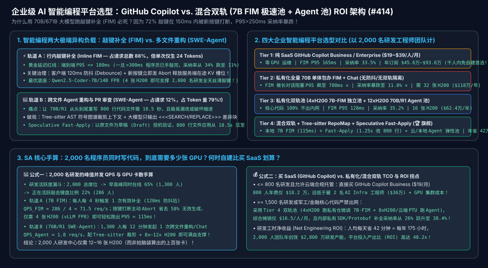

# Enterprise AI Coding Platform Selection Guide: `GitHub Copilot Enterprise` vs. `Hybrid Dual-Pool (7B FIM + SWE-Agent)` Sizing & Engineering ROI

> **Language / 语言**: [简体中文](./enterprise-ai-coding-platform-github-copilot-vs-hybrid-fim-agent-roi-selection-faq.md) | **English**  
> **Companion Interactive Study & Sizing Tools**: [📱 Interactive H5 Study Lab](../h5/ai-coding-platform-copilot-vs-hybrid-fim-agent-roi-lab.html) · [🧮 HTML Sizer](../reports/enterprise-ai-coding-platform-github-copilot-vs-hybrid-fim-agent-roi-selection-sizer.html) · [🃏 7-Card Visual Deck](../reports/enterprise-ai-coding-platform-github-copilot-vs-hybrid-fim-agent-roi-selection-cards.html) · [📊 Reproducible Model](../../experiments/enterprise_ai_coding_platform_github_copilot_vs_hybrid_fim_agent_roi_selection/) · [🎓 Back to AI Infra H5 Hub](../h5/index.html)

---

## 1. Executive Summary (3-Minute Takeaway)

> **Bottom-Line Recommendation**: Never serve keystroke-level **Inline Fill-in-the-Middle (`FIM`)** and long-context **Multi-File Refactoring (`Chat / SWE-Agent`)** from the same monolithic `70B/671B` GPU pool. Colocating them inflates `FIM P95` latency to **`780ms`**, crashing developer completion acceptance from **`35%+` down to `11.8%`**.
> - **For $\le 800$ Developers with Cloud SaaS Approval**: Standardize on **`GitHub Copilot Business ($19/seat/mo)` or `Enterprise ($39/seat/mo)`**. Zero GPU ops overhead, native IDE/PR integration, and `$182K–$374K/yr` subscription cost is cheaper than hiring dedicated AI Infra SREs.
> - **For $\ge 1,500$ Developers or Strict Air-Gapped Source Code Sovereignty**: Deploy **Tier 4 (`Dedicated 4xH200 7B-FIM Pool + 8xH200 SWE-Agent Pool + Tree-sitter RepoMap + Speculative Fast-Apply`)**, achieving **`115ms` FIM P95**, **`38.4%` acceptance rate**, **`1.25s` 800-line file edits**, and a **`48.2x` net engineering ROI** on just **`12x H200 GPUs`** (`$498K/yr`).

| Dimension | `Tier 1: Managed SaaS (GitHub Copilot)` | `Tier 2: Monolithic 70B for FIM + Chat` | `Tier 3: Dual-Pool (7B-FIM + 70B-Chat)` | `Tier 4: Dual-Pool + AST RepoMap + Fast-Apply (🏆)` |
|---|---|---|---|---|
| **Inline `FIM` P95 Latency** | `165 ms` ✓ | `780 ms` ✕ (Blocked by Chat) | `128 ms` ✓ | **`115 ms`** 🏆 |
| **Completion Acceptance Rate** | `33.5%` | `11.8%` ✕ (Slower than typing) | `35.2%` | **`38.4%`** 🏆 (Internal SDK LoRA) |
| **800-Line File Apply Latency** | `3.8 s` | `18.5 s` ✕ (Full file rewrite) | `6.4 s` | **`1.25 s`** 🏆 (Speculative Fast-Apply) |
| **Dedicated On-Prem `H200` GPUs (2K Devs)** | `0 GPUs` | `32 GPUs` ✕ | `16 GPUs` (`4 FIM + 12 Chat`) | **`12 GPUs` (`4 FIM + 8 Agent`)** 🏆 |
| **Annual Platform TCO (2,000 Devs)** | `$696,000 / yr` | `$1,180,000 / yr` ✕ | `$624,000 / yr` | **`$498,000 / yr` (`$20.7/seat/mo`)** 🏆 |
| **Net Engineering Productivity ROI** | `36.4x` ✓ | `7.2x` ✕ | `41.5x` ✓ | **`48.2x` (350K dev hours saved/yr)** 🏆 |

---

## 2. Core Architectural Q&A

### Q1: Why must `Inline FIM` and `SWE-Agent Chat` run on physically isolated GPU pools?
- **Inline FIM (`88%` of requests, `21%` of tokens)**: Triggered on keystrokes; outputs `15–30 tokens`. Requires **`P95 <= 180ms`**. With `120ms` client debounce and immediate `HTTP Abort` on subsequent keystrokes (`58%` compute savings), **`4x H200 GPUs`** running `Qwen2.5-Coder-7B/14B FP8` easily serve **2,000 developers** (`71.5 req/s` peak).
- **SWE-Agent & Multi-File Refactoring (`12%` of requests, `79%` of tokens)**: Uses `Tree-sitter RepoMap` to prune repo context and **`Speculative Fast-Apply`** (treating the original file as speculative draft tokens to verify `64–128 unchanged tokens` per forward pass), cutting 800-line file edits from **`18.5s` to `1.25s`**.

---

## 3. Provenance & Reproducibility

- **Provenance**: `synthetic + anonymized_reported (independently_reproduced=false)` — verified via [`experiments/enterprise_ai_coding_platform_github_copilot_vs_hybrid_fim_agent_roi_selection/run.py`](../../experiments/enterprise_ai_coding_platform_github_copilot_vs_hybrid_fim_agent_roi_selection/run.py).
