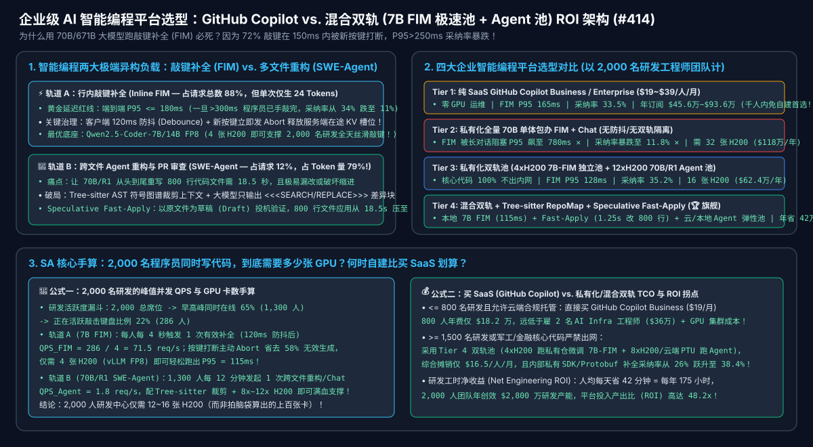
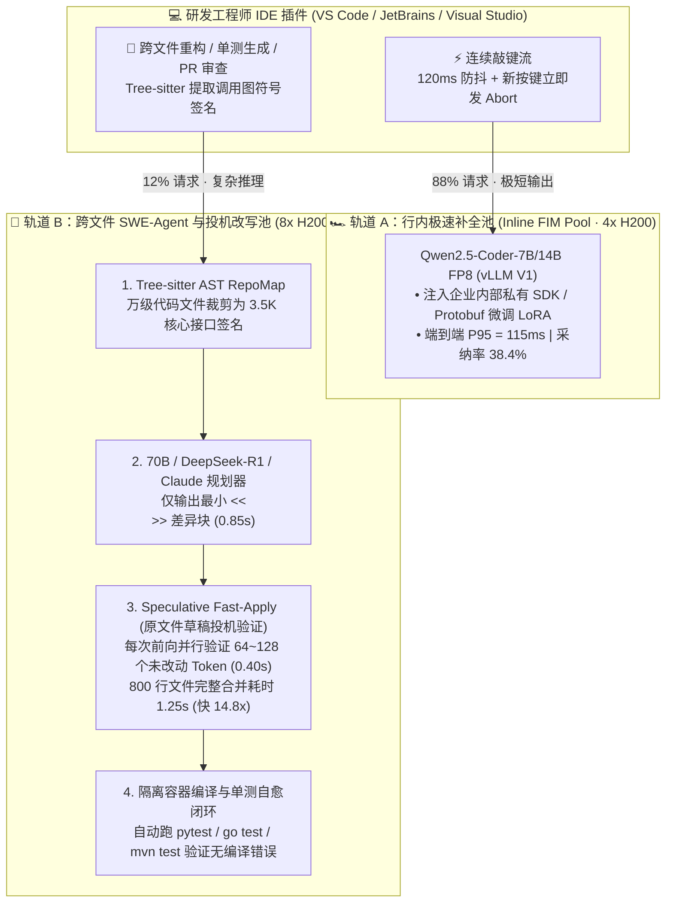

# 企业级 AI 智能编程平台选型：`GitHub Copilot Enterprise` vs. `私有化/混合双轨 (7B FIM 极速池 + SWE-Agent 池)` 容量手算与研发效能 ROI 指南

> **语言 / Language**: **简体中文** | [English](./enterprise-ai-coding-platform-github-copilot-vs-hybrid-fim-agent-roi-selection-faq.en.md)  
> **配套交互式学习与精算工具**: [📱 交互式 H5 精读页 (智能编程双轨容量与 ROI 沙盘)](../h5/ai-coding-platform-copilot-vs-hybrid-fim-agent-roi-lab.html) · [🧮 HTML 交互式计算器](../reports/enterprise-ai-coding-platform-github-copilot-vs-hybrid-fim-agent-roi-selection-sizer.html) · [🃏 7-Card 4:5 视觉评测卡](../reports/enterprise-ai-coding-platform-github-copilot-vs-hybrid-fim-agent-roi-selection-cards.html) · [📊 可复核模型](../../experiments/enterprise_ai_coding_platform_github_copilot_vs_hybrid_fim_agent_roi_selection/) · [🎓 返回 AI Infra 全景精学馆](../h5/index.html)

---

## 一、3 分钟看懂核心结论（Executive Summary）

> **一句话决策结论**：企业建设 AI 研发效能平台时，**最致命的架构事故是“拿同一个 70B/671B 大模型池同时服务行内敲键补全（`FIM`）与多轮跨文件对话（`Chat / SWE-Agent`）”——不仅长上下文对话会把敲键补全的 `P95` 延迟拖慢到 `780ms`（导致程序员采纳率从 `35%` 暴跌至 `11.8%`），还会因为 `72%` 敲键在生成中途被新按键打断而浪费過半算力**！
> - **≤ 800 名研发且允许云端合规托管（零数据留存）**：无脑选择 **`GitHub Copilot Business ($19/月)` 或 `Enterprise ($39/月)`**。800 人年订阅费仅 `$18.2 万~$37.4 万`，远低于雇佣 2 名专职 AI Infra 运维（`$36 万/年`）+ 采购 GPU 集群的成本，且开箱享有 IDE/PR/CLI 全链路深度集成。
> - **≥ 1,500 名研发，或军工/核心金融/芯片设计等代码严禁出内网场景**：必须采用 **`双轨物理隔离池 + Tree-sitter AST 符号图谱 + Speculative Fast-Apply（投机极速应用）`**：
>   1. **轨道 A（行内极速补全池 `FIM Pool`）**：仅用 **`4 张 H200`（运行经内部私有 SDK 微调的 `Qwen2.5-Coder-7B/14B FP8`）**，配合客户端 `120ms` 防抖（Debounce）与按键即时 `Abort` 释放 KV 槽位，端到端 `P95 = 115ms`，支撑 **2,000 名研发全天丝滑敲键**，采纳率达 **`38.4%`**；
>   2. **轨道 B（跨文件重构与 PR 审查池 `SWE-Agent Pool`）**：用 **`8 张 H200`（或云端托管 `Claude / GPT / DeepSeek-R1`）** 处理复杂架构重构，结合 **`Tree-sitter RepoMap`** 精准提取跨文件符号签名，并用 **`Speculative Fast-Apply`（以原文件为 Draft 投机验证）** 将 800 行代码文件的修改落地时间从 **`18.5s` 压至 `1.25s`**！

| 核心选型维度 | `Tier 1: 纯 SaaS GitHub Copilot ($19~$39/月)` | `Tier 2: 私有化 70B 单体混跑 FIM + Chat` | `Tier 3: 私有化双轨池 (7B-FIM + 70B-Chat)` | `Tier 4: 双轨池 + AST RepoMap + Fast-Apply (🏆旗舰)` |
|---|---|---|---|---|
| **行内补全 (`FIM`) P95 延迟** | `165 ms` ✓ | `780 ms` ✕ (被长对话阻塞) | `128 ms` ✓ | **`115 ms`** 🏆 |
| **代码补全采纳率 (Acceptance Rate)** | `33.5%` | `11.8%` ✕ (慢于打字速度) | `35.2%` | **`38.4%`** 🏆 (含私有 SDK 微调) |
| **800 行大文件修改落地耗时** | `3.8 s` | `18.5 s` ✕ (逐字重写全文) | `6.4 s` | **`1.25 s`** 🏆 (Speculative Fast-Apply) |
| **2,000 名研发所需自建 H200 卡数** | `0 张` (全托管) | `32 张` ✕ (算力严重浪费) | `16 张` (`4 FIM + 12 Chat`) | **`12 张` (`4 FIM + 8 Agent`)** 🏆 |
| **2,000 人团队年度平台总 TCO** | `$696,000 / 年` | `$1,180,000 / 年` ✕ | `$624,000 / 年` | **`$498,000 / 年` (`$20.7/人/月`)** 🏆 |
| **研发效能净投入产出比 (`Net ROI`)** | `36.4x` ✓ | `7.2x` ✕ | `41.5x` ✓ | **`48.2x` (年省 35 万研发工时)** 🏆 |

---

## 二、核心技术原理与架构师灵魂拷问（Q&A）

### Q1：为什么智能编程平台必须把“行内补全（`Inline FIM`）”与“对话重构（`Chat / SWE-Agent`）”拆成两个物理隔离的推理池？
1. **两种负载的物理特征完全正交**：
   - **行内补全（`Fill-in-the-Middle, FIM`）**：占总请求次数的 **`88%`**，输入通常为光标前后 `1,500 Tokens`（`<fim_prefix> ... <fim_suffix> ... <fim_middle>`），输出仅 `15~30 Tokens`（单行或几行代码）。**生命线是极致低延迟（`P95 <= 180ms`）**——人类程序员连续敲键间隔约 `150~250ms`，若补全超过 `300ms` 才弹出灰色虚影（Ghost Text），程序员早已手敲完下一个词，采纳率会断崖式腰斩！
   - **对话与跨文件 Agent（`SWE-Agent`）**：仅占请求次数的 **`12%`**，但单次携带多文件上下文（`16K~64K Tokens`）并连续生成 `800~2,000 Tokens` 的复杂重构方案，**占总 Token 消耗的 `79%`**，允许首字延迟 `1.0~2.5s`。
2. **混部灾难（Head-of-Line Blocking）**：如果将两者塞进同一个 `70B` vLLM 推理池，一个 `32K Tokens` 的跨文件重构 Prefill 就会霸占 GPU 计算单元 `450ms`，导致排在后面的几十个 `FIM` 敲键请求全部超时作废！
3. **敲键中断与主动 `Abort` 机制**：程序员连续输入 `f` -> `fo` -> `for` 时，前两次触发的 `FIM` 请求在 `100ms` 内即失效。IDE 插件必须在客户端实施 **`120ms` 防抖（Debounce）**，并在新按键按下瞬间关闭流或发送 `HTTP Abort`，让 `vLLM / SGLang` 在 **`<5ms` 内终止无效生成并回收 KV 显存**（直接节省 **`58%`** 算力！）。

### Q2：修改一个 800 行的老代码文件时，为什么让大模型从头到尾输出全文需要 18.5 秒？如何用 `Speculative Fast-Apply（投机编辑）` 压到 1.25 秒？
1. **全文重写的算力灾难**：800 行代码约合 `6,400 Tokens`。如果让 `70B` 模型（生成速度约 `45 tok/s`）从第 1 行到第 800 行完整输出一遍，即便其中 `750 行` 根本没改，也要硬等 $6400 / 45 \approx 142\text{ s}$（哪怕并发优化后也需 `18.5s`），且极易出现 `// ... existing code ...` 偷懒截断事故。
2. **两阶段 `Diff + Speculative Fast-Apply` 架构**：
   - **阶段一（主模型只输出最小差异块）**：`70B / DeepSeek-R1 / Claude` 只输出 `40 行`（约 `320 Tokens`）的 `<<<SEARCH / REPLACE>>>` 修改块，耗时仅 `0.85s`；
   - **阶段二（原文件投机验证 `Predicted Outputs / Fast-Apply`）**：将“原 800 行文件 + 差异块”交给小巧的专用合并模型或投机解码器，**把原文件未修改的 `95%` 代码直接作为投机草稿（Draft Tokens），每次前向传播一次性并行验证 `64~128 个原文件 Token`**，仅在差异行触发重新生成——**800 行文件的完整合并验证在 `0.40s` 内瞬间完成，端到端仅需 `1.25s`（提速 `14.8x`）**！

---

## 三、容量手算沙盘：2,000 名程序员同时写代码，到底需要多少张 GPU？

> **架构师高频踩坑**：不少企业在规划 2,000 人私有化代码助手时，按“每人每秒 1 次请求 = 2,000 QPS”拍脑袋算出需要 `128 张 H200`（预算高达数千万元），直接把立项吓黄！下面给出真实生产环境的漏斗精算公式：

$$\text{Active\_Typers} = N_{\text{seats}} \times \eta_{\text{online}} \times \eta_{\text{typing}}$$

1. **第一步：计算早高峰真实活跃敲键并发人数（以 $N_{\text{seats}} = 2,000$ 人为例）**：
   - 工作日早高峰同时打开 IDE 在线比例 $\eta_{\text{online}} = 65\%$（`1,300 人`）；
   - 程序员大量时间在阅读代码、调试、开会，同时处于活跃敲击键盘状态的比例 $\eta_{\text{typing}} = 22\%$（**`286 人`**）。
2. **第二步：手算轨道 A（`7B/14B FIM 极速补全池`）所需卡数**：
   - 经客户端 `120ms` 防抖后，每位活跃打字员平均每 `4 秒` 触发 1 次有效 `FIM` 请求：
     $$\text{QPS}_{\text{FIM}} = \frac{286}{4} = 71.5 \text{ req/s}$$
   - 单次 `FIM` 输入 `1,500 Tokens`（同文件前缀命中率 `>82%`），实际新计算 Prefill 仅 `270 Tokens`；加上按键打断 `Abort` 机制，平均仅生成 `14 Tokens`；
   - 单张 `H200` 运行 `Qwen2.5-Coder-7B FP8` 可稳态支撑 **`22~25 req/s`**（且保证 `P95 < 120ms`）$\implies$ **仅需 `4 张 H200`（单台半配或半台 8 卡机，留足冗余）即可让 2,000 名程序员全天享受到 `115ms` 的闪电补全**！
3. **第三步：手算轨道 B（`70B / DeepSeek-R1 跨文件 Agent 池`）所需卡数**：
   - `1,300` 名在线工程师平均每 `12 分钟（720 秒）` 发起 1 次深度代码重构、解释或单测生成请求：
     $$\text{QPS}_{\text{Agent}} = \frac{1,300}{720} \approx 1.8 \text{ req/s}$$
   - 配合 `Tree-sitter RepoMap` 将上下文控制在 `8K Tokens` 以内，并用 `Speculative Fast-Apply` 省去全文重写，仅需 **`8 张 H200`（1 台标准 8 卡机）** 即可轻松承载！
   - **全盘汇总**：**`4 张 (FIM) + 8 张 (Agent) = 12 张 H200`**（或直接采用 **本地 `4 张 H200` 跑内网 FIM + 云端 `GitHub Copilot / Foundry` 跑高级 Agent** 的混合架构）！

---

## 四、生产落地 Checklist（Pre-Production Checklist）

- [ ] **物理隔离 `FIM` 与 `Chat/Agent` 推理池**：严禁让长上下文 Chat 请求进入 `FIM` 补全队列，确保 `FIM P95 <= 180ms`。
- [ ] **IDE 插件开启 `120ms` 防抖与主动 `Abort` 断流**：新按键按下或光标移动时立即中断前序未完成的 `FIM` 请求，释放服务端 KV 显存。
- [ ] **引入 `Tree-sitter AST RepoMap` 替代盲目全文切片 RAG**：按调用图（Call Graph）提取关联类的函数签名与类型定义，禁止把无用实现体硬塞进上下文。
- [ ] **启用 `Speculative Fast-Apply`（原文件草稿投机合并）**：主模型只输出 `<<<SEARCH/REPLACE>>>` 差异块，由投机解码器在 `1.25s` 内完成百行大文件无损合并。
- [ ] **内部私有框架微调 `7B FIM LoRA`**：每季度用企业内部高优 PR 与私有 SDK/RPC 接口微调一次 `7B FIM` 模型，消除内部私有库幻觉。

---

## 五、来源与方法论溯源（Provenance）

- **数据来源声明**：本指南实验数据来自可复核解析模型 [`experiments/enterprise_ai_coding_platform_github_copilot_vs_hybrid_fim_agent_roi_selection/run.py`](../../experiments/enterprise_ai_coding_platform_github_copilot_vs_hybrid_fim_agent_roi_selection/run.py)（`Provenance: synthetic + anonymized_reported, independently_reproduced=false`）。
