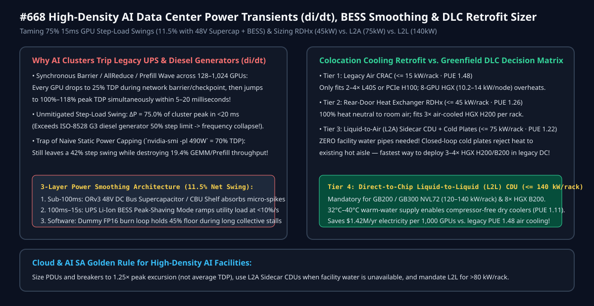

# Enterprise High-Density AI Data Center Power Delivery, Synchronous `di/dt` Transients, Capacitive/BESS Smoothing & Liquid Cooling (`RDHx` vs. `L2A` vs. `L2L`) Retrofit Sizer (`#668`)

> **Reader's Guide (3 Minutes for Key Takeaways, 10 Minutes for Power Step-Load & Cooling Sizing Math)**
> - **Interactive H5 Study Lab**: [Open `ai-datacenter-power-transient-bess-dlc-retrofit-sizer-lab.html`](../h5/ai-datacenter-power-transient-bess-dlc-retrofit-sizer-lab.html)
> - **Interactive HTML Sizer**: [Open `enterprise-ai-datacenter-power-transient-bess-dlc-retrofit-sizer.html`](../reports/enterprise-ai-datacenter-power-transient-bess-dlc-retrofit-sizer.html)
> - **7-Card 4:5 Visual Deck**: [Open `enterprise-ai-datacenter-power-transient-bess-dlc-retrofit-sizer-cards.html`](../reports/enterprise-ai-datacenter-power-transient-bess-dlc-retrofit-sizer-cards.html)
> - **中文版本**: [阅读中文版指南 (`#668`)](./enterprise-ai-datacenter-power-transient-bess-dlc-retrofit-sizer-faq.md)

---

## 1. Executive Summary (3-Minute Overview)

When deploying high-density `H200`, `B200`, or `GB200 NVL72` clusters into enterprise data centers or colocation facilities, infrastructure teams confront two physical blockers: **(1) Millisecond Synchronous Power Transients (`di/dt` Step Loads)** — when `128–1,024` GPUs exit a collective `AllReduce` barrier or start a synchronized `Prefill` wave together, cluster power jumps from `25%` idle (`264 kW`) to `100%–118%` peak (`1,056+ kW`) within **`5–20 milliseconds`** (a **`75.0%` step swing** that exceeds standard diesel generator `<50%` step-load tolerances and trips UPS inverters into bypass); and **(2) Cooling Density Retrofits in Air-Cooled Data Halls Without Facility Water Plumbing**:

1. **Tame `75.0%` `15ms` Power Swings Down to `11.5%` (with Only `0.8%` Compute Loss) via 3-Layer Power Smoothing (`ORv3 48V Supercapacitor Shelf + Li-Ion UPS BESS Slew-Rate Limiting + Long-Barrier Floor`)**:
   - **Never use static `70%` GPU power capping (`nvidia-smi -pl 490W`)** as your primary transient fix—it sacrifices **`19.4%` throughput** while still leaving a `42%` step swing.
   - Instead, combine **(Layer 1: `<100 ms`)** `ORv3 48V` rack supercapacitor shelves (`CBU`) to absorb `118%` micro-spikes, **(Layer 2: `100 ms–15 s`)** Li-Ion UPS `BESS` peak-shaving slew-rate control (`<=10% P_max/s`), and **(Layer 3: `>300 ms`)** driver-level idle floor warming during long checkpoint/barrier stalls, reducing grid/generator step swing from `75.0%` to **`11.5%`** at **`0.8%` throughput cost**.
2. **Cooling Selection Matrix: Use `Liquid-to-Air (L2A) Sidecar CDUs` (`<=75 kW/rack`) for Zero-Plumbing Legacy Colocation Retrofits, `RDHx` (`<=45 kW/rack`) for Air-Assisted HGX, and `Liquid-to-Liquid (L2L)` (`<=140 kW/rack`, `PUE 1.11`) for `GB200 NVL72` & `8× B200`**.

---

## 2. Cooling & Power Retrofit Decision Matrix

| Cooling Architecture | Max Rack Density | Design `PUE` | Facility Water Pipes Needed? | Retrofit CapEx / Rack | Target GPU Platforms |
| --- | --- | --- | --- | --- | --- |
| **1. Legacy Air Cooling (`CRAC`)** | `<= 15 kW/rack` | `1.48` | ❌ No | `$4,500` | `2–4× L40S` or `1× HGX` (80% rack empty) |
| **2. Rear-Door Heat Exchanger (`RDHx`)** | `<= 45 kW/rack` | `1.26` | ✅ Yes | `$18,500` | `3–4× Air-Cooled HGX H100/H200` |
| **3. Liquid-to-Air (`L2A Sidecar CDU + Cold Plates`)** | **`<= 75 kW/rack`** | **`1.22`** | **❌ No (Zero Facility Plumbing!)** | `$34,000` | **Fast 6-week retrofit for `3–4× HGX H200/B200` in air-cooled colos** |
| **4. Liquid-to-Liquid (`L2L In-Row CDU + 32–40°C Water`)** | **`<= 140 kW/rack`** | **`1.11`** | ✅ Yes (Primary + Secondary Loop) | `$42,000` | **`GB200 / GB300 NVL72 (132 kW)` & greenfield AI factories** |

---

## 3. Pre-Production Checklist

- [ ] **Size Rack PDUs & Breakers to `1.25×` Transient Excursion**: Account for `10 ms` `118%` GPU power excursions so magnetic breakers do not nuisance-trip during synchronized `AllReduce`.
- [ ] **Deploy `ORv3 48V` Capacitive Busbars (`CBU`) + Li-Ion UPS Slew-Rate Limiting**: Bound upstream utility/generator `di/dt` ramp rates to `<10% P_max / second`.
- [ ] **Select `L2A Sidecar CDUs` When Facility Chilled Water Is Unavailable**: Achieve up to `75 kW/rack` direct-to-chip cold-plate cooling while rejecting heat into existing hot aisles.
