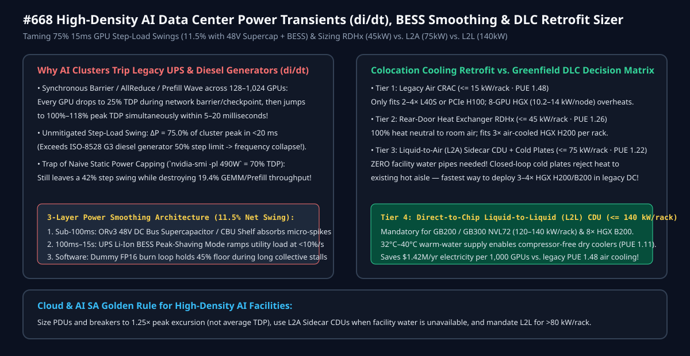
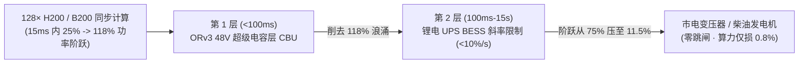

# 企业高密智算中心供电瞬态冲击（`di/dt` 毫秒级阶跃负载）、超级电容/储能（`CBU/BESS`）平滑与老旧风冷机房液冷改造（`RDHx` vs. `L2A` vs. `L2L`）选型指南（`#668`）

> **阅读指南（3 分钟看懂核心结论，10 分钟掌握供电阶跃冲击与液冷改造手算）**
> - **交互式 H5 精读页**：[打开 `ai-datacenter-power-transient-bess-dlc-retrofit-sizer-lab.html`](../h5/ai-datacenter-power-transient-bess-dlc-retrofit-sizer-lab.html)
> - **交互式容量计算器（Sizer）**：[打开 `enterprise-ai-datacenter-power-transient-bess-dlc-retrofit-sizer.html`](../reports/enterprise-ai-datacenter-power-transient-bess-dlc-retrofit-sizer.html)
> - **7-Card 4:5 视觉评测报告**：[打开 `enterprise-ai-datacenter-power-transient-bess-dlc-retrofit-sizer-cards.html`](../reports/enterprise-ai-datacenter-power-transient-bess-dlc-retrofit-sizer-cards.html)
> - **English Version**: [Read the English Guide (`#668`)](./enterprise-ai-datacenter-power-transient-bess-dlc-retrofit-sizer-faq.en.md)

---

## 一、执行摘要与核心结论（3 分钟速览）

当企业在自有老旧数据中心或租赁托管机房（Colocation）部署 `128–1,024` 张 `H200 / B200 / GB200` 时，最常在交付前夜踩中两大基础设施物理死穴：**① 毫秒级同步阶跃供电冲击（Synchronous Step-Load `di/dt`）**——当全集群 GPU 同时完成一次 `AllReduce` 集合通信屏障或同时启动一轮 `Prefill` 矩阵乘时，整排机柜功耗会在 **`5–20 毫秒` 内从 `25%` 空载（`264 kW`）瞬间跃升至 `100%–118%` 峰值（`1,056+ kW`）**，阶跃幅度高达 **`75.0%`**，直接打穿传统柴油发电机（单次阶跃承受上限 `<50%`）和双变换 UPS 逆变器，触发全机房跳闸或转旁路！**② 老旧机房无冷冻水管道却要装 `40–75 kW` 高密 GPU 机柜**——若等大楼改造二次侧冷冻水立管往往耗时 `9–12 个月`。

1. **毫秒级供电冲击（`di/dt`）治理铁律：严禁靠静态砍功耗上限（`70% Power Cap` 损失 `19.4%` 算力）！必须采用“机柜 `48V` 超级电容层（`<100ms`）+ UPS 锂电 `BESS` 削峰斜率控制（`100ms–15s`）+ 长屏障合成空载托底”三级平滑架构，将电网侧阶跃摆幅从 `75.0%` 压至 `11.5%`（算力损耗仅 `0.8%`）！**
   - **第一层（`0–100 ms` 毫秒级尖峰削平）**：在 `ORv3 48V DC` 母排配置 **超级电容层（Supercapacitor / CBU Power Shelf）**，吸收 GPU 瞬时 `118%` 微秒/毫秒浪涌（Excursion）并在 `5–20ms` 阶跃瞬间放电托底。
   - **第二层（`100 ms–15 s` 秒级斜率限制）**：将机房锂电 UPS 配置为 **主动斜率限制模式（Peak-Shaving / Slew-Rate Limiting，`<= 10% P_max / 秒`）**，给柴油发电机涡轮增压器留出充足机械响应时间。
   - **第三层（软件侧 `>500 ms` 集合通信/Checkpoint 空泡托底）**：在长时间 Checkpoint 或跨节点屏障等待期间，由运行时驱动仅在闲置超过 `300 ms` 时注入轻量级 `FP16` 保温指令，将空载跌落底线托在 `45% TDP`，且完全不抢占正常计算周期（吞吐损耗仅 **`0.8%`**）。
2. **存量风冷机房快速上高密 GPU 铁律：无楼宇水源选 `液对风（L2A Sidecar CDU + 冷板，<=75 kW/柜）`，有水源且 `<=45 kW/柜` 选 `背门热交换器（RDHx）`，`>80 kW/柜（GB200 NVL72 / 8×B200）` 强制选 `液对液（L2L CDU，<=140 kW/柜，PUE 1.11）`！**
   - 当老旧机房没有预留进机房的冷冻水管道，但业务要求在 **6 周内**上线 `32–128` 张 `H200/B200` 时，采用 **自闭环液对风旁路分配单元（`Liquid-to-Air L2A Sidecar CDU` + 服务器冷板）**：服务器内部用冷板（Cold Plate）带走 `75%` 热量，通过机柜侧边的 `L2A` 散热排直接把热量排入机房既有热通道，**零楼宇水管改造**即可支持 **`75 kW/机柜`**！

---

## 二、灵魂拷问 Q&A（架构师现场排障与手算拆解）

### Q1：为什么同样是 `1 MW` 总功耗，传统云计算 CPU 机房从来不跳闸，而 `1 MW` 的 AI 大模型机房频繁把 UPS 打入旁路甚至导致柴发熄火？如何手算阶跃摆幅？

**集群同步阶跃功率摆幅手算公式**：
$$\Delta P_{\text{step}} = N_{\text{GPU}} \cdot \left( P_{\text{peak\_TDP}} - P_{\text{idle\_barrier}} \right) \cdot \eta_{\text{sync}}$$
- **传统通用 CPU 机房**：数万个微服务请求相互独立（同步系数 $\eta_{\text{sync}} \approx 0.03$），根据中心极限定理，整机房总功率波动在 `±3%` 以内，极其平滑。
- **AI 训练 / 大批量同步推理机房**：`128–1,024` 张 GPU 被同一个 `NCCL AllReduce` 屏障或同步调度器锁死步调（$\eta_{\text{sync}} \approx 0.95+$）！以 `1,056 kW` 峰值集群为例，通信等待期跌至 `264 kW`（`25%`），屏障结束瞬间在 `15 ms` 内跳回 `1,056 kW`，瞬时阶跃 $\Delta P_{\text{step}} = 792\text{ kW}$（**占总容量 `75.0%`**），同时伴随长达 `1–10 ms` 的 `118%` 瞬态峰值电流（Excursion），导致机柜 PDU 空气开关误跳闸！
- **机柜 PDU 选型红线**：机柜支路断路器与 PDU 必须按 **$1.25 \times P_{\text{TDP\_Excursion}}$** 选型（严禁只按稳态平均功耗选型）。

---

### Q2：企业现有一个单柜限额 `12 kW` 的传统风冷机房，想在 2 个月内上线 8 台 `HGX H200`（单台满载 `10.2 kW`），三种液冷改造路径（`RDHx` vs. `L2A` vs. `L2L`）该如何拍板？

| 制冷架构层级 | 单机柜最大功率密度 | 设计 `PUE` | 是否需要机房大楼改水管 | 单机柜改造 CapEx | 适用 GPU 机型与交付周期 |
| --- | --- | --- | --- | --- | --- |
| **1. 传统冷热通道风冷 (`CRAC`)** | `<= 15 kW/柜` | `1.48` | ❌ 不需要 | `$4,500` | 仅能放 1 台 `HGX H200`（机柜 80% 空间空置，线缆极长！） |
| **2. 背门热交换器 (`RDHx`)** | `<= 45 kW/柜` | `1.26` | ✅ 需接冷冻水支管 | `$18,500` | 单柜可装 `3–4` 台风冷版 `HGX H200`，对机房室温 100% 热中和 |
| **3. 液对风闭环旁路 (`L2A Sidecar CDU + 冷板`)** | **`<= 75 kW/柜`** | **`1.22`** | **❌ 零水管改造！** | `$34,000` | **存量风冷机房救急首选（4–6 周交付）**：单柜装 `4` 台冷板 `H200/B200` |
| **4. 液对液直冷 (`L2L In-Row CDU + 32–40°C 温水`)** | **`<= 140 kW/柜`** | **`1.11`** | ✅ 需一次/二次环网 + 分集水器 | `$42,000` | **`GB200 / GB300 NVL72 (132 kW)` 与千卡智算中心新建唯一标准** |

---

## 三、生产落地核对清单（Pre-Production Checklist）

- [ ] **机柜母排配置 `ORv3 48V` 超级电容层（CBU）+ UPS 锂电斜率限制**：实测 `15 ms` 全集群 `AllReduce` 阶跃下电网侧 `di/dt` 斜率 `< 10% P_max / s`。
- [ ] **PDU 与断路器预留 `1.25×` 瞬态峰值余量**：校验 `H200 (700W TDP / 850W Excursion)` 与 `B200 (1,000W TDP / 1,200W Excursion)` 在 `10 ms` 尖峰下不触发热磁脱扣。
- [ ] **存量无水机房优先采用 `L2A Sidecar CDU` 过渡**：在楼宇冷冻水管未就绪前，用闭环冷板 + 液对风散热柜在 6 周内完成高密节点投产。
- [ ] **`L2L` 液冷环网部署双冗余 CDU 泵 + 漏液光电传感器绳 + 负压防漏（Sub-Atmospheric）设计**：确保单台 CDU 水泵故障切换时间 `< 3 秒`，杜绝 GPU 结温超过 `85°C` 降频线。
