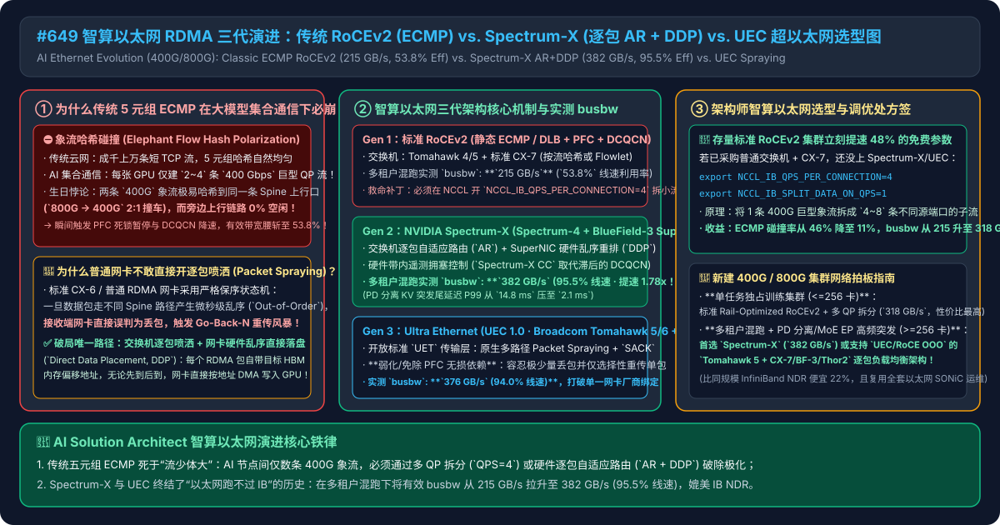

# AI Ethernet Fabric Evolution: Classic `RoCEv2 (ECMP + DCQCN)` vs. `NVIDIA Spectrum-X (Adaptive Routing + DDP)` vs. `Ultra Ethernet (UEC)` Packet Spraying Sizer

> **Language / 语言**: [简体中文](./enterprise-ai-ethernet-rocev2-ecmp-vs-spectrumx-ar-vs-uec-faq.md) | **English** · [📱 Open Interactive H5 Study Lab](../h5/ai-ethernet-rocev2-ecmp-vs-spectrumx-ar-vs-uec-lab.html) · [🧮 Open Interactive Sizer](../reports/enterprise-ai-ethernet-rocev2-ecmp-vs-spectrumx-ar-vs-uec-sizer.html) · [🃏 View 7-Card 4:5 Benchmark Deck](../reports/enterprise-ai-ethernet-rocev2-ecmp-vs-spectrumx-ar-vs-uec-cards.html)

---

## 0. 3-Minute Executive Summary

When scaling `400G / 800G` Ethernet AI fabrics across `256–4,096` GPUs under **multi-tenant fragmented placement, MoE `All-to-All` bursts, and PD Disaggregation KV transfers**, Cloud & AI Solution Architects must understand why classic `5-Tuple ECMP RoCEv2` loses nearly half its bandwidth and how `Spectrum-X` and `Ultra Ethernet (UEC)` restore `94%–95.5%` line-rate efficiency:
1. **Why Classic `5-Tuple ECMP RoCEv2` Collapses to `215 GB/s` (`53.8%` Line Rate) in Multi-Tenant Production**:
   - Each GPU generates only `1–2` massive `400 Gbps` RDMA Queue Pair (`QP`) elephant flows. Under static 5-tuple ECMP hashing, two `400G` flows collide onto the same Spine uplink `46%` of the time while adjacent uplinks sit idle — triggering `PFC` pause storms and `DCQCN` rate cuts (`P99` KV transfer tail latency spikes to **`14.8 ms`**).
2. **Breaking Hash Polarization: Switch Packet Spraying (`AR`) + NIC Hardware Out-of-Order Direct Data Placement (`DDP`)**:
   - **`NVIDIA Spectrum-X` (`Spectrum-4` + `BlueField-3 SuperNIC / CX-8`)**: Dynamically sprays packets across the least-loaded Spine links (`Adaptive Routing`) while the receiving SuperNIC places out-of-order RDMA packets directly into their target GPU HBM offset via DMA (`DDP`) without triggering retransmission — achieving **`382 GB/s` (`95.5%` line rate, `1.78×` over classic ECMP)** and **`2.1 ms`** `P99` KV latency.
   - **`Ultra Ethernet Consortium (UEC 1.0)` (`Broadcom Tomahawk 5/6 + Thor2 / AMD Pollara`)**: Uses open `UET` multi-path packet spraying + **Selective Repeat (`SACK`)** to eliminate `PFC` deadlock reliance, delivering **`376 GB/s` (`94.0%` line rate)**.
3. **Zero-Cost Emergency Tuning for Existing `RoCEv2` Clusters (`+47.9%` Throughput)**:
   - Setting `NCCL_IB_QPS_PER_CONNECTION=4` and `NCCL_IB_SPLIT_DATA_ON_QPS=1` (with ConnectX-7 hardware OOO enabled) splits each `400G` elephant flow into `4–8` hashed sub-flows, recovering multi-tenant `busbw` from `215 GB/s` to **`318 GB/s` (`79.5%` line rate)**.

---

## 1. Quantitative AI Ethernet Fabric Matrix (`400GbE` Multi-Tenant Mixed Workload)

| AI Ethernet Architecture (`1,024 GPUs`) | Load Balancing Mechanism | Out-of-Order (`OOO`) Handling | Multi-Tenant `busbw` (`%` Line Rate) | PD KV Transfer `P99` Latency | SA Verdict |
| :--- | :--- | :--- | :--- | :--- | :--- |
| **1. Classic `RoCEv2` (`Static ECMP, QP=1`)** | 5-Tuple static hash | Strict in-order (Go-Back-N) | `215 GB/s` (`53.8%`) | `14.8 ms` | ⛔ **Severe hash collisions** |
| **2. Tuned `RoCEv2` (`QPS=4 + DLB + NIC OOO`)** | Multi-QP split + Flowlet | CX-7 hardware OOO window | `318 GB/s` (`79.5%`) | `4.6 ms` | ✅ **Mandatory tuning for legacy fleets** |
| **3. `NVIDIA Spectrum-X` (`AR + BF-3 DDP`)** | **Per-packet Adaptive Routing** | **Hardware DMA `DDP` placement** | **`382 GB/s` (`95.5%`, `1.78×`)** | **`2.1 ms` (`-85.8%`)** | 🏆 **Matches IB NDR at `-22%` switch CapEx** |
| **4. `Ultra Ethernet (UEC)` (`UET Spraying + SACK`)** | **Open packet spraying** | **`UET` OOO + `SACK` (PFC-free)** | **`376 GB/s` (`94.0%`)** | **`2.4 ms`** | 🏆 **Open multi-vendor 400G/800G standard** |
