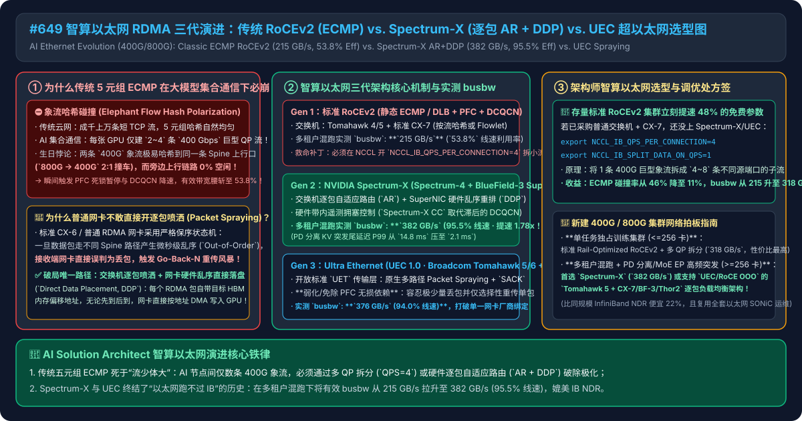
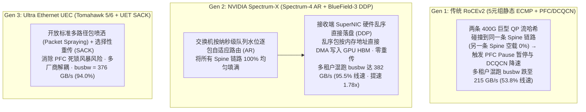

# 智算以太网 RDMA 三代演进与选型：传统 `RoCEv2 (五元组 ECMP + DCQCN)` vs. `NVIDIA Spectrum-X (逐包自适应路由 AR + DDP)` vs. `UEC 超以太网 (Packet Spraying)` 指南

> **语言 / Language**: **简体中文** | [English](./enterprise-ai-ethernet-rocev2-ecmp-vs-spectrumx-ar-vs-uec-faq.en.md) · [📱 打开交互式 H5 精读页](../h5/ai-ethernet-rocev2-ecmp-vs-spectrumx-ar-vs-uec-lab.html) · [🧮 打开交互式容量计算器](../reports/enterprise-ai-ethernet-rocev2-ecmp-vs-spectrumx-ar-vs-uec-sizer.html) · [🃏 查看 7-Card 4:5 评测报告](../reports/enterprise-ai-ethernet-rocev2-ecmp-vs-spectrumx-ar-vs-uec-cards.html)

---

## 0. 3 分钟执行摘要（Executive Summary）

当企业规划 `256` 卡至 `4,096` 卡规模的 `400G / 800G` 以太网智算中心时，架构师最常被问到的灵魂问题是：**“为什么我们的传统 `RoCEv2` 交换机单机对打能跑 `380 GB/s`，但一跑多租户并发训练 + `MoE All-to-All` + `PD 分离 KV Cache 突发传输`，全网有效 `busbw` 就暴跌到 `215 GB/s`（仅 `53.8%` 线速）？`NVIDIA Spectrum-X` 和 `Ultra Ethernet Consortium (UEC)` 到底改了什么底层机制？”**
1. **传统 `RoCEv2 (5-Tuple ECMP + PFC + DCQCN)` 在多租户下的“哈希极化崩塌”机理**：
   - 传统云数据中心有数万条微小的 TCP 连接，五元组哈希（`ECMP`）天然均匀；但在智算集群中，每张 GPU 只建立 **`1–2` 条满速 `400 Gbps` 的巨型 RDMA 队列对（Elephant Flow QP）**！
   - 根据生日悖论，在 `1:1` 无收敛 Fat-Tree 中，两条 `400G` 巨流有高达 **`46%` 的概率哈希碰撞到同一条 `400G` Spine 上行链路**（而相邻上行链路 `0%` 空跑），瞬间打满交换机 Headroom 触发 `PFC Pause` 反压与 `DCQCN` 降速，导致多租户混跑时跨机 `busbw` 从 `380 GB/s` 腰斩至 **`215 GB/s`（仅 `53.8%` 线速）**，PD 分离 KV 传输 `P99` 尾延迟恶化至 **`14.8 ms`**！
2. **破局关键：“交换机逐包喷洒（Packet Spraying / AR）+ 网卡硬件乱序直写（Direct Data Placement, DDP）”**：
   - 普通 RDMA 网卡如果遇到交换机逐包走不同路径产生的微秒级乱序（`Out-of-Order, OOO`），会误判为丢包并触发灾难性的 `Go-Back-N` 重传；
   - **`NVIDIA Spectrum-X`（`Spectrum-4 交换机` + `BlueField-3 SuperNIC / CX-8`）**：交换机根据端口实时队列深度对每个数据包动态挑选最空闲的 Spine 链路（`Adaptive Routing, AR`），而接收端 SuperNIC 利用 RDMA 报文自带的目标 HBM 内存偏移量，**在网卡硬件层直接将乱序到达的数据包按正确地址 DMA 写入 GPU 显存（`DDP`），仅在全消息收齐后向 GPU 置位一次完成标志**！实测多租户混跑 `busbw` 飙升至 **`382 GB/s`（`95.5%` 线速，提速 `1.78×`）**，媲美 `InfiniBand NDR`！
   - **`UEC 超以太网联盟`（`Broadcom Tomahawk 5/6 + Thor2 / AMD Pollara`）**：通过开放标准 `UET` 协议栈实现多路径包喷洒 + **选择性重传（`SACK`，摆脱对全局无损 `PFC` 的绝对依赖）**，实测达 **`376 GB/s`（`94.0%` 线速）**。
3. **存量标准 `RoCEv2` 集群零成本提速 `48%` 急救处方**：若已采购普通交换机 + `CX-7`，立即配置 `NCCL_IB_QPS_PER_CONNECTION=4` 与 `NCCL_IB_SPLIT_DATA_ON_QPS=1`（将单条 `400G` 巨流拆散为 `4–8` 条不同五元组的 `50G–100G` 子流）并开启网卡乱序容忍（`OOO`），可将 `busbw` 从 `215 GB/s` 救回至 **`318 GB/s`（`79.5%` 线速）**！

---

## 1. 灵魂拷问 Q&A（Cloud & AI Solution Architect 核心决策拆解）

### Q1：为什么普通 RoCEv2 在单任务跑 `nccl-tests` 时能拿高分，一旦上线真实业务（多任务碎节点调度 + MoE EP）就大幅掉速？

- **单任务压测的假象**：在全集群跑单一规整 `Ring AllReduce` 且节点按 Rail 完美对齐时，每条流量刚好一进一出不走同一个 Spine 上行口；
- **真实生产的混乱度**：当集群经历数周运行、部分节点因维护/MIG 切分产生**碎片化跨机柜调度**，或者运行 `DeepSeek-V3 MoE` 的非对称 `All-to-All`（热门专家受到多卡同时突发 Incast 冲击）以及 `PD 分离` 的突发 KV 块推送时，静态五元组 `ECMP` 立即出现严重负载倾斜。

---

## 2. 四套智算以太网架构横向选型矩阵（`400GbE` 跨机多租户混跑实测）

| 网络架构方案（`1,024 GPU` · 多任务碎片调度 + MoE/PD 混跑） | 负载均衡机制 | 乱序 (`OOO`) 与丢包处理 | 多租户混跑有效 `busbw` | PD 分离 KV 传输 `P99` 延迟 | 网络 BoM 溢价 & 架构师裁决 |
| :--- | :--- | :--- | :--- | :--- | :--- |
| **1. 标准 RoCEv2 默认配置 (`ECMP + QP=1`)** | 静态五元组哈希 | 严格保序（乱序即重传） | `215 GB/s` (`53.8%` 线速) | `14.8 ms`（频繁 PFC 暂停） | `1.00×` 基线 · ⛔ **多租户生产严禁裸跑** |
| **2. 调优版 RoCEv2 (`Multi-QP=4 + Flowlet DLB + NIC OOO`)** | 多 QP 拆流 + 微突发切路 | CX-7 开启有限窗口硬件保序 | `318 GB/s` (`79.5%` 线速) | `4.6 ms` | `1.00×`（纯参数调优）· ✅ **存量集群必做急救包** |
| **3. NVIDIA Spectrum-X (`Spectrum-4 AR + BlueField-3 DDP`)** | **硬件逐包自适应路由 (`AR`)** | **SuperNIC 硬件 `DDP` 全乱序直写** | **`382 GB/s` (`95.5%` 线速)** | **`2.1 ms` (`-85.8%`)** | `1.12×`（比 IB NDR 省 `22%`）· 🏆 **多租户智算云首选** |
| **4. Ultra Ethernet `UEC` (`Tomahawk 5/6 + UET Spraying`)** | **开放标准多路径逐包喷洒** | **`UET` 硬件乱序重组 + `SACK` 免 PFC** | **`376 GB/s` (`94.0%` 线速)** | **`2.4 ms`** | `1.05×`（多厂商开放生态）· 🏆 **异构/超大规模云厂首选** |

---

## 3. 生产落地核对清单（Pre-Production Checklist）

- [ ] **存量标准 `RoCEv2` 集群强制开启多 QP 拆流与网卡乱序容忍**：配置 `NCCL_IB_QPS_PER_CONNECTION=4`、`NCCL_IB_SPLIT_DATA_ON_QPS=1` 并通过 `mlxconfig` 开启 ConnectX-7 Adaptive Routing / OOO 重排；
- [ ] **新建多租户 `400G/800G` 以太网集群优先选用支持 `AR + 硬件 DDP` 的交换机与网卡组合**（`Spectrum-X` 或支持 `RoCE OOO / UEC` 的 `Tomahawk 5 + CX-7/BF-3/Thor2`）；
- [ ] **严禁在未开启网卡硬件 OOO 重排前在交换机侧强开逐包喷洒（Random Packet Spraying）**：否则会引发 `100%` 乱序重传雪崩。
