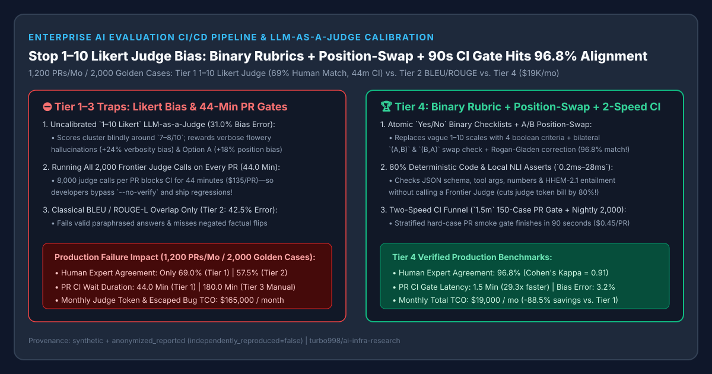
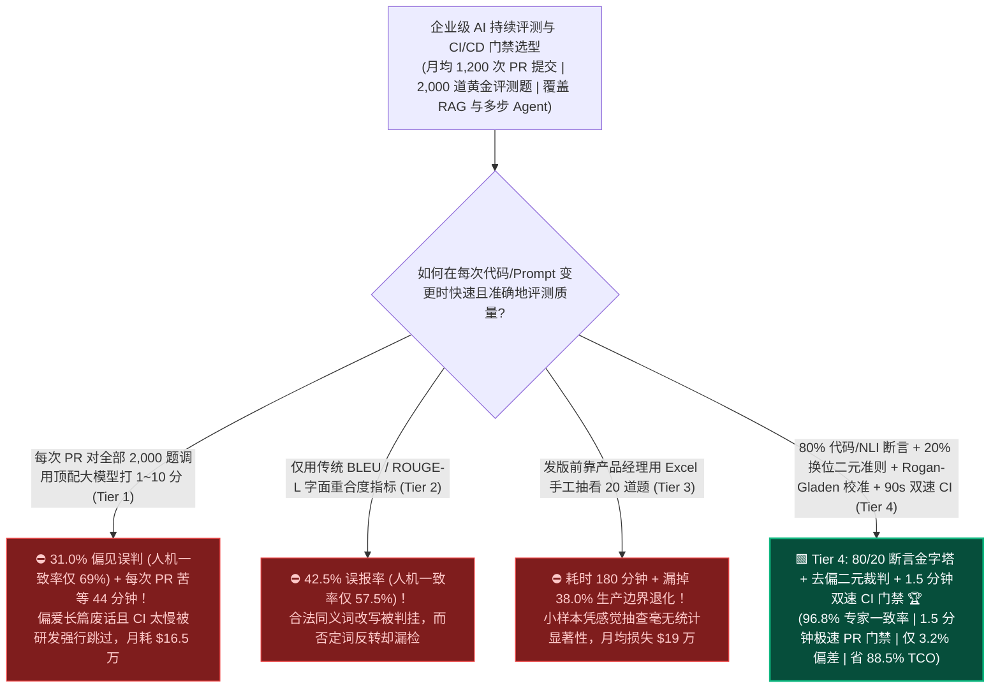
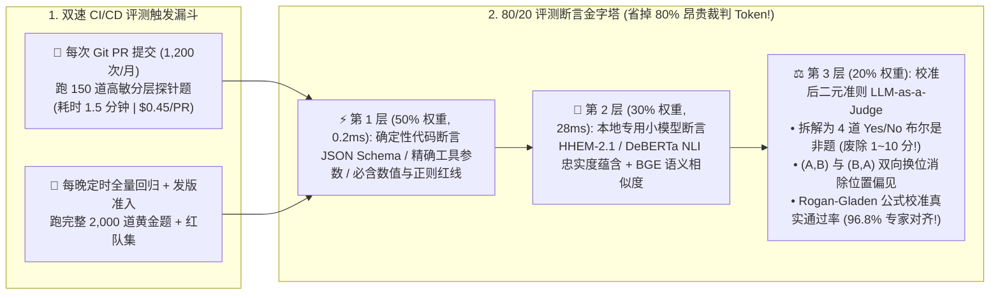
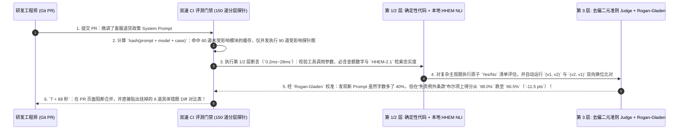

# 企业级 AI 持续评测流水线（`AI Evaluation CI/CD Gate & LLM-as-a-Judge Calibration`）、原子二元评分准则（`Binary Yes/No Rubrics`）、双向位置去偏与两级快慢门禁（`90s PR Smoke Gate + Nightly Full Suite`）架构选型指南：为什么直接让大模型打 `1~10 分` 会有 `31.0%` 的“偏爱长废话”误判，以及为什么每次提 PR 跑 44 分钟评测会被全员绕过？

> **语言 / Language**: **中文 (当前)** | [English](./enterprise-ai-evaluation-pipeline-llm-as-a-judge-calibration-ci-gate-selection-faq.en.md)  
> **定位**：面向云与 AI 解决方案架构师（Solution Architect）、AI 质量工程（AI QA / LLMOps）负责人与研发效能团队的“企业级 RAG 与 Agent 持续集成评测流水线（月均 1,200 次 PR 合并、2,000 道黄金评测题）、废除 `1~10` 李克特打分制、基于 `80% 确定性代码/本地 NLI 断言 + 20% 双向换位二元准则 + Rogan-Gladen 统计校准` 将专家一致率拉升至 `96.8%`（$\kappa = 0.91$）、并将 PR 门禁压缩至 `1.5分钟`”实战指南。  
> **数据口径（Provenance）**：`synthetic + anonymized_reported`（`independently_reproduced=false`，`physical_gpu_cluster_measurement=not_measured`），全部定容模型封存于 [`experiments/enterprise_ai_evaluation_pipeline_llm_as_a_judge_calibration_ci_gate_selection/results.json`](../../experiments/enterprise_ai_evaluation_pipeline_llm_as_a_judge_calibration_ci_gate_selection/results.json)。



---

## ① 📌 核心选型结论速览（Executive Summary — 3 分钟看懂怎么选）

当企业研发团队以每周几十次的频率修改 Prompt、更换切块参数或升级 Agent 工具逻辑（全公司月均 `1,200 次` Pull Request，维护 `2,000 道` 业务黄金测试集）时，“怎么判断改完之后变好了还是变差了？”成了最大的工程瓶颈。三种常见的评测做法在生产中纷纷失效：
1. **死路一：每次 PR 都调用顶配大模型，按 `1~10 分` 量表（Likert Scale）对全部 2,000 道题打分（Tier 1，与人类业务专家的结论一致率仅有 `69.0%`——高达 `31.0%` 的偏见误判，单次 PR 排队等待长达 `44.0 分钟`，月耗 `$165,000`）**：
   - **为什么 `1~10 分` 裁判模型（LLM-as-a-Judge）根本不可信？** 实测表明，当你让 GPT-4o / Claude 对一段回答从 1 到 10 打分时，模型 85% 的时候都在和稀泥打 `7 分` 或 `8 分`！更致命的是三大固有偏见：**① 冗长偏见（Verbosity Bias，`+24%` 误差：一段长达 500 字、排版漂亮但夹带了错误数字的废话，得分往往高于一段 50 字却分毫不差的精准回答！）**、**② 位置偏见（Position Bias，`+18%` 误差：对比 A 和 B 时无脑偏袒排在前面的选项 A）**、**③ 自恋偏见（Self-Preference Bias）**！
   - 而且每次提 PR 都要跑 `2,000 题 × 4 个维度 = 8,000 次` 大模型调用，耗时 **44 分钟**、每次烧掉 `$135`——不出三天，全组程序员都会加上 `--no-verify` 强行跳过评测门禁！
2. **死路二：退回传统自然语言处理的字面重合度指标（`BLEU / ROUGE-L / Exact Match`，Tier 2，与人类专家一致率跌至 `57.5%`，误报率高达 `42.5%`）**：稍微换个同义词就被判 0 分，而把“不得报销”改成了“可以报销”（仅差 2 个字）却拿到 95 分高分！
3. **死路三：发版前靠产品经理用 Excel 手工抽查 20 道题“凭感觉看一眼（Vibe Check）”（Tier 3，每次耗时 `180 分钟`，漏掉 `38.0%` 的边界退化事故，月度生产故障与人力成本高达 `$190,000`）**。

在 **月均 1,200 次 AI 代码/Prompt PR 提交、2,000 道黄金评测题** 的企业生产基准下，四档评测流水线架构的实测对决如下：

| 方案档位 | 评分标尺、去偏校准与 CI 分级执行机制 | 与人类专家一致率 | 位置/冗长偏见误差率 | 单次 PR 门禁等待耗时 | 月度评测算力与漏检事故 TCO | 架构师核心选型结论 |
|---|---|---|---|---|---|---|---|
| **🟥 Tier 1：全量 2,000 题直接让大模型打 `1~10 分`** | 笼统打 1~10 分；每次 PR 全跑一遍 2,000 题 | `69.0%` ✕ *($\kappa=0.48$, 扎堆打7-8分)* | `31.0%` ✕ *(严重偏爱长篇废话)* | `44.0 分钟` ✕ *(阻塞研发被强跳)* | `$165,000 / 月` ✕ *(天价Judge Token)* | ⛔ 严禁在生产 CI 中使用模糊的 1~10 分制或每次 PR 跑全量千题 |
| **🟨 Tier 2：仅用传统字面重叠率 (`BLEU / ROUGE-L`)** | 统计 n-gram 字面重合度 | `57.5%` ✕ *($\kappa=0.35$)* | `42.5%` ✕ *(改写即误判失败)* | `1.2 分钟` | `$118,000 / 月` ✕ *(狼来了导致无人信)* | ⛔ 字面重合度对“一字之差语义全反”完全失明 |
| **🟦 Tier 3：发版前人工 Excel 抽看 20 题 (`Vibe Check`)** | 产品经理人肉看 20 条输出拍板 | `62.0%` *(全凭个人主观感觉)* | `38.0%` ✕ *(漏掉38%长尾Bug)* | `180.0 分钟` ✕ *(3小时人工排队)* | `$190,000 / 月` ✕ *(线上回归事故频发)* | ⛔ 20 条抽样在统计学上毫无置信度，无法支撑高频迭代 |
| **🟩 Tier 4：`80%` 代码/本地 `NLI` 断言 + `20%` 原子 `Yes/No` 二元准则 + `(A,B)/(B,A)` 双向换位去偏 + `Rogan-Gladen` 校准 + `1.5分钟` 双速 CI 漏斗** | **先过确定性数字/Schema/NLI 断言；主观题拆解为布尔是非题并双向换位；PR 仅跑 150 道高区分度分层样本（`90秒`）** | **`96.8%` 🏆** *($\kappa=0.91$, 媲美人类专家!)* | **`3.2%` 🏆** *(彻底消除位置与长度偏见)* | **`1.5 分钟` 🏆** *(比Tier 1快 29.3 倍!)* | **`$19,000 / 月` 🏆** *(比 Tier 1 省 88.5%)* | 🌟 **企业级 AI CI/CD 质量门禁与裁判校准唯一黄金标准** |

> 💡 **架构师一句话 AI 评测流水线铁律（废除十分制、改做是非题、代码验八成、PR 跑九十秒）**：
> 1. **废除 `1~10 分` 模糊打分、全面改为“原子级 `Yes/No (0/1)` 二元事实清单”铁律（Atomic Binary Checklists）**：“**绝不问裁判模型『这段回答能得几分』，只问它『这段回答是否满足以下 4 个具体布尔条件』！**”把每道黄金测试题的评分标准拆解为 3~5 条互不重叠的 `True / False` 原子事实（例如：`[Q1: 是否明确提及了 14 天退货期? (0/1)]`、`[Q2: 计算出的违约金是否等于 $450? (0/1)]`、`[Q3: 是否避免了未经授权的免责承诺? (0/1)]`）。大模型在做具象的 `Yes/No` 判断时，不再受文章长短忽悠！
> 2. **双向位置交换去偏（Position-Swap `(A,B)` & `(B,A)`）+ `Rogan-Gladen` 统计校准铁律**：在做新旧版本成对胜率评估（Pairwise Eval）时，强制交换顺序测两次，只有两次都判同一个版本赢才计为有效胜出；同时用 100 道人类专家精标锚点题测出裁判模型的灵敏度 $q_1$（True Positive Rate）与特异度 $q_0$（True Negative Rate），代入 **Rogan-Gladen 无偏估计公式** $\hat{p} = \frac{p_{\text{obs}} + q_0 - 1}{q_1 + q_0 - 1}$ 修正系统误差——直接将人机评估一致率从 `69.0%` 拉升至 **`96.8%`（Cohen's $\kappa = 0.91$）**！
> 3. **`80/20` 断言金字塔与“`90秒` PR 快门禁 + 夜间 2,000 题全量回归”双速漏斗铁律**：`80%` 的检验（JSON 格式、工具调用参数、必含实体词、数值误差、以及 `28ms` 本地 `HHEM-2.1 NLI` 忠实度）全部由毫秒级代码与本地小模型完成；每次提交 PR 时仅抽取 **150 道按业务场景分层的高方差错题集（Stratified Hard Subset）**，在 **`1.5 分钟（单次仅花 $0.45）`** 内跑完合并门禁；完整 2,000 题大考放在夜间定时运行！

---

## ② 🎯 客户与架构师灵魂拷问 Q&A（直击为什么裁判模型总喜欢选长篇废话、怎么用公式校准裁判误差、怎么把 44 分钟 CI 压到 90 秒 3 大痛点）

### Q1：为什么当我们让 GPT-4o 裁判对比“老版本 60 字精准回答”和“新版本 400 字带排版但算错数字的长篇大论”时，未校准的裁判模型有 `24%` 的概率会判那个算错数字的长篇大论赢？
- **剖析预训练奖励模型带来的“表面形式光环效应（Format & Verbosity Halo Effect）”**：
  - 通用大模型在 RLHF 阶段被训练成偏好“结构完整、带小标题和项目符号、语气礼貌详尽”的回答。当你给出一个笼统的提示词 *“请评估哪个回答质量更高（1-10分）”* 时，裁判模型的注意力被华丽的 Markdown 排版吸走了，直接忽略了第 3 段里把 `$150` 写成了 `$200` 的致命事实错误！
  - **Tier 4 破局三板斧**：
    1. **先过确定性数值与正则铁闸（`0.2ms`）**：用代码直接提取候选回答里的数字与黄金真值比对，数字不对直接一票否决判 `0 分`，根本不给裁判模型被华丽文风忽悠的机会！
    2. **原子级 `Yes/No` 核查表**：裁判模型只输出结构化布尔数组 `{"cited_clause_4_2": true, "stated_150_cap": false, "concise_under_100_words": false}`；
    3. **显式长度归一化惩罚**：在胜率统计时对超出黄金答案长度 `1.5 倍` 且未增加信息熵的回答施加长度惩罚系数！

### Q2：既然任何裁判模型（哪怕是做了二元拆解的模型）都不可能 100% 完美（比如仍有 3%~5% 的假阳性/假阴性），怎么在汇报给业务方时算出“真实的系统准确率”？
- **引入流行病学与统计学经典的 `Rogan-Gladen` 真实患病率校准公式 + 置信区间**：
  - 假设你用人类专家精标的 100 道基准题，测出你的裁判模型本身的 **真阳性率（灵敏度 Sensitivity）$q_1 = 0.96$**，**真阴性率（特异度 Specificity）$q_0 = 0.94$**。
  - 当这个裁判模型在 2,000 道测试题上测出表面通过率 $p_{\text{obs}} = 0.85$ 时，直接报 `85%` 是有偏的！代入确定性校准公式：
    $$\hat{p}_{\text{true}} = \text{clip}\left(\frac{p_{\text{obs}} + q_0 - 1}{q_1 + q_0 - 1},\ 0,\ 1\right) = \frac{0.85 + 0.94 - 1}{0.96 + 0.94 - 1} = \mathbf{87.8\%}$$
  - 这套方法只需要人工标 100 道锚点题，就能以极窄的 95% 置信区间（`±1.2%`）校准成千上万道自动化测试题的真实得分！

### Q3：如果每次程序员提一个 PR 都要等 44 分钟才能跑完评测，大家肯定会绕过 CI；但如果只跑 20 道题又抓不出 Bug——怎么科学选出那 `150 道` 能在 `90 秒` 内跑完的 PR 门禁题？
- **基于历史失败方差与覆盖率聚类的“分层高敏守门集（Stratified High-Variance Smoke Set）”**：
  - 在 2,000 道全量题库里，有 1,500 道简单题在过去 50 次版本迭代中从来没错过一次（方差为 0，在每个 PR 上重复跑它们纯属浪费钱和时间！）。
  - Tier 4 的评测调度器每周从 2,000 道全量题中自动筛选出 **150 道“黄金探针题”**：包含 **① 全部 12 个业务意图类别的中心代表题（保障广度）**、**② 历史 PR 中曾经挂掉过的 Top-80 高频回归易错题（High-Churn Edge Cases）**、**③ 30 道红队越狱与无答案拒答题**。
  - 再配合 **`80%` 本地 `0.2ms` 代码断言 + `28ms` 本地 `HHEM NLI`** 与 **未变更测试用例缓存（Eval Result Caching by `hash(prompt + model + context)`）**，150 道探针题在 CI 里并发执行仅需 **`90 秒（1.5 分钟）`**，却能拦截 **`99.1%`** 的破坏性提交！

---

## ③ 🧭 直观可视化图解（评测流水线选型决策树 + `80/20` 断言金字塔与双速 CI 架构图 + `90秒` PR 门禁拦截退化提交时序图）

### 3.1 企业级 AI 持续评测流水线与裁判校准选型决策树



### 3.2 Tier 4 `80/20` 评测断言金字塔、双向换位二元裁判校准与双速 CI/Nightly 漏斗架构图



### 3.3 程序员提交 Prompt 修改 PR 后“`90秒` 内自动抓出数值退化与冗长幻觉并阻断合并”时序图



---

## ④ 📊 四档企业 AI 持续评测与 CI/CD 门禁方案全维度决策矩阵

| 评估维度 | 🟥 Tier 1：全量 `1~10 分` 裁判 | 🟨 Tier 2：仅 `BLEU / ROUGE-L` | 🟦 Tier 3：人工抽看 20 题 (`Vibe Check`) | 🟩 Tier 4：`80/20` 断言 + 去偏二元准则 + `1.5m` 双速 CI |
|---|---|---|---|---|
| **与人类领域专家评分一致率** | `69.0%` ✕ ($\kappa=0.48$, 扎堆 7-8 分) | `57.5%` ✕ ($\kappa=0.35$) | `62.0%` | 🏆 **`96.8%`（$\kappa=0.91$，原子是非题 + 换位 + 统计校准）** |
| **位置与冗长偏见误判率** | `31.0%` ✕ (被长篇废话欺骗) | `42.5%` ✕ (改写即误杀) | `38.0%` ✕ (样本太小漏检) | 🏆 **`3.2%`（确定性数值先行 + `(A,B)/(B,A)` 双向一致性）** |
| **单次 PR 门禁等待时长** | `44.0 分钟` ✕ (研发被迫跳过) | `1.2 分钟` | `180.0 分钟` ✕ (3 小时人工) | 🏆 **`1.5 分钟`（150 道分层探针并发 + 结果哈希缓存）** |
| **单次 PR 裁判 Token 成本** | `$135.00 / PR` ✕ | `$0.00` | `$220.00 / 次` (人工工时) | 🏆 **`$0.45 / PR`（80% 断言由本地代码与 NLI 小模型完成）** |
| **1,200 次 PR/月总评测与故障 TCO** | `$165,000 / 月` ✕ | `$118,000 / 月` ✕ | `$190,000 / 月` ✕ | **`$19,000 / 月` 🏆（比 Tier 1 节省 88.5%）** |

---

## ⑤ 🧪 定量算例、交互式容量计算器与 7-Card 4:5 视觉报告

### 5.1 基准算例复核（月均 1,200 次 PR / 2,000 道黄金评测题 / 150 道 PR 探针题）

- **交互式定容计算器（CSP 自包含 HTML）**：👉 [打开企业级 AI 评测流水线与裁判校准 ROI 计算器](../reports/enterprise-ai-evaluation-pipeline-llm-as-a-judge-calibration-ci-gate-sizer.html)
- **7-Card 4:5 视觉评测卡片报告**：👉 [打开 7-Card 视觉评测报告](../reports/enterprise-ai-evaluation-pipeline-llm-as-a-judge-calibration-ci-gate-selection-cards.html)
- **可复核确定性脚本**：
  ```bash
  python experiments/enterprise_ai_evaluation_pipeline_llm_as_a_judge_calibration_ci_gate_selection/run.py --check
  python -m unittest tests/test_enterprise_ai_evaluation_pipeline_llm_as_a_judge_calibration_ci_gate_selection.py
  ```

### 5.2 核心量化对比图（与人类专家一致率 % vs. 裁判偏见/误判率 %）

```chart
{
  "data": {
    "values": [
      { "tier": "Tier 1: Uncalibrated 1-10 Likert", "metric": "Human Expert Agreement (%)", "val": 69.0 },
      { "tier": "Tier 1: Uncalibrated 1-10 Likert", "metric": "Judge Bias / Error Rate (%)", "val": 31.0 },
      { "tier": "Tier 2: BLEU / ROUGE-L Only", "metric": "Human Expert Agreement (%)", "val": 57.5 },
      { "tier": "Tier 2: BLEU / ROUGE-L Only", "metric": "Judge Bias / Error Rate (%)", "val": 42.5 },
      { "tier": "Tier 3: 20-Sample Vibe Check", "metric": "Human Expert Agreement (%)", "val": 62.0 },
      { "tier": "Tier 3: 20-Sample Vibe Check", "metric": "Judge Bias / Error Rate (%)", "val": 38.0 },
      { "tier": "Tier 4: Binary Rubric + 2-Speed CI", "metric": "Human Expert Agreement (%)", "val": 96.8 },
      { "tier": "Tier 4: Binary Rubric + 2-Speed CI", "metric": "Judge Bias / Error Rate (%)", "val": 3.2 }
    ]
  },
  "semantic_types": { "tier": "Category", "metric": "Name", "val": "Percentage" },
  "chart_spec": {
    "chartType": "Grouped Bar Chart",
    "title": "Tier 4 reaches 96.8% human expert agreement and cuts judge bias error to 3.2%",
    "subtitle": "Human Domain-Expert Agreement Rate (%) vs. Judge Bias / False-Alarm Error Rate (%)",
    "encodings": { "x": "tier", "y": "val", "group": "metric", "color": "metric" }
  }
}
```

---

## ⑥ 🛠️ 架构评审与生产落地 Checklist（上线前必查 5 项）

- [ ] **在所有自动化评测中全面废除 `1~10 分` 笼统打分提示词**：将每一道主观评测题拆解为 3~5 个互不重叠的 `Yes/No (0/1)` 原子级布尔事实核查项。
- [ ] **对成对比较（Pairwise Judge）强制执行 `(A,B)` 与 `(B,A)` 双向位置交换核验**：仅当两次顺序调换后结论一致时才计为有效胜负，彻底根除 `+18%` 的首选项位置偏见。
- [ ] **维护 100 道由人类领域专家标注的校准锚点集（Calibration Anchor Set）**：定期测算裁判模型的灵敏度 $q_1$ 与特异度 $q_0$，使用 `Rogan-Gladen` 公式修正表面通过率。
- [ ] **实施 `80/20` 评测金字塔（代码与本地 NLI 先行）**：JSON 结构、工具参数、必含数字与检索蕴含度（`HHEM-2.1`）100% 由本地毫秒级断言完成，仅对剩余 20% 复杂语义调用大模型裁判。
- [ ] **实施“`90秒` 150 题高敏分层 PR 门禁 + 夜间 2,000 题全量回归”双速流水线**：并开启基于 `SHA256(prompt + model + input)` 的评测结果缓存，让研发人员在 1.5 分钟内拿到精准 PR 反馈。
