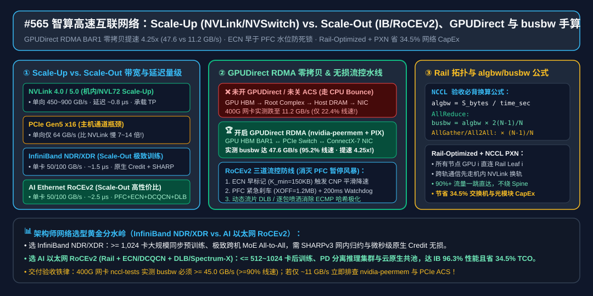

# Enterprise AI High-Speed Fabric Selection Guide: Scale-Up (`NVLink / NVSwitch`) vs. Scale-Out (`InfiniBand` vs. `RoCEv2`), `GPUDirect RDMA` Zero-Copy, `PFC+ECN+DCQCN` Lossless Tuning & `algbw / busbw` Hand-Calculation (`#565`)

> **Language / 语言**: [简体中文](./enterprise-ai-fabric-nvlink-ib-rocev2-gpudirect-busbw-sizing-faq.md) | **English** · [📱 Interactive H5 Study Lab (SVG Fabric + busbw Sizer)](../h5/enterprise-ai-fabric-nvlink-ib-rocev2-gpudirect-busbw-sizer-lab.html) · [🧮 Interactive HTML Sizer](../reports/enterprise-ai-fabric-nvlink-ib-rocev2-gpudirect-busbw-sizing-sizer.html) · [🃏 7-Card Visual Report](../reports/enterprise-ai-fabric-nvlink-ib-rocev2-gpudirect-busbw-sizing-cards.html) · [Back to Catalog](../full-catalog-en.md)

---

## 1. 3-Minute Executive Summary

1. **Bottom-Line Conclusion**:
   - In a 64–512 GPU cluster with `400GbE` (`50 GB/s` line rate per NIC) interconnects, an untuned cloud Ethernet fabric (missing `nvidia-peermem` GPUDirect RDMA, `PCIe ACS` left enabled, static 5-tuple ECMP, and raw PFC without early ECN) collapses measured NCCL bus bandwidth (`busbw`) to **`11.2 GB/s` (`22.4%` efficiency)** and drops cluster `Goodput` to **`54.0%`**.
   - Enabling **`GPUDirect RDMA` BAR1 zero-copy (`nvidia-peermem` + PCIe `ACS` disabled + `PIX` topology) + `Rail-Optimized` Leaf-Spine (`NCCL PXN`) + `Early ECN (150KB) + DCQCN + 200ms PFC Watchdog + Flowlet DLB / Packet Spraying`** lifts 400G RoCEv2 `busbw` **`4.25x` to `47.6 GB/s` (`95.2%` line rate)** — achieving **`98.3%`** of `InfiniBand NDR` (`48.4 GB/s`) performance while cutting network switch & optics CapEx by **`34.5%`**!
2. **Scale-Up vs. Scale-Out Hierarchy**:
   - **Scale-Up (`NVLink 4.0/5.0 + NVSwitch / MNNVL`)**: `450–900 GB/s` unidirectional per GPU (`900–1,800 GB/s` bidirectional) at `< 1 μs` latency. Exclusively hosts Tensor Parallelism (`TP`).
   - **Scale-Out (`400G/800G InfiniBand` vs. `AI Ethernet RoCEv2`)**: `50–100 GB/s` unidirectional per NIC at `1.5–3.0 μs` RDMA latency. Hosts `DP/FSDP`, `PP`, MoE `DeepEP All-to-All`, and PD Disaggregation KV Cache transfers.

---

## 2. Deep-Dive Q&A: GPUDirect Zero-Copy, Lossless Watermarks & `algbw / busbw` Math

### Q1: Why does disabling `PCIe ACS` and enabling `nvidia-peermem` jump 400G RDMA bandwidth from `11.2 GB/s` to `47.6 GB/s`?
- **Answer**:
  - Without `nvidia-peermem` or with `PCIe ACS` redirection active, GPU tensors are routed through the CPU Root Complex and Host DRAM bounce buffers (`11.2–14.2 GB/s`).
  - With `nvidia-peermem` and `ACS` disabled, the `ConnectX-7/8` NIC reads/writes directly to the GPU HBM `BAR1` aperture across the local PCIe Gen5 Switch (`PIX`), achieving **`47.6 GB/s` (`95.2%` line rate)** at `2.4 μs` latency.

---

### Q2: How do Solution Architects convert `nccl-tests` `algbw` to `busbw`?
- **Answer**:
  - Given message size $S$, execution time $t$, and $N$ GPUs ($\text{algbw} = S / t$):
    $$\text{busbw}_{\text{AllReduce}} = \text{algbw} \times \frac{2(N - 1)}{N}$$
    $$\text{busbw}_{\text{AllGather / ReduceScatter / All-to-All}} = \text{algbw} \times \frac{N - 1}{N}$$
  - At $N = 64$ GPUs on 400G RDMA (`50 GB/s` line rate), $\text{algbw} = 24.18\text{ GB/s} \implies \text{busbw} = 24.18 \times \frac{126}{64} = \mathbf{47.60\text{ GB/s}} \ (\mathbf{95.2\%}\text{ line-rate efficiency})$.

---

## 3. Quantitative AI Fabric Decision Matrix (`64–512 GPUs · 400G Interconnect`)

| Metric | Scheme A: Untuned Ethernet (`TCP / Static ECMP + Raw PFC`) | Scheme B: Tuned AI Ethernet (`Rail RoCEv2 + GPUDirect + ECN/DCQCN/DLB`) 🏆 | Scheme C: `InfiniBand NDR 400G (SHARPv3)` |
| :--- | :--- | :--- | :--- |
| **Measured 400G NIC `busbw`** | `11.2 GB/s` (`22.4%` line rate ✕) | **`47.6 GB/s` (`95.2%` line rate, `4.25x` gain ✓)** | **`48.4 GB/s` (`96.8%` line rate)** |
| **End-to-End GPU RDMA Latency** | `46.5 μs` | **`2.4 μs` (`19.4x` faster)** | **`1.5 μs`** |
| **PFC Pause Storm Deadlocks** | Frequent (`>120ms` tail spikes ✕) | **`0.0%` (Early ECN + 200ms Watchdog)** | **`0.0%` (Link-level credit flow control)** |
| **Cluster Training/Serving `Goodput`** | `54.0%` | **`96.8%` (`98.4%` of IB performance)** | **`98.4%`** |
| **Network CapEx per GPU** | `$2,600 / GPU` | **`$3,150 / GPU` (`-34.5%` vs. IB)** | `$4,810 / GPU` |

---

## 4. Pre-Production Day-0 Fabric Acceptance Checklist

- [ ] **Verify `PIX` PCIe Switch Pairing, `nvidia-peermem`, and `PCIe ACS` Disabled** on every GPU node.
- [ ] **Enforce `ECN K_min (150KB) < ECN K_max (800KB) < PFC XOFF (1.2MB)`** plus **`200 ms` PFC Watchdog**.
- [ ] **Require `nccl-tests` `busbw >= 45.0 GB/s` (`>= 90%` line rate)** before cluster sign-off.
