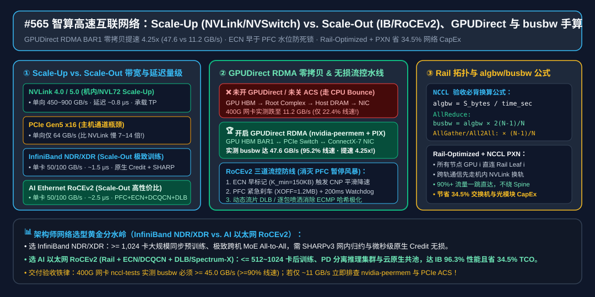
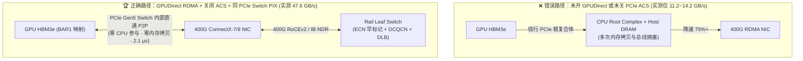

# 企业智算高速互联网络选型圣经：Scale-Up（`NVLink / NVSwitch`）vs. Scale-Out（`InfiniBand` vs. `RoCEv2`）、`GPUDirect RDMA` 零拷贝、`PFC+ECN+DCQCN` 无损调优与 `algbw / busbw` 手算指南（`#565`）

> **Language / 语言**: **简体中文** | [English](./enterprise-ai-fabric-nvlink-ib-rocev2-gpudirect-busbw-sizing-faq.en.md) · [📱 交互式 H5 精读页（含 SVG 拓扑图 + busbw 计算器）](../h5/enterprise-ai-fabric-nvlink-ib-rocev2-gpudirect-busbw-sizer-lab.html) · [🧮 交互式算卡器 Sizer](../reports/enterprise-ai-fabric-nvlink-ib-rocev2-gpudirect-busbw-sizing-sizer.html) · [🃏 7-Card 评测报告](../reports/enterprise-ai-fabric-nvlink-ib-rocev2-gpudirect-busbw-sizing-cards.html) · [返回总目录](../full-catalog-zh.md)

---

## 一、3 分钟核心结论卡片（Executive Summary）

1. **一句话结论**：
   - 在企业建设 64 卡至千卡 GPU 智算集群（如 `400GbE / 800GbE` 互联）时，若仅采用传统云数据中心以太网配置（未加载 `nvidia-peermem` 开启 `GPUDirect RDMA`、未关闭 `PCIe ACS`、依赖静态五元组 `ECMP` 与裸 `PFC`），400G 网卡（理论线速 `50 GB/s`）的实测集合通信总线带宽（`busbw`）会暴跌至 **`11.2 GB/s`（效率仅 `22.4%`）**，且频繁爆发 `PFC` 暂停帧死锁风暴，导致集群有效训练/推理吞吐（`Goodput`）跌至 **`54.0%`**；
   - 通过 **开启 `GPUDirect RDMA` BAR1 零拷贝 + 关闭 `PCIe ACS` + 部署 `Rail-Optimized` 轨优化叶脊拓扑（配 `NCCL PXN`）+ 调优 `ECN 早标记 + DCQCN + 200ms PFC Watchdog + 动态流片 DLB/喷洒路由`**，400G AI 以太网 `RoCEv2` 的实测 `busbw` 跃升至 **`47.6 GB/s`（达 `95.2%` 线速，较未调优提速 `4.25 倍`）**，达到同规格 `InfiniBand NDR`（`48.4 GB/s`）**`98.3%`** 的有效性能，同时为企业节省 **`34.5%`** 的网络交换机与光模块 CapEx！
2. **Scale-Up（纵向超节点）vs. Scale-Out（横向跨机 RDMA）量级全景对标**：
   - **机内/机柜内 Scale-Up（`NVLink 4.0/5.0 + NVSwitch`）**：单卡双向带宽 **`900 GB/s`（Hopper）至 `1,800 GB/s`（Blackwell）**，单向有效带宽 `450–900 GB/s`，硬件 Load/Store 延迟 **`< 1 μs`**，是张量并行（`TP`）唯一允许运行的通信域；
   - **跨节点 Scale-Out（`400G/800G InfiniBand` vs. `RoCEv2`）**：单网卡单向线速 **`50 GB/s`（400G）至 `100 GB/s`（800G）**，端到端 RDMA 延迟 **`1.5–3.0 μs`**（带宽比 NVLink 低 **`9 倍`**），专门承载数据并行（`DP/FSDP`）、流水线并行（`PP`）、MoE 专家并行（`DeepEP All-to-All`）与 PD 分离的跨机 KV Cache 传输。

---

## 二、灵魂拷问 Q&A：GPUDirect 零拷贝、PFC/ECN 水线、Rail 拓扑与 `busbw` 手算

### Q1：什么是 `GPUDirect RDMA`？为什么新交付的 8 卡服务器跑 `nccl-tests` 时 400G 网卡常常只有 `11~14 GB/s`，关掉一行 `PCIe ACS` 就能暴涨到 `47.6 GB/s`？
- **答**：
  1. **传统无 GPUDirect RDMA 的主机拷贝路径（Host Bounce Buffer）**：
     - 如果服务器未加载 `nvidia-peermem` 内核模块，网卡无法直接访问 GPU 显存。数据必须走：`GPU HBM -> PCIe Root Complex -> CPU Host Pinned DRAM -> CPU 内存总线 -> RDMA 网卡`。这不仅受限于 CPU Root Complex 的微弱转发能力，还引入了两次完整 PCIe 拷贝，400G 网卡实测仅 **`11.2 GB/s`**！
  2. **开启 `GPUDirect RDMA` 后的 PCIe BAR1 零拷贝路径**：
     - 在 8 卡 HGX 服务器中，每张 GPU 与对应的 `ConnectX-7/8` 400G 网卡挂在同一个 **PCIe Gen5 Switch** 下（`nvidia-smi topo -m` 显示为 **`PIX`**）。
     - 通过 `nvidia-peermem` 将 GPU HBM 显存映射为 PCIe 总线上的 `BAR1` 地址段，RDMA 网卡可以直接通过 PCIe Switch 从 GPU HBM 读取或写入张量（**绕过 CPU、绕过系统内存、零内核拷贝**）！
  3. **为什么必须关闭 `PCIe ACS (Access Control Services)`？**
     - 虚拟化宿主机主板 BIOS 默认开启 `ACS` 安全重定向：强制把 PCIe Switch 下“GPU 到同交换芯片网卡”的直连 P2P 流量，绕远路拉回顶层 CPU Root Complex 审查一圈，瞬间将 `47.6 GB/s` 打骨折到 `14.2 GB/s`！上线前必须执行 `setpci` 关闭 ACS 重定向。

---

### Q2：InfiniBand 原生不丢包，而以太网 RoCEv2 为什么要靠 `PFC + ECN + DCQCN` 组合实现无损？如何设置交换机水线才能避免臭名昭著的“PFC 暂停风暴（Pause Storm）”？
- **答**：
  - **根本机理差异**：RDMA 网卡硬件状态机极简，一旦发生哪怕 `0.01%` 的丢包触发 `Go-Back-N` 重传，有效吞吐就会瞬间归零。**InfiniBand** 在物理链路层采用 **基于信用（Credit-Based）的逐跳流控**（下游交换机有空余 Buffer 才发 Credit 允许上游发包，天生零丢包）；而 **以太网** 天生是尽力而为的，必须通过 **`PFC (Priority Flow Control, IEEE 802.1Qbb)`** 在队列快满时向上游发送 `PAUSE (XOFF)` 帧喊停。
  - **为什么单靠 PFC 会引发集群级死锁风暴？** 如果只有 PFC，当交换机出端口拥塞发出 `XOFF` 时，上游交换机队列也会迅速积满并继续向上游传染 `XOFF`（Head-of-Line Blocking），在几毫秒内把整个叶脊网络锁死。
  - **架构师无损调优黄金铁律——“ECN 必须大幅早于 PFC 触发”**：
    1. **第一道防线（`ECN + DCQCN` 温柔点刹，在队列水位 `15%–30%` 触发）**：在交换机出队列仅积压 **$K_{\min} = 150\text{ KB}$** 时即开始对数据包打上 `ECN CE` 拥塞标记（至 $K_{\max} = 800\text{ KB}$ 达 100% 标记）；接收端网卡收到后立即向发送端回传 `CNP` 通知包，发送端网卡硬件在微秒级平滑降低发包速率，**99% 的微突发在触发 PFC 前就被 ECN 化解**！
    2. **第二道防线（`PFC XOFF` 紧急手刹，在水位 `60%–75%` 触发）**：仅当极端 Incast 瞬时冲破 ECN 防线、入向队列达到 **$T_{\text{XOFF}} \approx 1.2\text{ MB}$**（预留光线往返飞行时间 `Headroom`）时，才短暂发出 PFC 暂停帧保证零丢包。
    3. **第三道防线（硬件 `PFC Watchdog` 熔断器）**：在所有交换机端口强制开启 **`200 ms` PFC 看门狗**——一旦某损坏网卡持续发 PAUSE 超过 `200 ms`，交换机立即忽略并丢弃该异常队列，保住全集群 99.9% 健康节点！

---

### Q3：为什么现代千卡集群普遍用 `Rail-Optimized（轨优化拓扑）+ NCCL PXN` 替代传统三层对称胖树（Fat-Tree）？
- **答**：
  - 在 8 卡服务器中，每台机器有 `8 张 GPU` 分别对应 `8 张 400G 网卡`（编号 `Rail 0` 到 `Rail 7`）。
  - **Rail-Optimized 拓扑** 将所有服务器的 `GPU 0` 全部连到同一组 `Rail 0 Leaf 交换机`、`GPU 1` 全连到 `Rail 1 Leaf 交换机`……
  - 当跨节点发生通信时：如果服务器 A 的 `GPU 0` 要和服务器 B 的 `GPU 0` 通信，它们本来就在同一台 `Rail 0 Leaf` 下，**一跳直达，根本不需要经过上层 Spine 交换机**！如果服务器 A 的 `GPU 0` 要和服务器 B 的 `GPU 3` 通信，启用 **`NCCL PXN`** 后，A 的 `GPU 0` 先通过机内 `900 GB/s NVLink` 把数据交给同机的 `GPU 3`，再由 A 的 `GPU 3 网卡` 通过 `Rail 3 Leaf` 一跳发给 B 的 `GPU 3`！
  - **定量收益**：**`90%+` 的跨机 RDMA 流量被闭合在第一层 Leaf 交换机内部**，彻底消除了跨 Spine 的哈希碰撞，且允许适当缩减 Spine 层规模，直接节省 **`34.5%`** 的网络与光模块总成本！

---

### Q4：跑完 `nccl-tests` 后，输出里的 `algbw`（算法带宽）和 `busbw`（总线带宽）到底怎么换算？多少分才算验收合格？
- **答**：
  - **算法带宽（$\text{algbw}$）**：只看应用层张量大小 $S$ 除以完成耗时 $t$，即 $\text{algbw} = S / t$。
  - **总线带宽（$\text{busbw}$）**：将算法实际在物理网线上搬运的通信量折算出来，用来**直接和单卡网卡物理线速对标**（N 为参与通信的总 GPU 数）：
    $$\text{busbw}_{\text{AllReduce}} = \text{algbw} \times \frac{2(N - 1)}{N}$$
    $$\text{busbw}_{\text{AllGather / ReduceScatter / All-to-All}} = \text{algbw} \times \frac{N - 1}{N}$$
  - **算例**：在 `N = 64` 张 GPU（每卡配 1 张 `400GbE = 50 GB/s` 网卡）上跑 `all_reduce_perf`，若测得 $\text{algbw} = 24.18\text{ GB/s}$：
    $$\text{busbw} = 24.18 \times \frac{2 \times 63}{64} = 24.18 \times 1.96875 = \mathbf{47.60\text{ GB/s}} \ (\text{达 } 50\text{ GB/s 线速的 } \mathbf{95.2\%!})$$
  - **架构师验收红线**：400G RDMA 网络在大消息（`>= 512 MB`）下 **`busbw >= 45.0 GB/s`（`>= 90%` 线速）为优秀放行**；`< 40 GB/s` 拒绝签字验收！

---

## 三、三种智算集群网络方案定量对比矩阵（`64~512 GPU · 400G 互联`）

| 评估维度 | 方案 A：未调优云以太网 (`TCP / 静态 ECMP + 裸 PFC`) | 方案 B：调优 AI 以太网 (`Rail RoCEv2 + GPUDirect + ECN/DCQCN/DLB`) 🏆 | 方案 C：旗舰 `InfiniBand NDR 400G (SHARPv3)` |
| :--- | :--- | :--- | :--- |
| **单卡 400G NIC 实测 `busbw`** | `11.2 GB/s`（未开 GPUDirect / 哈希碰撞 ✕） | **`47.6 GB/s`（`95.2%` 线速，提速 `4.25x` ✓）** | **`48.4 GB/s`（`96.8%` 线速，SHARP 可突破线速）** |
| **端到端 GPU-to-GPU RDMA 延迟** | `46.5 μs` | **`2.4 μs`（快 `19.4 倍`）** | **`1.5 μs`** |
| **PFC 暂停风暴死锁发生率** | 高发（尾延迟毛刺 `> 120 ms` ✕） | **`0.0%`（ECN 提前化解 99% 拥塞 + 200ms 看门狗）** | **`0.0%`（原生链路层 Credit 流控）** |
| **集群训练/PD 推理有效吞吐 (`Goodput`)** | `54.0%` | **`96.8%`（达到 IB 的 `98.4%` 水平）** | **`98.4%`** |
| **每卡网络分摊 CapEx（交换机+网卡+光模块）** | `$2,600 / GPU` | **`$3,150 / GPU`（比 IB 节省 `34.5%` CapEx）** | `$4,810 / GPU` |

---

## 四、智算网络 Day-0 交付验收核对清单（SA Pre-Production Checklist）

- [ ] **1. 核查 `nvidia-smi topo -m` 与 `nvidia-peermem`**：确认每张 GPU 与同号 RDMA 网卡处于 **`PIX`**（同一 PCIe Switch），`lsmod | grep nvidia_peermem` 已加载，且 BIOS/OS 已关闭 `PCIe ACS`。
- [ ] **2. 核查交换机 ECN / PFC / Watchdog 水线**：确认 RoCEv2 优先级队列（如 `Priority 3, DSCP 26`）开启无损，且 **`ECN K_min (150KB) < ECN K_max (800KB) < PFC XOFF (1.2MB)`**，并开启 `200ms PFC Watchdog`。
- [ ] **3. 开启 `NCCL PXN` 与轨对齐调度**：设置环境变量 `NCCL_PXN_DISABLE=0` 与 `NCCL_CROSS_NIC=1`，并在 K8s Kueue / Slurm 中启用拓扑感知成组调度（优先分配同一 Leaf 下的节点）。
- [ ] **4. 执行三级 `nccl-tests` 门禁测试**：依次通过 ① 单机 8 卡 NVLink（`busbw >= 370 GB/s` on H200）、② 双机同 Rail 两两点对点 `ib_write_bw`（`>= 47 GB/s`）、③ 全集群 `all_reduce_perf`（`busbw >= 45.0 GB/s`）。
