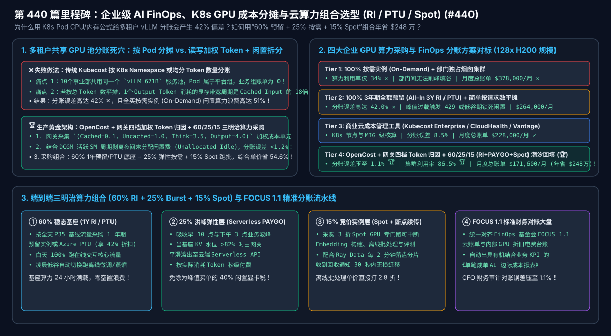

# Milestone #440: Enterprise AI FinOps, K8s Multi-Tenant GPU Cost Attribution & Capacity Portfolio Selection Guide (`OpenCost / Kubecost` vs. `Weighted Token Ledger + 60/25/15 RI/PAYGO/Spot`)

> **Language / 语言**: [简体中文](./enterprise-ai-finops-k8s-gpu-opencost-ptu-spot-portfolio-selection-faq.md) | **English**  
> **Companion Interactive Study & Sizing Tools**: [📱 Interactive H5 Study Lab](../h5/ai-finops-k8s-gpu-opencost-ptu-spot-portfolio-lab.html) · [🧮 HTML Sizer](../reports/enterprise-ai-finops-k8s-gpu-opencost-ptu-spot-portfolio-selection-sizer.html) · [🃏 7-Card Visual Deck](../reports/enterprise-ai-finops-k8s-gpu-opencost-ptu-spot-portfolio-selection-cards.html) · [📊 Reproducible Model](../../experiments/enterprise_ai_finops_k8s_gpu_opencost_ptu_spot_portfolio_selection/) · [🎓 Back to AI Infra H5 Hub](../h5/index.html)

---

## 1. Executive Summary (3-Minute Takeaway)

> **Bottom-Line Recommendation**: Running siloed 100% On-Demand departmental GPU clusters yields only **`34.0%` utilization** (`$378,000/mo` across 128 H200-equivalents), while naive request-count chargeback across shared `vLLM / SGLang` pools introduces **`42.0%` financial attribution error**.
> - **Recommended Production Architecture (`Tier 4: OpenCost + DCGM Idle/Active Split + AI Gateway 4-Tier Weighted Token Attribution [FOCUS 1.1] + 60% 1Y Reserved/PTU + 25% Serverless PAYGO Burst + 15% Spot Batch Portfolio`)**:
>   1. **Lifts Fleet Utilization from `34.0%` to `86.5%`** and lowers effective GPU cost from **`$4.10/GPU·hr` to `$1.86/GPU·hr` (-54.6%)**, saving **`$2.48M/year`** (`$171,600/mo` vs. `$378,000/mo`);
>   2. **Reduces Multi-Tenant Chargeback Error to `1.1%`** by separating unallocated off-peak idle capacity from active SM/HBM consumption and weighting `Cached Input (0.1x)`, `Uncached Input (1.0x)`, `Reasoning <think> (3.5x)`, and `Output Decode (4.0x)`.

| Dimension | `Tier 1: 100% On-Demand Silos` | `Tier 2: 100% 3Y RI + Flat Request Split` | `Tier 3: Commercial K8s Cost Tooling` | `Tier 4: OpenCost + 4-Tier Token + 60/25/15 Portfolio (🏆)` |
|---|---|---|---|---|
| **Fleet Effective Utilization** | `34.0%` ✕ | `52.0%` | `68.0%` ✓ | **`86.5%` (Online + Night Backfill + Spot)** 🏆 |
| **Multi-Tenant Chargeback Error** | `38.0%` ✕ | **`42.0%` ✕** | `8.5%` (Pod-level only) | **`1.1%` (4-Tier WCU + Idle separation)** 🏆 |
| **Effective Cost per GPU-Hour** | `$4.10 / hr` ✕ | `$2.86 / hr` | `$2.47 / hr` | **`$1.86 / hr` (-54.6%)** 🏆 |
| **Monthly Total Bill (128 GPUs)** | `$378,000 / mo` ✕ | `$264,000 / mo` | `$228,000 / mo` ✓ | **`$171,600 / mo` (Saves $2.48M/yr)** 🏆 |

---

## 2. Provenance & Reproducibility

- **Provenance**: `synthetic + anonymized_reported (independently_reproduced=false)` — verified via [`experiments/enterprise_ai_finops_k8s_gpu_opencost_ptu_spot_portfolio_selection/run.py`](../../experiments/enterprise_ai_finops_k8s_gpu_opencost_ptu_spot_portfolio_selection/run.py).
