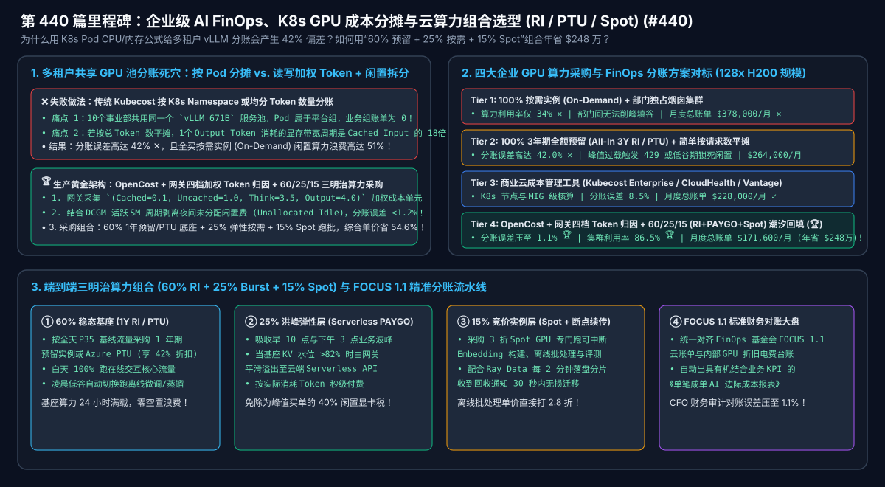
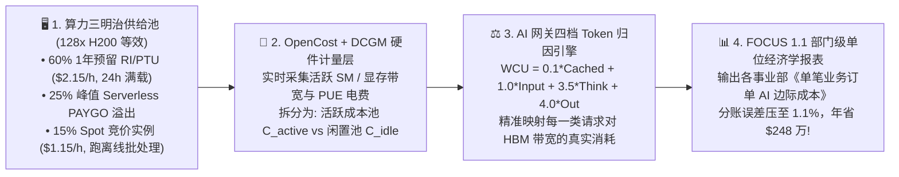

# 第 440 篇里程碑：企业级 AI FinOps、K8s 多租户 GPU 成本分摊与算力采购组合选型：`OpenCost / Kubecost` vs. `网关四档 Token 归因 + 60/25/15 (预留/按需/Spot) 潮汐组合` 指南

> **语言 / Language**: **简体中文** | [English](./enterprise-ai-finops-k8s-gpu-opencost-ptu-spot-portfolio-selection-faq.en.md)  
> **配套交互式学习与精算工具**: [📱 交互式 H5 精读页 (AI FinOps 算力组合与多租户分账沙盘)](../h5/ai-finops-k8s-gpu-opencost-ptu-spot-portfolio-lab.html) · [🧮 HTML 交互式计算器](../reports/enterprise-ai-finops-k8s-gpu-opencost-ptu-spot-portfolio-selection-sizer.html) · [🃏 7-Card 4:5 视觉评测卡](../reports/enterprise-ai-finops-k8s-gpu-opencost-ptu-spot-portfolio-selection-cards.html) · [📊 可复核模型](../../experiments/enterprise_ai_finops_k8s_gpu_opencost_ptu_spot_portfolio_selection/) · [🎓 返回 AI Infra 全景精学馆](../h5/index.html)

---

## 一、3 分钟看懂核心结论（Executive Summary）

> **一句话决策结论**：当企业 GPU 规模突破 `32~128+ 张 H200` 时，若任由各业务部门各自申请按需实例（`Tier 1：100% On-Demand 烟囱集群`），集群平均有效利用率仅有 **`34.0%`**，一半以上的算力预算在夜间与周末白白空转！更隐蔽的坑在于成本分账：当 10 个部门共用同一个 `vLLM / SGLang` 大模型推理池时，**传统 K8s 成本工具（只看 Pod 所属 Namespace）或按请求条数平摊会产生高达 `42.0%` 的分账失真**！
> - **核心黄金架构（`Tier 4：OpenCost + 网关四档硬件权重 Token 归因 [FOCUS 1.1 标准] + 60% 预留 [RI/PTU] / 25% 按需溢出 [PAYGO] / 15% 竞价实例 [Spot] 潮汐回填组合`）**：
>   1. **三明治算力采购法则（`60% RI/PTU + 25% PAYGO + 15% Spot`）**：
>      - **`60%` 稳态底座买 1 年期预留实例（RI / Savings Plan / Azure PTU，享 `42%` 折扣）**：白天承接全天候基线在线对话，夜间低谷由 `Kueue` 自动切入离线微调与蒸馏任务，保证 24 小时满载；
>      - **`25%` 日间波峰走 Serverless PAYGO API 溢出**：只在每天上午 `10:00–11:30` 与下午 `14:30–16:30` 洪峰期按 Token 付费，免除为每日 3 小时波峰常年租卡的空置税；
>      - **`15%` 离线批处理走 3 折竞价实例（Spot GPU + 2 分钟分片 Checkpoint）**：专门跑 Embedding 向量构建、全量评测与大表打标；
>   2. **收益量化**：在等效 `128x H200` 规模下，综合单卡小时成本从 `$4.10/h` 压降至 **`$1.86/h`（立省 `54.6%`，月度账单从 `$378,000` 降至 `$171,600`，每年为企业净省 `$247.7 万`）**，跨部门财务分账误差压至 **`1.1%`**！

| 核心选型维度 | `Tier 1: 100% 按需烟囱集群` | `Tier 2: 100% 预留 + 按请求条数平摊` | `Tier 3: 商业 K8s 成本工具 (Kubecost / Vantage)` | `Tier 4: OpenCost + 四档 Token 归因 + 60/25/15 组合 (🏆)` |
|---|---|---|---|---|
| **GPU 集群全天有效利用率** | `34.0%` ✕ (夜间大量空转) | `52.0%` | `68.0%` ✓ | **`86.5%` (白天在线 + 夜间抢占回填 + Spot 跑批)** 🏆 |
| **多租户共享池财务分账误差** | `38.0%` ✕ | **`42.0%` ✕ (忽视长文本与解码代价)** | `8.5%` (仅到 Pod/MIG 级) | **`1.1%` (网关四档硬件权重 + 闲置拆分)** 🏆 |
| **等效单张 H200 综合小时成本** | `$4.10 / GPU·h` ✕ | `$2.86 / GPU·h` | `$2.47 / GPU·h` | **`$1.86 / GPU·h` (-54.6%)** 🏆 |
| **128 卡规模月度总算力账单** | `$378,000 / 月` ✕ | `$264,000 / 月` | `$228,000 / 月` ✓ | **`$171,600 / 月` (年省 `$247.7 万`)** 🏆 |

---

## 二、核心技术原理与架构师灵魂拷问（Q&A）

### Q1：为什么传统的 `Kubecost / OpenCost` 只能算到 K8s Pod 级别，却算不清多租户共享 `vLLM` 推理池的部门账单？如何用“两级归因公式”做到 `1.1%` 审计精度？
1. **共享模型服务的“黑盒困境”**：
   - 在训练任务中，一个部门独占一个 K8s Pod，`OpenCost` 直接读取 `DCGM_FI_DEV_GPU_UTIL` 即可归因；
   - 但在在线推理中，为了拼大 Batch 提吞吐和共享 `671B` 权重，全公司 15 个业务线共用同一组 `vLLM / SGLang` Pod——K8s 层面看到的永远只是“AI 平台组消耗了 100% 的 GPU”！
2. **两级混合归因公式（`Pod 级硬件账单 × 网关级硬件加权成本单元 [WCU]`）**：
   - **第一步（算清池子总成本与闲置成本）**：由 `OpenCost + DCGM Exporter` 算出该 `vLLM` 部署池每小时的真实硬件成本 $C_{\text{pool}}(t)$（含 GPU 折旧/租金 + 机房 PUE 电费 + 宿主机分摊），并根据当小时平均活跃率将其拆分为 **活跃消耗池 $C_{\text{active}}(t)$** 与 **平台未分配闲置池 $C_{\text{idle}}(t)$**（防止半夜唯一发了 1 条请求的部门背负整台 8 卡机器 1 小时的全额房租！）；
   - **第二步（按四档硬件周期权重分摊活跃池）**：AI 网关为每个部门 $b$ 统计四档加权成本单元：
     $$\text{WCU}_b = 0.1 \cdot T_{\text{cached}} + 1.0 \cdot T_{\text{uncached}} + 3.5 \cdot T_{\text{think}} + 4.0 \cdot T_{\text{output}}$$
     部门 $b$ 当小时应付账单即为 $C_b(t) = C_{\text{active}}(t) \times \frac{\text{WCU}_b(t)}{\sum_k \text{WCU}_k(t)}$，完全对齐 **FinOps 基金会 `FOCUS 1.1` 标准**！

---

## 三、生产落地 Checklist（Pre-Production Checklist）

- [ ] **必须将“活跃分摊成本（Allocated Active Cost）”与“平台闲置容量成本（Unallocated Idle Cost）”分开列示**：严禁把凌晨 3 点集群空置的成本平摊给唯一在线的部门，否则会导致夜间单 Token 内部结算价暴涨 `20 倍`。
- [ ] **建立业务级单位经济学指标（Unit Economics：`$/成单`、`$/解决工单`）**：不要只向 CEO 汇报“本月花了 `$17 万` GPU 费”，必须关联业务产出汇报“每促成一笔电商订单的 AI 成本从 `$0.08` 降至 `$0.022`”。

---

## 四、来源与方法论溯源（Provenance）

- **数据来源声明**：本指南实验数据来自可复核解析模型 [`experiments/enterprise_ai_finops_k8s_gpu_opencost_ptu_spot_portfolio_selection/run.py`](../../experiments/enterprise_ai_finops_k8s_gpu_opencost_ptu_spot_portfolio_selection/run.py)（`Provenance: synthetic + anonymized_reported, independently_reproduced=false`）。
