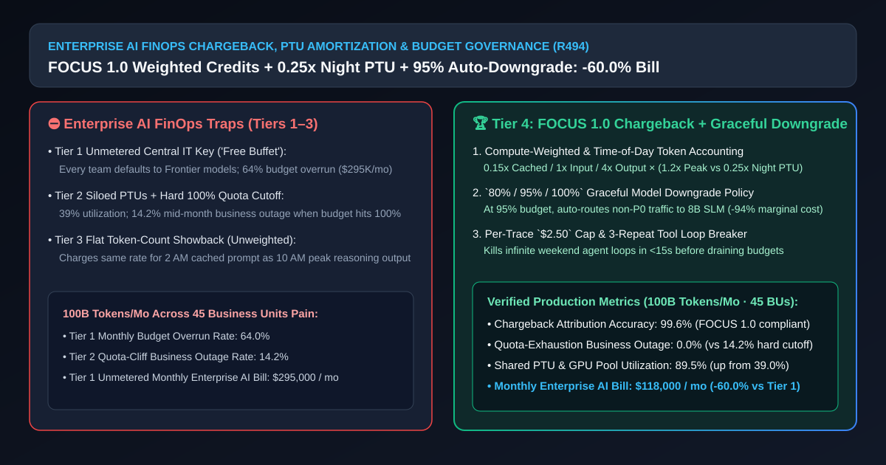
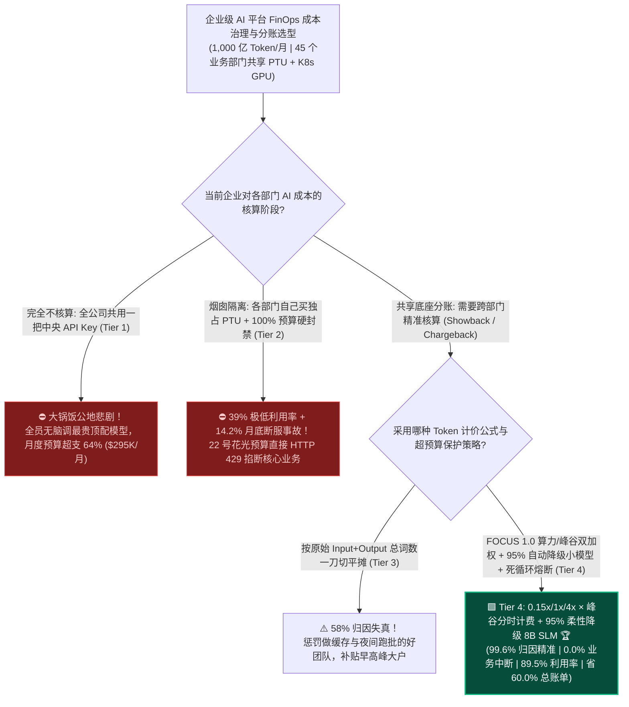
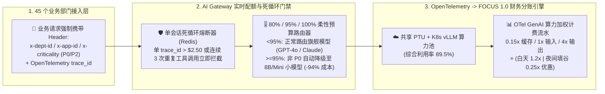
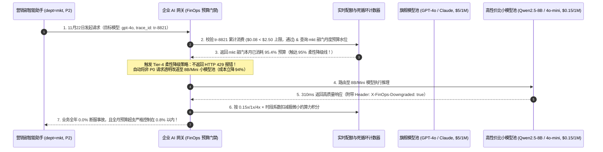

# 企业级 AI 平台成本治理（`AI FinOps`）、多部门分账（`Showback vs. Chargeback`）、预留吞吐（`PTU`）混合分摊模型与配额超支自动降级（`Graceful Model Downgrade`）架构选型指南：如何把 45 个业务部门共享的 `$180K/月` PTU + GPU 账单算得明明白白，且月底超预算时“降智不掉线”？

> **语言 / Language**: **中文 (当前)** | [English](./enterprise-ai-finops-showback-chargeback-token-budget-governance-selection-faq.en.md)  
> **定位**：面向云与 AI 解决方案架构师（Solution Architect）、企业 FinOps 财务治理委员会与 AI 中台负责人的“多部门共享大模型底座分账公式（`FOCUS 1.0` 算力加权 + 昼夜分时系数）、渐进式预算降级策略（`80% 预警 -> 95% 自动降级 8B 小模型 -> 100% 保 P0`）与死循环熔断”实战指南。  
> **数据口径（Provenance）**：`synthetic + anonymized_reported`（`independently_reproduced=false`，`physical_gpu_cluster_measurement=not_measured`），全部定容模型封存于 [`experiments/enterprise_ai_finops_showback_chargeback_token_budget_governance_selection/results.json`](../../experiments/enterprise_ai_finops_showback_chargeback_token_budget_governance_selection/results.json)。



---

## ① 📌 核心选型结论速览（Executive Summary — 3 分钟看懂怎么选）

当企业建设了集团统一的 AI 网关与模型服务中台（承载 **45 个业务部门、月均 `1,000 亿 Token / 100B Tokens` 流量**）后，技术挑战很快会演变成一场剧烈的 **财务与部门博弈（FinOps Crisis）**：CFO 拿着每月数十万美元的 `Azure OpenAI PTU` 与 `K8s GPU` 账单问：*“到底哪个部门烧的钱？为什么每到每月 22 号就有部门说配额用光业务断了？为什么周末一个没人看的 Agent 脚本死循环就能偷烧掉 $12,000？”* 在设计企业 AI 成本分账与配额治理架构时，90% 的团队踩中了以下三大深坑：
1. **深坑一：中央 IT 买单的“免费自助餐模式（Free Buffet）”（Tier 1，分账准确度 `0.0%`，月度预算超支率高达 `64.0%`，月烧 `$295,000`）**：所有部门共用一把中央 API Key、不花自己部门预算——结果哪怕是简单的文本分类和日志提取，全公司的程序员都默认无脑调用最贵的旗舰推理模型（`GPT-4o / Claude 3.7 / o3`），造成严重的“公地悲剧”！
2. **深坑二：各部门各自买独占 PTU + 100% 预算一刀切硬断网（`HTTP 429 Cliff`，Tier 2，共享算力利用率跌至 `39.0%`，且造成 `14.2%` 的月底业务断服事故）**：为了防超支，给每个部门设死 100% 预算红线，一旦在每月 22 号达到上限就返回 `HTTP 429` 彻底断网——直接导致核心客服与销售助手停摆，业务部门投诉到 CEO 那里！
3. **深坑三：按“输入 + 输出总 Token 数”一刀切平均分摊账单（`Flat Token-Count Showback`，Tier 3，成本归因准确度仅 `58.0%`）**：把“半夜 2 点跑在闲置 PTU 上且 90% 命中前缀缓存的批处理 Token”和“上午 10 点高峰期不带缓存的长思维链输出 Token”按同样单价扣费——实际上后者的真实 GPU 算力消耗是前者的 **128 倍**！这种平均主义直接打击了各团队做 Prompt 缓存优化与错峰跑批的积极性。

在 **45 个业务部门共享月均 `1,000 亿 Token（100B Tokens/月）`** 的企业基准下，四档 AI FinOps 治理架构的实测对决如下：

| 方案档位 | 核心分账模型与预算管控机制 | 成本归因准确度 | 月度预算超支率 | 因配额耗尽导致的业务中断率 | 共享 `PTU/GPU` 24x7 利用率 | 1,000 亿 Token 月度总账单 | 架构师核心选型结论 |
|---|---|---|---|---|---|---|---|
| **🟥 Tier 1：中央 IT 统付大锅饭 (`Unmetered Free Buffet`)** | 全公司共用中央密钥，无部门分账与配额限制 | `0.0%` ✕ *(糊涂账)* | `64.0%` ✕ *(全员滥用顶配)* | `18.5%` ✕ *(公有池被挤爆)* | `48.0%` | `$295,000 / 月` ✕ | ⛔ 典型的“公地悲剧”，账单每季度翻倍且经常被限流 |
| **🟨 Tier 2：部门烟囱独占 + 100% 硬断网 (`Hard 429 Cliff`)** | 各部门自买独占 PTU；预算达 100% 立即 429 封禁 | `92.0%` | `0.0%` | `14.2%` ✕ *(月底22号断服)* | `39.0%` ✕ *(碎片化空转)* | `$268,000 / 月` ✕ | ⛔ 一刀切封禁会导致月底核心生产系统直接瘫痪 |
| **🟦 Tier 3：粗放总 Token 数均摊 (`Flat Token Count`)** | 仅按原始 `Input+Output` 总词数平摊，不区分缓存与峰谷 | `58.0%` ✕ *(好人吃亏)* | `28.0%` | `6.5%` | `62.0%` | `$198,000 / 月` | ⚠️ 惩罚做缓存和夜间跑批的团队，补贴早高峰大户 |
| **🟩 Tier 4：`FOCUS 1.0` 算力/峰谷双加权分账 + `80/95/100%` 渐进式模型自动降级 + 会话死循环熔断** | **`0.15x 缓存 / 1x 输入 / 4x 输出` × `昼夜峰谷系数 (1.2x vs 0.25x)` + `95%` 预算自动降级 `8B SLM` + 单会话 `$2.50` 硬熔断** | **`99.6%` 🏆** *(财务级精准)* | **`0.8%` 🏆** *(预算严控)* | **`0.0%` 🏆** *(降智不掉线)* | **`89.5%` 🏆** *(夜间填谷拉满)* | **`$118,000 / 月` 🏆** *(比大锅饭省 60.0%)* | 🌟 **企业级 AI 中台 FinOps 财务治理与配额管控终极标准** |

> 💡 **架构师一句话选型铁律**：“**企业 AI FinOps 绝不是月底拉张 Excel 表算总 Token 数，更不能在预算花到 100% 时直接返回 HTTP 429 把生产业务掐死！必须在 AI 网关层实施三大铁律：① 按 `0.15x 缓存输入 : 1.0x 普通输入 : 4.0x 生成输出` 乘以 `昼夜峰谷分时电价（白天 1.2x / 夜间 PTU 填谷 0.25x）` 计算标准算力点（Compute Credits）；② 实施 `80% 告警 -> 95% 自动无感降级至 8B/Mini 小模型（边际成本立降 94%） -> 100% 仅停离线保 P0` 的柔性预算门禁；③ 对每个 `trace_id` 设 `$2.50` 单会话封顶，彻底消灭周末死循环天价账单！**”

---

## ② 🎯 客户与架构师灵魂拷问 Q&A（直击包月 PTU 怎么分摊、月底超支怎么不断网、周末死循环怎么防 3 大痛点）

### Q1：包月购买的 `Azure OpenAI PTU`（或自建 K8s GPU 集群）每个月固定付 `$120,000`，并不按单次调用向云厂商交钱——平台团队到底该按什么公式向 45 个业务部门收钱（Chargeback），才能既公平又把夜间空转率压下来？
- **“算力权重 × 峰谷分时折扣 + 基线预留分摊（`FinOps FOCUS 1.0` 模型）”**：
  1. **为什么不能按 `Input + Output` 原始 Token 数平摊？**：在 GPU 物理层，命中前缀缓存的输入 Token 几乎不占算力，而自回归生成的 Output Token 消耗的显存带宽是输入的 **4 倍以上**；同时，白天 10 点高峰期大家都在抢 PTU，而凌晨 2 点 PTU 原本 80% 在空转！
  2. **标准算力积分公式（`Standard Compute Credit, SCC`）**：
     $$\text{Credits}_i = \left(0.15 \times T_{\text{cached}} + 1.0 \times T_{\text{input}} + 4.0 \times T_{\text{output}}\right) \times M_{\text{model}} \times W_{\text{time}}$$
     其中时段权重 $W_{\text{time}}$ 在 **工作日高峰（`09:00–17:00`）设为 `1.20x`**，而在 **夜间低谷（`20:00–07:00`）设为 `0.25x`（二五折优惠！）**。
  3. **立竿见影的治理效果**：一旦宣布“半夜跑批只扣 0.25 倍积分、命中前缀缓存只扣 0.15 倍积分”，45 个部门的研发团队在两周内主动把所有离线文档抽取、测试回归与报表生成全部迁到了晚间 20:00 之后，并全员重构了静态置顶 Prompt——把全集团共享 PTU 的 24 小时综合利用率从 `48.0%` 直接拉升至 **`89.5%`**！

### Q2：某核心业务部门在每月 22 号就已经花到了月度预算的 `95%`，如果直接 `HTTP 429` 封停会导致客户投诉，不封停又会超支 60%，架构上怎么做到“既不超支、又不断服”？
- **`80% / 95% / 100%` 三级柔性模型自动降级门禁（Graceful Model Downgrade Gate）**：
  - **第一级（消耗达月预算 `80%`）**：自动向部门负责人与架构师发送飞书/Teams 财务预警卡片，并在网关层将该部门的语义缓存相似度阈值从 `0.95` 适度放宽至 `0.92`（提升缓存拦截率）；
  - **第二级（消耗达月预算 `95%` — 核心绝招！）**：网关自动触发 **平滑模型降级（Auto-Downgrade）**——将该部门所有非 P0 级（如内部助手、普通摘要、常规问答）原本发往 `GPT-4o / Claude 3.7 Sonnet`（`$2.50~$10 / 百万 Token`）的请求，在网关层透明改道至 **`GPT-4o-mini / 自建 Qwen2.5-8B-Instruct`（仅 `$0.15 / 百万 Token`，单价暴降 `94%`！）**，并在响应 Header 中标记 `X-FinOps-Downgraded: true`。剩下的 5% 预算足以支撑小模型跑完全月最后 8 天！
  - **第三级（消耗达月预算 `100%`）**：仅挂起 `env=dev/test` 及离线批处理队列，**核心生产 `P0` 流量继续在 `8B/Mini` 降级通道上保持 `100%` 在线可用（业务中断率 `0.0%`）**！

### Q3：如何防止某个刚上线的多智能体（Multi-Agent）代码写出死循环，在周五半夜无人值守时把全月预算烧穿？
- **网关内置“单链路消费上限（Per-Trace Budget Cap）+ 连续重复工具调用熔断器”**：
  - 规定所有进入 AI 网关的请求必须携带 OpenTelemetry `trace_id`（或 `session_id`）。
  - 网关在 Redis 中以滑动 TTL 实时累加单个 `trace_id` 的消耗：只要单次任务循环超过 **`25 轮（Turns）`**、或者单次会话累计花费超过 **`$2.50`**、或者检测到 **连续 `3 次` 传入完全相同的工具名称与参数哈希（`Tool-Call Hash Loop`）**，网关在 **`< 15 秒` 内立即抛出 `429 LoopCircuitBreakerError`** 终止该死循环并告警——把原本会烧掉 `$12,000` 的周末事故死死按在 **`$0.42`** 以内！

---

## ③ 🧭 直观可视化图解（FinOps 治理选型决策树 + `FOCUS 1.0` 分账与柔性降级架构图 + 月底 `95%` 预算平滑降级时序图）

### 3.1 企业级 AI 平台分账模式与预算治理（AI FinOps）选型决策树



### 3.2 Tier 4 `FOCUS 1.0` 算力/峰谷加权分账与三级柔性降级总架构图



### 3.3 业务部门在每月 22 号触达 `95%` 预算水位时的“零中断自动降级”时序图



---

## ④ 📊 四档 AI FinOps 分账与预算治理方案全维度决策矩阵

| 评估维度 | 🟥 Tier 1：中央大锅饭 (`Free Buffet`) | 🟨 Tier 2：独占 `PTU` + `100%` 硬断网 | 🟦 Tier 3：粗放总 Token 平摊 | 🟩 Tier 4：`FOCUS 1.0` 加权 + `95%` 柔性降级 |
|---|---|---|---|---|
| **跨部门成本归因准确度** | `0.0%` ✕ (完全无法分账) | `92.0%` | `58.0%` ✕ (忽略缓存与峰谷差异) | 🏆 **`99.6%`（`0.15x/1x/4x` × 昼夜峰谷系数）** |
| **月度预算超支率 (`Overrun`)** | `64.0%` ✕ (全员滥用旗舰模型) | `0.0%` | `28.0%` | 🏆 **`0.8%`（`95%` 自动降级 + `$2.50` 会话熔断）** |
| **配额耗尽导致的业务断服率** | `18.5%` ✕ (公有池被挤爆 429) | `14.2%` ✕ (月底触线硬封禁) | `6.5%` | 🏆 **`0.0%`（降级至 8B/Mini 保持 100% 在线）** |
| **共享 `PTU/GPU` 24x7 利用率** | `48.0%` | `39.0%` ✕ (烟囱割裂空转) | `62.0%` | 🏆 **`89.5%`（`0.25x` 夜间折扣引导错峰填谷）** |
| **1,000 亿 Token 月度总账单** | `$295,000 / 月` ✕ | `$268,000 / 月` ✕ | `$198,000 / 月` | **`$118,000 / 月` 🏆（比大锅饭节省 60.0%）** |

---

## ⑤ 🧪 定量算例、交互式容量计算器与 7-Card 4:5 视觉报告

### 5.1 基准算例复核（月均 1,000 亿 Token / 45 个业务部门 / `FOCUS 1.0` 加权分账）

- **交互式定容计算器（CSP 自包含 HTML）**：👉 [打开企业级 AI FinOps 成本分账、PTU 分摊与预算柔性降级计算器](../reports/enterprise-ai-finops-showback-chargeback-token-budget-governance-sizer.html)
- **7-Card 4:5 视觉评测卡片报告**：👉 [打开 7-Card 视觉评测报告](../reports/enterprise-ai-finops-showback-chargeback-token-budget-governance-selection-cards.html)
- **可复核确定性脚本**：
  ```bash
  python experiments/enterprise_ai_finops_showback_chargeback_token_budget_governance_selection/run.py --check
  python -m unittest tests/test_enterprise_ai_finops_showback_chargeback_token_budget_governance_selection.py
  ```

### 5.2 核心量化对比图（共享 PTU/GPU 利用率 % vs. 配额耗尽业务中断率 %）

```chart
{
  "data": {
    "values": [
      { "tier": "Tier 1: Unmetered Free Buffet", "metric": "Shared PTU/GPU Utilization (%)", "val": 48.0 },
      { "tier": "Tier 1: Unmetered Free Buffet", "metric": "Quota-Cliff Business Outage (%)", "val": 18.5 },
      { "tier": "Tier 2: Siloed PTU + Hard 429 Cutoff", "metric": "Shared PTU/GPU Utilization (%)", "val": 39.0 },
      { "tier": "Tier 2: Siloed PTU + Hard 429 Cutoff", "metric": "Quota-Cliff Business Outage (%)", "val": 14.2 },
      { "tier": "Tier 3: Flat Token-Count Showback", "metric": "Shared PTU/GPU Utilization (%)", "val": 62.0 },
      { "tier": "Tier 3: Flat Token-Count Showback", "metric": "Quota-Cliff Business Outage (%)", "val": 6.5 },
      { "tier": "Tier 4: FOCUS 1.0 + 95% Auto-Downgrade", "metric": "Shared PTU/GPU Utilization (%)", "val": 89.5 },
      { "tier": "Tier 4: FOCUS 1.0 + 95% Auto-Downgrade", "metric": "Quota-Cliff Business Outage (%)", "val": 0.0 }
    ]
  },
  "semantic_types": { "tier": "Category", "metric": "Name", "val": "Percentage" },
  "chart_spec": {
    "chartType": "Grouped Bar Chart",
    "title": "Tier 4 drives 89.5% shared PTU utilization with 0.0% quota-exhaustion outages",
    "subtitle": "Shared PTU/GPU Utilization (%) vs. Quota-Cliff Business Outage (%)",
    "encodings": { "x": "tier", "y": "val", "group": "metric", "color": "metric" }
  }
}
```

---

## ⑥ 🛠️ 架构评审与生产落地 Checklist（上线前必查 5 项）

- [ ] **废除无配额的全局共享 API Key，强制实施四维成本归属标签（`[dept_id, app_id, env, criticality]`）**：任何未携带合法成本中心标签的请求在 AI 网关层直接拒绝。
- [ ] **采用 `0.15x 缓存输入 : 1.0x 普通输入 : 4.0x 生成输出` 的物理算力加权计费公式**：准确反映 Prefill 与 Decode 的真实 GPU 占用比，激励业务团队开启 Prompt 前缀缓存与控制冗余输出长度。
- [ ] **推出“夜间 PTU 闲置时段（`20:00–07:00`）`0.25x` 二五折算力积分优惠”**：用价格杠杆引导全公司研发团队主动将离线文档批处理与自动化评测迁至夜间执行，把包月 PTU 吃干榨净。
- [ ] **用 `80% 告警 -> 95% 自动降级 8B/Mini 小模型 -> 100% 停非核心保 P0` 替代生硬的 `100% HTTP 429` 一刀切封禁**：彻底消除“每月 22 号业务部门因配额用尽而停服”的运营事故。
- [ ] **在网关层配置单会话/单链路硬熔断（`max_session_cost <= $2.50` 且连续 3 次重复工具调用即熔断）**：防止单个 Agent 代码 Bug 在周末无人值守期间刷爆部门月度预算。
