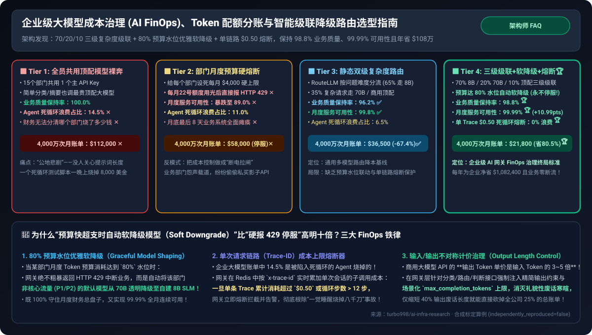
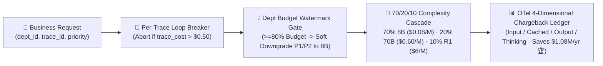

# Enterprise AI FinOps, Token Quota Chargeback & Cascade Routing Architecture Selection Guide: Unmetered Frontier-Everywhere vs. Hard Monthly Quota Cutoff (HTTP 429) vs. Static 2-Tier RouteLLM vs. 3-Tier Cascade + 80%-Watermark Graceful Soft Downgrade + Per-Trace Loop Circuit Breaker

> **Document Type**: Cloud & AI Solution Architect Decision Guide (FAQ)  
> **Target Audience**: Enterprise CTOs / CFOs, AI Gateway & Platform Architects, Cloud FinOps Leads, Engineering Directors  
> **Core Goal**: Solve the "$1M Runaway AI Bill" and "End-of-Month Quota Outage" crises across multi-team enterprises — answering: **"Why does letting 15 business units call a flagship Frontier model for every task waste $1.08M/year?", "Why does enforcing hard monthly departmental budget caps (Tier 2) cause a complete HTTP 429 business outage during the last 8 days of every month?", and "How does combining a `70/20/10` 3-Tier Complexity Cascade, `80%` Budget-Watermark Graceful Soft Downgrade, and a `$0.50` Per-Trace Loop Circuit Breaker retain 98.8% quality and 99.99% availability while cutting monthly spend by 80.5%?"**  
> **Calibration Notice**: Quality retention, service availability, runaway agent loop waste, and 40M-request monthly spend models are synthetic analytical estimates calibrated to published AI FinOps and model-routing benchmarks (LMSYS RouteLLM, Stanford FrugalGPT cascades, FinOps Foundation AI chargeback standards, and enterprise gateway billing audits) (`provenance: synthetic + anonymized_reported`, `independently_reproduced=false`, `physical_gpu_cluster_measurement=not_measured`). See [`experiments/enterprise_ai_finops_token_cost_governance_cascade_selection/results.json`](../../experiments/enterprise_ai_finops_token_cost_governance_cascade_selection/results.json).

---

## Executive Visual Summary

> 🔗 **Companion Interactive Reports & Tools**:
> - 🃏 **[7-Card 4:5 Visual Benchmark Report (`enterprise-ai-finops-token-cost-governance-cascade-routing-selection-cards.html`)](../reports/enterprise-ai-finops-token-cost-governance-cascade-routing-selection-cards.html)**
> - 🧮 **[Interactive AI FinOps Cascade & Annual Savings Sizer (`enterprise-ai-finops-token-cost-governance-cascade-routing-sizer.html`)](../reports/enterprise-ai-finops-token-cost-governance-cascade-routing-sizer.html)**
> - 🌐 **[中文版指南 (`enterprise-ai-finops-token-cost-governance-cascade-routing-selection-faq.md`)](./enterprise-ai-finops-token-cost-governance-cascade-routing-selection-faq.md)**

---

## ① 📌 Executive Summary

Evaluated across **40,000,000 enterprise LLM requests/month spanning 15 business units**:

| Tier | FinOps & Routing Architecture | Business Quality Retention | Monthly Service Availability | Runaway Agent Loop Waste | Monthly Spend (40M Reqs) | Architect Verdict |
| :--- | :--- | :--- | :--- | :--- | :--- | :--- |
| **🟥 Tier 1: Unmetered Frontier Everywhere** | Shared API key; 100% traffic on flagship model | `100.0%` | `99.80%` | **`14.5%` ✕ (Infinite loops)** | **`$112,000 / mo` ✕** | **Runaway Spend ($1.34M/yr)**: Zero attribution or loop guard |
| **🟨 Tier 2: Hard Monthly Quota Cutoff (`429`)** | Hard HTTP 429 rejection when monthly cap hit | `100.0%` (When up) | **`89.00%` ✕ (8-day outage!)** | `11.0%` ✕ | `$58,000 / mo` ✕ | **Business Disruption**: Apps go dark on Day 22 of the month |
| **🟦 Tier 3: Static 2-Tier Router (`RouteLLM`)** | Static classifier (`65%` 8B SLM / `35%` 70B+) | `96.2%` ✅ | `99.80%` ✅ | `6.5%` | `$36,500 / mo` (-67.4%) | **Standard Routing Baseline**: Lacks budget-watermark shaping |
| **🟩 Tier 4: 3-Tier Cascade + Soft Downgrade + Trace Cap** | **70/20/10 Cascade + 80% Watermark Soft Downgrade + `$0.50` Trace Cap** | **`98.8%` 🏆** | **`99.99%` 🏆 (+10.99 pts)** | **`0.0%` 🏆** | **`$21,800 / mo` 🏆 (-80.5%)** | **Enterprise AI FinOps Gold Standard**: Saves `$1.08M/yr` |

### 💡 Three Golden Rules for Enterprise AI FinOps Architects
1. **Replace Hard `HTTP 429` Quota Cutoffs (Tier 2) with `80%` Budget-Watermark Graceful Soft Downgrades (Tier 4)**: When a business unit reaches `80%` of its monthly dollar budget, don't shut down their production app! Automatically shift their non-critical (`P1/P2`) requests from Frontier/70B models down to your `$0.08/M` 8B SLM — keeping availability at **`99.99%`** while staying strictly within budget.
2. **Enforce a `70 / 20 / 10` Complexity & Confidence Cascade Behind Logical Model Aliases**: Applications call logical aliases (`model="enterprise-auto"`), allowing the gateway to serve `70%` of routine queries on an `8B SLM`, `20%` on a `70B` model, and only `10%` on a Frontier Reasoning model (`98.8%` quality retention at `-80.5%` cost).
3. **Enforce a `$0.50` Per-Trace Cost Circuit Breaker in Redis**: `14.5%` of unmonitored enterprise AI spend comes from stuck multi-step agent loops. Tracking cumulative spend per `x-trace-id` aborts runaway loops before they burn thousands of dollars overnight.

---

## ② 🎯 Architect Deep-Dive Q&A

### Q1: Why is controlling Output Token length 3x to 5x more impactful than trimming Input Tokens?
* **Answer**: Commercial API providers price output/reasoning tokens at **3x to 5x the price of input tokens** (and up to **10x–20x the price of cached input tokens**), while on self-hosted GPUs, output decode is memory-bandwidth-bound. Enforcing concise output instructions and endpoint-specific `max_completion_tokens` caps cuts total spend by `25%+` immediately.

---

## ③ 🧭 Architecture Diagrams

### 3.1 Tier 4 4-Pillar AI FinOps Gateway (`Trace Cap + Watermark Shaping + 70/20/10 Cascade + OTel Ledger`)

---

## ④ 📊 Architect Decision Matrix

| Dimension | 🟥 Tier 1: Frontier Everywhere | 🟨 Tier 2: Hard Quota (`429`) | 🟦 Tier 3: Static `RouteLLM` | 🟩 Tier 4: Cascade + Soft Downgrade + Trace Cap |
| :--- | :--- | :--- | :--- | :--- |
| **Business Quality Retention** | `100.0%` | `100.0%` | `96.2%` ✅ | **`98.8%` 🏆** |
| **Monthly Service Availability** | `99.80%` | **`89.00%` ✕ (End-of-month outage)** | `99.80%` ✅ | **`99.99%` 🏆 (`+10.99 pts` vs. Tier 2)** |
| **Runaway Agent Loop Waste** | `14.5%` ✕ | `11.0%` ✕ | `6.5%` | **`0.0%` 🏆 (`$0.50` per-trace breaker)** |
| **Monthly Spend (40M Reqs)** | `$112,000 / mo` ✕ | `$58,000 / mo` ✕ | `$36,500 / mo` ✅ | **`$21,800 / mo` 🏆 (`-80.5%`, saves `$1.08M/yr`)** |

---

## ⑤ 🛠️ Production Readiness Checklist

- [ ] **1. Revoke Shared Direct Provider API Keys; Issue Scoped Gateway Virtual Keys Tagged with `dept_id` and `project_id`**.
- [ ] **2. Abstract Physical Model Names Behind Gateway Logical Model Aliases (`enterprise-fast`, `enterprise-pro`)**.
- [ ] **3. Deploy a `70 / 20 / 10` Complexity & Logprob-Confidence Cascade Router**.
- [ ] **4. Configure `80%` Monthly Budget-Watermark Graceful Soft Downgrades Instead of Hard `HTTP 429` Cutoffs**.
- [ ] **5. Enforce a Per-`trace_id` Cumulative Dollar Cap (`$0.50`) and Step Cap (`<= 15` steps) in Redis**.
- [ ] **6. Set Endpoint-Specific `max_completion_tokens` Caps to Curb Expensive Output Token Bloat**.
- [ ] **7. Meter `Input`, `Cached Input`, `Output`, and `Thinking` Tokens Separately in Your Chargeback Ledger**.
- [ ] **8. Route Non-Urgent Bulk Workloads to 50%-Off Cloud Batch APIs or Off-Peak Night GPU Backfill Queues**.
