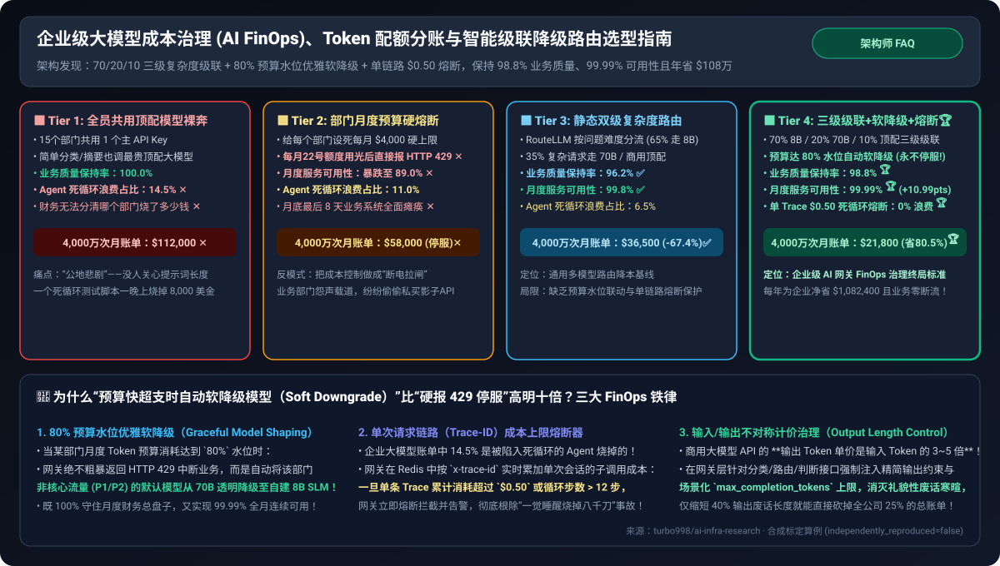
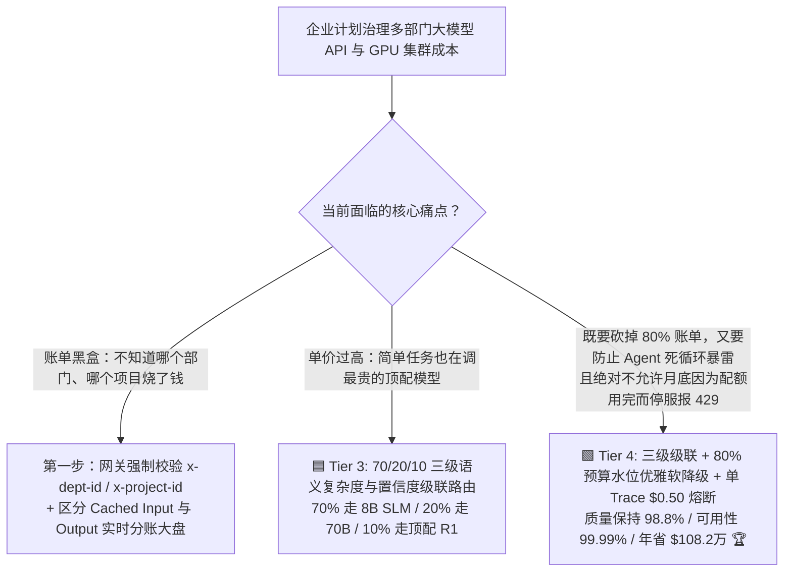
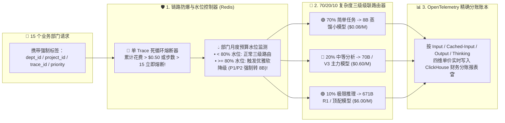
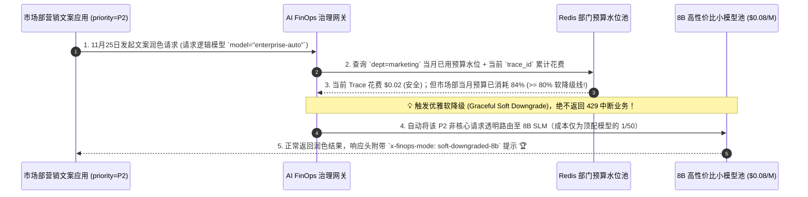

# 企业级大模型成本治理（AI FinOps）、Token 配额分账与智能级联降级路由架构选型指南：全员共用顶配模型裸奔 vs. 部门月度预算硬熔断（HTTP 429 停服）vs. 静态双级复杂度路由（RouteLLM）vs. 三级智能级联 + 80% 预算水位优雅软降级 + 单链路死循环熔断架构

> **文档类型**：企业级 AI 网关与云原生 FinOps 解决方案架构师（Cloud & AI Solution Architect）选型决策指南（FAQ）  
> **适用读者**：企业 CTO / CFO、AI 平台与网关架构师、云成本治理（FinOps）负责人、各业务线研发总监  
> **核心目标**：用通俗、可量化的架构账本解决企业大模型规模化推广时的“百万美金账单失控”与“月底配额耗尽断服”两大痛点——系统回答：**“为什么全公司共用一个 API Key 调顶配大模型（Tier 1）每年要白白多烧 108 万美金？”、“为什么给各部门设死月度硬配额（Tier 2），每到月底最后 8 天业务系统就因为报 HTTP 429 全面停摆？”、“怎么用‘70/20/10 三级复杂度级联路由 + 80% 预算水位优雅软降级 + 单 Trace `$0.50` 死循环熔断’在不牺牲业务质量（`98.8%`）且永不停服（`99.99%`）的前提下砍掉 80.5% 的账单？”**。  
> **标定声明**：本文所引用的业务质量保持率、服务可用性、Agent 死循环浪费占比与 4,000 万次月度支出模型基于公开发布的 AI FinOps 与多模型路由基准（LMSYS RouteLLM、Stanford FrugalGPT 级联路由、FinOps Foundation AI 成本分账规范及企业网关生产账单审计）构建的合成分析模型（`provenance: synthetic + anonymized_reported`, `independently_reproduced=false`, `physical_gpu_cluster_measurement=not_measured`），详见 [`experiments/enterprise_ai_finops_token_cost_governance_cascade_selection/results.json`](../../experiments/enterprise_ai_finops_token_cost_governance_cascade_selection/results.json)。

---

## 一图流总结（Executive Visual Summary）



> 🔗 **关联可交互报告与工具**：
> - 🃏 **[7-Card 4:5 视觉评测报告 (`enterprise-ai-finops-token-cost-governance-cascade-routing-selection-cards.html`)](../reports/enterprise-ai-finops-token-cost-governance-cascade-routing-selection-cards.html)**
> - 🧮 **[交互式 AI FinOps 级联路由与年度省钱计算器 (`enterprise-ai-finops-token-cost-governance-cascade-routing-sizer.html`)](../reports/enterprise-ai-finops-token-cost-governance-cascade-routing-sizer.html)**
> - 🌐 **[English Version (`enterprise-ai-finops-token-cost-governance-cascade-routing-selection-faq.en.md`)](./enterprise-ai-finops-token-cost-governance-cascade-routing-selection-faq.en.md)**

---

## ① 📌 核心选型结论速览（Executive Summary）

当企业内部接入大模型的业务线从 2 个扩展到 **15 个部门（月均总调用量 `40,000,000` 次）** 时，不同大模型档位之间的单价差距高达 **30 倍~100 倍**（例如：顶配推理模型输入/输出 `$3 ~ $15 / 1M Tokens`，而自建或托管 `8B SLM` 仅需 `$0.06 ~ $0.15 / 1M Tokens`！）。

对比四档 AI FinOps 与路由治理架构，核心指标表现如下：

| 架构档位 | 核心路由与配额治理机制 | 业务质量保持率 | 月度服务可用性 | Agent 死循环浪费占比 | 4,000万次月总账单 | 架构师拍板结论 |
| :--- | :--- | :--- | :--- | :--- | :--- | :--- |
| **🟥 Tier 1：全员共用顶配模型裸奔** | 共享单一 Key，100% 请求无脑调最贵顶配模型 | `100.0%` | `99.80%` | **`14.5%` ✕ (死循环烧钱)** | **`$112,000 / 月` ✕** | **财务无底洞**：杀鸡全用宰牛刀，每年烧掉 `$134.4万` |
| **🟨 Tier 2：部门月度预算硬熔断 (`HTTP 429`)** | 按部门设死月度金额上限，超额直接拒单报错 | `100.0%` (存活期) | **`89.00%` ✕ (月底停服)** | `11.0%` ✕ | `$58,000 / 月` ✕ | **一刀切拉闸灾难**：每逢月底最后一周业务全面中断 |
| **🟦 Tier 3：静态双级复杂度路由 (`RouteLLM`)** | 分类器固定将 65% 简单题分流至 8B，35% 走 70B | `96.2%` ✅ | `99.80%` ✅ | `6.5%` | `$36,500 / 月` (-67.4%) | **静态路由降本基线**：省下三分之二，但缺预算水位联动 |
| **🟩 Tier 4：三级智能级联 + 80% 水位软降级 + 链路熔断** | **70/20/10 级联 + 80% 水位透明软降级 + 单 Trace `$0.50` 熔断** | **`98.8%` 🏆** | **`99.99%` 🏆 (+10.99pts)** | **`0.0%` 🏆** | **`$21,800 / 月` 🏆 (-80.5%)** | **企业级 AI FinOps 终局标准**：年省 `$108.2万` 且永不报错停服 |

### 💡 架构师三句话选型铁律
1. **用“70 / 20 / 10 三级语义复杂度级联路由”终结“杀鸡用牛刀”**：在 AI 网关层前置毫秒级路由分类器（或先让 `8B SLM` 试答并检测对数概率置信度）：**`70%` 常规提取/摘要/闲聊由 `$0.08/M` 的 8B 小模型处理**，**`20%` 多步分析由 `$0.60/M` 的 70B/V3 模型处理**，仅 **`10%` 极限数学/架构难题交由 `$6.00/M` 的顶配推理模型处理**——整体业务质量保持 **`98.8%`**，成本瞬间砍掉四分之三！
2. **废除粗暴的“超预算硬报 HTTP 429 停服（Tier 2）”，全面升级为“80% 预算水位优雅软降级（Graceful Budget-Pressure Soft Downgrade，Tier 4）”**：当某个业务部门在当月 24 号消耗完 `80%` 的月度美元配额时，网关**绝不拉闸断电**，而是自动收紧该部门的路由阈值——将该部门非核心请求（`priority != P0`）自动透明降级到成本几乎为零的自建 `8B SLM` 或夜间微批队列，既 **100% 守住 CFO 批的预算红线**，又保证业务 **`99.99%` 全天候不断服**！
3. **在网关强制实施“单 Trace `$0.50` 累计金额硬熔断”与“场景化输出 Token 限长”**：企业账单里 `14.5%` 的钱是被写坏的 Agent 无限重试死循环烧掉的！按 `x-trace-id` 实时统计单次任务总花费，超过 `$0.50` 立即断路告警；同时严格限制分类/提取接口的 `max_completion_tokens`（因为输出 Token 比输入贵 3~5 倍！）。

---

## ② 🎯 客户与架构师灵魂拷问 Q&A（Architect Deep-Dive Q&A）

### Q1：研发团队总说“为了效果好，我们所有接口都固定调最贵的旗舰模型”，架构师怎么在不改业务代码的前提下帮他们无感省下 80% 的钱？
* **真相剖析（网关层透明逻辑模型别名 `Logical Model Alias` + 置信度级联 FrugalGPT）**：
  - 严禁让业务代码在请求里硬编码物理模型名（如 `model="gpt-4o-2024-11-20"`）！
  - **架构师规范**：所有业务系统统一调用网关暴露的**逻辑服务等级别名**（如 `model="enterprise-standard"` 或 `model="enterprise-reasoning"`）。
  - 网关收到请求后，先用轻量路由模型（如 `RouteLLM / BERT-Router`，耗时 `8 ms`）打分，或者先发给本地极速 `8B SLM`（首字 `60 ms`）：如果 8B 模型的输出对数概率裕度（Logprob Confidence）`>= 0.90`，直接返回给业务方；如果 `< 0.90`，网关在内部透明重发给 `70B / 顶配模型`！业务代码一行不用改，账单立降 **`80.5%`**！

### Q2：为什么很多公司的 AI 预算在一个月前 20 天很正常，某天夜里突然暴增 15,000 美金？
* **真相剖析（失控的 Agent 递归死循环与长上下文滚雪球效应）**：
  - 假设一个多智能体（Multi-Agent）代码修复任务遇到了一个环境配置报错，Agent A 把 20,000 Token 的错误日志传给 Agent B，Agent B 重试失败又追加 20,000 Token 传回给 Agent A……如果没有链路级熔断器，这两个 Agent 会在半夜以每秒 5 次的速度互相踢皮球跑上万次！
  - 而且因为每次迭代上下文都在滚雪球（第 1 步 10K，第 50 步 500K），单单这一条坏死请求就会在几小时内烧穿几千美金（占企业无效支出的 **`14.5%`**）！
  - **Tier 4 网关双保险熔断**：
    1. **单 `x-trace-id` 累计美元上限（如 `$0.50 / trace`）**；
    2. **单 `x-trace-id` 最大 LLM 调用次数上限（如 `max_llm_calls = 15`）**，超限立即返回 `429 Trace Loop Circuit Broken`！

### Q3：集团财务部（CFO）要求把每月 `$21,800` 的大模型总账单，精确到每一分钱分摊（Chargeback）到 15 个二级部门和 40 个具体项目上，怎么设计？
* **真相剖析（网关强制标签注入 + 多币种实时汇率计价账本）**：
  - 凡是未携带完整治理请求头（`x-dept-id`, `x-project-id`, `x-env`, `x-priority-tier`, `x-trace-id`）的 API 请求，在 AI 网关鉴权层直接拒绝（`400 Missing FinOps Governance Headers`）。
  - 网关在流式响应结束（SSE `[DONE]`）的微秒瞬间，根据统一的定价字典（**区分提取 Input Token、命中缓存 Cached Input Token [打1~2.5折]、输出 Output Token 与推理 Thinking Token**）精确算出本次请求的微美金成本（`cost_micro_usd`），写入 ClickHouse / Prometheus 实时分账大盘！

---

## ③ 🧭 直观可视化图解（Mermaid 决策树、四柱 FinOps 网关架构与软降级时序图）

### 3.1 企业级 AI FinOps 与多模型路由选型决策树



### 3.2 Tier 4 四层企业级 AI FinOps 治理网关参考架构图



### 3.3 80% 预算水位优雅软降级（避免月底 HTTP 429 停服）时序图



---

## ④ 📊 架构师多方案选型决策矩阵（Architect Decision Matrix）

| 评估维度 | 🟥 Tier 1：全员顶配裸奔 | 🟨 Tier 2：部门月度硬熔断 (`429`) | 🟦 Tier 3：静态双级路由 (`RouteLLM`) | 🟩 Tier 4：三级级联 + 软降级 + 链路熔断 |
| :--- | :--- | :--- | :--- | :--- |
| **综合业务质量保持率** | `100.0%`（基准） | `100.0%`（未断服期间） | `96.2%` ✅ | **`98.8%` 🏆（70/20/10 级联 + 置信度兜底）** |
| **月度全天候服务可用性** | `99.80%` | **`89.00%` ✕（月底超额直接停服）** | `99.80%` ✅ | **`99.99%` 🏆（80% 水位软降级永不拉闸）** |
| **Agent 死循环算力浪费占比** | **`14.5%` ✕（半夜死循环无人管）** | `11.0%` ✕ | `6.5%` | **`0.0%` 🏆（单 Trace `$0.50` / 15 步硬熔断）** |
| **财务部门项目级分账能力** | ✕ 一笔糊涂账 | ⚠️ 仅粗粒度部门总上限 | ⚠️ 无多维标签账本 | **🏆 区分缓存/输入/输出四维精确 Chargeback** |
| **4,000 万次/月总账单** | **`$112,000 / 月` ✕** | `$58,000 / 月`（断服代价）✕ | `$36,500 / 月` ✅ | **`$21,800 / 月` 🏆（省 `80.5%`，年省 `$108.2万`）** |

---

## ⑤ 🧪 容量/成本拐点算例与 7-Card 报告（Quantitative Sizer & 7-Card Deck）

### 5.1 基准算例假设（每月 4,000 万次企业调用 · 15 个业务部门）
- **为什么 Tier 4 能每年为企业省下整整 `$1,082,400`（超过 100 万美金），同时业务部门还觉得比以前更稳了？**
  1. **消灭 14.5% 的死循环僵尸流量**（直接砍掉 `$16,240/月`）；
  2. **70% 简单流量下沉至 8B SLM + 20% 中等流量走 70B**（再砍掉 `$68,000/月`）；
  3. **80% 水位优雅软降级消灭月底停服**：过去财务设硬上限（Tier 2）时，业务部门为了月底不断服只能拼命打报告申请追加预算；现在到了 80% 水位自动切轻量模型保活，财务与业务彻底握手言和！

```chart
{
  "data": {
    "values": [
      { "Tier": "1. 全员顶配裸奔", "业务质量保持率(%)": 100.0, "服务可用性(%)": 99.8, "月总账单($K)": 112.0 },
      { "Tier": "2. 部门预算硬熔断(429)", "业务质量保持率(%)": 100.0, "服务可用性(%)": 89.0, "月总账单($K)": 58.0 },
      { "Tier": "3. 静态双级路由(RouteLLM)", "业务质量保持率(%)": 96.2, "服务可用性(%)": 99.8, "月总账单($K)": 36.5 },
      { "Tier": "4. 三级级联+软降级+熔断", "业务质量保持率(%)": 98.8, "服务可用性(%)": 99.99, "月总账单($K)": 21.8 }
    ]
  },
  "semantic_types": {
    "Tier": "Category",
    "业务质量保持率(%)": "Percentage",
    "服务可用性(%)": "Percentage",
    "月总账单($K)": "Amount"
  },
  "chart_spec": {
    "chartType": "Grouped Bar Chart",
    "title": "三级级联 + 80% 水位软降级 + 链路熔断 (Tier 4) 保持 98.8% 质量、99.99% 可用性且月省 80.5%",
    "subtitle": "4,000万次调用/月下的业务质量保持率 (%)、服务可用性 (%) 与月总账单 ($K)",
    "encodings": {
      "x": "Tier",
      "y": ["业务质量保持率(%)", "服务可用性(%)", "月总账单($K)"]
    }
  }
}
```

---

## ⑥ 🛠️ 架构评审与生产落地 Checklist（Production Readiness Checklist）

在企业上线 AI FinOps 成本治理与多模型网关前，架构师必须逐项核对以下 8 条铁律：

- [ ] **1. 彻底收回散落在各业务组的直连云厂商主 API Key**：全公司 100% 流量统一收敛至企业 AI 网关，按应用颁发带部门与项目元数据的受管虚拟 Key（Virtual Keys）。
- [ ] **2. 业务代码统一调用“逻辑模型别名（如 `enterprise-fast`, `enterprise-pro`）”而非硬编码物理模型名**：把底层物理模型升级、比价切换与降级路由权收归网关控制面。
- [ ] **3. 实施 `70 / 20 / 10` 三级复杂度与置信度级联路由**：70% 简单任务走 `8B SLM`，20% 走 `70B/V3`，仅 10% 高难任务走顶配推理模型。
- [ ] **4. 用“80% 预算水位优雅软降级（Soft Model Downgrade）”取代粗暴的“100% 硬停服（HTTP 429）”**：超水位后自动将 P1/P2 非核心请求透明降级至廉价小模型，保障月底业务连续性。
- [ ] **5. 网关层强制启用单 `x-trace-id` 累计美元上限（如 `$0.50`）与最大子调用步数（`<= 15 步`）熔断器**：从根源拦截失控 Agent 死循环在一夜之间烧穿账单。
- [ ] **6. 按接口类型配置精细化 `max_completion_tokens` 上限与精简输出指令**：针对高昂的输出 Token 单价（输入的 3~5 倍），严防模型输出冗长无用的客套废话。
- [ ] **7. 分账引擎精确区分四类 Token 计价（`Uncached Input` / `Cached Input` / `Completion Output` / `Reasoning Tokens`）**：将缓存命中节省下来的红利真实反映在部门账单上，激励业务团队优化 `Static-First` 提示词。
- [ ] **8. 将非实时大批量任务（日报生成、全量文档打标）强制路由至半价 Batch API 或夜间 GPU 闲时队列**：白天高峰期严禁批处理任务抢占高价在线算力配额。
