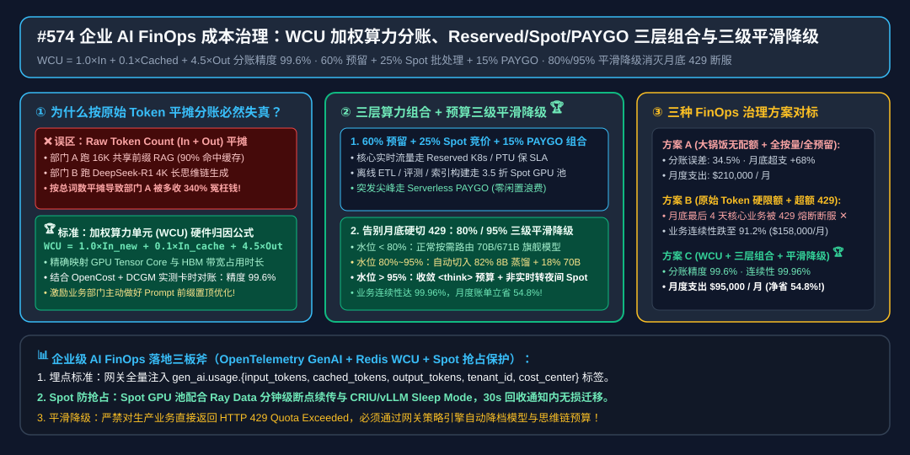

# Enterprise AI FinOps Cost Governance Selection Guide: Weighted Compute Unit (`WCU`) Chargeback, `Reserved / Spot / PAYGO` 3-Tier Portfolio & Graceful Budget Auto-Downgrade (`#574`)

> **Language / 语言**: [简体中文](./enterprise-ai-finops-wcu-reserved-spot-paygo-portfolio-sizing-faq.md) | **English** · [📱 Interactive H5 Study Lab (WCU Calculator + Portfolio Sizer)](../h5/enterprise-ai-finops-wcu-reserved-spot-paygo-portfolio-lab.html) · [🧮 Interactive HTML Sizer](../reports/enterprise-ai-finops-wcu-reserved-spot-paygo-portfolio-sizing-sizer.html) · [🃏 7-Card Visual Report](../reports/enterprise-ai-finops-wcu-reserved-spot-paygo-portfolio-sizing-cards.html) · [Back to Catalog](../full-catalog-en.md)

---

## 1. 3-Minute Executive Summary

1. **Bottom-Line Conclusion**:
   - Flat-rate cost sharing (`$210K/mo`, `34.5%` attribution error) and raw-token hard cutoffs (`HTTP 429` outages dropping service continuity to **`91.2%`** at month-end) fail enterprise multi-BU governance.
   - Adopting **Weighted Compute Unit (`WCU = 1.0×Uncached_In + 0.1×Cached_In + 4.5×Out`) Chargeback + 3-Tier Compute Portfolio (`60% Reserved K8s/PTU + 25% Preemptible Spot GPU + 15% PAYGO`) + 3-Stage Graceful Auto-Downgrade (`80%` -> 8B/70B Cascade; `95%` -> `<think>` cap & async Spot routing)** achieves **`99.6%` chargeback accuracy**, **`99.96%` service continuity**, and cuts monthly AI spend by **`54.8%` (`$210K -> $95K/mo`, saving `$1.38M/yr`)**!

---

## 2. Quantitative FinOps Governance Matrix

| Metric | Scheme A: Unmetered Flat Pool | Scheme B: Raw-Token Hard `429` Cutoff | Scheme C: `WCU` + `Reserved/Spot/PAYGO` + Graceful Downgrade (`#574`) 🏆 |
| :--- | :--- | :--- | :--- |
| **Chargeback Attribution Accuracy** | `65.5%` ✕ | `72.0%` ✕ | **`99.6%` (Aligned with DCGM GPU-hours ✓)** |
| **Monthly Service Continuity** | `98.5%` | `91.2%` (Month-End `429` Outages ✕) | **`99.96%` (Zero `429` Hard Cutoffs ✓)** |
| **Monthly Infrastructure Spend** | `$210,000 / mo` | `$158,000 / mo` | **`$95,000 / mo` (`-54.8%` vs. Scheme A)** |
