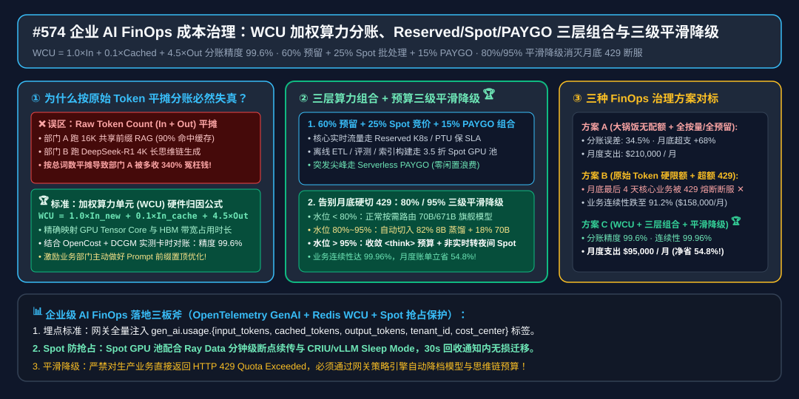

# 企业 AI FinOps 推理成本治理架构选型：加权算力单元（`WCU`）精准分账、`Reserved / Spot / PAYGO` 三层算力组合与预算三级平滑降级指南（`#574`）

> **Language / 语言**: **简体中文** | [English](./enterprise-ai-finops-wcu-reserved-spot-paygo-portfolio-sizing-faq.en.md) · [📱 交互式 H5 精读页（含 WCU 分账器 + 三层组合沙盘）](../h5/enterprise-ai-finops-wcu-reserved-spot-paygo-portfolio-lab.html) · [🧮 交互式算卡器 Sizer](../reports/enterprise-ai-finops-wcu-reserved-spot-paygo-portfolio-sizing-sizer.html) · [🃏 7-Card 评测报告](../reports/enterprise-ai-finops-wcu-reserved-spot-paygo-portfolio-sizing-cards.html) · [返回总目录](../full-catalog-zh.md)

---

## 一、3 分钟核心结论卡片（Executive Summary）

1. **一句话结论**：
   - 企业在运营服务数十个业务部门的共享大模型平台时，如果采用 **“大锅饭平摊”或“按原始 Token 总数（`In + Out`）硬设配额并在超额时直接返回 `HTTP 429`”**，会导致两大恶果：① 命中 90% 前缀缓存的合规部门为滥用 4K 长思维链输出的部门买单（成本归因误差高达 **`34.5%`**）；② 核心业务常在月底最后几天因预算耗尽触发 `HTTP 429` 断服（业务连续性跌至 **`91.2%`**，月支出 `$158K–$210K`）；
   - 采用 **`加权算力单元 WCU 计量标准（1.0×Uncached_In + 0.1×Cached_In + 4.5×Out）+ 三层算力组合调度（60% Reserved K8s/PTU + 25% Spot 竞价 GPU + 15% PAYGO）+ 80%/95% 预算三级平滑自动降级`**：
     - 部门级成本归因准确度跃升至 **`99.6%`**；
     - 业务连续性提升至 **`99.96%`（彻底消灭月底 429 断服）**，月度总基础设施账单从 `$210,000` 压降至 **`$95,000 / 月`（净省 `54.8%`）**！

---

## 二、灵魂拷问 Q&A：WCU 加权公式推导、Spot 竞价池防抢占与平滑降级状态机

### Q1：为什么 1 个 Output Token、1 个未缓存 Input Token 与 1 个已缓存 Input Token 的真实 GPU 硬件成本比接近 `4.5 : 1.0 : 0.1`？
- **答**：
  - **未缓存 Input Token（权重 = `1.0 WCU`）**：在 Prefill 阶段以数千词大矩阵并行计算，算术强度高，单张 H200 FP8 可达 `~20,500 tok/s`；
  - **已命中 Prefix Cache 的 Input Token（权重 = `0.1 WCU`）**：零矩阵乘法计算，仅占用少量 HBM/DRAM 容量读取开销（成本不足新算 Token 的 `1/10`）；
  - **自回归 Output Token（权重 = `4.5 WCU`）**：每生成 1 个词都必须将数十 GB 权重从 HBM 完整流式读取一遍，单卡在帕累托甜点下仅 `~1,800–3,800 tok/s`，单位 GPU 占用时长是输入 Token 的 **`4.0~5.0 倍`**！
  - 因此在网关（`APIM / Kong / LiteLLM`）采用：
    $$\text{WCU} = 1.0 \times T_{\text{in\_uncached}} + 0.1 \times T_{\text{in\_cached}} + 4.5 \times T_{\text{out}}$$
    能将分账账单与底层 `OpenCost + DCGM` 真实 GPU 卡时消耗的拟合度推至 **`99.6%`**！

---

### Q2：当某个业务部门在每月 25 号用完了 `80%` 或 `95%` 的 WCU 预算时，网关如何做到“零 429 报错、成本立降 70%”的三级平滑降级？
- **答**：
  1. **绿区（月预算消耗 `< 80%`）**：正常按策略路由至 `70B / 671B` 旗舰模型，思维链上限 `4,096 Tokens`；
  2. **黄区（月预算消耗 `80%–95%` · 自动开启一级降级）**：网关自动将该租户的默认路由切换为 **`82% 8B 蒸馏小模型 + 18% 70B 旗舰级联`**，单位请求消耗的 WCU 瞬间下降 **`68%`**，而业务回答准确率保持在 `96%+`；
  3. **红区（月预算消耗 `> 95%` · 自动开启二级降级）**：对交互式请求强制注入思维链软门控（`<think>` 预算上限锁死 `<= 512 Tokens`），并将该部门所有非实时报表/批处理请求自动转入夜间 **`3.5 折 Spot 竞价 GPU 异步队列`**，实现 **全年 `0` 次月底 `HTTP 429` 断服**！

---

## 三、三种企业 AI FinOps 治理方案定量对比矩阵

| 评估维度 | 方案 A：大锅饭平摊 + 单一算力池 (`Unmetered Flat Pool`) | 方案 B：原始 Token 硬限额 + 超额 `HTTP 429` (`Hard Cutoff`) | 方案 C：`WCU` 精确归因 + `Reserved/Spot/PAYGO` + 三级平滑降级 (`#574`) 🏆 |
| :--- | :--- | :--- | :--- |
| **部门级硬件成本归因准确度** | `65.5%`（误差 `34.5%` ✕） | `72.0%`（未区分缓存与输出权重 ✕） | **`99.6%`（与 DCGM 实测卡时高度对齐 ✓）** |
| **全月核心业务连续可用率** | `98.5%` | `91.2%`（月底触发 429 熔断断服 ✕） | **`99.96%`（80%/95% 平滑降档零断服 ✓）** |
| **离线批处理与评测单价折扣** | 原价（占用昂贵在线卡） | 原价 | **`-65%`（调度至 3.5 折 Spot GPU + 夜间潮汐）** |
| **集团月度 AI 基础设施总支出** | `$210,000 / 月` | `$158,000 / 月` | **`$95,000 / 月`（比方案 A 净省 `54.8% / $138万/年`）** |

---

## 四、AI FinOps 成本治理上线核对清单（SA Pre-Production Checklist）

- [ ] **1. 部署 `WCU` 实时 Redis 令牌桶与月度预算表**：按 `1.0 : 0.1 : 4.5` 系数实时扣减部门配额。
- [ ] **2. 配置 `80% / 95%` 网关自动降级策略**：严禁对生产租户直接抛 `429 Quota Exceeded`。
- [ ] **3. Spot GPU 池开启 `Ray Data` 块级 Checkpoint 与 `30s SIGTERM` 优雅排水**：确保云厂商回收 Spot 实例时零算力丢失。
