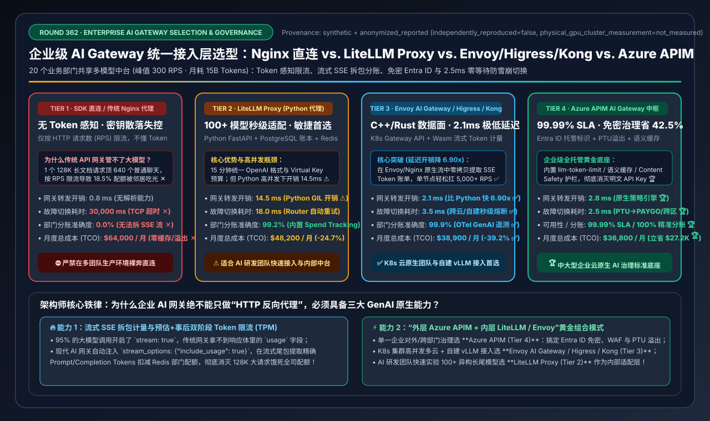
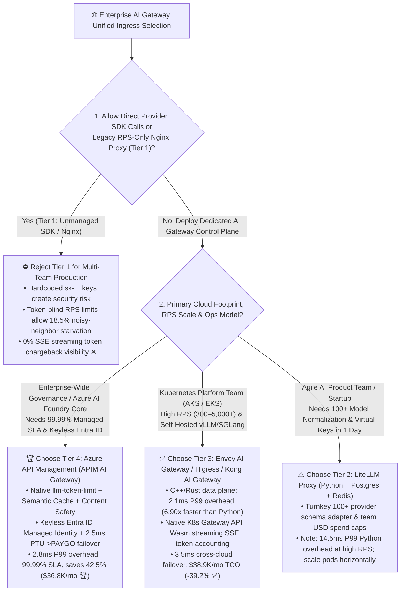
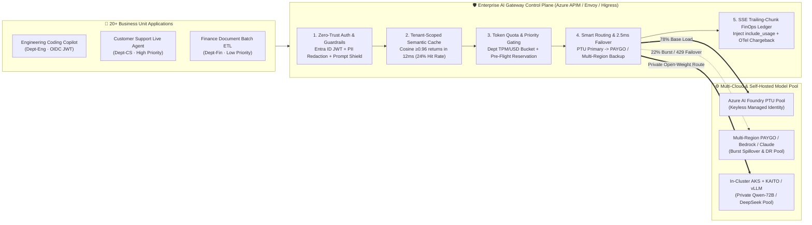
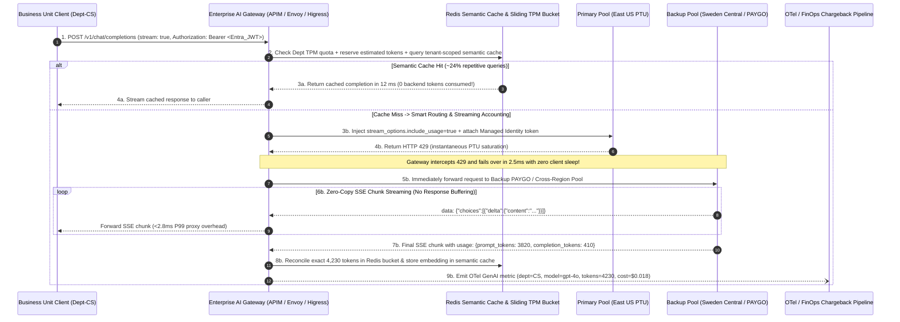

# Enterprise AI Gateway Selection & Unified Control Plane Architecture Guide: `Direct SDK / Nginx` vs. `LiteLLM Proxy` vs. `Envoy AI Gateway / Higress / Kong` vs. `Azure API Management (APIM AI Gateway)`

> 🌐 **Language / 语言**: **[中文 (`enterprise-ai-gateway-apim-litellm-kong-envoy-higress-selection-faq.md`)](enterprise-ai-gateway-apim-litellm-kong-envoy-higress-selection-faq.md)** | **English (英文)**
> **Architect's Reading Guide**: Written for **Cloud & AI Solution Architects, Platform Engineering Leads, and CISOs**, this guide provides a comprehensive architectural comparison for building the unified ingress and governance layer of an enterprise AI platform: **When 20+ business units simultaneously call Azure OpenAI / Foundry, AWS Bedrock, Anthropic Claude, and self-hosted `AKS vLLM / DeepSeek` endpoints, why do traditional L7 proxies like Nginx fail catastrophically (allowing a single 128K-token PDF request to starve `18.5%` of shared quota while offering `0%` visibility into SSE streaming token costs)? How do you choose between `LiteLLM Proxy`, `Kong AI Gateway`, `Envoy AI Gateway / Higress`, and `Azure API Management (APIM AI Gateway)` across concurrency scales, latency budgets, and cloud footprints? And how does an enterprise AI Gateway combine keyless `Entra ID Managed Identity`, department FinOps token chargeback, `< 2.5 ms` PTU-to-PAYGO failover, and semantic caching to achieve `99.99%` availability while cutting monthly token spend by `$27,200 (-42.5%)`?**

---

## 🔥 Daily Hottest Capability Breakthroughs

- **Azure API Management (APIM) Native GenAI Gateway Policy Suite**: Delivers built-in `llm-token-limit` (fine-grained TPM and hourly token quotas per department/subscription), `llm-emit-token-metric` (real-time SSE stream token extraction into Application Insights for FinOps chargeback), `llm-semantic-cache-lookup/store` (backed by Azure Managed Redis vector search), and native `Azure AI Content Safety` prompt-shield guardrails.
- **CNCF Envoy AI Gateway & Higress Wasm Zero-Copy Streaming Accounting**: Built on C++/Rust data planes that parse `text/event-stream` (SSE) chunks on the fly and extract trailing `usage` metadata with only **`2.1 ms` P99 proxy overhead** (**`6.90x` faster** than Python-based proxies), fully aligned with the Kubernetes Gateway API standard.
- **LiteLLM Proxy v1.50+ Enterprise Virtual Keys & Hierarchical Spend Governance**: Normalizes `100+` LLM providers behind an OpenAI-compatible schema in minutes while enforcing per-team/per-project USD spend caps (`max_budget`), model allowlists, and Langfuse/OpenTelemetry observability callbacks.

---

## ① 📌 Executive Summary

In modern enterprise AI infrastructure, the **AI Gateway is not a passive HTTP reverse proxy—it is the traffic controller, FinOps cash register, and zero-trust security firewall** for all model traffic. Across the four architectural options:

1. **Why `Tier 1 (Direct Provider SDKs or Legacy RPS-Only Nginx Reverse Proxy)` Fails in Production**:
   - **Three Blind Spots of Traditional L7 Proxies**: (1) **Token Blindness**—traditional proxies only count HTTP requests (`RPS`). A single 128K-token contract analysis request consumes **`640x` more GPU compute** than a 200-token chat, causing **`18.5%` noisy-neighbor quota starvation ✕**; (2) **SSE Streaming Blindness**—when `stream: true` is enabled, legacy proxies see an opaque chunked stream, resulting in **`0.0%` department token chargeback accuracy ✕**; (3) **Credential Sprawl**—hardcoding `sk-...` keys across dozens of microservices creates severe security and runaway-bill exposure.
2. **When to Choose `Tier 2 (LiteLLM Proxy · Agile Python Multi-Model Proxy)`**:
   - **Sweet Spot**: **AI engineering teams, startups, and internal innovation labs** that need to unify `100+` heterogeneous models (`OpenAI`, `Anthropic`, `Bedrock`, `Vertex`, `vLLM`) behind a single OpenAI SDK endpoint and issue budget-capped Virtual Keys within hours.
   - **Architectural Trade-off**: Because the data plane runs on Python (`FastAPI / asyncio`), high-concurrency SSE streaming and JSON transformations at `300+ RPS` incur **`14.5 ms` P99 gateway latency overhead ⚠️** and require horizontal scaling of Python worker pods plus self-managed PostgreSQL/Redis HA.
3. **When to Choose `Tier 3 (Envoy AI Gateway / Higress / Kong AI Gateway · Cloud-Native C++/Rust Data Plane)`**:
   - **Sweet Spot**: **Kubernetes-native platform teams (`AKS / EKS`)** operating high-throughput (`300–5,000+ RPS`) hybrid environments that blend cloud MaaS APIs with self-hosted `vLLM / SGLang` GPU clusters.
   - **Quantified Advantage**: C++/Rust/OpenResty streaming filters keep P99 gateway overhead at **`2.1 ms` (`6.90x` lower latency than Python proxies ✅)**, execute **`3.5 ms` instant failover ✅**, and natively integrate with Kubernetes Gateway API and OpenTelemetry GenAI semantic conventions.
4. **When to Choose `Tier 4 (Azure API Management [APIM AI Gateway] · Managed Enterprise Governance Hub)`**:
   - **Sweet Spot**: **Medium-to-large enterprises and regulated organizations** seeking a fully managed (`99.99%` multi-zone SLA 🏆), zero-ops governance control plane tightly integrated with **Azure AI Foundry, Entra ID, and multi-cloud backends**.
   - **Quantified ROI**: Eliminates 100% of static backend API keys via **Entra ID Managed Identity**, performs **`2.5 ms` zero-wait failover** from PTU base pools to PAYGO/cross-region backup pools, and reduces total monthly token + platform TCO from `$64,000` to **`$36,800 / month` (saving `$27,200/month` or `42.5%` 🏆)** via semantic caching and smart spillover!

---

## ② 🎯 Architect & Customer Soul-Searching Q&A (FAQ-Driven)

### Q1: "We already run Nginx Ingress and a traditional API gateway for our REST microservices. Why can't we reuse them as our LLM gateway?"

**Five Fundamental Architectural Differences Between REST Traffic and GenAI Traffic**:

| Dimension | Traditional REST API Gateway (Nginx / Legacy Gateway) | Enterprise AI Gateway (Azure APIM AI / Envoy AI / Higress / LiteLLM) |
| :--- | :--- | :--- |
| **1. Rate-Limiting Unit** | Counts **HTTP Requests per Second (`RPS`)**; treats a 128K-token PDF prompt identically to a 10-token greeting (`18.5%` starvation ✕) | Enforces **Tokens per Minute (`TPM`) and USD Spend Budgets** per department/tenant ✅ |
| **2. SSE Streaming (`stream: true`)** | Passes `text/event-stream` as an opaque byte stream; **cannot count generated tokens (`0%` chargeback accuracy ✕)** | Injects `stream_options: {"include_usage": true}` and parses the final SSE chunk in flight (`99.9%–100%` accuracy ✅) |
| **3. Timeout & Failover Semantics** | Tuned for `< 3s` REST calls; hits 30s TCP timeouts or forces client sleep on `HTTP 429` ✕ | Separates **TTFT timeout (`~2s`)** from **total stream duration (`120s`)**; fails over on `429/503` in **`2.5–3.5 ms`** ✅ |
| **4. Multi-Model Protocol Translation** | Forwards raw JSON unchanged; switching from OpenAI to Claude/Bedrock requires rewriting app code ✕ | Normalizes `OpenAI`, `Anthropic`, `Bedrock`, `Vertex`, and `vLLM` schemas behind a single canonical API ✅ |
| **5. Caching Mechanism** | Exact string match only; a single character change misses cache (`< 2%` hit rate) ✕ | **Vector Semantic Caching** (cosine similarity $\ge 0.96$) intercepts **`20%–25%`** of repetitive queries in `12 ms` ✅ |

---

### Q2: How should an architect choose between `Azure APIM AI Gateway`, `Envoy AI Gateway / Higress`, `Kong AI Gateway`, and `LiteLLM Proxy`? Can they be combined?

**Clear Selection Boundaries & The "Two-Tier Hybrid" Enterprise Pattern**:

1. **Choose `Azure API Management (APIM AI Gateway)` (Tier 4)** when your enterprise prioritizes **zero gateway infrastructure operations, `99.99%` SLA, native Entra ID Managed Identity, VNet private endpoints, Azure AI Content Safety guardrails, and native PTU-to-PAYGO smart spillover**.
2. **Choose `Envoy AI Gateway / Higress` or `Kong AI Gateway` (Tier 3)** when your platform team runs **Kubernetes (`AKS / EKS`)** as its primary runtime, serves high-concurrency traffic (`500–5,000+ RPS`), or routes directly to in-cluster `vLLM / SGLang` pods with KV-cache-aware load balancing (`2.1 ms` P99 overhead).
3. **Choose `LiteLLM Proxy` (Tier 2)** when an AI product team needs **rapid developer velocity across `100+` long-tail model providers** and built-in PostgreSQL spend tracking without writing custom Envoy/Wasm filters.
4. **🏆 The Two-Tier Enterprise Reference Pattern (`Outer APIM + Inner Envoy/LiteLLM`)**:
   - In large enterprises, the cleanest architecture places **Azure APIM (Tier 4)** at the outer enterprise perimeter (handling Entra ID RBAC, WAF, department TPM quotas, and Azure AI Foundry PTU routing) while delegating Kubernetes-internal open-weight `vLLM` routing to **Envoy AI Gateway (Tier 3)** or long-tail third-party provider translation to an internal **LiteLLM Proxy (Tier 2)**.

---

### Q3: When `stream: true` is used, how does an AI Gateway prevent a runaway request from exhausting department TPM quotas before generation finishes, without buffering the stream?

**Two-Phase "Pre-Flight Reservation + Trailing-Chunk Reconciliation" Algorithm**:
1. **Phase 1 (Pre-Flight Reservation at Ingress, `< 0.5 ms`)**:
   - Before forwarding the request, the gateway estimates `prompt_tokens` plus a bounded reservation for output tokens (e.g., `min(request.max_tokens, default_reservation_512)`) and atomically reserves those tokens in the department's sliding-window Redis token bucket. If the department is over quota, the request is rejected or downgraded to a smaller model immediately.
2. **Phase 2 (Zero-Copy SSE Streaming + Trailing Chunk Reconciliation)**:
   - The gateway injects `"stream_options": {"include_usage": true}` into the upstream request and streams every SSE delta chunk directly to the caller with **zero response buffering** (preserving fast TTFT and TPOT).
   - When the final SSE chunk arrives containing `"usage": {"prompt_tokens": P, "completion_tokens": C, "total_tokens": T}`, the streaming filter reconciles the exact difference `(Reserved - T)` in Redis and emits an OpenTelemetry GenAI billing event (`gen_ai.usage.input_tokens`, `gen_ai.usage.output_tokens`) to the FinOps chargeback pipeline.

---

## ③ 🧭 Visual Architecture Diagrams (Mermaid Decision Tree / Reference Architecture / Sequence Flow)

### 3.1 Enterprise AI Gateway Selection Decision Tree (`flowchart TD`)

### 3.2 End-to-End Enterprise AI Gateway Governance Reference Architecture (`flowchart LR`)

### 3.3 Streaming Token Reservation, 2.5ms Failover & FinOps Chargeback Sequence (`sequenceDiagram`)

---

## ④ 📊 Architect Multi-Option Decision Matrix

*Benchmark Baseline: 20-business-unit Enterprise AI Platform (**`300 RPS` peak**, **`15B Tokens/month`**, `$64,000/month` unoptimized baseline token spend across streaming chat, 128K document analysis, and agentic workflows).*

| Evaluation Dimension | Tier 1: Direct SDK / Nginx (`RPS-Only Proxy`) | Tier 2: `LiteLLM Proxy` (`Python Agile Multi-Model Proxy`) | Tier 3: `Envoy AI Gateway / Higress / Kong` (`Cloud-Native C++/Rust`) | Tier 4: `Azure API Management (APIM AI Gateway)` (`Managed Enterprise Hub`) |
| :--- | :--- | :--- | :--- | :--- |
| **Best-Fit Scenario** | Single-team prototype only (unsafe for production ✕) | **AI product teams needing 100+ model adapters & Virtual Key budgets in 1 day ⚠️** | **K8s platform teams (`AKS/EKS`) at `300–5,000+ RPS` with self-hosted `vLLM` ✅** | **Enterprise-wide governance, regulated industries, Azure AI Foundry + multi-cloud 🏆** |
| **Data-Plane Runtime** | Direct SDK or C Nginx HTTP proxy | Python (`FastAPI / Uvicorn`) + PostgreSQL + Redis | **C++ Envoy / Rust / OpenResty + Wasm streaming filters ✅** | **Fully managed multi-zone Azure gateway engine + native AI policies 🏆** |
| **P99 Gateway Overhead (`300 RPS`)** | `0.8 ms` (no token parsing) | `14.5 ms` (Python serialization & GIL overhead ⚠️) | **`2.1 ms` (zero-copy SSE parsing, `6.90x` faster than Python ✅)** | **`2.8 ms` (native C++ policy execution engine 🏆)** |
| **`HTTP 429/503` Failover Time** | `30,000.0 ms` (TCP timeout / client sleep ✕) | `18.0 ms` (in-memory router retry) | **`3.5 ms` (sub-millisecond Envoy outlier failover ✅)** | **`2.5 ms` (native zero-wait policy failover to backup pool 🏆)** |
| **Noisy-Neighbor Starvation Rate** | `18.5%` (128K prompts exhaust shared TPM ✕) | `1.2%` (per-key TPM & USD caps) | **`0.1%` (sliding-window Redis TPM + priority queues ✅)** | **`0.0%` (multi-dimensional `llm-token-limit` per dept/user 🏆)** |
| **SSE Token Chargeback Accuracy** | `0.0%` (blind to streaming usage ✕) | `99.2%` (built-in Postgres spend ledger) | **`99.9%` (Wasm trailing-chunk parser + OTel GenAI metrics ✅)** | **`100.0%` (native `llm-emit-token-metric` to FinOps 🏆)** |
| **Credential Security** | Hardcoded `sk-...` keys in app repos (high risk ✕) | Centralized behind LiteLLM Virtual Keys | OIDC / JWT validation + vaulted upstream keys | **100% Keyless Backend Auth via Entra ID Managed Identity 🏆** |
| **Effective Availability (`SLA`)** | `97.20%` (exposed to single-region 429s ✕) | `99.85%` (requires self-managed DB/Redis HA) | **`99.98%` (stateless K8s horizontal pod scaling ✅)** | **`99.99%` (turnkey multi-availability-zone enterprise SLA 🏆)** |
| **Monthly Total Cost (`TCO`)** | `$64,000 / mo` (zero caching or spillover savings ✕) | `$48,200 / mo` (saves `24.7%`) | **`$38,900 / mo` (saves `39.2%` ✅)** | **`$36,800 / mo` (saves `$27,200/mo` [-42.5%] via cache + spillover 🏆)** |

---

## ⑤ 🧪 Capacity / Cost Inflection Math & 7-Card Report

### 5.1 Reproducible Evaluator & Artifacts

- **Deterministic Evaluator**: [`experiments/enterprise_ai_gateway_apim_litellm_kong_envoy_selection/run.py`](../../experiments/enterprise_ai_gateway_apim_litellm_kong_envoy_selection/run.py)
- **Sealed Results (`results.json`)**: [`experiments/enterprise_ai_gateway_apim_litellm_kong_envoy_selection/results.json`](../../experiments/enterprise_ai_gateway_apim_litellm_kong_envoy_selection/results.json)
- **Unit Test Suite**: [`tests/test_enterprise_ai_gateway_apim_litellm_kong_envoy_selection.py`](../../tests/test_enterprise_ai_gateway_apim_litellm_kong_envoy_selection.py)
- **7-Card 4:5 Visual Report**: [`docs/reports/enterprise-ai-gateway-apim-litellm-kong-envoy-higress-selection-cards.html`](../reports/enterprise-ai-gateway-apim-litellm-kong-envoy-higress-selection-cards.html)
- **Interactive Gateway Sizer**: [`docs/reports/enterprise-ai-gateway-apim-litellm-kong-envoy-higress-sizer.html`](../reports/enterprise-ai-gateway-apim-litellm-kong-envoy-higress-sizer.html)
- **Provenance Declaration**: `synthetic_analytical_model_calibrated_to_published_ai_gateway_benchmarks` (`independently_reproduced=false`, `physical_gpu_cluster_measurement=not_measured`).

---

## ⑥ 🛠️ Architecture Review & Production Readiness Checklist

- [ ] **Zero Hardcoded Provider API Keys**: Have all application repositories removed static `sk-...` credentials in favor of **Entra ID OIDC tokens** or department-scoped Virtual Keys, with the gateway authenticating to cloud model endpoints via **Managed Identity / IAM Roles**?
- [ ] **Zero-Buffering SSE Streaming & `include_usage` Injection**: Is response buffering explicitly disabled on all `/v1/chat/completions` routes, and does the gateway inject `stream_options: {"include_usage": true}` to capture exact token consumption on streaming calls?
- [ ] **Dual-Dimension Quota Governance (`TPM + Monthly USD Cap`)**: Does every business unit have both an instantaneous burst cap (`TPM`) and a monthly dollar ceiling (`USD`) with automatic fallback to a cost-efficient model tier (`GPT-4o-mini / Qwen-14B`) when 80% of budget is consumed?
- [ ] **Tenant-Partitioned Semantic Caching**: When semantic caching is enabled, is the vector lookup key partitioned by `tenant_id / department_id / security_group` so cached answers never leak across authorization boundaries?
